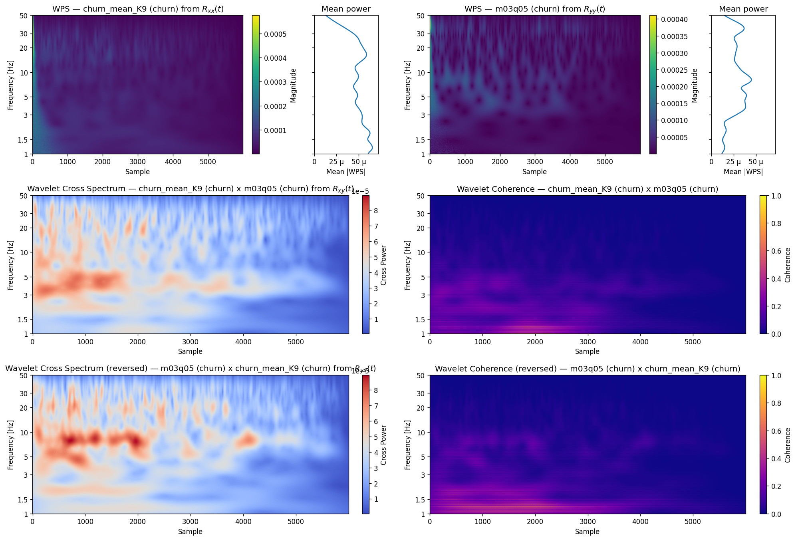
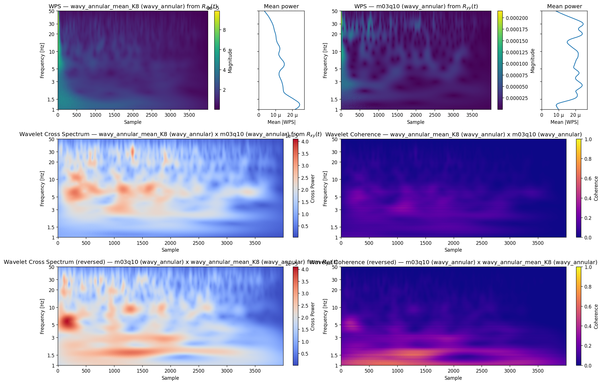

# Insights — v13 (WPS/WCS/WCO, estimador enviesado, lowpass 50Hz)

## Comparação churn × wavy_annular (mesmo padrão, holdout intra-classe)

### Churn

- WPS: espectro largo e plano, sem frequência dominante clara. Potência média baixa (~0,5×10⁻⁴). Comportamento esperado para escoamento caótico sem estrutura periódica definida.
- WCO (forward): coerência concentrada na faixa 1–3 Hz, moderada (~0,4–0,5), presente apenas nos primeiros lags. Não persiste ao longo do eixo de amostras.
- WCO (reversed): comportamento similar ao forward, ligeiramente mais fraco. A quasi-simetria entre forward e reversed indica ausência de estrutura de lag direcional clara.

**Conclusão churn:** coerência fraca, transitória e sem banda espectral bem definida. O padrão não apresenta assinatura estável na WCO.

---

### Wavy Annular

- WPS (classe média): energia concentrada na faixa 3–7 Hz, estrutura mais organizada que churn. O holdout individual confirma a concentração espectral com manchas quentes em 5–20 Hz.
- WCO (forward): coerência difusa, ~0,3, espalhada entre 2–10 Hz. Fraca.
- WCO (reversed): **banda de coerência forte e persistente em 1–2 Hz, alcançando ~0,8, estável ao longo de todo o eixo de lags.** Esse é o traço discriminante mais evidente observado até agora.

**Conclusão wavy_annular:** a assimetria entre forward e reversed é o achado central. A WCO reversed revela que o holdout lidera a média da classe na faixa <2 Hz — estrutura de lag direcional que churn não apresenta. A banda 1–2 Hz é candidata a feature discriminante.

---

## Diferença estrutural entre os padrões

| Característica | churn | wavy_annular |
|---|---|---|
| WPS (faixa dominante) | broadband, sem pico | 3–7 Hz |
| WCO máxima observada | ~0,5 (fraca, transitória) | ~0,8 (forte, persistente) |
| Assimetria forward/reversed | baixa | alta |
| Banda discriminante candidata | — | 1–2 Hz (reversed) |

---

## Limitação importante

Todos os resultados acima são comparações **intra-classe** (média da classe vs. holdout do mesmo padrão). A WCO alta em wavy_annular reversed ainda não foi testada contra um holdout de churn — isso seria o experimento cross-pattern necessário para confirmar poder discriminante real. Os resultados atuais mostram que a assinatura é **consistente dentro da classe**, não que ela separa as classes.

---

## Plug (K=2 holdouts: m05q01, m06q01, m07q05)

- WPS (média da classe): energia dominante em <2 Hz, decaimento monotônico muito acentuado. Estrutura quase unimodal — potência concentrada na frequência mais baixa do espectro. Comportamento consistente nos três holdouts.
- WPS (holdouts individuais): estrutura mais rica que a média — manchas espalhadas entre 2–20 Hz, mas com energia baixa (~1–2,5 × 10⁻³). O holdout m06q01 é discrepante: potência ~10× maior que os outros dois (eixo vai a 0,025), sugerindo condição operacional atípica ou artefato.
- WCO (forward): coerência fraca (~0,2–0,3), transitória, banda 1–2 Hz. Não persiste ao longo do eixo de amostras.
- WCO (reversed): **banda persistente em ~1–1,5 Hz**, coerência ~0,3–0,5, presente em todos os três holdouts. Mais fraca que wavy_annular reversed (~0,8), mas mais consistente que churn. m07q05 mostra a banda reversed mais evidente (~0,4–0,5).
- Assimetria forward/reversed: presente, mas moderada.

**Conclusão plug:** assinatura espectral dominada por baixas frequências (<2 Hz) na média da classe. WCO reversed mostra banda 1–1,5 Hz moderadamente consistente. Padrão distinguível de churn (WCO fraca/transitória) e de wavy_annular (WCO reversed muito mais forte). A discrepância de potência em m06q01 é uma anomalia a investigar.

---

## Slug (K=2 holdouts: m04q01, m05q05, m06q05)

- WPS (média da classe): espectro mais uniforme entre 1–15 Hz, sem pico dominante claro. Potência baixa (~300–600 µ). Perfil de potência média relativamente plano comparado a plug.
- WPS (holdouts individuais): estrutura rica com manchas discretas espalhadas em 5–20 Hz, visíveis nos três holdouts. Padrão sugere eventos periódicos localizados — coerente com a natureza intermitente do escoamento slug.
- WCO (forward): **coerência moderada (~0,3–0,5) em banda larga 1–15 Hz**, parcialmente persistente ao longo do eixo. Mais estruturada que churn e plug.
- WCO (reversed): similar ao forward em magnitude, com manchas de coerência moderada espalhadas em múltiplas bandas (1–15 Hz). **Sem banda dominante estreita** — diferença chave em relação a wavy_annular (reversed concentrado em 1–2 Hz).
- Assimetria forward/reversed: baixa — forward e reversed têm energia similar distribuída de forma similar.

**Conclusão slug:** WCO moderada e broadband, sem banda discriminante estreita. Assimetria forward/reversed baixa (como churn), mas coerência mais alta e mais estruturada. WPS com manchas discretas em 5–20 Hz é traço potencialmente discriminante em relação aos outros padrões.

---

## Tabela comparativa atualizada (todos os padrões)

| Característica | churn | plug | slug | wavy_annular |
|---|---|---|---|---|
| WPS (faixa dominante) | broadband, sem pico | <2 Hz, monotônico | broadband, manchas 5–20 Hz | 3–7 Hz |
| WCO máxima observada | ~0,5 (fraca, transitória) | ~0,3–0,5 (banda 1–1,5 Hz) | ~0,4–0,5 (broadband) | ~0,8 (forte, persistente) |
| Assimetria forward/reversed | baixa | moderada | baixa | **alta** |
| Banda reversed estreita | não | 1–1,5 Hz (fraca) | não | **1–2 Hz (forte)** |
| Traço discriminante candidato | — | WPS <2 Hz + reversed fraco | manchas WPS 5–20 Hz | reversed 1–2 Hz ~0,8 |
