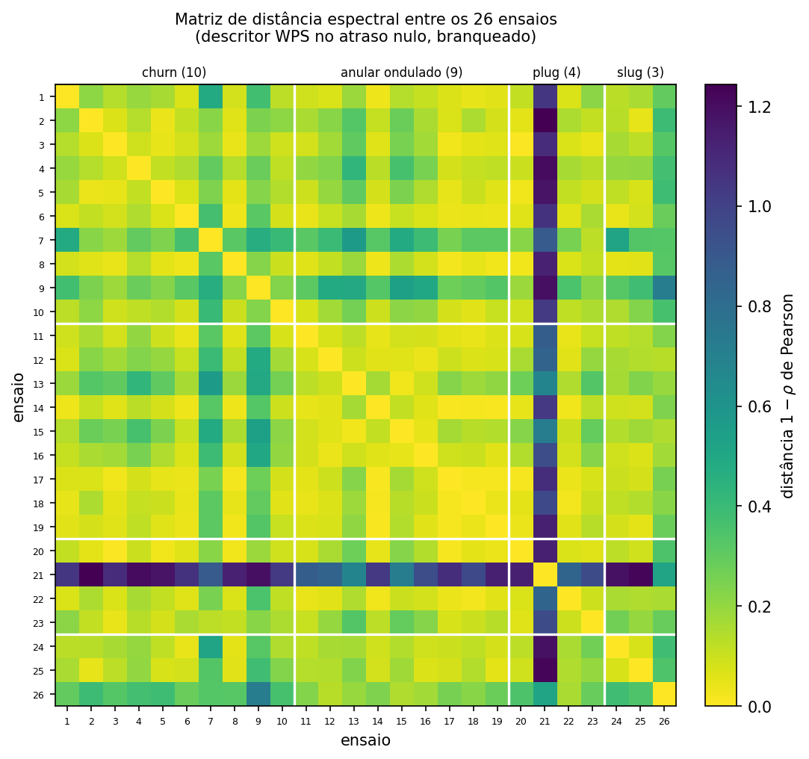
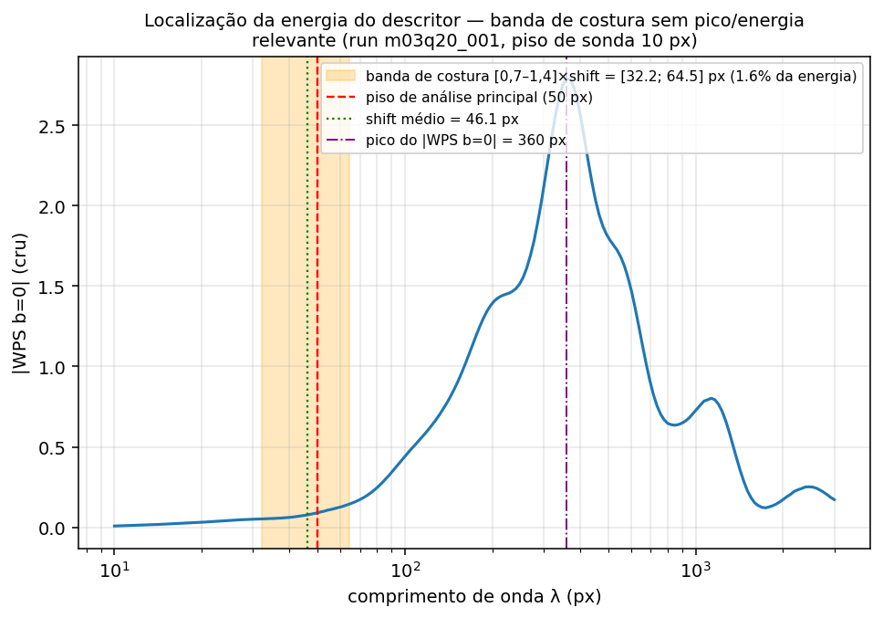
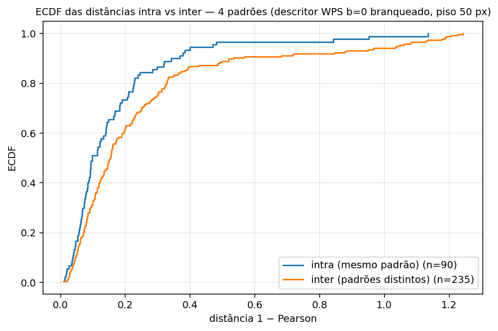

# Quantificação estatística da repetibilidade — QUATRO padrões (`src2/estatistica3/`)

**Data:** 2026-10-06 · **Base:** motor Schuck & Bodmann (`../v8_spatial_cropped_and_center/wavelet_v8.py`, **intocado**).
**Scripts:** `extract_descriptors.py`, `run_stats.py`, `plot_out_of_band.py`.
**Saídas:** `descriptors_{cropped,center}_{piso50,piso10}.npz`, `stats_results3.txt`,
`v8-estat-dmatrix.png`, `v8-estat-ecdf.png`, `v8-estat-piso.png`.

Esta pasta estende a análise de `../estatistica2/` (dois padrões: *churn* e anular ondulado) aos
**quatro padrões** *churn*, anular ondulado, *plug* e *slug*, mantendo **exatamente o mesmo método
de descritor**. É a realização da Figura 17 (matriz de distância espectral) com os quatro padrões,
destinada à `TCC/resultados.tex` a partir da seção 4.7.

---

## 1. O que foi feito, passo a passo (em termos simples)

Imagine que, de cada vídeo de ebulição, extraímos uma **assinatura** — um resumo numérico de "em
que tamanhos de estrutura a imagem concentra energia". A pergunta é a mesma de sempre:

> **Vídeos do mesmo padrão de escoamento têm assinaturas mais parecidas entre si do que vídeos
> de padrões diferentes?**

A diferença agora é que não comparamos dois padrões, e sim **quatro**.

### Passo 1 — A assinatura de cada ensaio (descritor)
Para cada um dos 26 ensaios tomamos o sinal espacial reconstruído (o "panorama" do tubo), calculamos
sua autocorrelação, aplicamos a transformada *wavelet* contínua (CWT) exatamente como no método de
Schuck & Bodmann, e lemos o **perfil de potência no atraso nulo** (coluna `b=0`). Em seguida
**branqueamos** esse perfil: removemos o declive comum de fundo (o decaimento tipo 1/f) para que a
assinatura guarde a **forma** do espectro — *onde* a energia está — e não a amplitude bruta.

- **Mesmíssimo descritor da estatistica2.** Prova: o subconjunto {*churn*, anular} aqui é
  **byte-a-byte idêntico** ao da estatistica2 (`max|Δ| = 0,0`). Acrescentar *plug*/*slug* é aditivo;
  não mexe nos padrões antigos.
- Todas as séries são truncadas ao menor ensaio de *churn* (7001 px) para terem o mesmo comprimento.

### Passo 2 — A matriz de distância (a Figura 17)
Medimos a semelhança entre dois ensaios pela **correlação de Pearson** entre suas assinaturas e
definimos a **distância** como `1 − correlação`. Fazendo isso para todos os pares obtemos uma matriz
26×26. Ordenada por padrão (com linhas brancas separando os blocos), ela **é** a Figura 17:



Como ler: **amarelo = parecido** (distância pequena), **roxo = diferente**. Os blocos na diagonal
reúnem ensaios do mesmo padrão. O tom mais claro desses blocos (quando existe) é a semelhança
intra-padrão que queremos quantificar. **Note o ensaio 21** (um *plug*, `m05q05_002`): sua linha e
coluna são escuras — ele é um **valor atípico espectral**, anticorrelacionado com quase tudo (ver §4).

### Passo 3 — Um número para a separação (ANOSIM R global)
O coeficiente **R de Clarke** resume a matriz: ordena todas as 325 distâncias e compara a posição
média das distâncias "mesmo padrão" com a das "padrões diferentes". `R≈0` = indistinguível;
`R≈1` = separação perfeita. **Observado: `R = 0,204`** (contra 0,177 com dois padrões).

### Passo 4 — Quem separa de quem (matriz R par-a-par)
Com quatro padrões, um único número esconde demais. Calculamos **R para cada um dos 6 pares** de
padrões (restringindo a matriz aos dois grupos de cada vez). É a leitura mais informativa (§3).

### Passo 5 — Isso pode ser acaso? (teste de permutação)
Embaralhamos os rótulos de padrão e recalculamos R milhares de vezes, para ver que valores R
assumiria se os rótulos não tivessem relação com a assinatura. O embaralhamento **não é livre**:
cada ensaio foi coletado numa combinação de fluxo de calor `q` e fluxo mássico `m`, e essas condições
acompanham o padrão. Então permutamos **dentro de estratos** de condição parecida — e aqui a escolha
do estrato importa muito (§5).

### Passo 6 — É só efeito das condições de operação? (confound)
Verificamos se a "semelhança" é mera proximidade de `q` ou de `m`, correlacionando a distância de
cada par com `|Δq|` e `|Δm|` (§6).

### Passo 7 — A costura do panorama cria um padrão falso? (robustez)
O sinal espacial é montado costurando tiras de quadros. Testamos se essa emenda injeta um artefato
confundível com o sinal, rebaixando o piso de análise de 50 px para 10 px (§7).

---

## 2. Resultado global

| Grandeza | Valor | Leitura |
|---|---|---|
| **R de ANOSIM global (4 grupos)** | **0,204** | separação fraca–moderada, porém real |
| p — estrat. por fluxo de calor `q` (18 000 arranjos, exato) | 0,019 | **mal condicionado** (metade dos estratos puros/quase-puros) |
| **p — estrat. por fluxo mássico `m`** (Monte Carlo 50 000) | **0,030** | **bem condicionado — referência** |
| p — não estratificado (Monte Carlo 50 000) | 0,017 | contexto (sem controle de confound) |
| percentil 95 de R sob rótulos embaralhados (`m`-estrat) | ≈ 0,18 | régua do acaso |

O R subiu em relação aos dois padrões (0,177 → 0,204) porque *plug*/*slug* trazem assinaturas
razoavelmente distintas do anular, puxando a separação média para cima. Continua sendo um
**tamanho de efeito descritivo**, não um teste inferencial forte (§8).

---

## 3. Quem separa de quem — a descoberta principal (matriz R par-a-par)

| Par de padrões | R | nº de pares | Leitura |
|---|---|---|---|
| anular ondulado × **slug** | **+0,523** | 66 | **separação mais forte** de todas |
| anular ondulado × *plug* | +0,320 | 78 | separação clara |
| *churn* × **slug** | +0,218 | 78 | separação moderada |
| *churn* × anular ondulado | +0,177 | 171 | fraca (≡ valor da estatistica2) |
| *plug* × *slug* | +0,111 | 21 | fraca · **n pequeno (ler com cautela)** |
| *churn* × *plug* | **+0,028** | 91 | **praticamente indistinguíveis** |

**A história física que emerge:**

- O **anular ondulado** é o padrão mais "diferentão": separa-se bem de *tudo* que é lento
  (slug 0,52; plug 0,32). Faz sentido — é um filme fino ondulando rápido na parede, uma textura
  espacial muito distinta dos pistões/golfadas de gás.
- **slug** é o que mais contrasta com o anular (0,52) e ainda separa de *churn* (0,22) — é o padrão
  intermitente lento mais "assinável".
- **churn e plug são quase gêmeos** para este descritor (R=0,03). Ou seja, a assinatura espectral
  **não distingue** a fervura agitada (*churn*) do regime de bolhas alongadas (*plug*).
- **plug × slug** separa só fracamente (0,11), e com apenas 21 pares (7 ensaios) — é a leitura menos
  confiável; não se deve ler como "plug e slug são distinguíveis".

Esses R par-a-par caem diretamente da matriz `1 − Pearson` com a definição de livro de Clarke,
reproduzidos por um caminho de código independente (erro < 0,0005) — são **propriedade dos dados**,
não do script.

---

## 4. O valor atípico: `plug` m05q05_002 (ensaio 21)

Um ensaio de *plug* (`m05q05_002`) é **anticorrelacionado** com quase todos os outros (ρ chega a
−0,24; distância até 1,24; distância média ≈ 1,0 — a maior de todas). É a cruz escura na Figura 17.
É sinal **real**, não erro: a assinatura espectral desse ensaio é atípica. Ele explica em grande
parte por que o grupo *plug* é internamente incoerente e por que `churn×plug ≈ 0` (o *plug*, como
grupo, está espalhado no espaço espectral). Mantido na análise e **declarado**, não removido.

---

## 5. Por que `m` é a referência e `q` é mal condicionado

Ao embaralhar rótulos "dentro de estratos", o estrato precisa **misturar** padrões — senão não há o
que permutar e o teste perde o sinal. Com quatro padrões o fluxo de calor `q` ficou **ainda mais
confundido** com o padrão (plug/slug em `q` baixo, churn médio, anular alto — `q` quase ordena os
padrões):

| Estratos por `q` | composição | | Estratos por `m` | composição |
|---|---|---|---|---|
| q=1 | SL1 PL2 (misto) | | m=3 | CH1 AO3 (quase-puro) |
| q=5 | CH1 SL2 PL2 (misto) | | m=4 | SL1 CH2 AO2 (misto) |
| q=10 | AO1 CH3 (quase-puro) | | m=5 | PL2 SL1 CH3 AO1 (**mistura os 4**) |
| q=20 | AO1 CH4 (quase-puro) | | m=6 | PL1 SL1 CH2 AO2 (**mistura os 4**) |
| q=40 | AO3 CH2 (misto) | | m=7 | PL1 CH2 AO1 (misto) |
| q=80 | AO4 (**PURO**) | | | |
| **3 de 6 puros/quase-puros** | | | **1 de 5** | |

Por isso o `p` por `m` (0,030, Monte Carlo sobre 108,9 milhões de arranjos) é a referência honesta, e
o `p` por `q` (0,019, exato sobre 18 000) é só a linha "mal condicionada" de comparação.

---

## 6. Controle de confound (sobre todos os 325 pares)

| Fator comparado à distância | correlação | Interpretação |
|---|---|---|
| diferença de fluxo de calor `|Δq|` | **−0,099** | semelhança **não** é proximidade em `q` (correlação pequena e de sinal "errado") |
| diferença de fluxo mássico `|Δm|` | −0,053 | efeito de `m` pequeno sobre a distância |
| pertencer ao mesmo padrão | **−0,143** | efeito do padrão (pares de mesmo padrão são mais próximos) |

Com quatro padrões, o efeito do padrão (−0,143) **domina** os dois confounds operacionais, ambos
≈0. É um quadro mais limpo do que o de dois padrões (onde `|Δm|` rivalizava com o padrão): aqui a
semelhança intra-padrão não é explicável por proximidade de `q` nem de `m`.

---

## 7. Robustez ao artefato de costura



A análise principal usa piso de 50 px (herdado de Schuck & Bodmann), que já exclui as escalas curtas
onde a emenda se manifestaria. Rebaixando o piso para 10 px, R sobe (0,204 → 0,292, cropped). Mas a
banda associada à costura carrega só **0,9 %** da energia do descritor e **não** é o pico (o pico fica
em λ≈360 px, bem acima). Logo o aumento **não** vem do artefato de costura, e sim de conteúdo difuso
de pequena escala — colinear com velocidade/comprimento (confounds). A leitura **conservadora** mantém
o piso de 50 px; o piso de 10 px é só sonda de robustez, nunca manchete.

---

## 7b. Robustez à escolha do readout (b=0 vs potência média sobre lags)

O descritor lê a coluna de **atraso nulo** (`b=0`) do WPS. Uma escolha alternativa, igualmente
válida por ser **auto** (shift-invariante), seria a **potência média sobre todos os lags** (espectro
*wavelet* global à la Torrence Eq. 22). Confirmou-se, com os 26 ensaios, que o resultado **não
depende** desse detalhe:

| Grandeza | b=0 (principal) | potência média sobre lags |
|---|---|---|
| correlação por-ensaio entre os dois descritores (branqueados) | — | **0,986** (mín 0,942) |
| correlação entre as duas matrizes de distância | — | **0,984** |
| R de ANOSIM global | 0,204 | 0,176 |
| ordenação par-a-par | anular×slug > … > churn×plug | **idêntica** |

Após o branqueamento (que remove o fundo 1/f comum), b=0 e média-sobre-lags são **praticamente o
mesmo descritor** (r≈0,98) e produzem a **mesma ordenação** entre padrões; a média-sobre-lags dá um R
marginalmente **menor** (0,176 vs 0,204). Portanto a leitura em `b=0` não é um recorte conveniente —
qualquer redução razoável do auto-WPS leva à mesma conclusão, e b=0 é, no limite, o readout
ligeiramente mais nítido. (WCS/WCO **não** entram: são termos cruzados entre ensaios, que somem sob
deslocamento circular — medem coincidência de fase, não repetibilidade — e ficam só como figura
ilustrativa.)

---

## 8. ECDF — distribuições de distância



A curva intra-padrão (azul) fica consistentemente à **esquerda** da inter-padrão (laranja): distâncias
de mesmo padrão são sistematicamente menores. A separação é visivelmente mais nítida do que no caso de
dois padrões (onde as curvas quase se sobrepunham), coerente com R maior (0,204 vs 0,177).

| grupo | n | mediana | média |
|---|---|---|---|
| intra (mesmo padrão) | 90 | 0,098 | 0,166 |
| inter (padrões distintos) | 235 | 0,153 | 0,249 |

---

## 9. Alcance e limitações (declarado)

- **Tamanho de efeito, não teste forte.** 26 ensaios, 4 padrões, 1 ensaio por célula (`m`,`q`) → sem
  réplicas verdadeiras. "Mesmo padrão" = pontos operacionais distintos com o mesmo rótulo de regime.
- **plug (4) e slug (3) são minúsculos.** O R global é dominado pelos grupos grandes (churn/anular);
  os R par-a-par com plug/slug — sobretudo **plug×slug (21 pares)** — são grosseiros e instáveis.
  Os 6 pares são exploratórios, **não** uma família de testes com correção de múltiplas comparações.
- **Propriedade do descritor, não da física.** Tudo é propriedade do perfil WPS `b=0` reconstruído
  (câmera, luz, costura), não uma afirmação sobre a física do escoamento.
- **Não é classificador.** Quantifica repetibilidade/separação de uma assinatura; não atribui um
  ensaio novo a um padrão.
- **Ressalva de resolução temporal (importante para o texto).** A exclusão original de plug/slug no
  TCC apoiava-se na resolução *temporal* das filmagens (≈10–14 Hz, acima das frequências lentas <3 Hz
  de plug/slug). Esta análise opera no **domínio espacial** (o panorama em pixels), não no temporal —
  por isso é computável e informativa como enunciado *no espaço do descritor*. O argumento de
  resolução temporal **continua válido para a dinâmica temporal** e deve ser mantido no texto como
  limitação; o que mudou é que a repetibilidade **espacial** desses padrões agora é mensurável.

---

## 10. Deliberadamente fora (cerimônia, não rigor)

PERMANOVA/PERMDISP (r≈0,98 com ANOSIM R); ML/classificador (exigiria centenas de exemplos por
classe); IC bootstrap de R (o nulo permutado já é a distribuição); correção de múltiplas comparações
entre A1/A1b/A2/A3′ (perguntas distintas, não uma família) — mantida a mesma postura minimalista da
estatistica2.

**Sondado e descartado como análise permanente:** descritor por **potência média sobre lags** (ver
§7b) — r≈0,98 com b=0, R marginalmente menor (0,176 vs 0,204), mesma ordenação par-a-par ⇒ redundante;
registrado só como nota de robustez. **WCS/WCO cross-ensaio** como descritor — inválidos (somem sob
deslocamento circular, medem fase acidental); permanecem figura ilustrativa.

---

## 11. Reproduzir

```
python extract_descriptors.py   # ~8–12 min: 104 leituras xlsx + asserts de identidade; gera 4 .npz
python run_stats.py             # A0/A1/A1b/A2/A4/A3′ → stats_results3.txt + v8-estat-dmatrix.png + v8-estat-ecdf.png
python plot_out_of_band.py      # localização de energia → v8-estat-piso.png
```

Checagens de integridade embutidas: identidade FFT≡laço do motor (erro ~1e-14); âncora de regressão
subconjunto {churn, anular} ≡ estatistica2 (`max|Δ| = 0,0`); contagem travada em churn=10, anular=9,
plug=4, slug=3.
