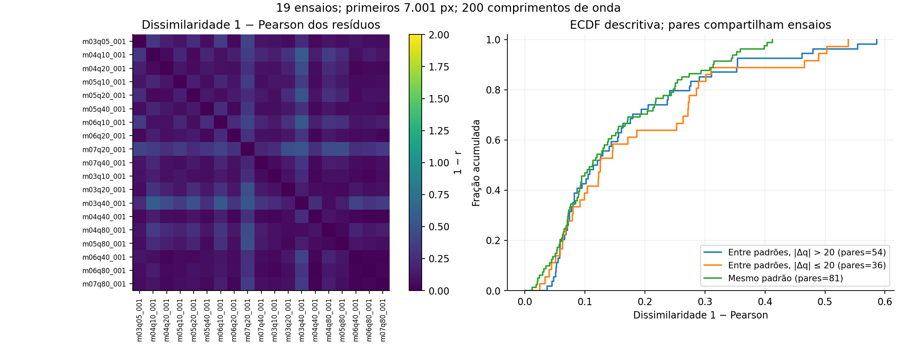
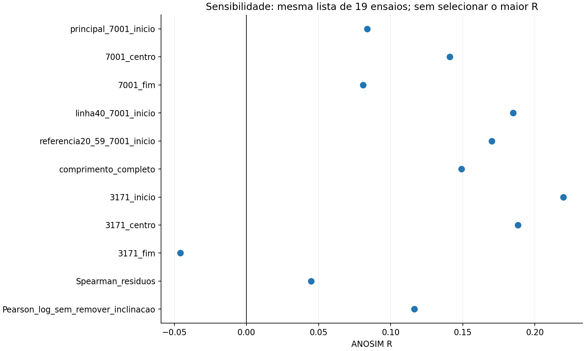
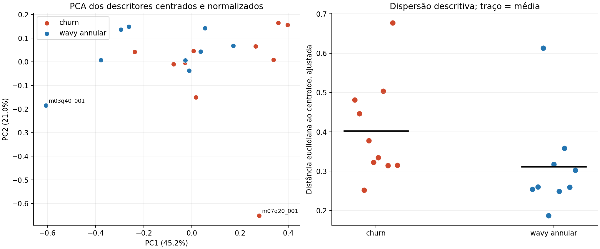
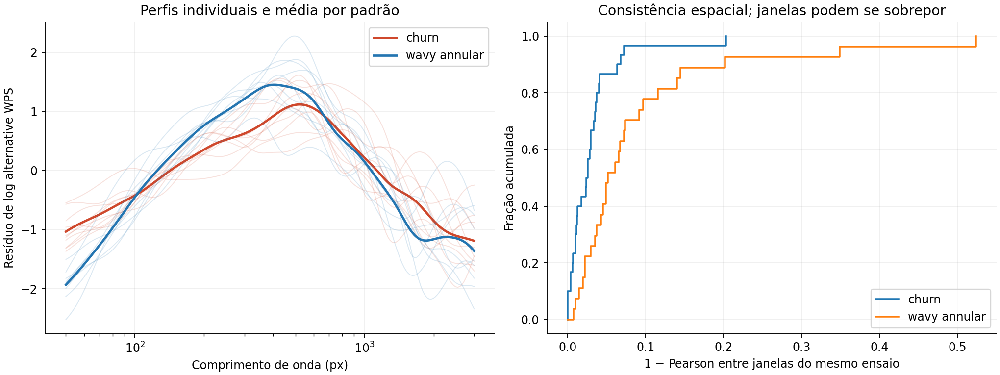
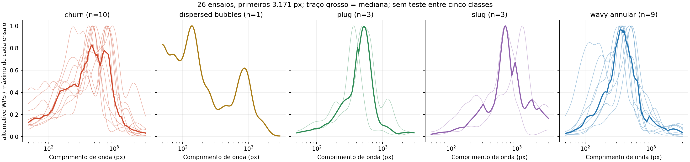

# Análise dos resultados v16_spatial2_18_71

## Resposta

**Sim, faz sentido reaplicar Pearson para comparar a forma dos perfis wavelet por ensaio. Nos novos sinais, o descritor principal não sustentou separação robusta entre churn e wavy annular.** ANOSIM R = 0.083676, p exato condicionado a q = 0.085. Após Holm para os dois testes definidos no plano, p = 0.090 para ANOSIM e 0.090 para PERMANOVA.

Isso não prova equivalência entre padrões ou ausência de informação útil nos sinais. Este conjunto pequeno e observacional, com este descritor, não forneceu evidência convincente de separação estável. O efeito observado foi menor que o histórico e variou com o trecho escolhido. Não se selecionou o trecho ou a transformação com resultado mais favorável.

Os [métodos e fórmulas](METODOLOGIA.md) foram definidos antes do cálculo novo. Todos os números vêm dos CSVs e JSONs desta pasta ou das tabelas de origem identificadas. Os controles sintéticos validam o código e não integram os resultados experimentais.

## Verificação dos dados e das fórmulas

- Os 31 sinais salvos e seus CSVs coincidiram com a média das 54 linhas 18–71 dos PNGs; hashes dos panoramas e CSVs foram conferidos.
- Os 31 perfis completos de alternative WPS no lag zero e os 78 perfis de janelas existentes foram recalculados independentemente. A maior diferença relativa L2 foi 3.857e-16 nos perfis completos e 2.246e-16 nas janelas.
- A Eq. 32.17 foi conferida nos coeficientes complexos dos 87 mapas intrapadrão salvos, com diferença máxima 0.0. A cobertura e os resumos foram cruzados com as tabelas.
- Um trecho experimental novo de 7.001 px foi conferido nas 200 escalas contra a FFT da v16. Diferença absoluta máxima: 2.665e-15.
- Os controles verificaram Pearson contra SciPy; ANOSIM por uma identidade independente baseada em AUC, incluindo empates; PERMANOVA contra ANOVA univariada e somas de quadrados de distâncias; enumeração exata; Holm; ortogonalidade dos resíduos; autocorrelações por somas literais; Morlet por convolução temporal; e uma senoide de comprimento de onda conhecido.

Não se refez a reconstrução dos panoramas nem a transformada completa de cada par. Os mapas foram conferidos a partir dos coeficientes armazenados; o recálculo independente foi dos perfis em zero. Os arquivos de origem consultados permaneceram inalterados, com hashes no [manifesto](results/manifest.json). [Controles de fórmulas](results/formula_validation.json) e [validação das fontes](results/source_validation.json) tiveram status PASS.

Na v16 enviesada, a mediana do máximo de alternative WCO entre os 87 pares foi 0.6888; o maior máximo foi 0.9917. Um máximo procurado em todo o plano de lag e escala não demonstra similaridade uniforme. Autocoerência igual a um em lag zero é uma identidade algébrica, não uma validação experimental. A versão não enviesada permanece uma sensibilidade metodológica e não foi usada como fonte do descritor principal.

Os picos dos perfis completos conferidos foram:

| pattern | n | mínimo | mediana | máximo |
| --- | --- | --- | --- | --- |
| churn | 10 | 407.7 | 527.4 | 1238.5 |
| dispersed bubbles | 1 | 139.9 | 139.9 | 139.9 |
| plug | 3 | 375.5 | 521.9 | 566.7 |
| slug | 3 | 641.2 | 682.0 | 1213.3 |
| wavy annular | 9 | 175.4 | 433.7 | 480.7 |

São comprimentos de onda em pixels do panorama reconstruído, não medidas automaticamente equivalentes a comprimento de bolha, frequência temporal ou dimensão em milímetros.

## Relação com a estatística anterior

A análise anterior usou Pearson entre resíduos de log alternative WPS no lag zero, seguido de ANOSIM. Seus descritores arquivados reproduziram:

| variant | n_runs | ANOSIM_R | p_exact_q | n_q_arrangements |
| --- | --- | --- | --- | --- |
| cropped | 19 | 0.1770 | 0.0200 | 200 |
| center | 19 | 0.1791 | 0.0300 | 200 |

Essa conferência reexecutou a estatística sobre os descritores existentes; não refez a extração v8 das planilhas. Foram preservados os mesmos 19 ensaios, o comprimento comum de 7.001 px e a ideia do descritor. Para os novos dados, usaram-se a média 18–71 e a Morlet da v16, selecionando o trecho antes de retirar a tendência e normalizar.

As 200 escalas são coordenadas correlacionadas de um vetor, e os 171 pares compartilham ensaios. Nenhum deles foi tratado como observação independente. Não se aplicou p paramétrico de Pearson às escalas nem testes de duas amostras aos pares. A unidade de permutação foi o rótulo de ensaio.

O whitening anterior é interpretado estritamente como retirada de uma reta de log(P) contra log(escala). Não demonstra independência entre escalas nem eliminação de um fundo físico 1/f. Uma costura nominal abaixo de 50 px não prova ausência de contaminação dentro da banda; uma máscara que não cobre escala alguma não oferece um controle experimental adicional.

## Resultado principal

Foram usados 10 churn e 9 wavy annular, com 81 pares intrapadrão e 90 entre padrões. O perfil foi a magnitude da alternative WPS no lag zero, transformada em log e com tendência log-linear removida. A dissimilaridade foi D = 1 − Pearson, nos primeiros 7.001 px.

| Teste | Estatística | p_exato_q | p_Holm |
| --- | --- | --- | --- |
| ANOSIM | 0.0837 | 0.0850 | 0.0900 |
| PERMANOVA | 2.9445 | 0.0450 | 0.0900 |

O ANOSIM R pequeno indica pouca vantagem na ordenação das distâncias para pares do mesmo padrão. Pela identidade R = 2 AUC − 1, a proporção empírica de uma distância inter exceder uma intra, com meio crédito para empates, foi 54.18%. **Não é acurácia de um classificador.**

A PERMANOVA usou os descritores centrados e normalizados para norma um, cuja distância euclidiana é sqrt(2D). Seu R² marginal foi 0.1476, ou 14.76% da soma de quadrados nessa geometria. Não é R² ajustado por q, porcentagem física explicada pelo regime ou capacidade preditiva. O p bruto de 0.045 não foi interpretado isoladamente: após Holm, ficou em 0.090.

As distribuições de distância apresentam forte sobreposição:

| category | n_pairs | median | mean |
| --- | --- | --- | --- |
| inter_q_distante | 54 | 0.1174 | 0.1666 |
| inter_q_vizinho | 36 | 0.1253 | 0.1843 |
| intra | 81 | 0.1124 | 0.1471 |

Pearson alto também ocorre entre padrões diferentes; similaridade absoluta alta não torna o descritor discriminativo. A divisão q-vizinho/q-distante conserva o limiar histórico de 20 unidades do código q como descrição, sem controlar todos os efeitos de q.

## Alcance das permutações

As contagens por código q foram:

| q_code | churn | wavy annular |
| --- | --- | --- |
| 5 | 1 | 0 |
| 10 | 3 | 1 |
| 20 | 4 | 1 |
| 40 | 2 | 3 |
| 80 | 0 | 4 |

Os estratos q = 5 e q = 80 não trocam rótulos, pois contêm só uma classe. Os demais geram 4 × 5 × 10 = 200 arranjos distintos, incluindo o observado. O p exato é a fração de estatísticas pelo menos tão grandes quanto a observada.

Permutar somente dentro de m gerou 1728 arranjos e p ANOSIM = 0.120370. Essa sensibilidade não controla m e q simultaneamente. Dentro das combinações (m,q) houve apenas 1 arranjo, sem troca possível. O esquema não permite isolar o padrão dos dois códigos operacionais ao mesmo tempo.

A resolução de 0,005 é conhecida, mas a principal limitação é a exigência de permutabilidade dos ensaios dentro dos estratos, não garantida por randomização experimental. Os valores-p são condicionais e exploratórios. Não existem réplicas suficientes em condições idênticas para demonstrar repetibilidade experimental independente.

## Sensibilidade ao observável e ao trecho

Todas as condições usam os mesmos 19 ensaios. Os R são diagnósticos, sem selecionar uma nova análise principal e sem acrescentar testes por condição.

| Condição | ANOSIM R |
| --- | --- |
| 18–71, 7.001 px, começo (principal) | 0.0837 |
| 18–71, 7.001 px, centro | 0.1410 |
| 18–71, 7.001 px, fim | 0.0809 |
| Linha 40, 7.001 px, começo | 0.1849 |
| 20–59, mesmo motor, 7.001 px, começo | 0.1701 |
| 18–71, comprimento completo de cada ensaio | 0.1490 |
| 18–71, 3.171 px, começo | 0.2198 |
| 18–71, 3.171 px, centro | 0.1882 |
| 18–71, 3.171 px, fim | -0.0458 |
| Spearman dos resíduos, 7.001 px, começo | 0.0447 |
| Pearson dos log-perfis, sem retirar inclinação | 0.1163 |

Com motor v16, ensaios e trecho iguais, a referência 20–59 teve R = 0.170096, contra 0.083676 em 18–71, diferença de -0.086420. **Ampliar a faixa diminuiu a separação observada deste descritor neste trecho.** Não se testou a significância dessa diferença; não se conclui que 18–71 seja globalmente pior. A comparação com a v8 antiga, isoladamente, não separa mudanças de faixa, motor e ordem de pré-processamento.

Nas janelas de 3.171 px, R foi positivo no começo e no centro, mas negativo no fim. Isso enfraquece uma afirmação de separação espacialmente estável. O resultado maior na linha 40 não autoriza substituir retrospectivamente a média escolhida.

As janelas não são aquisições novas. Para começo versus fim de 7.001 px, a sobreposição em churn variou de 52.2% a 100.0%; em wavy annular foi 0.0%. Portanto, maior concordância entre janelas churn não implica maior estacionariedade física. O controle de 3.171 px mantém comprimentos de onda até 3.000 px, e o registro finito limita a interpretação das maiores escalas.

Ao retirar um ensaio por vez, R variou de 0.019178 a 0.150549. O menor valor ocorreu sem m04q80_001; o maior, sem m03q05_001. Nenhum ensaio foi excluído por esse diagnóstico. A faixa mede influência, não é intervalo de confiança.

## Análises complementares realizadas

### Localização e dispersão

A PERMANOVA acrescenta uma leitura da diferença entre centroides. Foi acompanhada de dispersão descritiva porque dispersões distintas também podem contribuir para diferenças entre distribuições.

| pattern | n | mean_radius | mean_adjusted_radius | median_adjusted_radius |
| --- | --- | --- | --- | --- |
| churn | 10 | 0.3820 | 0.4027 | 0.3563 |
| wavy annular | 9 | 0.2935 | 0.3113 | 0.2603 |

A distância média ajustada ao centroide foi 1.29 vezes maior em churn. Isso exige cautela antes de descrever a diferença como puro deslocamento entre grupos compactos. Não se executou teste formal de PERMDISP; a razão não demonstra significância de dispersões diferentes. A PCA reteve 66.27% da variância nos dois eixos mostrados, com sobreposição entre classes. Os demais eixos permaneceram nos testes. Os dois pontos mais afastados na projeção receberam rótulos; todos os identificadores estão no CSV.

### Consistência espacial e condições operacionais

Foram exportadas as distâncias entre janelas de cada ensaio e suas frações de sobreposição. Esse diagnóstico avalia dependência da região do panorama sem converter janelas em réplicas.

Nos 19 registros, Pearson entre comprimento original e deslocamento médio da reconstrução foi 1.000000; não são evidências independentes neste conjunto. Spearman entre o pico do perfil de 7.001 px e o comprimento original foi -0.706247. Truncar os registros iguala o número de pixels, mas não elimina associações com condições operacionais e reconstrução. A associação não pode ser atribuída exclusivamente a um artefato nem exclusivamente ao escoamento.

As associações descritivas de pico, inclinação e magnitude residual com m, q, comprimento e deslocamento estão em [feature_covariate_correlations.csv](results/feature_covariate_correlations.csv), sem busca de significância por variável.

### Cinco classes: descrição com comprimento igual

Os 26 ensaios foram comparados nos primeiros 3.171 px. Os picos abaixo se referem a essa janela, não ao perfil completo apresentado antes.

| pattern | n_runs | n_intra_pairs | median_intra_distance | peak_min_px | peak_median_px | peak_max_px |
| --- | --- | --- | --- | --- | --- | --- |
| churn | 10 | 45 | 0.203 | 407.741 | 638.898 | 928.542 |
| dispersed bubbles | 1 | 0 | não estimável | 139.876 | 139.876 | 139.876 |
| plug | 3 | 3 | 0.227 | 367.881 | 500.886 | 521.927 |
| slug | 3 | 3 | 0.431 | 668.089 | 668.089 | 1213.283 |
| wavy annular | 9 | 36 | 0.140 | 331.917 | 367.881 | 511.298 |

Plug e slug têm três ensaios cada; dispersed bubbles tem apenas um, impossibilitando estimar sua distância intraclasse. Curvas e intervalos de pico apresentam sobreposições. Não se aplicou teste confirmatório entre cinco classes nem se estimou acurácia de classificação com os mesmos dados.

### Diagnóstico nulo de alternative WCO já disponível

A v16 já contém máximos de WCO comparados a 199 pares de fases aleatórias por exemplo. Os valores-p foram conferidos nas replicações salvas:

| run_x | run_y | observed_max | conditional_monte_carlo_p |
| --- | --- | --- | --- |
| m03q05_001 | m04q10_001 | 0.6990 | 0.6750 |
| m05q01_001 | m06q01_001 | 0.7284 | 0.6250 |
| m04q01_001 | m05q05_001 | 0.9093 | 0.4400 |
| m03q10_001 | m03q20_001 | 0.3701 | 0.9150 |
| m04q01_001 | m05q01_001 | 0.8068 | 0.8200 |

Nenhum dos cinco exemplos foi incomum ao nível de 5% sob esse modelo. Um pico alto de WCO não demonstra sincronização ou acoplamento entre aquisições. O diagnóstico é condicional ao modelo estacionário, não prova ausência de relação física e não representa um teste de todos os 87 pares.

## Conclusão

Pearson foi adequado como medida descritiva de forma, com teste por rótulos de ensaio sem pseudorreplicação. A versão 18–71 apresentou efeito pequeno e sensível à janela. Os resultados não autorizam afirmar separação robusta, repetibilidade experimental, classificação validada ou causalidade do padrão. Também não demonstram equivalência ou ausência de informação discriminativa nos sinais.

PERMANOVA, dispersão, PCA, influência por ensaio e variação espacial acrescentaram informação relevante: sobreposição entre classes, dispersões amostrais distintas e dependência do recorte. A prioridade para evidência mais forte é obter aquisições independentes repetidas em condições operacionais comparáveis. Se houver desenvolvimento posterior de classificadores, seleção de descritores e pré-processamento precisam ocorrer dentro da validação, mantendo todos os pixels e janelas de um ensaio no mesmo grupo de treino ou teste.

Reprodução computacional e fórmulas verificadas não eliminam limitações do delineamento.
