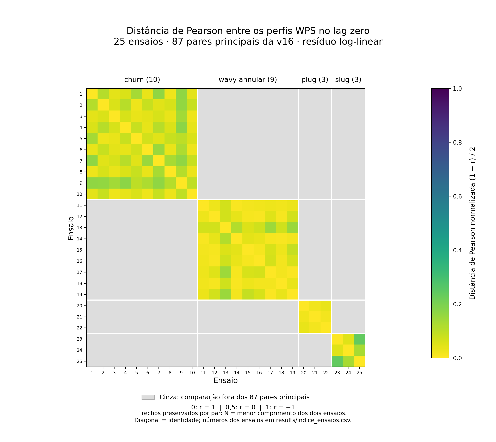

# Pearson dos pares principais da v16

## Gráfico

[PNG](figures/matriz_pearson_normalizada.png) · [PDF](figures/matriz_pearson_normalizada.pdf)

Pearson r varia de −1 a 1. A dissimilaridade usual 1−r varia de 0 a 2. Para apresentar a faixa 0–1 solicitada, foi usada **d = (1−r)/2**, com limites de cor fixos em 0 e 1. Não houve normalização pelo mínimo e máximo da amostra nem uso de |r| ou r². Correlações negativas, se presentes, continuam negativas no CSV e correspondem a d > 0,5.

| r de Pearson | d normalizada | Leitura |
| --- | --- | --- |
| 1 | 0 | Mesma forma linear após centralização, salvo escala positiva |
| 0 | 0,5 | Sem associação linear entre as coordenadas dos perfis |
| −1 | 1 | Formas linearmente opostas |

Zero não exige igualdade de amplitude dos perfis; Pearson é invariante a deslocamento e escala positiva. A distância é uma dissimilaridade de forma, não um percentual de diferença física ou uma probabilidade. O termo distância não implica que a desigualdade triangular seja satisfeita.

## Escopo: somente os pares principais

Foram usados exatamente os **87 pares** de [pair_methods.csv](../v16_spatial2_18_71/results/pair_methods.csv), filtrados pelo método v16_biased, correspondentes aos 87 mapas em intermediate: churn 45, wavy annular 36, plug 3 e slug 3. Esses pares envolvem **25 ensaios**: 10 churn, 9 wavy annular, 3 plug e 3 slug.

As células cinza não foram calculadas: indicam pares fora desse conjunto, e não distância zero. O conjunto contém apenas comparações intrapadrão. A diagonal foi fixada em zero pela identidade de cada vetor consigo mesmo e não entra na contagem de 87 pares. As duas metades da matriz repetem os mesmos pares por simetria.

O ensaio elegível m07q01_001, rotulado dispersed bubbles, não tem par intrapadrão nos mapas principais e ficou fora da matriz. Não foi reclassificado como plug. Os cinco ensaios excluídos na v16 também permanecem fora. As comparações adicionais do experimento de pré-processamento não foram incorporadas.

## Perfil e cálculo preservados

Para cada par foram extraídos P_x(a)=|wxx(0,a)| e P_y(a)=|wyy(0,a)| dos coeficientes complexos salvos no mapa correspondente. O índice do lag zero foi localizado no vetor de lags; não se tomou o meio da imagem como índice presumido. Foram mantidos os 200 comprimentos de onda de 50 a 3.000 px.

Como na análise de forma anterior, cada perfil foi transformado em log(P+10^−12) e dele foi retirado o ajuste de uma reta contra log(comprimento de onda). Pearson foi calculado entre os dois vetores residuais. Essa operação é remoção de tendência log-linear, sem afirmar branqueamento estatístico ou independência entre escalas. O gráfico não mostra Pearson dos sinais brutos, média da WPS em lag, nem alternative WCO.

A v16 usa os primeiros N=min(N_x,N_y) pixels de cada par, retirando tendência e normalizando depois do corte. Esses comprimentos foram preservados, variando de 5071 a 22636 px. **O mesmo ensaio pode ter um descritor diferente conforme o parceiro**, porque o trecho muda. A matriz é uma tabela simétrica de comparações por par; não é apresentada como matriz de correlação de um único vetor fixo por ensaio. Não foi imposta a janela global de 7.001 px da estatistica4.

## Resultados observados

- r variou de 0.521065 a 0.989224.
- d normalizada variou de 0.005388 a 0.239467; mediana 0.053082.
- Menor distância: m06q40_001 / m07q80_001, wavy annular, d=0.005388, r=0.989224.
- Maior distância: m04q01_001 / m06q05_001, slug, d=0.239467, r=0.521065.

Os valores baixos descrevem semelhança de forma dentro dos padrões nos trechos usados. **Esta matriz não avalia separação entre padrões**, porque as comparações entre padrões foram omitidas conforme o escopo solicitado. Não foram executados testes de separação, classificação ou novos diagnósticos além de Pearson. Os coeficientes não vêm acompanhados de valores-p que tratem as escalas como observações independentes.

## Identificação dos ensaios

| Nº | Ensaio | Padrão |
| --- | --- | --- |
| 1 | m03q05_001 | churn |
| 2 | m04q10_001 | churn |
| 3 | m04q20_001 | churn |
| 4 | m05q10_001 | churn |
| 5 | m05q20_001 | churn |
| 6 | m05q40_001 | churn |
| 7 | m06q10_001 | churn |
| 8 | m06q20_001 | churn |
| 9 | m07q20_001 | churn |
| 10 | m07q40_001 | churn |
| 11 | m03q10_001 | wavy annular |
| 12 | m03q20_001 | wavy annular |
| 13 | m03q40_001 | wavy annular |
| 14 | m04q40_001 | wavy annular |
| 15 | m04q80_001 | wavy annular |
| 16 | m05q80_001 | wavy annular |
| 17 | m06q40_001 | wavy annular |
| 18 | m06q80_001 | wavy annular |
| 19 | m07q80_001 | wavy annular |
| 20 | m05q01_001 | plug |
| 21 | m06q01_001 | plug |
| 22 | m07q05_001 | plug |
| 23 | m04q01_001 | slug |
| 24 | m05q05_001 | slug |
| 25 | m06q05_001 | slug |

## Arquivos e reprodução

- [Coeficientes e distâncias dos 87 pares](results/pearson_pairs.csv): r assinado, 1−r, (1−r)/2, N e origem de cada mapa.
- [Matriz 0–1](results/matriz_distancia_normalizada.csv), [matriz r](results/matriz_pearson_r.csv), [comprimento por par](results/matriz_n_px.csv) e [índice dos ensaios](results/indice_ensaios.csv).
- [Perfis por par](results/pair_descriptors.npz): magnitudes e resíduos, com IDs dos dois ensaios.
- [Validação](results/validation.json), [resumo](results/summary.json) e [manifesto com hashes](results/manifest.json).
- [Explicação do gráfico ECDF anterior](EXPLICACAO_ECDF.md).

Na raiz do repositório:

    PYTHONDONTWRITEBYTECODE=1 python3 src2/estatistica5/run_pearson.py

Os mapas e tabelas de origem são somente lidos. Os campos vazios dos CSVs representam comparações não incluídas; a diagonal zero é identidade. As versões efetivamente usadas estão no manifesto.
