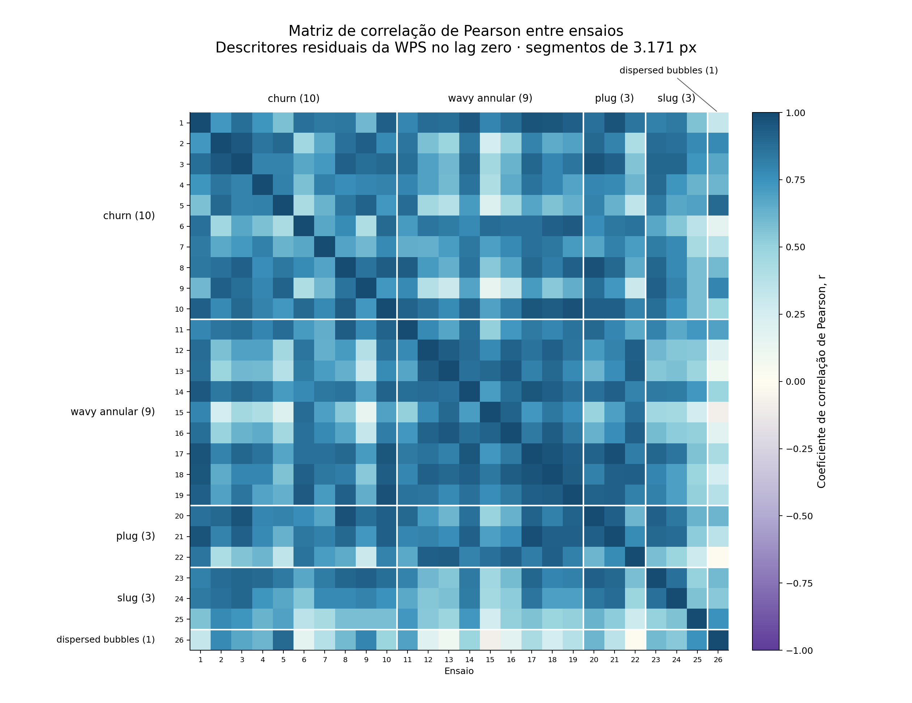
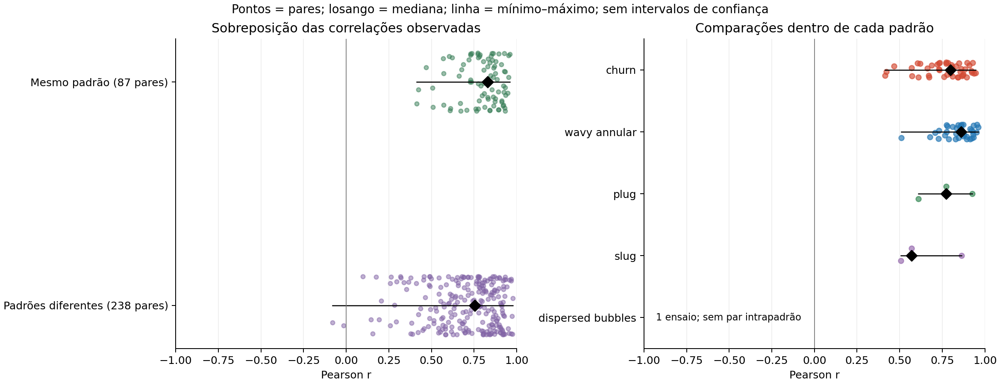
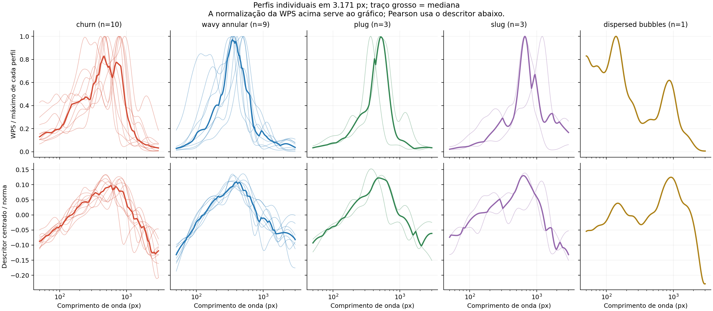
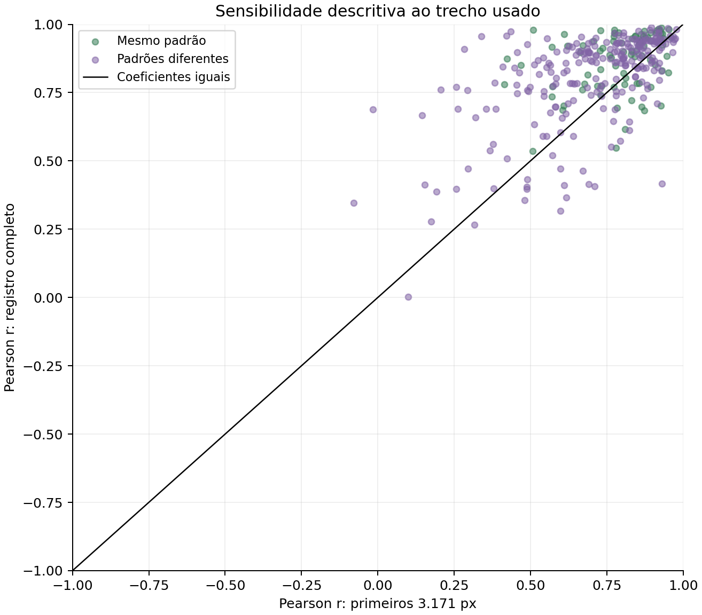

# Resumo executivo — correlação entre descritores espectrais

**A análise contemplou 26 ensaios e 325 pares distintos, cuja similaridade espectral foi quantificada pelo coeficiente de correlação de Pearson.** A mediana foi 0.8301 dentro dos padrões e 0.7546 entre padrões. Observou-se sobreposição entre as distribuições: 79 dos 238 pares entre padrões atingiram ou superaram a mediana intrapadrão. Esses resultados indicam que a correlação elevada entre perfis, isoladamente, não caracteriza o padrão de escoamento.

[Resumo em PDF](RESUMO_EXECUTIVO.pdf) · [Fórmulas e método detalhado](METODOLOGIA_TODOS_CONTRA_TODOS.md) · [Matriz em PDF](todos_contra_todos/figures/matriz_pearson_todos.pdf)

## Delimitação da amostra e padronização dos descritores

A amostra compreendeu 87 pares intrapadrão e 238 pares entre padrões. A diagonal da matriz representa a correlação de cada descritor consigo mesmo e foi excluída dos resumos estatísticos. Devido à simetria da matriz, cada par foi contabilizado uma única vez.

O ensaio m07q01_001 foi mantido na classe dispersed bubbles e comparado aos demais registros. Como essa classe contém uma única aquisição, sua similaridade intraclasse não pôde ser estimada. Foram preservados os critérios de exclusão dos cinco registros não elegíveis da base original.

Cada ensaio foi representado por um descritor obtido dos primeiros **3.171 px**, correspondentes ao menor comprimento disponível. O mesmo vetor foi utilizado em todas as comparações envolvendo o respectivo ensaio.

## Matriz de correlação de Pearson

<!-- Nota de apresentação: a matriz contém 325 pares distintos, sendo 87 intrapadrão e 238 entre padrões. As 676 células foram calculadas; a diagonal r=1 expressa identidade. Na paleta utilizada, roxo indica correlação negativa, creme indica valor próximo de zero e azul indica correlação positiva. Essas informações foram retiradas do rodapé da figura para simplificar sua apresentação. Na versão anterior, as regiões cinzas correspondiam a comparações omitidas e os trechos dependiam do par; a análise atual utiliza um descritor fixo por ensaio. -->

- **r próximo de 1:** forma semelhante, admitindo mudança de amplitude e deslocamento vertical do descritor.
- **r próximo de 0:** pouca associação linear entre as coordenadas espectrais.
- **r próximo de −1:** formas linearmente opostas.

A escala cromática foi fixada no intervalo de −1 a 1. Os coeficientes representam a associação linear entre os **resíduos log-lineares da alternative WPS no lag zero**; sua interpretação se restringe à forma desses descritores espectrais.

## Resultados observados

| Comparação | Pares | r mínimo | r mediano | r máximo | r negativos |
| --- | --- | --- | --- | --- | --- |
| Mesmo padrão | 87 | 0.4139 | 0.8301 | 0.9610 | 0 |
| Padrões diferentes | 238 | -0.0796 | 0.7546 | 0.9779 | 2 |

A amplitude observada foi de -0.079588 a 0.977896; 2 pares apresentaram r negativo. Desses, 2 envolveram o único ensaio dispersed bubbles. Isso descreve esse registro, sem demonstrar o comportamento geral dessa classe.

Os pares compartilham ensaios; as 325 correlações não são 325 aquisições independentes. Pontos, medianas e intervalos mínimo–máximo são descritivos e não incluem inferência de significância.

Dentro de cada padrão:

| Padrão | Pares | r mínimo | r mediano | r máximo |
| --- | --- | --- | --- | --- |
| churn | 45 | 0.4139 | 0.7971 | 0.9460 |
| wavy annular | 36 | 0.5091 | 0.8602 | 0.9610 |
| plug | 3 | 0.6110 | 0.7730 | 0.9267 |
| slug | 3 | 0.5069 | 0.5694 | 0.8630 |
| dispersed bubbles | 0 | não estimável | não estimável | não estimável |

Dispersed bubbles tem apenas um registro: sua similaridade intraclasse não pode ser estimada. Plug e slug possuem três registros cada. As contagens e a incerteza de representatividade impedem generalizações fortes a partir das diferenças visuais.

Os cinco maiores coeficientes entre padrões diferentes foram:

| run_x | pattern_x | run_y | pattern_y | pearson_r |
| --- | --- | --- | --- | --- |
| m06q40_001 | wavy annular | m06q01_001 | plug | 0.9779 |
| m06q20_001 | churn | m05q01_001 | plug | 0.9741 |
| m07q40_001 | churn | m07q80_001 | wavy annular | 0.9714 |
| m03q05_001 | churn | m06q40_001 | wavy annular | 0.9675 |
| m03q05_001 | churn | m06q01_001 | plug | 0.9664 |

Esses pares ilustram por que uma matriz com somente blocos intrapadrão não bastava para avaliar a especificidade da semelhança. O destaque é descritivo; os pares foram ordenados após calcular o conjunto completo e nenhum foi removido.

## O que foi executado, passo a passo

1. Conferiu-se a média das linhas 18–71 diretamente nos 26 PNGs e sua igualdade com os sinais salvos.
2. Selecionaram-se os primeiros 3.171 px de cada ensaio, sem reamostragem.
3. Inverteu-se a intensidade, retirou-se a tendência linear e padronizou-se cada trecho, como na v16.
4. Calculou-se a autocorrelação bilateral enviesada, com divisor N.
5. Aplicou-se a Morlet, com frequência angular 6, em 200 comprimentos de onda de 50 a 3.000 px. Retirou-se a magnitude da CWT da autocorrelação no lag zero.
6. Ajustou-se log(P+10⁻¹²) em função de log(comprimento de onda) e usaram-se os resíduos como descritor de forma.
7. Calculou-se Pearson assinado para todos os pares, com um único descritor por ensaio.
8. Repetiu-se somente Pearson com os registros completos como controle de sensibilidade; os dois resultados são apresentados sem selecionar o mais favorável.

As definições centrais são:

$$P_i(a)=|\mathrm{CWT}\{\widehat R_{ii}\}(0,a)|,\qquad z_{ik}=\log(P_i(a_k)+10^{-12})-\widehat c_i-\widehat d_i\log\lambda_k,$$

$$r_{ij}=\frac{\sum_k(z_{ik}-\overline z_i)(z_{jk}-\overline z_j)}{\sqrt{\sum_k(z_{ik}-\overline z_i)^2}\sqrt{\sum_k(z_{jk}-\overline z_j)^2}}.$$

O [método detalhado](METODOLOGIA_TODOS_CONTRA_TODOS.md) apresenta também as fórmulas da extração, tendência, normalização, autocorrelação e Morlet. O resíduo log-linear não constitui prova de branqueamento estatístico nem de independência entre escalas.

## Sensibilidade ao comprimento

| condition | comparison | n_pairs | median | minimum | maximum |
| --- | --- | --- | --- | --- | --- |
| 3171_px_inicio | Mesmo padrão | 87 | 0.8301 | 0.4139 | 0.9610 |
| 3171_px_inicio | Padrões diferentes | 238 | 0.7546 | -0.0796 | 0.9779 |
| comprimento_completo | Mesmo padrão | 87 | 0.9034 | 0.5360 | 0.9870 |
| comprimento_completo | Padrões diferentes | 238 | 0.8617 | 0.0018 | 0.9891 |

Ao usar os registros completos, a alteração absoluta mediana de r foi 0.1014; a maior alteração foi 0.7040. O controle também usa um descritor fixo por ensaio, porém os comprimentos originais diferem. Mudanças refletem comprimento e conteúdo espacial incluído, sem permitir atribuir toda variação a uma única causa.

A [matriz com registros completos](todos_contra_todos/figures/matriz_pearson_completo.png) foi conservada como controle. A janela principal foi definida pela disponibilidade dos dados, não pelo maior contraste entre padrões. Como 3.000 px se aproxima do comprimento de 3.171 px, as maiores escalas exigem cautela quanto ao registro finito.

## Checagem do método e dos cálculos

**Status: PASS.** Todos os 26 sinais coincidiram com os pixels de origem. As somas temporais da wavelet foram confrontadas com a implementação FFT em todas as 200 escalas de cada ensaio; a maior diferença relativa L2 foi 2.237e-16. Os 52 perfis das duas condições também reproduziram as tabelas da v16.

Os 325 coeficientes de cada condição foram conferidos contra SciPy, com diferença absoluta máxima de 1.110e-15, além de NumPy. Foram verificados casos conhecidos r=−1,0,1, recusa de vetores constantes, ordem do pré-processamento, autocorrelação por soma literal, conversão de escala e ortogonalidade dos resíduos. As matrizes são simétricas, têm diagonal unitária, 676 células finitas e autovalores não negativos dentro da tolerância de arredondamento, como exige R=UUᵀ.

[Validação completa](todos_contra_todos/results/validation.json) · [Verificação por ensaio](todos_contra_todos/results/verificacao_por_ensaio.csv) · [Hashes e versões](todos_contra_todos/results/manifest.json)

As fontes permaneceram inalteradas. A reconstrução dos panoramas não foi refeita. Correção matemática não demonstra causalidade, representatividade da amostra ou desempenho de classificação. Não foram calculados testes de separação ou classificadores; Pearson não foi usado para gerar valores-p tomando as escalas como aquisições independentes.

## Identificação dos ensaios

| Nº | Ensaio | Padrão | N original (px) |
| --- | --- | --- | --- |
| 1 | m03q05_001 | churn | 9586 |
| 2 | m04q10_001 | churn | 8829 |
| 3 | m04q20_001 | churn | 9344 |
| 4 | m05q10_001 | churn | 7001 |
| 5 | m05q20_001 | churn | 7391 |
| 6 | m05q40_001 | churn | 9937 |
| 7 | m06q10_001 | churn | 7584 |
| 8 | m06q20_001 | churn | 10044 |
| 9 | m07q20_001 | churn | 8255 |
| 10 | m07q40_001 | churn | 10349 |
| 11 | m03q10_001 | wavy annular | 14224 |
| 12 | m03q20_001 | wavy annular | 23079 |
| 13 | m03q40_001 | wavy annular | 20743 |
| 14 | m04q40_001 | wavy annular | 14960 |
| 15 | m04q80_001 | wavy annular | 22636 |
| 16 | m05q80_001 | wavy annular | 17524 |
| 17 | m06q40_001 | wavy annular | 14772 |
| 18 | m06q80_001 | wavy annular | 18665 |
| 19 | m07q80_001 | wavy annular | 16658 |
| 20 | m05q01_001 | plug | 5940 |
| 21 | m06q01_001 | plug | 7798 |
| 22 | m07q05_001 | plug | 7358 |
| 23 | m04q01_001 | slug | 5071 |
| 24 | m05q05_001 | slug | 6323 |
| 25 | m06q05_001 | slug | 7787 |
| 26 | m07q01_001 | dispersed bubbles | 3171 |
