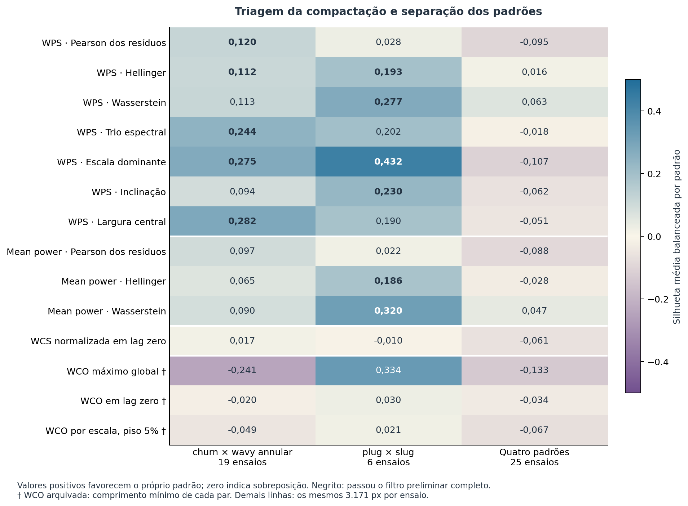
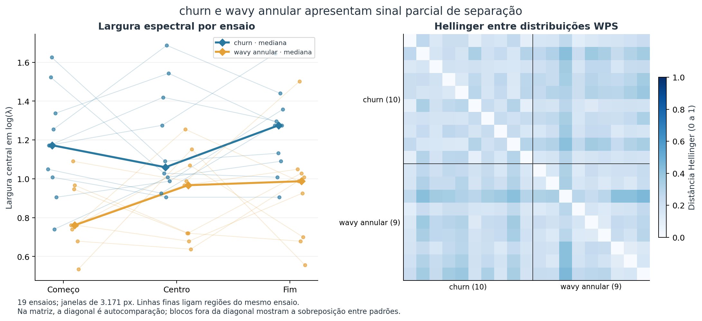
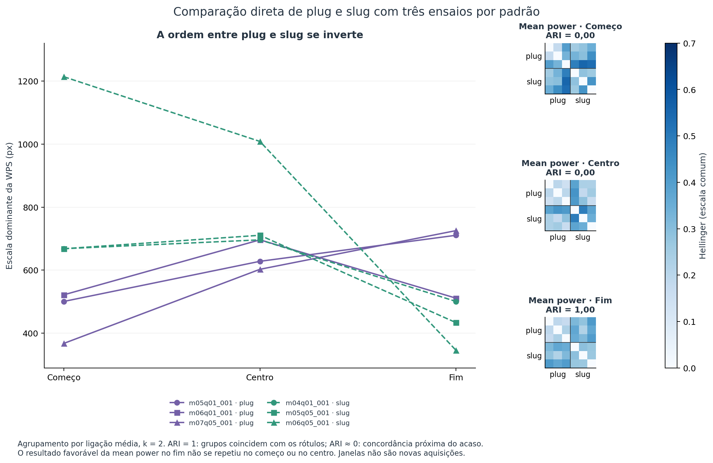
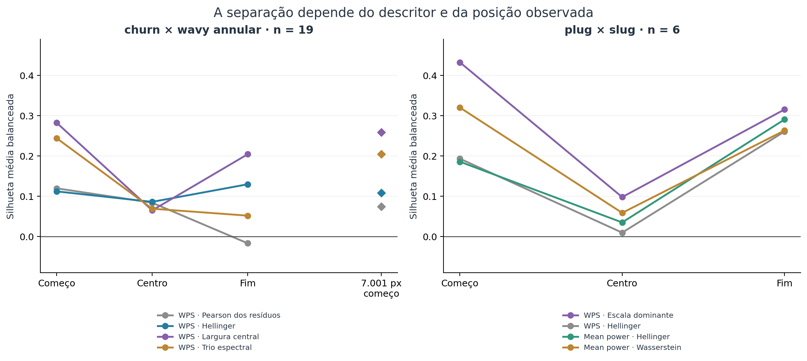

# Resumo executivo da discriminação de padrões por wavelets

**A WPS trouxe sinais úteis para comparar padrões, mas nenhum método testado sustentou agrupamento consistente nas diferentes janelas. Para churn e wavy annular, a distribuição e a largura espectral foram os melhores caminhos para continuidade. Para plug e slug, a escala dominante separou os ensaios no começo, mas sua relação com o padrão se inverteu no fim.**

[PDF com os principais gráficos](RESUMO_EXECUTIVO.pdf) · [Método e reprodução](METODOLOGIA.md) · [Tabelas completas](results/metricas_finais.csv)

## O que foi feito

1. Conferi os 26 ensaios elegíveis, os sinais extraídos das linhas 18–71, os perfis e os hashes das fontes. Mantive os cinco excluídos da origem.
2. Fixei trechos de 3.171 px e a grade de 200 escalas entre 50 e 3.000 px. Comparei 14 representações em três conjuntos: churn/wavy annular (19), plug/slug (6) e quatro padrões com réplicas (25).
3. Filtrei candidatos por silhueta balanceada ≥ 0,10, silhueta positiva em cada classe e vantagem do vizinho mais próximo ≥ 10 pontos percentuais sobre o acaso. Avançaram 11 combinações descritor/comparação.
4. Conferi começo, centro, fim, retirada de um ensaio e, nos mesmos 19 registros, o controle de 7.001 px. Recalculei mean power no centro/fim somente nos seis plug/slug que justificaram essa extensão.
5. Comparei agrupamentos por ligação média com número fixo de grupos e examinei condições operacionais. Passaram 5 combinações pelo filtro geométrico; isso não garantiu agrupamento correto ou direção estável do efeito.

## churn e wavy annular

Hellinger sobre a WPS teve silhuetas 0,112 / 0,086 / 0,130 no começo/centro/fim e 0,108 em 7.001 px. A concordância balanceada do vizinho mais próximo foi 84,4 / 83,9 / 73,3%, contra 47,2% ao acaso. São descrições da amostra, não acurácia preditiva. A largura central mediana foi 1,173 em churn e 0,761 em wavy annular, em log(λ). As diferenças persistiram em média, mas houve sobreposição; no centro, uma classe apresentou silhueta negativa. Com Hellinger, o ARI do agrupamento ficou próximo de zero nas três posições: a boa vizinhança local não se converteu em dois grupos bem definidos.

## plug e slug

No começo, plug teve picos de 368–522 px e slug de 668–1213 px, sem sobreposição. No fim, plug passou a 511–725 px e slug a 346–501 px. O delta de Cliff de plug menos slug mudou de -1 para +1. Logo, não há uma regra única “maior escala = slug” para todo o panorama. A mean power com Hellinger teve ARI 0,000 / 0,000 / 1,000: recuperou os rótulos apenas no fim. Wasserstein também mostrou sinal parcial, enfraquecido no centro. Com três ensaios por classe, esses resultados são pistas para investigação, não validação.

## Análises encerradas na triagem

Pearson em churn/wavy annular teve contraste intra−inter de 0,053 / 0,065 / -0,013: a vantagem desapareceu no fim. Nenhuma representação passou a triagem conjunta das quatro classes; a maior silhueta foi 0,063. WCS no lag zero e os três resumos WCO não passaram o filtro. A triagem WCO usou comprimentos variáveis por par; sua falha não exclui outras análises WCO com comprimento fixo. Não ampliei simulações nulas WCO nem testes funcionais por escala ou PERMDISP, pois não resolveriam a discriminação observada nesta etapa.

## Limitações

- Amostra já explorada: a seleção de descritores e as métricas usam os mesmos ensaios. Não houve teste externo, classificadores ou valores-p novos.
- Padrão, operação e reconstrução se confundem. A largura WPS teve Spearman −0,748 com o comprimento original nos 19 ensaios; comprimento e deslocamento médio tiveram correlação 1,000. Não existem trocas de rótulo dentro de (m,q) que permitam separar ambos os efeitos.
- Janelas do mesmo panorama não são réplicas independentes. As janelas extremas de plug/slug se sobrepõem em até 40,1%. Dispersed bubbles tem um ensaio e não permite avaliar compactação intraclasse.
- Escalas em pixels, sem conversão física ou temporal. Escalas de até 3.000 px têm suporte limitado em trechos de 3.171 px. Mean power significa média da magnitude WPS sobre os lags, não energia física. A nomenclatura da origem é WCO; WPO não está definida.

**Próximo passo útil:** Priorizar distribuição WPS e largura espectral para churn/wavy annular. Em plug/slug, investigar a variação espacial do pico e da mean power antes de propor uma regra de agrupamento. A próxima evidência decisiva requer aquisições independentes em condições comparáveis.

**Validação:** PASS. Extração dos 26 sinais, 123 perfis em cache, fórmulas, pares e agrupamentos conferidos por cálculos independentes; 70 fontes preservadas. [Validação numérica](validation/final_numeric.json).
