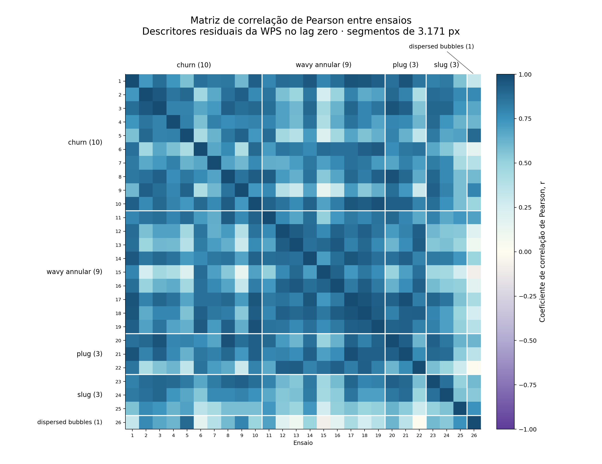
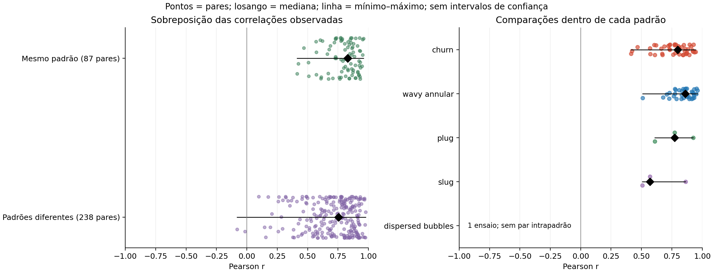
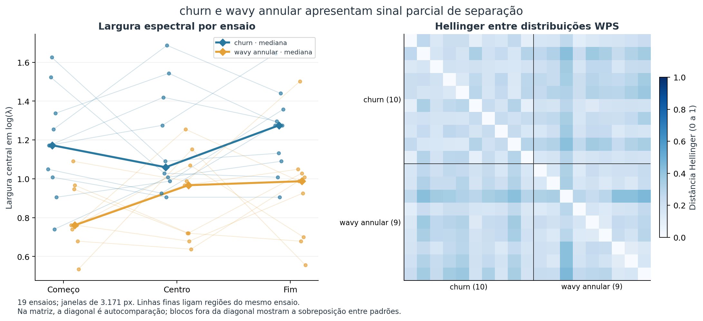
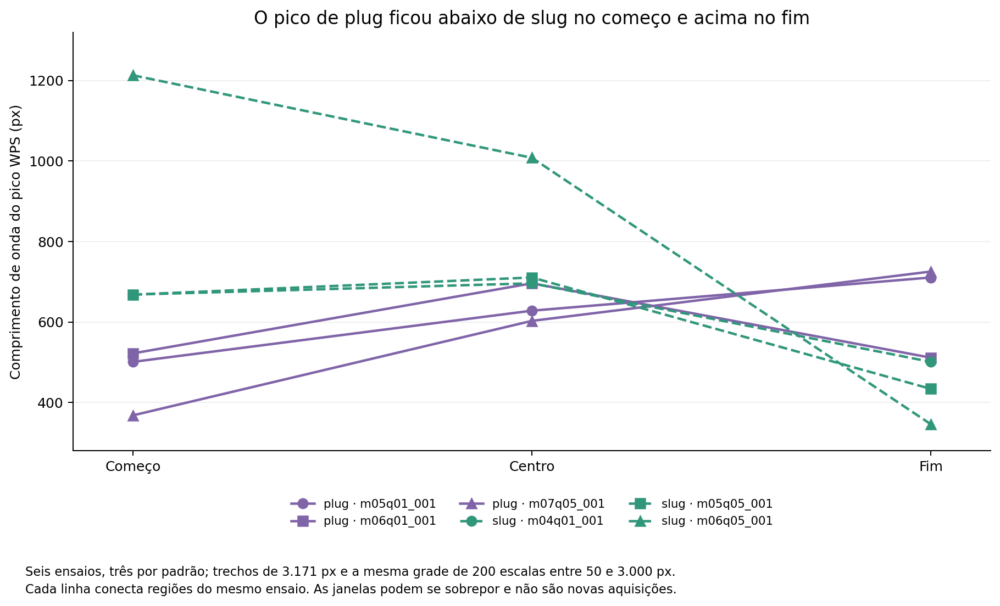
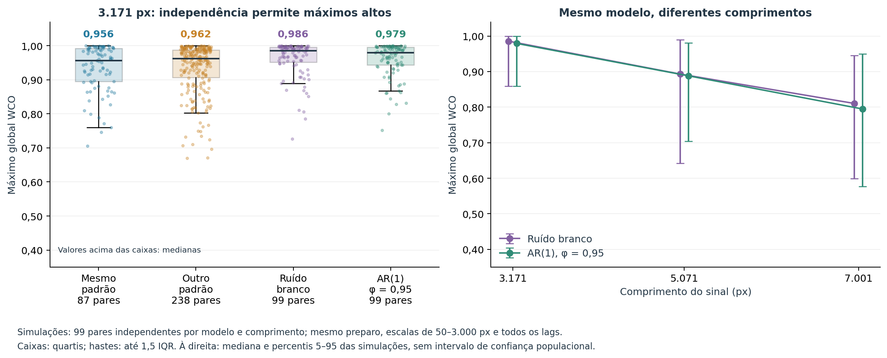

# Análises estatísticas selecionadas para o TCC

Estas quatro análises foram mantidas porque ajudaram a caracterizar diferenças entre padrões ou a identificar limites dos critérios de similaridade. A pergunta comum foi: **ensaios do mesmo padrão ficaram próximos entre si e separados dos demais?** Os resultados foram exploratórios; nenhum demonstrou classificação confiável de novas aquisições.

## Base comum dos cálculos

Foram utilizados os 26 ensaios elegíveis da `v16_spatial2_18_71`: churn 10, wavy annular 9, plug 3, slug 3 e dispersed bubbles 1. Cada sinal veio da média das 54 linhas 18–71 do panorama, com índices a partir de zero. Selecionou-se o trecho antes de inverter a intensidade (`255 − intensidade`), remover uma tendência linear e padronizar para média zero e desvio-padrão populacional igual a um. As comparações principais usaram **3.171 pixels por ensaio**.

A **WPS alternativa** descreveu a contribuição de diferentes comprimentos de onda espaciais. Primeiro calculou-se a autocorrelação, que compara o sinal com versões deslocadas dele próprio; depois aplicou-se a transformada wavelet contínua (CWT):

$$
\widehat R_{ii}[m]=\frac{1}{N}\sum_n x_i[n+m]x_i[n],
\qquad
P_{ik}=\left|\operatorname{CWT}\{\widehat R_{ii}\}(0,a_k)\right|.
$$

Aqui, $i$ identifica o ensaio, $N$ é o tamanho do trecho, $m$ é o deslocamento e a soma inclui somente índices válidos. O divisor foi sempre $N$, caracterizando o estimador **enviesado**. Usou-se Morlet com frequência angular 6 e uma grade geométrica de 200 comprimentos de onda $\lambda_k$, entre 50 e 3.000 px. A escala wavelet $a_k$ correspondeu a $\lambda_k=4\pi a_k/(6+\sqrt{38})$. O zero na CWT indica o *lag zero*, isto é, deslocamento nulo.

**Limite de interpretação:** $P$ foi uma magnitude da CWT da autocorrelação, não uma medida calibrada de energia física. As escalas estão em pixels, sem conversão para milímetros ou frequência temporal. As [equações completas da v16](../v16_spatial2_18_71/EQUATION_AUDIT.md) foram preservadas.

## 1. Pearson entre descritores espectrais

Cada célula mostra a correlação entre os descritores de dois ensaios. Azul indica correlação positiva, creme representa valores próximos de zero e roxo indica correlação negativa. As linhas brancas delimitam os padrões. A presença de azul intenso também nos blocos entre padrões mostra que formas espectrais semelhantes não foram exclusivas de uma classe.

**Limite de leitura da matriz:** a diagonal vale $r=1$ por autocomparação, não por evidência de agrupamento. A matriz é simétrica: os dois triângulos repetem os mesmos pares. A diagonal e as repetições foram excluídas dos resumos abaixo.

### Leitura da distribuição

Cada ponto representa um par de ensaios; o losango marca a mediana, e a linha indica mínimo–máximo. À esquerda, a mediana foi **0,830 dentro do mesmo padrão** e **0,755 entre padrões diferentes**. Porém, houve forte sobreposição: **79 dos 238 pares entre padrões** alcançaram ou superaram a mediana intrapadrão. À direita, aparecem somente comparações dentro de cada classe.

**Limitação junto ao resultado:** os pares compartilham ensaios. Portanto, 325 correlações não equivalem a 325 aquisições independentes, e as linhas não são intervalos de confiança. Classes maiores contribuíram com mais pares; a mediana conjunta não deu o mesmo peso a cada padrão. Dispersed bubbles teve apenas um ensaio e não permitiu comparação intraclasse.

### Em palavras simples

Cada ensaio virou uma curva. Pearson verificou se duas dessas curvas, depois de retirar sua inclinação geral, faziam subidas e descidas parecidas ao percorrer as escalas. Na matriz, azul forte significa que esses desenhos se pareceram bastante. Um valor de 0,83 não significa 83% de chance de os ensaios pertencerem ao mesmo padrão.

Os pares do mesmo padrão tiveram maior semelhança pela mediana, mas muitos pares de padrões diferentes também se pareceram muito. Por isso, **Pearson ajudou a encontrar semelhanças, porém não forneceu uma fronteira clara para separar as classes**. Dois ensaios podem ter curvas parecidas e ainda representar padrões diferentes.

### Motivo da análise

Verificou-se se a semelhança da **forma espectral** acompanhava os rótulos de padrão. A comparação pode ser entendida como observar dois relevos após retirar sua inclinação geral: interessa se as elevações e depressões aparecem nas mesmas regiões da escala.

### Procedimento e equações

1. Para cada ensaio, utilizou-se a WPS no lag zero dos primeiros 3.171 px. Aplicou-se o logaritmo e ajustou-se, por mínimos quadrados, uma reta em função de $t_k=\ln(\lambda_k/1\,\mathrm{px})$. O descritor foi o **resíduo**, a parte que restou após remover essa reta:

   $$
   z_{ik}=\ln(P_{ik}+10^{-12})-\widehat c_i-\widehat d_i t_k.
   $$

   O termo $10^{-12}$ protegeu o logaritmo. Retirar a reta reduziu o efeito da tendência espectral geral; não tornou as escalas independentes.

2. Calculou-se Pearson entre os 200 resíduos de cada par:

   $$
   r_{ij}=\frac{\sum_k(z_{ik}-\overline z_i)(z_{jk}-\overline z_j)}
   {\sqrt{\sum_k(z_{ik}-\overline z_i)^2}\sqrt{\sum_k(z_{jk}-\overline z_j)^2}}.
   $$

   Valores próximos de 1 indicam variações de forma semelhantes; próximos de 0, pouca associação linear; próximos de −1, variações opostas. **Não se calculou significância supondo que as 200 escalas fossem 200 ensaios.**

3. Compararam-se todos os pares distintos, sem autocomparações e sem contar o mesmo par duas vezes: 87 pares do mesmo padrão e 238 de padrões diferentes. Usaram-se medianas e distribuições observadas, sem ajustar um limiar de classificação.

### Conclusão

A forma espectral apresentou maior similaridade mediana dentro dos padrões, mas a sobreposição impediu usar Pearson elevado como identificação do padrão. **A análise foi útil como descrição de semelhança, sem demonstrar uma regra de classificação.**

Fontes: [325 pares](../estatistica5/todos_contra_todos/results/pearson_325_pares.csv) e [resumos das distribuições](../estatistica5/todos_contra_todos/results/resumo_dentro_entre_padroes.csv).

## 2. Distribuição e largura da WPS em churn e wavy annular

### Leitura do gráfico

À esquerda, as linhas finas conectam trechos do mesmo ensaio; as grossas mostram a mediana de cada padrão. Churn apresentou maior largura espectral mediana nas três posições. No começo, as medianas foram **1,173 para churn e 0,761 para wavy annular**, em logaritmo do comprimento de onda. Isso significa que a região central da distribuição espectral ocupou uma faixa mais ampla de escalas.

À direita, cada célula mostra a **distância Hellinger** entre dois perfis do começo: cores claras indicam maior semelhança. A diagonal vale zero porque compara o ensaio consigo mesmo. Os blocos entre classes também contêm células claras, revelando sobreposição.

**Limitação junto à interpretação:** essa largura descreve o perfil WPS; não mede diretamente a largura de bolhas. Padrão, condições operacionais e reconstrução dos panoramas se confundiram na amostra. Fixar o tamanho do trecho não permitiu atribuir a diferença exclusivamente ao regime de escoamento.

### Em palavras simples

Imagine repartir 100 fichas entre os comprimentos de onda, conforme a contribuição de cada um para o perfil WPS. **Hellinger** verifica se dois ensaios colocaram as fichas nos mesmos lugares. A **largura espectral** resume quanto a parte central dessa distribuição ficou espalhada. Assim, uma medida compara dois perfis inteiros; a outra resume uma característica de cada perfil.

Nos registros analisados, churn apresentou maior largura mediana que wavy annular. Além disso, vários ensaios tinham como vizinho mais parecido outro do mesmo padrão. Mesmo assim, quando se tentou organizar o conjunto em dois grupos, as classes se misturaram. **Houve diferenças úteis para descrever os ensaios, mas ainda não uma separação confiável.** As condições de aquisição também podem contribuir para essas diferenças.

### Motivo da análise

Quantificou-se como a contribuição da WPS se distribuiu pelas escalas e quanto dessa distribuição ficou concentrado em uma faixa estreita. Essas medidas complementaram a comparação de forma pela Pearson.

### Procedimento e equações

1. Normalizou-se cada perfil, conservando sua distribuição relativa. Com pesos trapezoidais $h_k$ na grade $t_k=\ln(\lambda_k/1\,\mathrm{px})$:

   $$
   p_{ik}=\frac{h_kP_{ik}}{\sum_\ell h_\ell P_{i\ell}},
   \qquad \sum_k p_{ik}=1.
   $$

   Os pesos representam a extensão de cada intervalo de escala, com meia contribuição nas extremidades. **$p$ não é probabilidade de um padrão nem energia física; é a participação relativa no perfil.**

2. Calculou-se Hellinger entre os perfis normalizados:

   $$
   H_{ij}=\frac{1}{\sqrt2}\sqrt{\sum_k\left(\sqrt{p_{ik}}-\sqrt{p_{jk}}\right)^2}.
   $$

   A distância vai de 0, distribuições iguais, a 1, distribuições sem sobreposição.

3. Acumulou-se $p$ e localizaram-se os quantis 25% e 75%. Cada quantil foi o primeiro ponto da grade em que a soma acumulada atingiu a fração indicada, sem interpolação. A largura central foi:

   $$
   L_i=Q_{75\%}(t)-Q_{25\%}(t)
      =\ln\!\left(\frac{\lambda_{75\%,i}}{\lambda_{25\%,i}}\right).
   $$

4. Avaliou-se se a proximidade favoreceu a própria classe. A **silhueta** comparou a distância média aos demais ensaios do mesmo padrão ($A_i$) com a distância média ao outro padrão ($B_i$):

   $$
   s_i=\frac{B_i-A_i}{\max(A_i,B_i)}.
   $$

   Positivo favorece a própria classe; perto de zero indica pouca separação; negativo favorece a outra classe. Calculou-se a média dentro de cada classe e depois a média das duas, dando o mesmo peso aos padrões. Também se verificou se o vizinho mais próximo, excluindo o próprio ensaio, tinha o mesmo rótulo. Em empates, dividiu-se o crédito entre os vizinhos empatados; a concordância também foi resumida com peso igual por classe.

5. Repetiram-se os cálculos no começo, centro e fim dos mesmos 19 ensaios, sempre com 3.171 px. Para Hellinger, obtiveram-se:

   | Posição | Silhueta média balanceada | Menor média de classe | Vizinhança com o mesmo padrão, balanceada |
   | --- | ---: | ---: | ---: |
   | Começo | 0,112 | 0,090 | 84,4% |
   | Centro | 0,086 | −0,059 | 83,9% |
   | Fim | 0,130 | 0,098 | 73,3% |

   A referência de vizinhança aleatória foi 47,2%, considerando as contagens de 10 e 9 ensaios e excluindo a autocomparação. **Essas porcentagens descrevem os vizinhos nesta amostra, não acurácia em dados novos.** No centro, a silhueta negativa de uma classe mostrou uma falha que a média global positiva esconderia. Um controle de 7.001 px no começo, com os mesmos 19 registros, teve silhueta média 0,108.

6. Formaram-se dois grupos por **ligação média**, que une grupos pela distância média entre seus integrantes. A concordância com os rótulos, medida pelo índice Rand ajustado (ARI), ficou próxima de zero nas três posições: 0,012 / 0,012 / −0,020. Nesse índice, 1 representa coincidência dos grupos com os rótulos; próximo de zero representa concordância próxima da referência ajustada ao acaso.

### Conclusão

**A distribuição e a largura WPS foram pistas úteis de diferenças espectrais, mas a boa vizinhança local não se converteu em dois grupos bem definidos.** A interpretação permanece exploratória: os mesmos ensaios serviram para escolher e avaliar as representações, sem validação externa.

Fontes: [características por ensaio](../estatistica6/results/a3_features.csv), [métricas de separação](../estatistica6/results/metricas_finais.csv), [agrupamentos](../estatistica6/results/cluster_summary.csv) e [associações com condições de aquisição](../estatistica6/results/a6_associations.csv).

## 3. Variação espacial do pico WPS em plug e slug

### Leitura do gráfico

Cada linha representa um ensaio. No começo, os três plug tiveram picos entre **368 e 522 px**, enquanto os três slug ficaram entre **668 e 1.213 px**. No fim, a ordem se inverteu: plug ficou entre **511 e 725 px**, e slug entre **346 e 501 px**. Os limites foram arredondados para apresentação.

**Limitação junto ao resultado:** foram apenas três ensaios por padrão. As três posições não aumentaram esse número; começo e fim chegaram a compartilhar 40,1% das amostras em um dos registros. A mudança do pico não demonstra que o escoamento mudou de classe, pois os rótulos continuaram sendo os dos ensaios originais.

### Em palavras simples

O pico é o ponto que mais se destaca no perfil WPS. O número acompanhado aqui foi o **comprimento de onda onde esse destaque apareceu**. Procurou-se saber se esse número simples ajudaria a distinguir plug de slug em diferentes partes do mesmo panorama.

O começo parecia dar uma resposta clara: os três slug tinham picos em comprimentos de onda maiores que os três plug. No fim, a ordem se inverteu. **Olhar apenas o começo teria dado uma impressão exagerada de separação.** A característica dependeu do trecho observado; isso não demonstrou que o escoamento mudou de classe. Com apenas três ensaios por padrão, o achado foi útil principalmente para mostrar o cuidado necessário ao escolher a janela de análise.

### Motivo da análise

Verificou-se se uma característica simples, o comprimento de onda com maior contribuição WPS, sustentaria uma regra de separação em diferentes partes do panorama. Uma característica útil para o ensaio inteiro não deveria depender de escolher apenas o trecho favorável.

### Procedimento e equações

1. Selecionaram-se janelas de 3.171 px no começo, centro e fim de cada panorama. Os inícios foram $0$, $\lfloor(N_{\mathrm{original}}-3171)/2\rfloor$ e $N_{\mathrm{original}}-3171$. Cada trecho recebeu novamente o preparo e o cálculo WPS descritos na base comum.

2. Localizou-se o maior valor do perfil na mesma grade de 200 escalas:

   $$
   k_i^*=\operatorname*{arg\,max}_k P_{ik},
   \qquad \lambda_i^*=\lambda_{k_i^*}.
   $$

   Esse foi o **pico espectral**, ou escala dominante. A precisão está limitada à grade calculada; ele não é uma medida direta do tamanho físico de uma bolha.

3. Compararam-se os seis valores em cada posição. Para resumir a direção da diferença, calculou-se o **delta de Cliff**, que conta quantas comparações favorecem plug ou slug:

   $$
   \delta=\frac{1}{3\times3}
   \sum_{i\in\mathrm{plug}}\sum_{j\in\mathrm{slug}}
   \operatorname{sgn}(\lambda_i^*-\lambda_j^*).
   $$

   O sinal vale +1, 0 ou −1 conforme o pico de plug seja maior, igual ou menor. Obtiveram-se **−1 no começo, −0,889 no centro e +1 no fim**. Os extremos significam que todos os plug ficaram abaixo dos slug no começo e acima deles no fim. As nove comparações da fórmula continuam envolvendo somente seis ensaios.

### Conclusão

**A regra “maior pico corresponde a slug” funcionou no começo e falhou no fim.** O achado útil foi a dependência espacial da característica. Ele justificou avaliar várias regiões antes de propor uma regra de identificação. Não foi possível separar a contribuição da variação do sinal da influência da reconstrução dos panoramas.

Fontes: [picos por ensaio](../estatistica6/results/a3_features.csv), [delta de Cliff](../estatistica6/results/a3_effects.csv) e [sobreposição das janelas](../estatistica6/results/a2_within_run_windows.csv). A figura foi gerada a partir dos resultados arquivados, sem novo processamento dos sinais.

## 4. Máximo WCO confrontado com sinais independentes

### Leitura do gráfico

À esquerda, em 3.171 px, a mediana do máximo WCO foi **0,956 entre ensaios do mesmo padrão e 0,962 entre padrões diferentes**. Os controles independentes também produziram valores elevados: **0,986 para ruído branco e 0,979 para AR(1)**. As caixas mostram os quartis; a linha interna, a mediana; as hastes estendem-se até os pontos dentro de 1,5 vezes o intervalo interquartil. Todos os pontos foram exibidos.

À direita, o máximo típico diminuiu quando os sinais simulados ficaram mais longos, mantendo os mesmos modelos e a mesma faixa de escalas. As hastes são os percentis 5–95 das simulações, **não intervalos de confiança populacionais**. Nos dados reais, 222 dos 325 máximos, **68,3%**, ocorreram em 3.000 px, limite superior da grade e próximo do comprimento do trecho principal.

### Em palavras simples

A WCO produziu um mapa de comparações entre dois sinais, usando diferentes escalas e deslocamentos. O máximo guardou somente o maior valor encontrado nesse mapa. É como procurar o ponto de maior concordância: esse ponto, sozinho, não descreve o restante das comparações.

Para conferir o significado de um valor alto, geraram-se sinais aleatórios independentemente e aplicou-se o mesmo cálculo. Eles também produziram máximos muito próximos de 1, mesmo sem uma ligação entre os sinais por construção. **O controle mostrou que um máximo alto não basta para afirmar que dois ensaios têm o mesmo padrão.** Isso não significa que os sinais reais sejam ruído; significa que esse número isolado não confirmou a identificação pretendida.

### Motivo da análise

Verificou-se se um máximo próximo de 1 exigia relação entre os sinais. O controle forneceu uma situação de independência conhecida, permitindo avaliar o que esse número, sozinho, realmente sustentava.

### Procedimento e equações

1. Calculou-se a correlação cruzada enviesada $\widehat R_{ij}$ entre dois sinais, substituindo um dos fatores da autocorrelação por $x_j$. A WCO alternativa foi:

   $$
   \Gamma_{ij}(b,a)=
   \frac{|\operatorname{CWT}\{\widehat R_{ij}\}(b,a)|^2}
   {P_i(a)P_j(a)}.
   $$

   $b$ é o lag espacial. Os denominadores $P_i$ e $P_j$ são as WPS no **lag zero**, mantidos em todos os lags de cada escala. Não foram substituídos pelo valor local do mapa.

2. Extraiu-se um único máximo por par:

   $$
   S_{ij}=\max_{b,a}\Gamma_{ij}(b,a).
   $$

   A busca percorreu as 200 escalas e todos os $2N-1$ lags. Mantiveram-se as equações da v16, sem recortar regiões de borda por cone de influência e sem limitar artificialmente os valores calculados. Exigiu-se, em cada sinal, WPS acima de $10^{-10}$ do próprio máximo para proteger as divisões; esse piso numérico não foi um limiar de significância.

3. Geraram-se dois tipos de sinal: **ruído branco gaussiano**, com amostras independentes, e **AR(1)**, em que cada amostra retém parte da anterior:

   $$
   v[n]=0{,}95\,v[n-1]+\varepsilon[n].
   $$

   As inovações $\varepsilon$ foram gaussianas e independentes entre sinais. Assim, o AR(1) teve dependência dentro de cada sinal, mas os dois sinais de um par permaneceram independentes. Geraram-se $N+1.000$ amostras e conservaram-se as últimas $N$, reduzindo o efeito da inicialização do AR(1).

4. Aplicaram-se o mesmo preparo e o mesmo cálculo WCO dos ensaios. Foram **99 pares independentes por modelo e comprimento**, para $N=3.171$, $5.071$ e $7.001$, totalizando 594 pares simulados. Compararam-se medianas e distribuições, sem tratar os pares reais compartilhados como aquisições independentes.

**Limite do controle:** ruído branco e AR(1) não reproduzem toda a estrutura dos panoramas. O resultado não demonstra que os sinais reais sejam ruído, nem atribui todos os máximos ao mesmo mecanismo. Ele mostrou que valores elevados eram compatíveis com independência nessa configuração. A ausência de máscara de borda e o suporte limitado das maiores escalas fazem parte do método avaliado.

### Conclusão

**Um máximo WCO alto, isoladamente, não foi evidência suficiente de padrão comum.** Esse foi um resultado metodológico útil para o TCC: impediu interpretar a magnitude do máximo como confirmação de agrupamento. A conclusão se restringe a esse resumo e à configuração avaliada; não demonstra que toda informação presente nos mapas WCO seja inútil.

Fontes: [WCO dos 325 pares reais](results/scores_3171_prefix.csv), [simulações individuais](results/independent_noise_controls.csv), [resumos dos controles](results/independent_noise_summary.csv) e [configuração do diagnóstico](configs/diagnostics_addendum.json).
