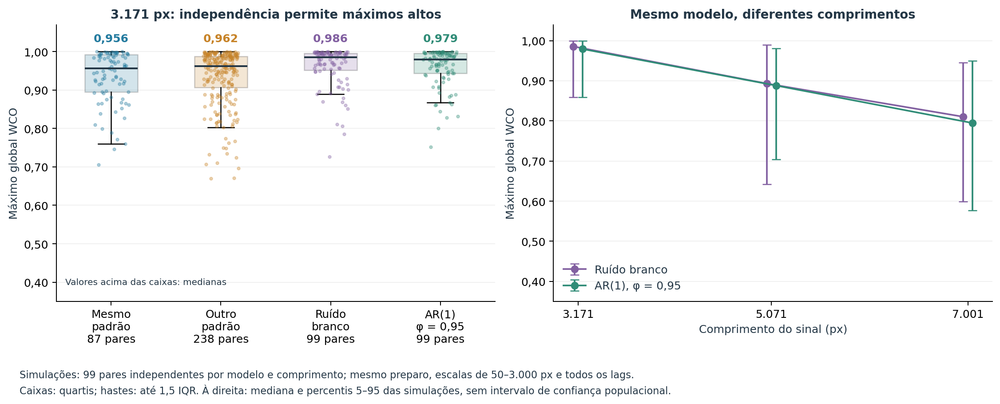
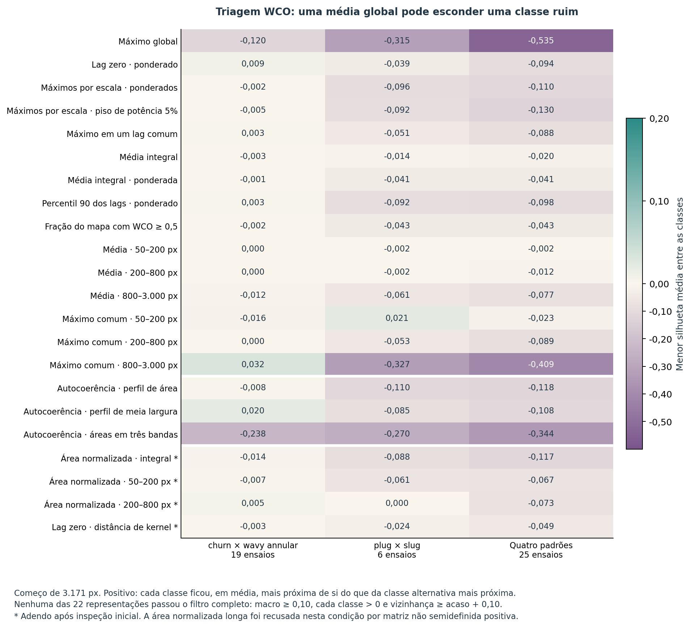
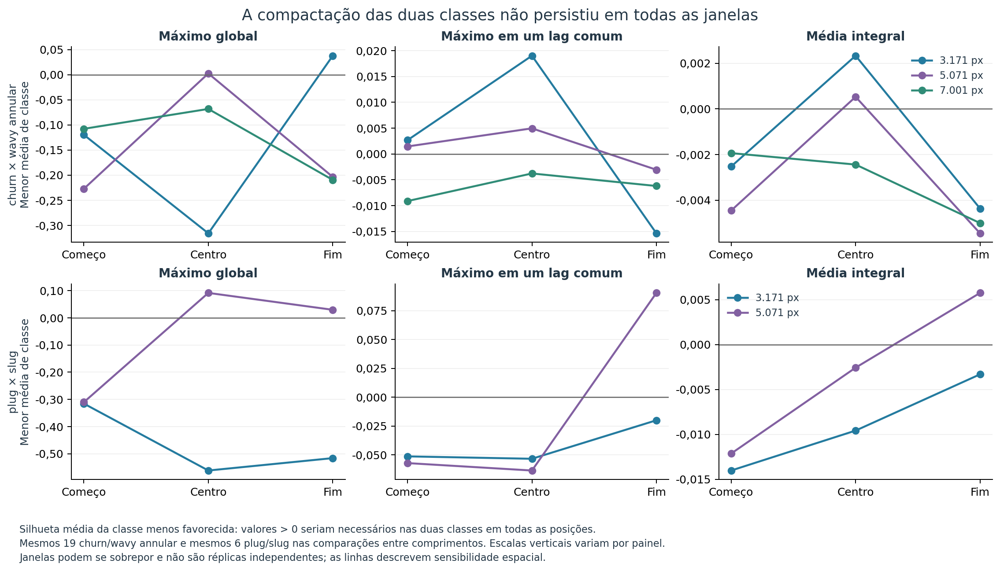
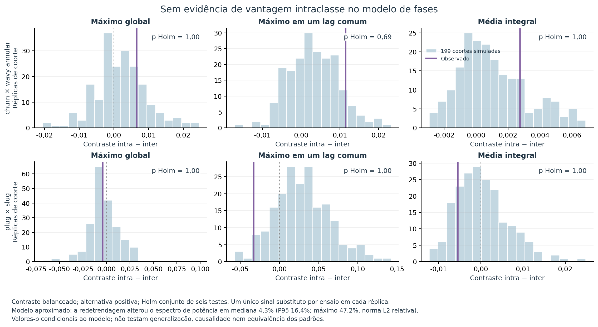

# WCO: exploração e utilidade para o TCC

**Vale manter a WCO no TCC como diagnóstico dos limites da similaridade. Nesta exploração, ela não sustentou um método estável para agrupar os padrões. O resultado mais claro foi que sinais independentes também produziram máximos próximos de 1.**

[PDF com os gráficos principais](RESUMO_EXECUTIVO.pdf) · [Método e reprodução](METODOLOGIA.md) · [Todas as métricas](results/metrics_all.csv)

## O que foi feito

1. Conferi as fontes e recalculei a WCO da v16 para os 26 ensaios: churn 10, wavy annular 9, plug 3, slug 3 e dispersed bubbles 1. Mantive linhas 18–71 e as exclusões da origem.
2. Usei comprimentos comuns: 3.171 px nos 26, 5.071 px nos mesmos 25 com classes replicadas e 7.001 px nos mesmos 19 churn/wavy annular; começo, centro e fim. Foram 2.388 mapas cruzados e 210 de autocoerência, sempre com todos os lags.
3. Examinei 18 representações: máximos, lag zero, médias, fração acima de 0,5, três bandas e perfis de autocoerência. No adendo exploratório, testei cinco normalizações; quatro foram utilizáveis em 3.171 e 5.071 px.
4. Avaliei seis comparações entre duas classes e a comparação conjunta das quatro: silhueta por classe, vizinho mais próximo, agrupamento por ligação média, retirada de um ensaio, perfis por escala e condições operacionais.
5. Calibrei a interpretação com 594 pares independentes de ruído branco/AR(1) e 199 réplicas de coorte com fases aleatórias. Os seis contrastes do modelo de fases receberam correção de Holm.

## Resultado que vale manter

Nos 325 pares reais, a mediana do máximo foi 0,961: 0,956 dentro do padrão e 0,962 entre padrões. 222 máximos (68,3%) caíram em λ = 3.000 px, limite superior da grade. Em 3.171 px, as medianas foram 0,986 para ruído branco independente e 0,979 para AR(1) independente. Isso demonstra que um máximo alto, isoladamente, não é evidência de padrão comum ou acoplamento físico. Não demonstra que os ensaios reais sejam ruído.

## O objetivo de agrupamento

Nenhuma das 22 representações utilizáveis passou o filtro inicial completo em qualquer uma das sete comparações. Mesmo retirando o limiar de silhueta macro ≥ 0,10, nenhuma manteve silhueta média positiva em todas as classes nas seis janelas de 3.171/5.071 px. Para churn/wavy annular, o máximo global teve silhueta macro 0,072 no começo, mas a classe menos favorecida teve -0,120. Nos quatro padrões, a maior silhueta macro inicial foi apenas 0,005. Vizinhança local e agrupamento não foram interpretados como acurácia preditiva.

## Plug e slug

Plug e slug foram comparados diretamente, com três ensaios por classe, em todas as posições de 3.171 e 5.071 px. O máximo global apresentou compactação das duas classes em algumas janelas de 5.071 px, mas falhou nas três posições de 3.171 px. As vantagens pontuais não sustentaram uma regra espacialmente estável. Os perfis por escala e as normalizações adicionais também não mudaram essa decisão.

## Referência estatística de fases

Os testes de vantagem intraclasse dos três resumos fixados (máximo global, máximo em um lag comum e média integral) não indicaram contraste maior que o esperado pelo modelo de fases após Holm: p ajustado ≥ 0,69. São testes condicionais a um modelo aproximado, não demonstração de equivalência ou ausência de informação. A redetrendagem alterou o espectro de potência em mediana 4,3% e chegou a 47,2% em uma realização.

## Limitações

- Amostra pequena e já explorada; plug/slug têm n=3 cada e dispersed bubbles não permite compactação intraclasse. Sem teste externo ou estimativa de generalização.
- Pares compartilham ensaios; escalas e janelas não são aquisições independentes. Em 5.071 px, começo/centro/fim de um slug são exatamente o mesmo trecho.
- Padrão, m, q e reconstrução se confundem. Apenas q=40 permite contraste simétrico churn/wavy annular (2 e 3 ensaios); não há separação desses efeitos em (m,q).
- Escalas em pixels, sem calibração física. Mantive o estimador sem máscara de cone de influência; os controles medem essa configuração, não todas as definições possíveis de coerência.
- A normalização da área na banda longa falhou na condição de matriz semidefinida positiva em 3.171/5.071 px e foi recusada como kernel. Isso não invalida o cálculo WCO original.

## Decisão para o TCC

Manter no TCC os controles independentes, a concentração dos máximos na maior escala e a ausência de separação estável dos resumos testados. Não usar “WCO alta” como prova de mesmo padrão. Para o objetivo de agrupamento, a distribuição e a largura da WPS da estatistica6 continuam sendo pistas mais promissoras, ainda sem validação. A estatistica5 descreve semelhança de forma espectral; a estatistica6 mostra sua sensibilidade espacial; esta análise acrescenta a calibração necessária para interpretar a WCO.

**Auditoria numérica: PASS.** WCO integral conferida contra o núcleo original, erro máximo 7.55e-15; contagens, silhuetas, testes, normalizações e hashes verificados. As 34 fontes diretas permaneceram inalteradas. [Auditoria](validation/final.json). Correção numérica não demonstra validade física ou representatividade.
