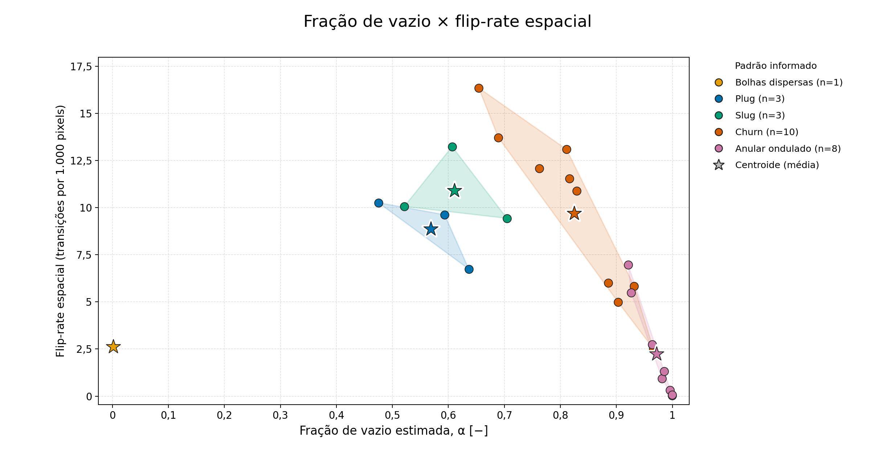

# v14.1 — void fraction and flip-rate

[Executive summary](findings/EXECUTIVE_SUMMARY.md) · [Resumo executivo](findings/EXECUTIVE_SUMMARY_PT_BR.md) · [Effectiveness of the correction](findings/fix_effectiveness.md)

This version repeats the v14 analysis with the same sample, formulas, thresholds, geometry and classifiers. It corrects the panorama seam overwrite that reordered/duplicated columns, rebuilds the liquid reference under the same rule, and exposes threshold dependence in the main scatter analysis. The primary threshold remains 0.70 and the full lumen remains rows 18:71, D=53.

The original v14 folder, original panoramas and native frames are preserved. A frozen [v14 baseline](intermediate/history/v14_baseline/README.md) and its [hash manifest](intermediate/history/v14_baseline_manifest.json) support the comparison. Historical snapshot documents preserve original bytes and may contain links intended for their original locations.

| Start here | Contents |
|---|---|
| [findings](findings/README.md) | Summaries, method reviews and adversarial checks |
| [results](results/README.md) | Current measurements, classifier predictions and verification |
| [results/summary](results/summary/README.md) | Whether the fixes helped, including unfavorable changes |
| [figures](figures/README.md) | Regenerated figures and sensitivity comparisons |
| [scripts](scripts/README.md) | Ordered reproduction stages |
| [intermediate](intermediate/README.md) | Corrected inputs, masks, features, sensitivity and logs |
| [literature](literature/README.md) | Preserved literature evidence |



Void estimates remain conditional optical measurements, without independent physical calibration. Flip-rate is spatial transition density, not a temporal frequency. Observed convex hulls are not classification boundaries.

## Reproduce

From the repository root, with NumPy, SciPy, pandas, Pillow, Matplotlib and PyWavelets installed:

```sh
python3 -B src2/v14.1_new_voidfraction/scripts/run_all.py
```

The runner includes all original analysis stages and native-frame alternatives, regenerates comparisons and reports, stops on failure, and records [logs and status](intermediate/logs/pipeline_run.json). All inputs are local. Reconstruction requires the original native JPEGs, configurations, markers and pipeline_v11.py. No source data or shared pipeline is overwritten.
