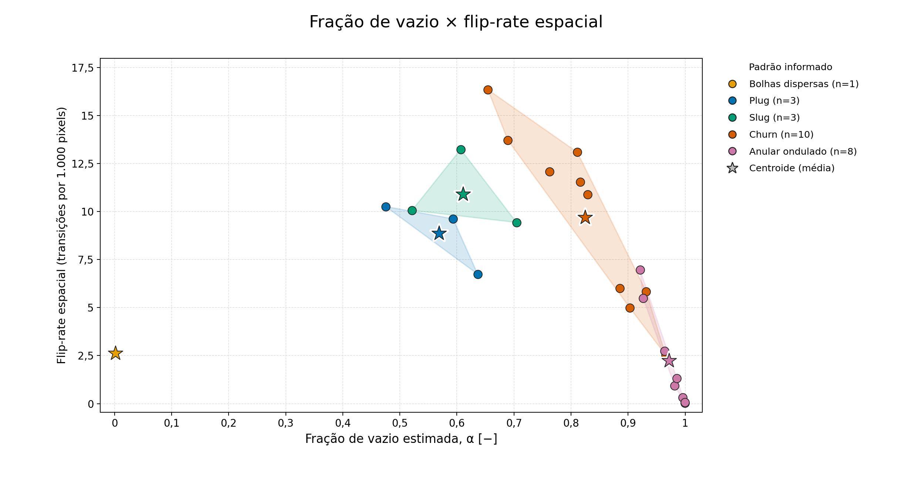
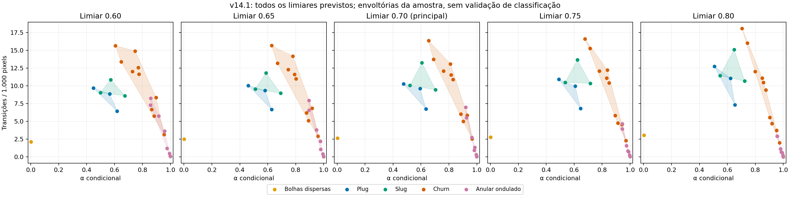
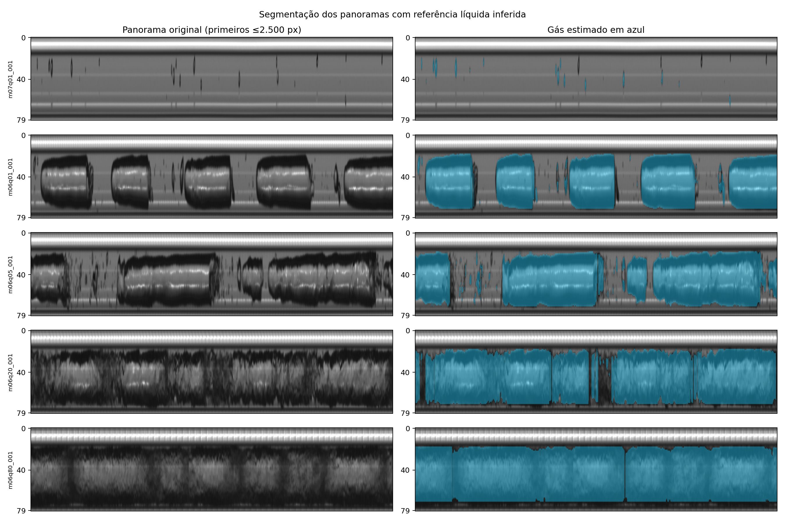
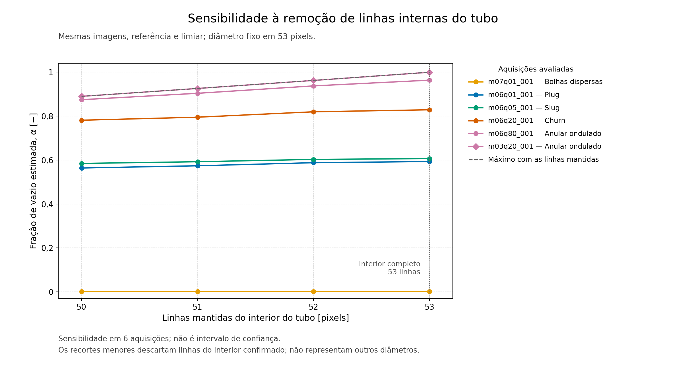

# Executive summary — v14.1: void fraction and flip-rate

[Versão em português](EXECUTIVE_SUMMARY_PT_BR.md) · [Correction effectiveness](fix_effectiveness.md)

**The seam column-order defect is removed. Physical volumetric void fraction remains uncalibrated.** The analysis estimates visible gas under optical and geometric assumptions. Selection, formulas, thresholds, models and the user-confirmed geometry remain unchanged: **Python rows 18:71, D = 53 pixels**.

## Were the corrections effective?

The old assembly could turn `[1,2,3,4 | 5,6,7,8]` into `[1,2,3,6,5,6,7,8]`, producing three transitions when binarizing at intensity > 5 instead of one. v14.1 concatenates the same strips in their original order without that overwrite. All 26 old panoramas were reproduced pixel for pixel as a control; corrected inputs preserve shifts and widths. The liquid reference was rebuilt with the same rule. Original files are preserved.

Across 25 eligible acquisitions, **maximum absolute α change: 0.000976**; **relative flip-rate change: -7.26% to 6.76%**. This fixes the assembly defect, without proving better physical accuracy. The [per-run comparison](../results/summary/fix_comparison_per_run.csv) also freezes the old reference to isolate the direct input effect.

Of 12 fixed model/validation pairs, balanced accuracy improved in **1**, worsened in **4**, and stayed equal in **7**. Settings were not tuned to favor the plot or classifiers. Lower flip-rate is not automatically a better result.

## Void fraction versus spatial flip-rate

**α [−] is dimensionless:** inferred circular gas areas divided by circular tube area, then averaged spatially. Multiplying by 100 expresses the estimate as a percentage. **The Y axis is 1,000 F**, adjacent-pixel changes along the panorama, averaged over 53 rows. This is **not a time frequency**, and is not per second.

The chart uses **25 eligible acquisitions** in five patterns. Saturated acquisition m03q40_001 stays out of the chart and statistics but remains in the audit of 26 selected records. Shaded regions are observed convex hulls, not classification boundaries. **Stars are arithmetic means with equal acquisition weights; the table contains medians.**

| Pattern | n | Estimated α | Changes / 1,000 pixel pairs |
|---|---:|---:|---:|
| dispersed bubbles | 1 | 0.0017 | 2.631 |
| plug | 3 | 0.5933 | 9.629 |
| slug | 3 | 0.6067 | 10.067 |
| churn | 10 | 0.8227 | 11.223 |
| wavy annular | 8 | 0.9835 | 1.127 |

Observed hull intersections: **churn × wavy annular**. This result applies to the primary **0.70** threshold. Dispersed bubbles have only **one acquisition**, m07q01_001, so within-class variation is unknown. Both axes derive from the same mask; their association does not validate physical void fraction.

## Threshold dependence

| Threshold | Intersections in v14.1 |
|---:|---|
| 0.60 | plug × slug; churn × wavy annular |
| 0.65 | plug × slug; churn × wavy annular |
| 0.70 | churn × wavy annular |
| 0.75 | plug × slug; churn × wavy annular |
| 0.80 | plug × slug; churn × wavy annular |

Hull separation changes with the threshold. Separation in the primary chart therefore is not robust across all tested settings. The original five thresholds and primary 0.70 setting were retained without selecting the most favorable outcome. Hulls describe available observations; they are neither classification tests nor confidence intervals.

## Steps, methods and equations

1. **Input, selection and saturation.** Preserve frames, shifts and center strips; remove only the defective seam overwrite. Original labels and the [previous selection](../results/validation/dataset_selection.json) remain. Mixed patterns, smooth annular and m05q05_002 stay excluded. The fraction S of intensity-255 pixels in rows 20:60 excludes acquisitions from statistics when **S > 0.20**. Reconstruction still assumes advection and depends on measured shifts.
2. **Normalization and liquid reference.** Divide each column by P75 of rows 30:50, bounded below by 1. In the same three plug panoramas, select columns at/below the fifth percentile of radial variability in rows 20:68, then apply medians and Gaussian σ = 1 pixel. These visually liquid-like regions are not certified pure-liquid calibration.
3. **Segmentation.** **R = Gσ(normalized I) / max(L, 0.01)**; **R < 0.70** detects shadows. Preserve upper/lower pairs, padded 3×3 closing, components without radial boundary contact and hole filling. Disconnected pairs need at least 20 consecutive columns; isolated components need at least 4 pixels. Segmentation implementation is unchanged.

4. **Conditional circular area.** For separate radial intervals dᵢⱼ in column j: **αⱼ = Σᵢ(dᵢⱼ/D)²**; **ᾱ = (1/W) Σⱼ αⱼ**, D = 53. A full-lumen mask yields α = 1. A side view does not determine three-dimensional gas shape; circularity, refraction and unresolved films remain limitations.
5. **Spatial flip-rate.** **F = Σᵣ Σⱼ |Bᵣ,ⱼ₊₁ − Bᵣ,ⱼ| / [H(W−1)]**, H = 53, B = binary gas mask. The chart displays 1,000 F. Strip widths, seams and resolution still affect F. The [fixed y=40 probe](../figures/void_fraction/void_fraction_vs_center_flips.png) is a comparison, not a calibrated physical center.
6. **Sensitivity and adversarial controls.** Repeat all previous thresholds, references and internal crops. Independent controls check column order, masks, areas, denominators and written results. D is not changed to compensate for input effects. Keeping h interior rows imposes the mathematical ceiling (h/53)²; for m06q80_001 the crop results span α = 0.8748–0.9637. This is not a confidence interval.

7. **Classification and verification.** Preserve models, leave-one-run/group-out validation and references fitted only on training data. Rebuild confusion matrices, means, medians and plotted coordinates. Holding out the only bubble acquisition leaves no bubble training example; that test remains in the scores. Detector development used these data, so validation is internal. The [literature audit](source_audit.md) supports method discussion, not physical volume calibration of these images.

[Adversarial correction audit](seam_adversarial_review.md) · [Post-regeneration verification](post_regeneration_adversarial_review.md) · [Structured results](../results/summary/fix_effectiveness.json)
