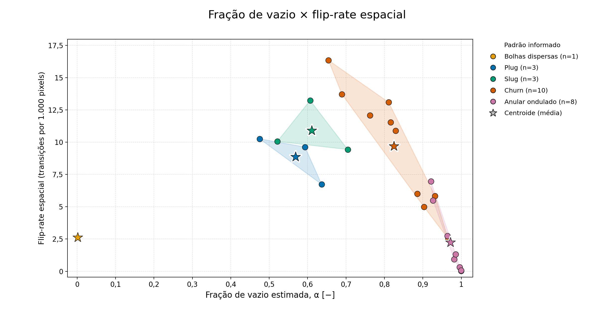
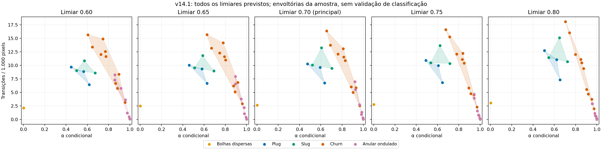
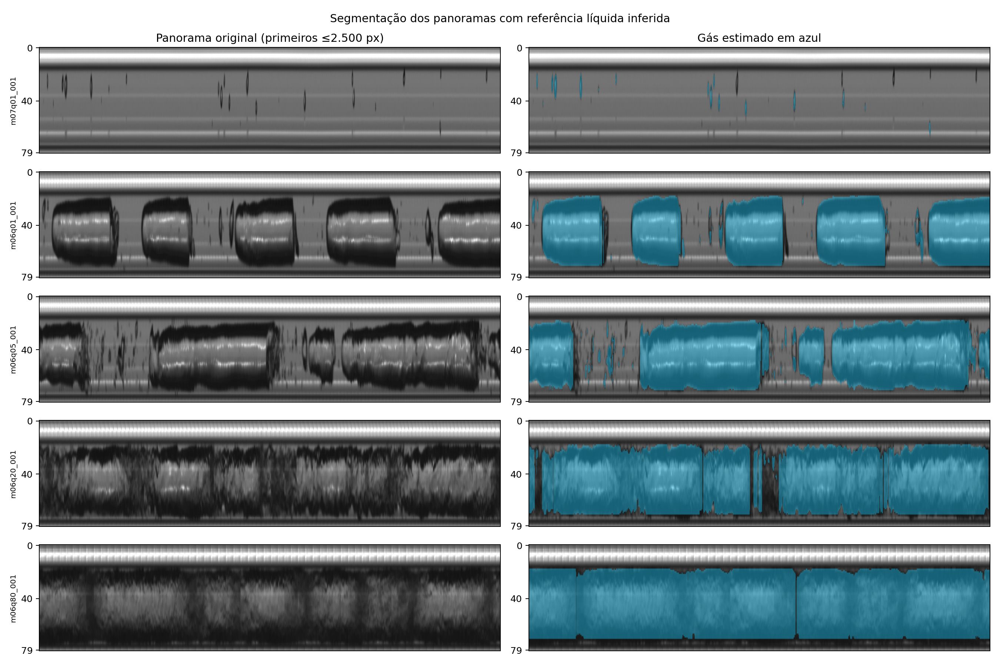
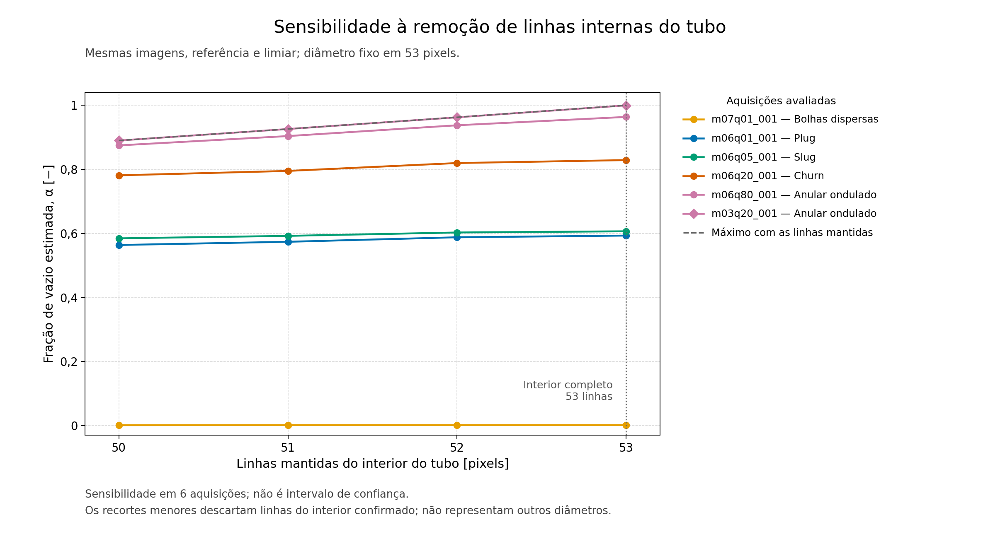

# Resumo executivo — v14.1: fração de vazio e flip-rate

[English version](EXECUTIVE_SUMMARY.md) · [Efeito das correções](fix_effectiveness.md)

**A inversão/duplicação de colunas nas emendas foi removida. A fração volumétrica real não está calibrada.** A análise estima gás visível sob hipótestes ópticas e geométricas. Foram preservados seleção, fórmulas, limiares, modelos e a geometria confirmada pelo usuário: **linhas Python 18:71, D = 53 pixels**.

## As correções foram efetivas?

A montagem antiga podia transformar `[1,2,3,4 | 5,6,7,8]` em `[1,2,3,6,5,6,7,8]`, gerando três transições em vez de uma ao binarizar por intensidade > 5. A v14.1 concatena as mesmas tiras na ordem original, sem essa sobrescrita. Os 26 panoramas antigos foram reproduzidos pixel a pixel como controle; as entradas novas conservam os deslocamentos e as larguras. A referência líquida foi reconstruída com a mesma regra. Os arquivos originais permanecem preservados.

Nas 25 aquisições elegíveis, **máxima mudança absoluta de α: 0,000976**; **mudança relativa de flip-rate: -7,26% a 6,76%**. A correção removeu o defeito de montagem, mas não demonstra maior exatidão física. A tabela [por aquisição](../results/summary/fix_comparison_per_run.csv) também mantém a referência antiga fixa para isolar o efeito direto das colunas.

Nos 12 pares fixos de modelo/validação, a acurácia balanceada aumentou em **1**, diminuiu em **4** e ficou igual em **7**. Não houve ajuste para favorecer o gráfico ou os classificadores. Menor flip-rate não significa automaticamente melhor resultado.

## Fração de vazio × flip-rate espacial

**α [−] é adimensional:** a soma das áreas circulares inferidas de cada intervalo de gás, dividida pela área circular do tubo, seguida da média espacial. Multiplicar por 100 expressa a estimativa em porcentagem. **O eixo Y é 1.000 F**, transições entre pixels vizinhos na direção longitudinal, com média das 53 linhas; **não é uma frequência em Hz**.

O gráfico usa **25 aquisições elegíveis**, em cinco padrões. A aquisição saturada m03q40_001 fica fora do gráfico e das estatísticas, mas permanece na rastreabilidade dos 26 registros selecionados. As regiões coloridas são envoltórias convexas da amostra, não fronteiras de classificação. **Estrelas: médias por padrão, com peso igual por aquisição. Tabela: medianas.**

| Padrão | n | α estimado | Trocas / 1.000 pares de pixels |
|---|---:|---:|---:|
| Bolhas dispersas | 1 | 0,0017 | 2,631 |
| Plug | 3 | 0,5933 | 9,629 |
| Slug | 3 | 0,6067 | 10,067 |
| Churn | 10 | 0,8227 | 11,223 |
| Anular ondulado | 8 | 0,9835 | 1,127 |

Interseções entre as envoltórias observadas: **Churn × Anular ondulado**. Esse resultado refere-se ao limiar principal **0,70**. Bolhas dispersas têm **uma aquisição**, m07q01_001, sem informação sobre a variabilidade da classe. Os dois eixos vêm da mesma máscara; sua associação não valida a fração volumétrica real.

## Dependência do limiar

| Limiar | Interseções na v14.1 |
|---:|---|
| 0,60 | Plug × Slug; Churn × Anular ondulado |
| 0,65 | Plug × Slug; Churn × Anular ondulado |
| 0,70 | Churn × Anular ondulado |
| 0,75 | Plug × Slug; Churn × Anular ondulado |
| 0,80 | Plug × Slug; Churn × Anular ondulado |

A separação entre envoltórias muda com o limiar. Portanto, a separação observada no gráfico principal não é uma conclusão robusta para todos os parâmetros. Foram mantidos 0,70 como principal e os cinco limiares já previstos, sem escolher o mais favorável. As envoltórias descrevem os pontos disponíveis; não constituem teste de classificação nem intervalo de confiança.

## Etapas, métodos e equações

1. **Entrada, seleção e saturação.** Mantivemos os quadros, deslocamentos e tiras centrais; retiramos apenas a sobrescrita defeituosa nas emendas. Usamos os rótulos originais e a [seleção anterior](../results/validation/dataset_selection.json). Mistos, anular liso e m05q05_002 continuam excluídos. A fração de pixels 255 nas linhas 20:60 define S; **S > 0,20** exclui a aquisição das estatísticas. A montagem continua dependendo da hipótese de advecção e dos deslocamentos medidos.
2. **Normalização e referência líquida.** Dividimos cada coluna pelo P75 das linhas 30:50, limitado inferiormente a 1. Nos mesmos três panoramas plug, selecionamos as colunas com variação radial nas linhas 20:68 no percentil 5 ou abaixo; usamos medianas e filtro gaussiano σ = 1 pixel. São trechos interpretados como líquido, sem certificação de fase pura.
3. **Segmentação.** **R = Gσ(I normalizada) / max(L, 0,01)**; **R < 0,70** identifica sombras. Conservamos pares superior/inferior, fechamento 3×3 com borda preservada, componentes sem contato radial com o limite e preenchimento de buracos. Pares desconectados exigem ao menos 20 colunas consecutivas; componentes isolados exigem ao menos 4 pixels. A implementação da segmentação permaneceu a mesma.

4. **Área circular condicional.** Para intervalos separados de largura dᵢⱼ na coluna j: **αⱼ = Σᵢ(dᵢⱼ/D)²**; **ᾱ = (1/W) Σⱼ αⱼ**, D = 53. A máscara preenchendo todo o interior produz α = 1. Uma projeção lateral não determina a forma tridimensional; circularidade, refração e espessura de filmes permanecem limitações.
5. **Flip-rate espacial.** **F = Σᵣ Σⱼ |Bᵣ,ⱼ₊₁ − Bᵣ,ⱼ| / [H(W−1)]**, H = 53, B = máscara binária. O gráfico apresenta 1.000 F. Larguras das tiras, emendas e resolução ainda influenciam F. A [linha fixa y=40](../figures/void_fraction/void_fraction_vs_center_flips.png) é uma comparação, não um centro físico calibrado.
6. **Sensibilidade e controles adversariais.** Repetimos todos os limiares, referências e recortes anteriores. Controles independentes verificaram a ordem das colunas, máscaras, áreas, denominadores e resultados escritos. Não alteramos D para compensar os efeitos da entrada. Para h linhas internas mantidas, o teto matemático permanece (h/53)²; em m06q80_001, os recortes produzem α de 0,8748 a 0,9637. Isso não é intervalo de confiança.

7. **Classificação e verificação.** Mantivemos modelos, validação por aquisição/grupo de fluxo mássico e referências ajustadas somente no treino. Reconstruímos matrizes de confusão, médias, medianas e coordenadas. A classe de bolhas não possui exemplo no treino quando sua única aquisição é retirada; esse teste continua nos escores. O detector foi desenvolvido nestes dados, portanto a validação é interna. A [literatura](source_audit.md) orienta os métodos, sem fornecer calibração volumétrica destas imagens.

[Auditoria adversarial da correção](seam_adversarial_review.md) · [Verificação após a regeneração](post_regeneration_adversarial_review.md) · [Resultados estruturados](../results/summary/fix_effectiveness.json)
