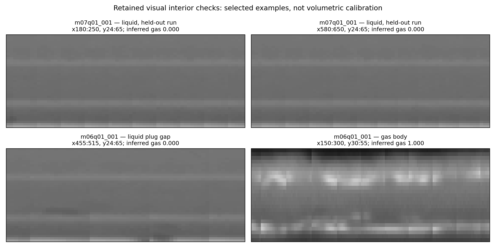
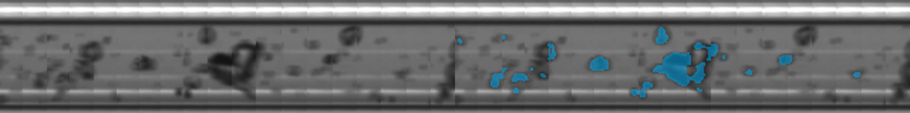

# Adversarial phase, reference and crop review

Current scope: 26 acquisitions in the five approved single patterns. Only retained acquisitions contribute to the checks below. The [selection manifest](../results/validation/dataset_selection.json) documents exclusions.

Current segmentation source SHA-256: 68e7d0b7ea4f37a6a4ea474f68e440510a2887ef960a258dd52aa92faa6658f2.

## Selected visual interior checks

These existing gas/liquid interpretations come from the previous visual review; excluded-run patches are removed. Their current mask fractions are recomputed below.

| Run | x interval | y interval | Visual interpretation | Gas-map fraction |
|---|---|---|---|---:|
| m07q01_001 | [180, 250] | [24, 65] | liquid, held-out run | 0.000000 |
| m07q01_001 | [580, 650] | [24, 65] | liquid, held-out run | 0.000000 |
| m06q01_001 | [455, 515] | [24, 65] | liquid plug gap | 0.000000 |
| m06q01_001 | [150, 300] | [30, 55] | gas body | 1.000000 |

**Limit:** selected clear patches are not an unbiased boundary-validation set. The retained gas-positive patch is from a plug reference panorama. Detector design used these data; all visual checks are internal development checks.

## Liquid-reference alternatives

Automatic reference construction still uses the same three retained plug panoramas. Manual alternatives now use only retained liquid patches.

| Run | Conditional alpha range across retained references |
|---|---:|
| m07q01_001 | 0.001716–0.001742 |
| m06q01_001 | 0.593264–0.599404 |
| m06q05_001 | 0.606656–0.613919 |
| m06q20_001 | 0.828865–0.836535 |
| m06q80_001 | 0.963695–0.967582 |
| m03q20_001 | 0.999769–0.999804 |

## Removal of known-interior rows

The user confirmed rows 18:71 as the complete tube interior: 53 rows and D=53 px. Boundary source: User-confirmed full tube interior on 2026-10-23: Python slice 18:71, rows 18 through 70, 53 pixel cells. Optical profile minima are not used as lumen boundaries. Refraction mapping remains uncalibrated. Every variant below uses that same diameter; smaller slices discard known-interior rows. Segmentation is rerun for each slice, so changes also include contour decisions near the artificial crop edge.

| Run | Rows 20:70 | Rows 19:70 | Rows 19:71 | Rows 18:71 — full lumen |
|---|---:|---:|---:|---:|
| m07q01_001 | 0.001313 | 0.001716 | 0.001716 | 0.001716 |
| m06q01_001 | 0.563811 | 0.573867 | 0.587937 | 0.593264 |
| m06q05_001 | 0.584602 | 0.592331 | 0.602878 | 0.606656 |
| m06q20_001 | 0.781331 | 0.795093 | 0.819682 | 0.828865 |
| m06q80_001 | 0.874778 | 0.903917 | 0.937610 | 0.963695 |
| m03q20_001 | 0.889987 | 0.925943 | 0.962419 | 0.999769 |

**Interpretation:** these variants test removal of rows from the confirmed lumen, not alternative physical diameters. Their analytic maximum is (included rows/53)²; the full-lumen maximum is 1. No outside-lumen expansion contributes to these ranges. Reflections outside the confirmed lumen are not additional gas area.

**Limit:** user-confirmed boundaries do not independently calibrate phase segmentation, refraction or circular reconstruction. A full gas mask does not prove a physically all-gas cross-section. These perturbation ranges are not confidence intervals.

Reference-profile minima near y=15 and y=75 are optical extrema, not the confirmed lumen boundaries. The fixed probe remains y=40; the midpoint of the included row centers is y=44. The probe is not called the physical center.

## Corrected false-bridge case

The liquid slug in m06q05_001, x300:560, has 0 accepted paired fills between different closed-outline components. The original false bridge and its correction remain documented in the [historical review](../intermediate/history/v14_baseline/intermediate/history/pre_scope_exclusions/findings/adversarial_review.md).

The connection/interval rule can still miss fragmented true gas outlines or retain a long false bridge. Both void and flip-rate come from the same inferred map; their agreement is not independent physical validation.

Use the [current machine checks](../results/validation/adversarial_checks.json), [final arithmetic verification](../results/validation/final_verification.json) and [post-regeneration adversarial review](post_regeneration_adversarial_review.md). The previous wider-scope evidence is historical, not a current result.
