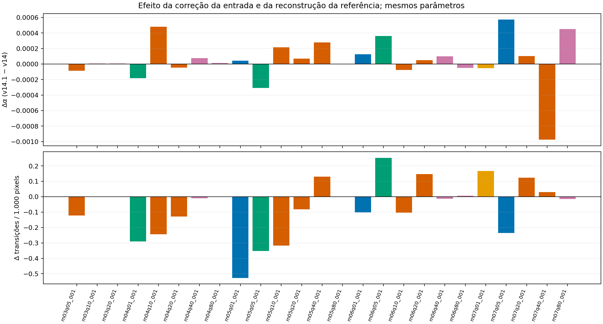
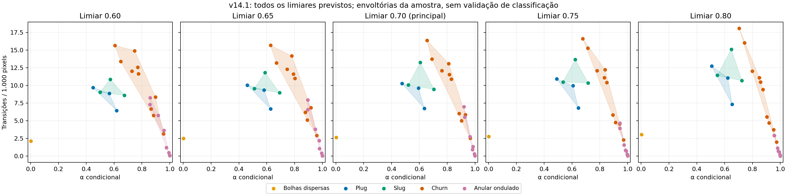

# Efeito da correção das emendas na v14.1

A v14.1 preservou as tiras e os deslocamentos da v14 e retirou a sobrescrita de colunas nas emendas. A referência líquida foi reconstruída com a mesma regra. O controle com a referência antiga fixa isolou a alteração da entrada.

Nas 25 aquisições elegíveis, a maior mudança absoluta de α foi 0.000976; a mudança relativa de flip-rate variou de -7.26% a 6.76%.

A correção foi efetiva para remover a inversão/duplicação local de colunas. A exatidão física da máscara e do volume de gás continua sem calibração. O valor maior ou menor de flip-rate não é, por si só, um critério de melhora.

| Padrão | n | α v14 | α v14.1 | F×1000 v14 | F×1000 v14.1 |
|---|---:|---:|---:|---:|---:|
| dispersed bubbles | 1 | 0.001768 | 0.001716 | 2.4641 | 2.6308 |
| plug | 3 | 0.593138 | 0.593264 | 9.7304 | 9.6288 |
| slug | 3 | 0.606295 | 0.606656 | 10.4188 | 10.0667 |
| churn | 10 | 0.822621 | 0.822682 | 11.1901 | 11.2225 |
| wavy annular | 8 | 0.983426 | 0.983465 | 1.1329 | 1.1267 |

Valores por padrão são medianas, com peso igual por aquisição.

## Dependência do limiar

As envoltórias observadas foram recalculadas em todos os limiares já previstos. Elas não são fronteiras de classificação.

| Versão | Limiar | Interseções |
|---|---:|---|
| v14 | 0.60 | [["plug", "slug"], ["churn", "wavy annular"]] |
| v14 | 0.65 | [["plug", "slug"], ["churn", "wavy annular"]] |
| v14 | 0.70 | [["churn", "wavy annular"]] |
| v14 | 0.75 | [["churn", "wavy annular"]] |
| v14 | 0.80 | [["plug", "slug"]] |
| v14.1 | 0.60 | [["plug", "slug"], ["churn", "wavy annular"]] |
| v14.1 | 0.65 | [["plug", "slug"], ["churn", "wavy annular"]] |
| v14.1 | 0.70 | [["churn", "wavy annular"]] |
| v14.1 | 0.75 | [["plug", "slug"], ["churn", "wavy annular"]] |
| v14.1 | 0.80 | [["plug", "slug"], ["churn", "wavy annular"]] |

Nos 12 pares fixos de modelo/validação, a acurácia balanceada aumentou em 1, diminuiu em 4 e ficou igual em 7. Todos os modelos e variantes constam na tabela; não houve seleção do resultado mais favorável. A classe de bolhas dispersas continua com uma aquisição e sem exemplo de treino quando ela é retirada.

[Resultados estruturados](../results/summary/fix_effectiveness.json) · [Por aquisição](../results/summary/fix_comparison_per_run.csv) · [Classificadores](../results/summary/classifier_comparison.csv) · [Interseções](../results/summary/threshold_hull_intersections.csv)
