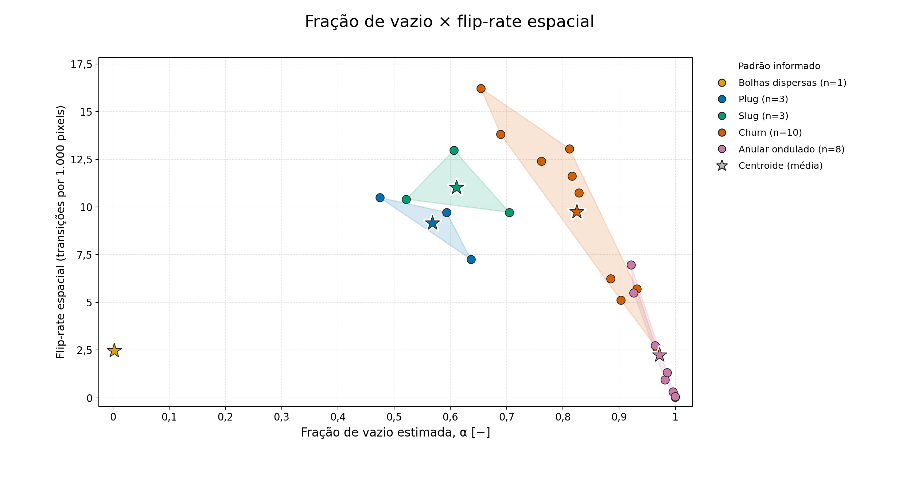
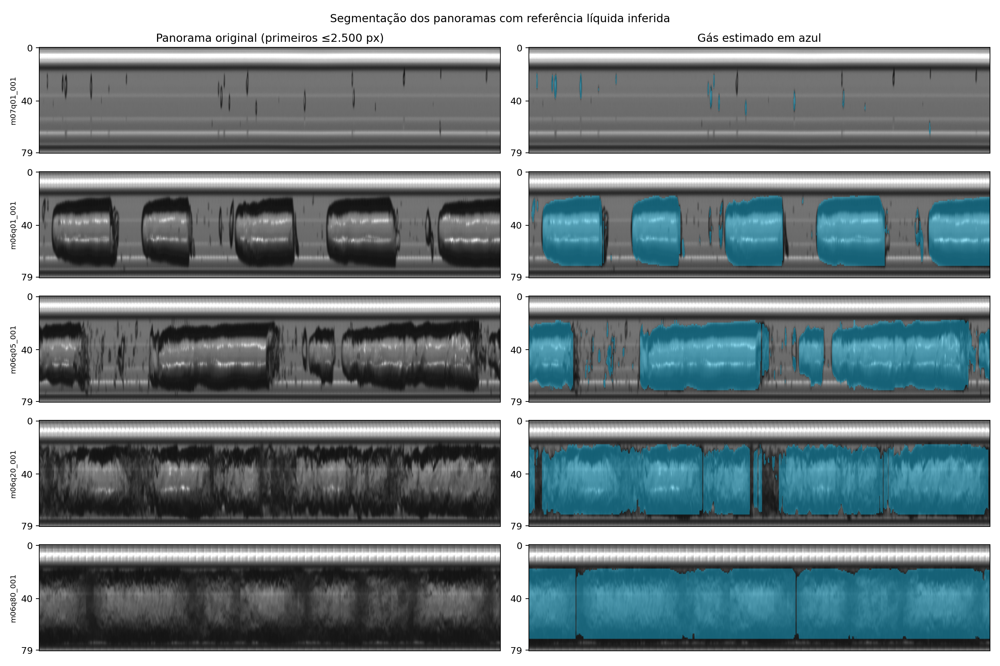
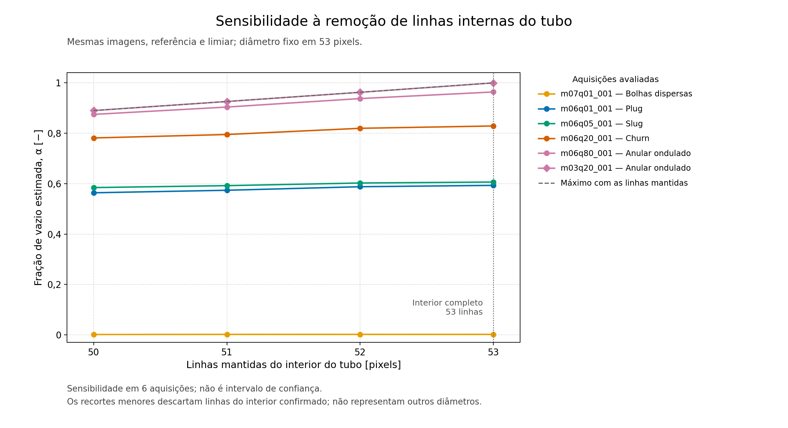

# Executive summary — void fraction and flip-rate

[Versão em português](EXECUTIVE_SUMMARY_PT_BR.md)

**The panoramas support estimates of visible gas and spatial phase alternation. Absolute gas-volume fractions remain uncalibrated.** Values depend on segmentation and assumed circular cross-sections.

**Scale correction:** the user confirmed that the complete tube interior occupies Python rows **18:71**, or 53 pixels. D = 60 was inconsistent with that boundary. We now use **D = 53**, and **α₅₃ = α₆₀ × (60/53)²** for the same mask. This correction leaves the masks and flip-rate unchanged.

## Void fraction × spatial flip-rate

**What does α [−] mean?** α is the void estimate reconstructed from visible gas widths under circular geometry. **[−] means dimensionless**, with no unit; multiplying α by 100 expresses the estimate as a percentage. Optical and geometric uncertainty still applies.

**Y-axis:** transitions per 1,000 pixels along the panorama, averaged over 53 rows. Compare each pixel with the next column in the same row; W columns provide W−1 one-pixel intervals. Scaling the count per 1,000 adjacent pixel pairs therefore gives the stated spatial rate, not per second.

The plot and table use **25 acquisitions passing the saturation criterion** in five patterns. Saturated m03q40_001 is omitted from the plot and statistics but retained in the provenance of the 26 selected records. Shaded areas are observed convex hulls, not classification boundaries. **Stars mark each pattern centroid: mean α and mean flip-rate, with equal weight per acquisition.** The table below reports medians. The dispersed-bubble star coincides with its sole acquisition.

| Pattern | n | Estimated α | Changes / 1,000 pixel pairs |
|---|---:|---:|---:|
| dispersed bubbles | 1 | 0.0018 | 2.464 |
| plug | 3 | 0.5931 | 9.730 |
| slug | 3 | 0.6063 | 10.419 |
| churn | 10 | 0.8226 | 11.190 |
| wavy annular | 8 | 0.9834 | 1.133 |

Values are group medians. Only m07q01_001 represents dispersed bubbles; one acquisition cannot establish within-pattern variability. Observed hull intersections: **churn × wavy annular**. Apparent separation of other groups in this sample does not validate boundaries for new acquisitions. Both axes use the same mask, so their joint behavior does not validate true void fraction.

## Steps, methods and equations

1. **Selection and saturation control.** Original labels and the [selection policy](../results/validation/dataset_selection.json) exclude mixed classifications, smooth annular and m05q05_002. Method: fraction S of intensity-255 pixels in rows 20:60; **S > 0.20** excludes an acquisition from statistics. **Limit:** S ≤ 0.20 still allows some saturated pixels. This is an inherited quality rule, not a calibration.

2. **Percentile normalization and robust liquid reference.** In three visually selected plug panoramas, choose columns at or below the 5th percentile of radial standard deviation. Pipeline: **intensity / P75 in rows 30:50 → select by variation in rows 20:68 → medians → Gaussian filter (σ = 1 pixel)**. The divisor is floored at 1. **Limit:** liquid-looking gaps are not certified liquid-only references.

3. **Shadow segmentation and binary morphology.** Compute **R = Gσ(normalized image) / max(L, 0.01)**, with reference profile L. Pipeline: **R < 0.70 → paired upper/lower shadows → fill between them**, plus **3×3 closing → components without radial lumen-edge contact → hole filling**. Disconnected pairs require at least 20 consecutive accepted columns; small components require at least 4 pixels. **Correction:** closing preserves border pixels before testing contact. **Limit:** image-based phase identification requires validation.

4. **Circular reconstruction and spatial averaging.** Each separate gas interval in column j has width dᵢⱼ. Equations: **αⱼ = Σᵢ(dᵢⱼ/D)²** and **ᾱ = (1/W) Σⱼ αⱼ**, with D = 53 pixels and panorama width W. This divides circular areas πd²/4 by πD²/4. A mask filling the complete lumen gives **α = 1**. **Limit:** a filled mask does not prove that no liquid is present; geometry remains an assumption.

5. **Binary spatial transition density — flip-rate.** B = 1 denotes inferred gas and B = 0 unmarked pixels. Equation: **F = Σᵣ Σⱼ |Bᵣ,ⱼ₊₁ − Bᵣ,ⱼ| / [H(W−1)]**, H = 53. The chart uses **1,000 F**. A complete isolated gas segment normally contributes two changes. **Limit:** seams, pixel spacing and crop affect this measure. The [fixed-row y=40 comparison](../figures/void_fraction/void_fraction_vs_center_flips.png) is not a validated physical tube center.

6. **Sensitivity analysis and adversarial controls.** Vary thresholds from 0.60 to 0.80, leave one reference out, and perturb internal crops and interval rules. Synthetic controls test borders, areas and counts. The earlier morphology correction changed 24 masks; the largest absolute α change was 0.005417, **historically calculated with D = 60**. This change is separate from the current correction to D = 53. **Limit:** these are internal checks on data used to develop the detector.

**Reading the crop test:** retain 50, 51, 52 or 53 rows of the interior, always with **D = 53**. For h retained rows, the mathematical maximum is **(h/53)²**; the full lumen permits **α = 1**. These crops produce α from 0.8748 to 0.9637 for m06q80_001. **Limit:** smaller crops discard known-interior rows; they are not alternative diameters or a confidence interval. Regions outside the confirmed lumen are excluded from the calculation.

7. **Independent arithmetic verification and literature comparison.** Recompute areas from interval starts/ends, flip counts, denominators, medians and chart coordinates. Local sources: Schepperle et al. (2024), §2.3, for segmentation and liquid references; de Oliveira et al. (2021) and Dias et al. (2025), to distinguish their correlation estimates from these optical estimates. **Limit:** reproducible arithmetic and source methods do not validate the true gas volume of these records.

## Scientific limitations for the discussion

- **Gas identification:** the camera records light and shadows. Filling contours may count reflections or liquid as gas. Correct arithmetic does not prove that each pixel received the correct phase label.
- **Binary mask and resolution:** grayscale helps detect contours, but the output is **1 = inferred gas; 0 = unmarked as gas**. We do not estimate partial occupancy within each pixel or assign a probability to its classification. Liquid films and bubbles below image resolution may remain unresolved, affecting α and flip-rate. **We have no calibration converting grayscale intensity into a gas/liquid proportion.**
- **Area reconstruction:** for one circular interval, **α = (d/D)²**; for several, sum the estimated areas. A circular tube does not ensure circular gas, especially in churn. It is like looking at an object from the side: visible width does not necessarily reveal depth. The curved wall and fluids also refract light and may shift apparent edges.
- **Crop history, now corrected:** using 53 rows with D = 60 imposed **(53/60)² ≈ 0.7803**. The [old m06q80_001 experiment](../intermediate/history/before_confirmed_lumen_D53/results/validation/adversarial_checks.json) used 50/53/57/60-row crops, all with D = 60, and produced **0.6826–0.8575**. Its wider crops extended beyond the now-confirmed lumen, **18:71, D = 53**. This old range is not current uncertainty or evidence of gas missing outside the tube. The chart above tests only removal of interior rows. The [normalization audit](lumen_normalization_review.md) separates the two versions.

**Results are reproducible under these assumptions; their correspondence with true gas volume still needs validation.**

## Findings and next steps

Wavy annular images tend to show broad gas regions and few mask changes. Automatic separation of all patterns still lacks external validation.

- Annotate representative outlines across all patterns and measure mask errors.
- Calibrate the relation between silhouettes and true volume, including refraction and noncircular shapes, before claiming absolute gas-volume fractions.

Details: [method review](deep_method_review.md), [thesis discussion graphics](GRAFICOS_PARA_DISCUSSAO_PT_BR.md), [per-run void](../results/void_fraction/panorama_void_per_run.csv), [flip counts](../results/flip_rate/phase_mask_flip_per_run.csv), [literature](source_audit.md), [post-summary audit](post_regeneration_adversarial_review.md).
