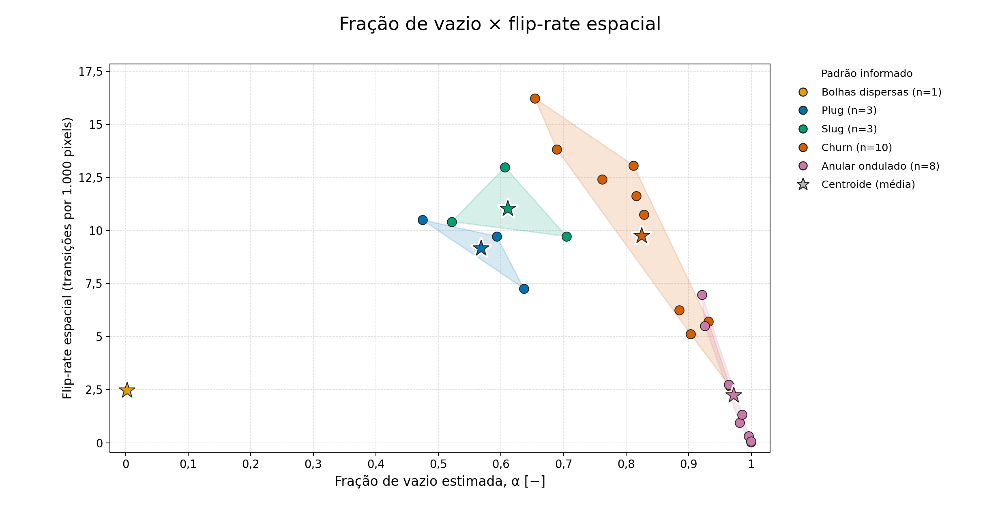
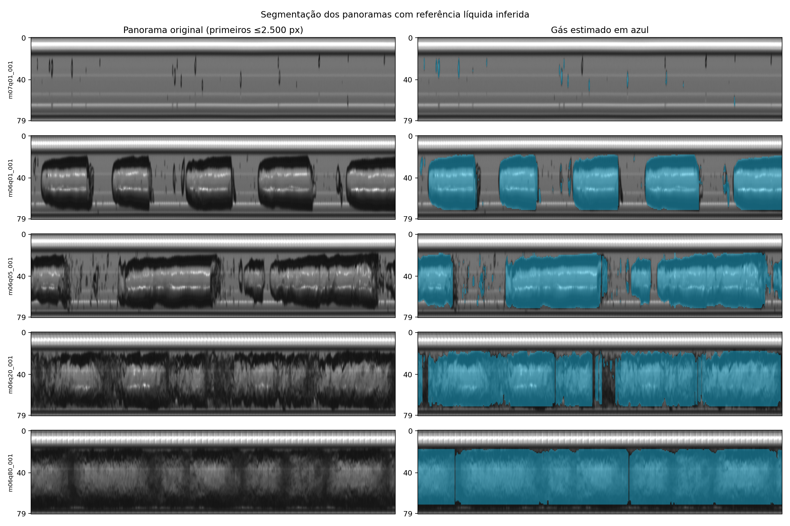
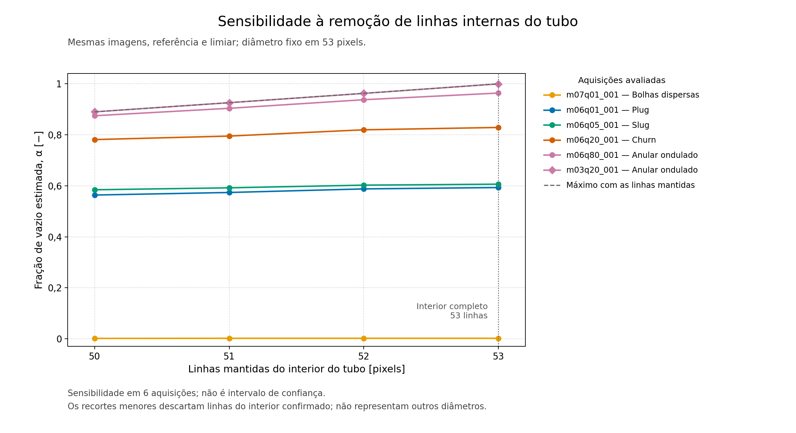

# Resumo executivo — fração de vazio e flip-rate

[English version](EXECUTIVE_SUMMARY.md)

**Os panoramas permitem estimar o gás visível e contar alternâncias espaciais. A fração volumétrica real ainda não está calibrada.** Os valores dependem da segmentação e da hipótese de seções circulares.

**Correção da escala:** o usuário confirmou que o interior completo ocupa as linhas Python **18:71**, ou seja, 53 pixels. Usar D = 60 era incompatível com esse limite. Agora **D = 53**, e **α₅₃ = α₆₀ × (60/53)²** para a mesma máscara. As máscaras e o flip-rate não mudam com essa correção.

## Fração de vazio × flip-rate espacial

**O que significa α [−]?** α é a fração de vazio estimada a partir das larguras de gás visíveis, assumindo geometria circular. **[−] significa adimensional**, sem unidade; multiplicar α por 100 expressa a estimativa em porcentagem. Isso não elimina as incertezas ópticas e geométricas.

**Eixo Y:** transições por 1.000 pixels na direção longitudinal do panorama, com média das 53 linhas. Cada pixel é comparado com o da coluna seguinte; W colunas fornecem W−1 intervalos de um pixel. Assim, a normalização por 1.000 pares de pixels vizinhos equivale à escala indicada no eixo. Não é uma frequência em Hz.

O gráfico e a tabela usam **25 aquisições elegíveis pelo critério de saturação**, em cinco padrões. A aquisição saturada m03q40_001 foi retirada do gráfico e das estatísticas; permanece na rastreabilidade dos 26 registros selecionados. As áreas coloridas são envoltórias da dispersão observada, não fronteiras de classificação. **As estrelas indicam o centroide de cada padrão: média de α e do flip-rate, com peso igual por aquisição.** A tabela abaixo apresenta medianas. Para bolhas dispersas, a estrela coincide com a única aquisição.

| Padrão | n | α estimado | Trocas / 1.000 pares de pixels |
|---|---:|---:|---:|
| Bolhas dispersas | 1 | 0,0018 | 2,464 |
| Plug | 3 | 0,5931 | 9,730 |
| Slug | 3 | 0,6063 | 10,419 |
| Churn | 10 | 0,8226 | 11,190 |
| Anular ondulado | 8 | 0,9834 | 1,133 |

Valores: medianas por padrão. A classe de bolhas dispersas contém somente m07q01_001; uma aquisição não representa a variabilidade da classe. Interseções entre as envoltórias observadas: **Churn × Anular ondulado**. A separação aparente de outros grupos nesta amostra não valida fronteiras para novas aquisições. Os dois eixos vêm da mesma máscara, portanto seu comportamento conjunto não valida a fração de vazio real.

## Etapas, métodos e equações

1. **Seleção e controle de saturação.** Usamos os rótulos originais e a [política de seleção](../results/validation/dataset_selection.json). Classificações mistas, anular liso e m05q05_002 ficam excluídos. Método: fração S de pixels com intensidade 255 nas linhas 20:60; registros com **S > 0,20** não entram nas estatísticas. **Limite:** S ≤ 0,20 ainda permite alguns pixels saturados. É uma regra de qualidade herdada, não uma calibração.

2. **Normalização por percentil e referência robusta de líquido.** Em três panoramas plug escolhidos visualmente, selecionamos colunas com desvio-padrão radial no percentil 5 ou abaixo. Pipeline: **intensidade / P75 das linhas 30:50 → seleção pela variação nas linhas 20:68 → medianas → filtro gaussiano (σ = 1 pixel)**. O divisor é limitado inferiormente a 1. **Limite:** os trechos parecem líquidos, mas não são uma referência certificada de líquido puro.

3. **Segmentação por sombras e morfologia binária.** Calculamos **R = Gσ(I normalizada) / max(L, 0,01)**, com perfil de referência L. Pipeline: **R < 0,70 → pares de sombras superior/inferior → preenchimento entre elas**, somado a **fechamento 3×3 → componentes sem contato radial com o limite interno → preenchimento de buracos**. Pares desconectados exigem pelo menos 20 colunas consecutivas aceitas; componentes pequenos exigem ao menos 4 pixels. **Correção:** o fechamento preserva os pixels das bordas antes de testar o contato. **Limite:** identificar fase pela imagem exige validação.

4. **Reconstrução circular e média espacial.** Cada intervalo de gás separado na coluna j tem largura dᵢⱼ. Equações: **αⱼ = Σᵢ(dᵢⱼ/D)²** e **ᾱ = (1/W) Σⱼ αⱼ**, com D = 53 pixels e W = número de colunas. É a razão entre áreas circulares πd²/4 e πD²/4. Uma máscara que preenche todo o interior produz **α = 1**. **Limite:** preencher a máscara não comprova ausência de líquido; a geometria continua sendo uma hipótese.

5. **Densidade espacial de transições binárias — flip-rate.** B = 1 indica gás estimado; B = 0 indica região não marcada. Equação: **F = Σᵣ Σⱼ |Bᵣ,ⱼ₊₁ − Bᵣ,ⱼ| / [H(W−1)]**, H = 53. O gráfico usa **1.000 F**. Um segmento de gás isolado e completo normalmente gera duas trocas. **Limite:** emendas, espaçamento em pixels e recorte afetam o resultado. A [comparação na linha fixa y=40](../figures/void_fraction/void_fraction_vs_center_flips.png) não representa um centro físico validado.

6. **Sensibilidade e controles adversariais.** Variamos limiares de 0,60 a 0,80, retiramos uma referência por vez e variamos recortes internos e regras de intervalos. Controles sintéticos verificam bordas, áreas e contagens. A correção anterior da morfologia alterou 24 máscaras; a maior mudança absoluta de α foi 0,005417, **calculada historicamente com D = 60**. Essa mudança é separada da correção atual para D = 53. **Limite:** são testes internos; o detector foi desenvolvido com estes mesmos dados.

**Leitura do teste de recorte:** mantemos 50, 51, 52 ou 53 linhas do interior, sempre com **D = 53**. Para h linhas mantidas, o máximo matemático é **(h/53)²**; o interior completo permite **α = 1**. Em m06q80_001, esses recortes produzem α entre 0,8748 e 0,9637. **Limite:** os recortes menores removem linhas conhecidas do interior; não representam outros diâmetros nem um intervalo de confiança. Regiões externas ao interior confirmado não entram no cálculo.

7. **Verificação independente da aritmética e confronto com a literatura.** Recalculamos áreas pelo início/fim dos intervalos, trocas, denominadores, medianas e coordenadas dos gráficos. Fontes locais: Schepperle et al. (2024), §2.3, para segmentação e referência líquida; de Oliveira et al. (2021) e Dias et al. (2025), para distinguir suas estimativas por correlações das nossas estimativas ópticas. **Limite:** reproduzir contas e citar métodos não comprova o volume real de gás destes registros.

## Limitações científicas para a discussão

- **Identificação do gás:** a câmera registra luz e sombras. Preencher contornos pode contar reflexos ou líquido como gás. A conta correta não comprova que cada pixel recebeu a fase correta.
- **Máscara binária e resolução:** os tons de cinza ajudam a detectar contornos, mas a saída é **1 = gás estimado; 0 = não marcado como gás**. Não estimamos ocupação parcial de cada pixel nem atribuímos uma probabilidade à sua classificação. Filmes líquidos e bolhas abaixo da resolução podem não ser resolvidos, afetando α e o flip-rate. **Não temos calibração que converta intensidade de cinza em proporção de gás/líquido.**
- **Reconstrução da área:** para um intervalo circular, **α = (d/D)²**; para vários, somam-se as áreas estimadas. Um tubo circular não garante gás circular, sobretudo em churn. É como olhar um objeto de lado: a largura visível não revela necessariamente a profundidade. A parede curva e os fluidos também desviam a luz por refração e podem deslocar as bordas aparentes.
- **Histórico do recorte, já corrigido:** usar 53 linhas com D = 60 impunha **(53/60)² ≈ 0,7803**. No [experimento antigo de m06q80_001](../intermediate/history/before_confirmed_lumen_D53/results/validation/adversarial_checks.json), recortes de 50/53/57/60 linhas, todos com D = 60, produziram **0,6826–0,8575**. Os recortes mais largos ultrapassavam o interior agora confirmado, **18:71, D = 53**. Essa faixa antiga não representa a incerteza atual nem indica gás ausente fora do tubo. O gráfico acima testa somente remoção de linhas internas. A [auditoria da normalização](lumen_normalization_review.md) separa as duas versões.

**Os resultados são reproduzíveis sob essas hipóteses; sua correspondência com o volume real de gás ainda precisa de validação.**

## Conclusões e próximos passos

O anular ondulado tende a apresentar uma região de gás ampla e poucas trocas na máscara. A separação automática de todos os padrões continua sem validação externa.

- Anotar contornos em trechos representativos de todos os padrões e medir erros da máscara.
- Calibrar a relação entre a silhueta e o volume real, considerando refração e formas não circulares, antes de afirmar frações volumétricas absolutas.

Detalhes: [revisão dos métodos](deep_method_review.md), [gráficos para a discussão do TCC](GRAFICOS_PARA_DISCUSSAO_PT_BR.md), [valores por aquisição](../results/void_fraction/panorama_void_per_run.csv), [contagens de flip-rate](../results/flip_rate/phase_mask_flip_per_run.csv), [fontes](source_audit.md), [auditoria após o resumo](post_regeneration_adversarial_review.md).
