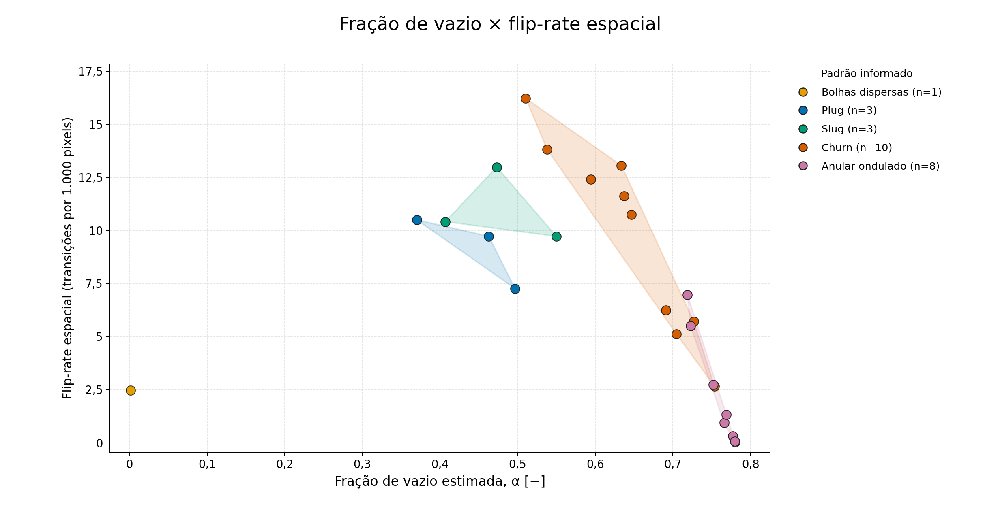
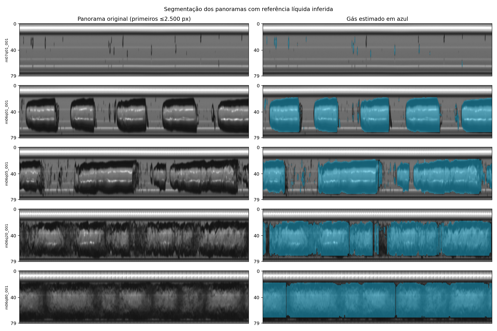
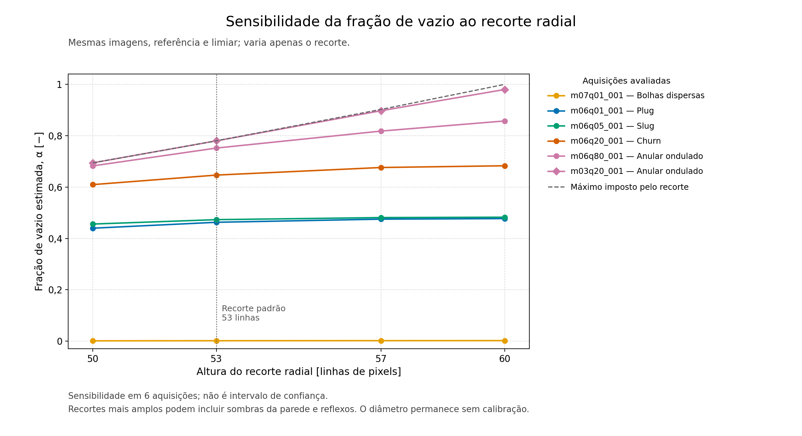

# Executive summary — void fraction and flip-rate

[Versão em português](EXECUTIVE_SUMMARY_PT_BR.md)

**The panoramas support estimates of visible gas and spatial phase alternation. Absolute gas-volume fractions remain uncalibrated.** Values depend on segmentation and assumed circular cross-sections.

## Void fraction × spatial flip-rate

**What does α [−] mean?** α is the void estimate reconstructed from visible gas widths under circular geometry. **[−] means dimensionless**, with no unit; multiplying α by 100 expresses the estimate as a percentage. Optical and geometric uncertainty still applies.

**Y-axis:** transitions per 1,000 pixels along the panorama, averaged over 53 rows. Compare each pixel with the next column in the same row; W columns provide W−1 one-pixel intervals. Scaling the count per 1,000 adjacent pixel pairs therefore gives the stated spatial rate, not per second.

The plot and table use **25 acquisitions passing the saturation criterion** in five patterns. Saturated m03q40_001 is omitted from the plot and statistics but retained in the provenance of the 26 selected records. Shaded areas are observed convex hulls, not classification boundaries.

| Pattern | n | Estimated α | Changes / 1,000 pixel pairs |
|---|---:|---:|---:|
| dispersed bubbles | 1 | 0.0014 | 2.464 |
| plug | 3 | 0.4628 | 9.730 |
| slug | 3 | 0.4731 | 10.419 |
| churn | 10 | 0.6419 | 11.190 |
| wavy annular | 8 | 0.7673 | 1.133 |

Values are group medians. Only m07q01_001 represents dispersed bubbles; one acquisition cannot establish within-pattern variability. Observed hull intersections: **churn × wavy annular**. Apparent separation of other groups in this sample does not validate boundaries for new acquisitions. Both axes use the same mask, so their joint behavior does not validate true void fraction.

## Steps, methods and equations

1. **Selection and saturation control.** Original labels and the [selection policy](../results/validation/dataset_selection.json) exclude mixed classifications, smooth annular and m05q05_002. Method: fraction S of intensity-255 pixels in rows 20:60; **S > 0.20** excludes an acquisition from statistics. **Limit:** S ≤ 0.20 still allows some saturated pixels. This is an inherited quality rule, not a calibration.

2. **Percentile normalization and robust liquid reference.** In three visually selected plug panoramas, choose columns at or below the 5th percentile of radial standard deviation. Pipeline: **intensity / P75 in rows 30:50 → select by variation in rows 20:68 → medians → Gaussian filter (σ = 1 pixel)**. The divisor is floored at 1. **Limit:** liquid-looking gaps are not certified liquid-only references.

3. **Shadow segmentation and binary morphology.** Compute **R = Gσ(normalized image) / max(L, 0.01)**, with reference profile L. Pipeline: **R < 0.70 → paired upper/lower shadows → fill between them**, plus **3×3 closing → components without radial crop contact → hole filling**. Disconnected pairs require at least 20 pixels of accepted interval; small components require at least 4 pixels. **Correction:** closing now preserves border pixels before testing crop contact. **Limit:** shadows are not proven gas outlines; noise and liquid inside envelopes can be mislabeled.

4. **Circular reconstruction and spatial averaging.** Each separate gas interval in column j has width dᵢⱼ. Equations: **αⱼ = Σᵢ(dᵢⱼ/D)²** and **ᾱ = (1/W) Σⱼ αⱼ**, with apparent D = 60 pixels and panorama width W. This divides circular areas πd²/4 by πD²/4. **Limit:** tube edges are unvalidated; refraction, noncircular shapes and depth overlap remain unresolved.

5. **Binary spatial transition density — flip-rate.** B = 1 denotes inferred gas and B = 0 unmarked pixels. Equation: **F = Σᵣ Σⱼ |Bᵣ,ⱼ₊₁ − Bᵣ,ⱼ| / [H(W−1)]**, H = 53. The chart uses **1,000 F**. A complete isolated gas segment normally contributes two changes. **Limit:** seams, pixel spacing and crop affect this measure. The [fixed-row y=40 comparison](../figures/void_fraction/void_fraction_vs_center_flips.png) is not a validated physical tube center.

6. **Sensitivity analysis and adversarial controls.** Vary thresholds from 0.60 to 0.80, leave one reference out, and perturb crop, apparent diameter and interval rules. Synthetic controls test borders, areas and counts. Border correction changed 24 masks; the largest absolute α change was 0.005417. **Limit:** these are internal checks on data used to develop the detector.

**Why is there a ceiling of 0.7803?** The main mask occupies only 53 rows. With D = 60, the formula imposes **α ≤ (53/60)² ≈ 0.7803**. Even separate intervals cannot have total width above 53. **This is a processing ceiling, not a flow limit.** For m06q80_001, changing only the crop produces α from 0.6826 to 0.8575. This is sensitivity, not a confidence interval. Wider crops can include wall reflections.

7. **Independent arithmetic verification and literature comparison.** Recompute areas from interval starts/ends, flip counts, denominators, medians and chart coordinates. Local sources: Schepperle et al. (2024), §2.3, for segmentation and liquid references; de Oliveira et al. (2021) and Dias et al. (2025), to distinguish their correlation estimates from these optical estimates. **Limit:** reproducible arithmetic and source methods do not validate the true gas volume of these records.

## Findings and next steps

Wavy annular images tend to show broad gas regions and few mask changes. Clustering near the crop ceiling cannot establish precision. Automatic separation of all patterns still lacks external validation.

- Annotate representative outlines across all patterns and measure mask errors.
- Validate internal tube boundaries and optical distortion before claiming absolute gas-volume fractions.

The tabulated extension interval describes only a scenario for already-detected gas touching crop edges. It requires no wholly unseen gas outside the crop; it is not a general physical bound.

Details: [method review](deep_method_review.md), [thesis discussion graphics](GRAFICOS_PARA_DISCUSSAO_PT_BR.md), [per-run void](../results/void_fraction/panorama_void_per_run.csv), [flip counts](../results/flip_rate/phase_mask_flip_per_run.csv), [literature](source_audit.md), [post-summary audit](post_regeneration_adversarial_review.md).
