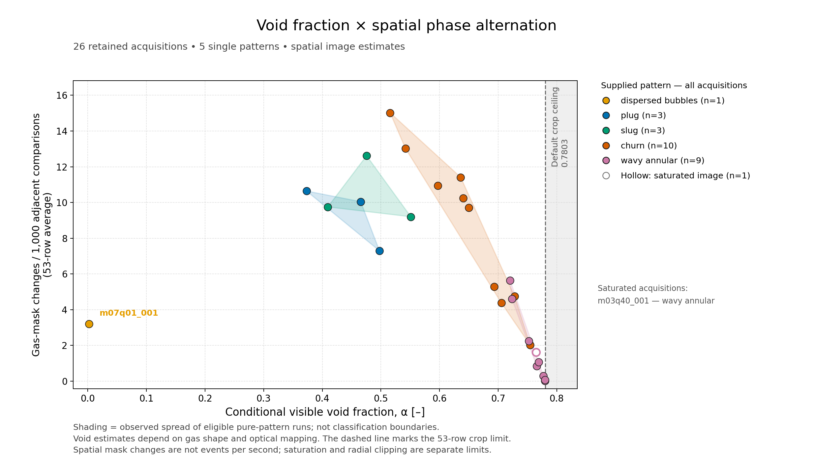
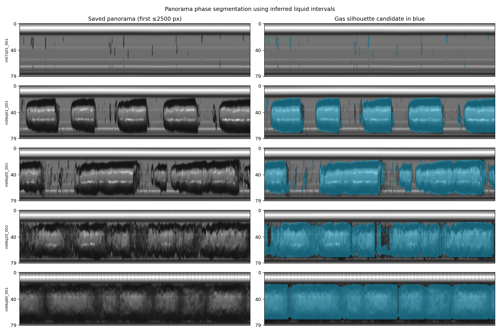
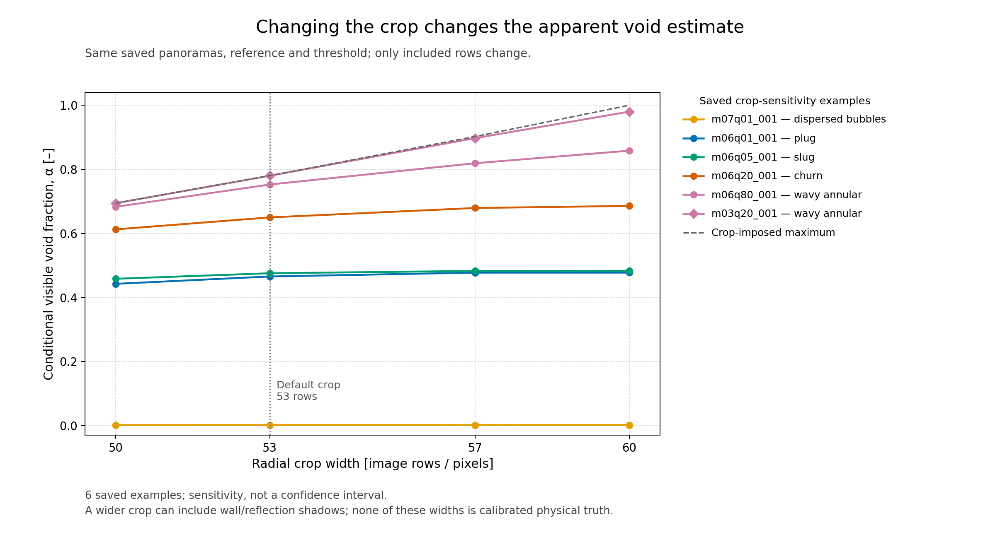

# Executive summary

**We estimated visible gas and spatial gas/liquid switches. Absolute gas-volume fractions remain uncalibrated.** Results depend on detected outlines and assumed circular geometry.

## Void fraction × spatial intermittency

The current analysis retains **26 acquisitions and 5 single patterns**. Colored areas show sample spread, not proven pattern boundaries. The group table uses 25 pure-pattern, unsaturated acquisitions. Hollow points have unsupported estimates because their images are saturated.

Y-axis: gas/liquid changes per 1,000 neighboring pixel comparisons, averaged over 53 rows. Higher means more changes **along the image**, not per second. The [center-line version](../figures/void_fraction/void_fraction_vs_center_flips.png) misses off-center bubbles.

**Limits:** plug, slug and churn overlap. Both axes use the same gas map, so agreement does not verify true void fraction. The artificial crop ceiling at **0.7803** prevents clustered annular points from proving precision.

| Pattern / acquisition | n | Visible fraction α | Spatial flips / 1,000 comparisons |
|---|---:|---:|---:|
| Dispersed bubbles: m07q01_001 | 1 | 0.0018 | 3.202 |
| plug | 3 | 0.4655 | 10.045 |
| slug | 3 | 0.4756 | 9.750 |
| churn | 10 | 0.6451 | 9.980 |
| wavy annular | 8 | 0.7675 | 0.963 |

Group values are medians. Only m07q01_001 represents dispersed bubbles; one run cannot establish within-pattern variability or independently validate that class.

Mixed classifications, smooth annular and m05q05_002 are excluded from every calculation, reference check, classifier and chart. Annular means wavy annular throughout. Previous results are [archived](../../pre_scope_exclusions/README.md).

## How we reached this result

1. **Read images and labels.** We retained 26 single-pattern panoramas under the [selection policy](../results/validation/dataset_selection.json). The one saturated retained image is shown as unsupported and omitted from group statistics.

2. **Find liquid-looking gaps.** Gaps in 3 plug panoramas provide a liquid-appearance reference. **Limit:** these gaps are inferred, not a confirmed liquid-only calibration.

3. **Trace gas outlines and fill their insides.** Like coloring a balloon, the bright middle belongs inside its outline. We kept separate bubbles and rejected short false bridges. **Limit:** broken outlines can still cause errors.

4. **Turn width into area.** We converted separate gas widths to circular areas, added them at each column, then averaged along the image. Assumed apparent tube diameter: 60 pixels. **Limit:** the tube edges are unvalidated; a side view hides shape in depth and optical distortion remains uncertain.

5. **Count switches.** We compared neighboring gas/liquid mask pixels across 53 rows, keeping counts and denominators. **Limit:** spacing and stitching affect this spatial measure; it is not a time frequency.

6. **Try to break the result.** We changed thresholds, liquid references and crops, and inspected clear gas/liquid patches. This found a false bridge that was corrected. **Limit:** clear patches do not validate every boundary.

**The biggest demonstrated uncertainty is crop width.** For annular m06q80, crop alone moves α from **0.6831 to 0.8582**. This is sensitivity, not a confidence interval. Wider crops can include wall reflections.

7. **Check calculations and sources.** We independently verified all 26 gas maps, void calculations, flip counts and input hashes. **Limit:** the local papers provide methods, not verified true values for these images.

## Findings and next steps

The outline method avoids counting a bright liquid middle as a large gas core. Annular images usually show broad gas cores with few switches. Pattern identification remains unresolved; held-out training can lack the only bubble example, and those test cases remain in the reported scores.

- Annotate gas/liquid outlines across all panoramas and measure mask errors.
- Validate tube boundaries, optical distortion and circular geometry before claiming absolute void fractions.

Use the numbers as **conditional image estimates and spatial flip-rates**. All values come from saved results; flip-rates are multiplied by 1,000 for readability.

Details: [per-run void](../results/void_fraction/panorama_void_per_run.csv), [per-run flips](../results/flip_rate/phase_mask_flip_per_run.csv), [method](panorama_void_alternatives.md), [flip definitions](phase_mask_flip_review.md), [adversarial checks](adversarial_review.md), [literature](source_audit.md), [post-regeneration adversarial review](post_regeneration_adversarial_review.md).
