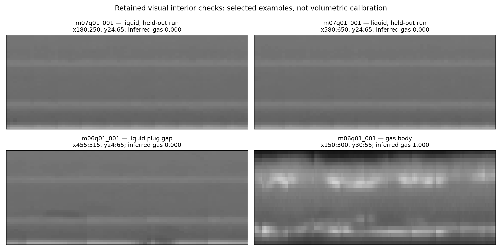
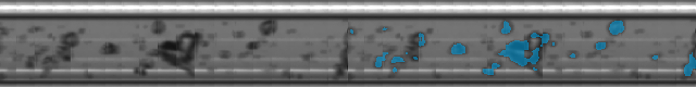

# Adversarial phase, reference and crop review

Current scope: 26 acquisitions in the five approved single patterns. Only retained acquisitions contribute to the checks below. The [selection manifest](../results/validation/dataset_selection.json) documents exclusions.

Current segmentation source SHA-256: 072ffca53f5f7393548a40a9f90948cf24d9f92d7d477ccc930723d308e4682b.

## Selected visual interior checks

These existing gas/liquid interpretations come from the previous visual review; excluded-run patches are removed. Their current mask fractions are recomputed below.

| Run | x interval | y interval | Visual interpretation | Gas-map fraction |
|---|---|---|---|---:|
| m07q01_001 | [180, 250] | [24, 65] | liquid, held-out run | 0.000000 |
| m07q01_001 | [580, 650] | [24, 65] | liquid, held-out run | 0.000000 |
| m06q01_001 | [455, 515] | [24, 65] | liquid plug gap | 0.000000 |
| m06q01_001 | [150, 300] | [30, 55] | gas body | 1.000000 |

**Limit:** selected clear patches are not an unbiased boundary-validation set. The retained gas-positive patch is from a plug reference panorama; independent positive-control coverage is reduced by the requested exclusion.

## Liquid-reference alternatives

Automatic reference construction still uses the same three retained plug panoramas. Manual alternatives now use only retained liquid patches.

| Run | Conditional alpha range across retained references |
|---|---:|
| m07q01_001 | 0.001836–0.001867 |
| m06q01_001 | 0.465548–0.470902 |
| m06q05_001 | 0.475613–0.481680 |
| m06q20_001 | 0.649972–0.656338 |
| m06q80_001 | 0.752651–0.755715 |
| m03q20_001 | 0.780092–0.780121 |

## Crop sensitivity

| Run | Rows 20:70 | Rows 18:71, default | Rows 16:73 | Rows 15:75 |
|---|---:|---:|---:|---:|
| m07q01_001 | 0.001698 | 0.001836 | 0.001904 | 0.001919 |
| m06q01_001 | 0.442589 | 0.465548 | 0.477514 | 0.477608 |
| m06q05_001 | 0.458355 | 0.475613 | 0.482988 | 0.483324 |
| m06q20_001 | 0.612630 | 0.649972 | 0.679344 | 0.685845 |
| m06q80_001 | 0.683077 | 0.752651 | 0.819173 | 0.858243 |
| m03q20_001 | 0.694437 | 0.780092 | 0.897458 | 0.980087 |

**Limit:** the default 53-row crop imposes the conditional maximum (53/60)^2 = 0.7803. Wider crops can include wall/reflection shadows. These ranges describe sensitivity, not physical confidence intervals.

## Corrected false-bridge case

The liquid slug in m06q05_001, x300:560, has 0 accepted paired fills between different closed-outline components. The original false bridge and its correction remain documented in the [historical review](../../pre_scope_exclusions/findings/adversarial_review.md).

The connection/interval rule can still miss fragmented true gas outlines or retain a long false bridge. Both void and flip-rate come from the same inferred map; their agreement is not independent physical validation.

Use the [current machine checks](../results/validation/adversarial_checks.json), [final arithmetic verification](../results/validation/final_verification.json) and [post-regeneration adversarial review](post_regeneration_adversarial_review.md). The previous wider-scope evidence is historical, not a current result.
