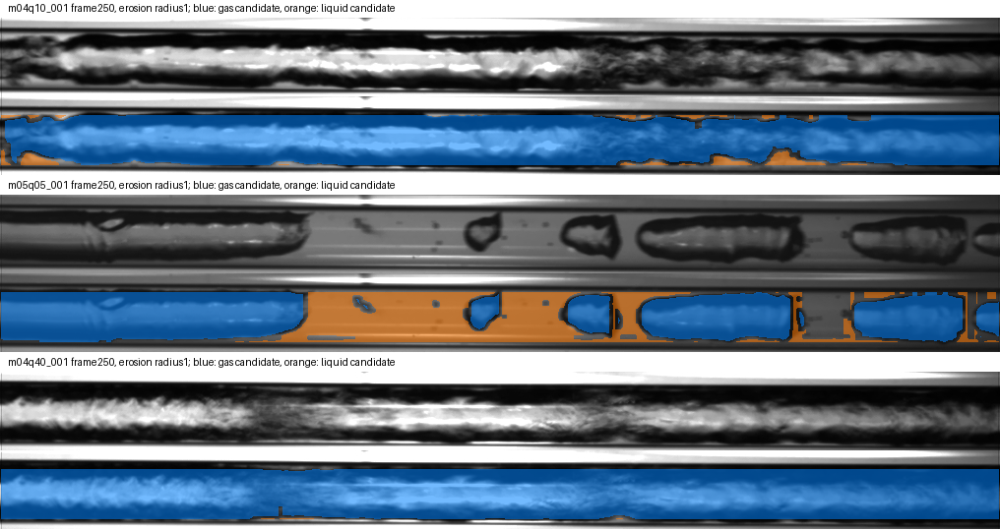

# Distributed phase-interior motion experiment

This experiment replaces contiguous pure-phase boxes with the union of all available inferred phase-interior pixels. A small bubble or thin irregular region can contribute even when no 32×12-pixel rectangle fits. It used every one of the 501 native frames in all 26 included recordings.

## Result

| Spatial erosion | Finite two-coordinate candidates | Two-coordinate optical support | Support after removing only fixed peak-margin gate |
|---|---:|---:|---:|
| Radius 3 px (7×7) | 20/26 | 7/26 | 11/26 |
| Radius 1 px (3×3) | 23/26 | 8/26 | 13/26 |

Requiring support at both erosion radii and compatible velocities leaves 6/26 pairs. The consensus table keeps the radius-3 coordinates for every run; it never switches radius to fill a missing coordinate.

None is independently identified as a gas/liquid material-velocity pair. The new optical matches show that the previous rectangular-patch failure was not a universal limit on image correspondence; they do not establish phase-material identity.

## Observable and controls

For every axial trial displacement, only pixels belonging to the same eroded consensus phase candidate at both source and destination enter the correlation. Gas uses the intersection of the 0.60/0.70/0.80 masks. The liquid candidate is the lumen complement of their union. Rows 18:71 are retained. Radius 3 is the initial reference and radius 1 is a declared interface-distance sensitivity. These masks remain optical candidates, not independently verified material labels.

The estimator subtracts the full-record temporal mean at each pixel. Six summed products (count, source/target sums, squares and cross-product) define one normalized correlation over all matched pixels. Larger visible phase areas receive greater weight; this is neither equal frame weighting nor a volume-weighted phase velocity. No contiguous-patch requirement or tracking from another recording is imposed.

Five disjoint chronological blocks use lags of 1, 2 and 4 frames. Pairs crossing block boundaries are omitted: 496, 491 and 481 comparisons respectively, while all 501 images contribute. Acceptance requires at least 100 phase pixels in 20 frames, original within-mask gray standard deviation ≥1, dynamic matched-pixel standard deviation ≥1, correlation ≥0.20 at all lags, compatible lag speeds within max(2 px/frame,20%), four of five compatible lag-1 blocks, a peak margin ≥0.02 outside ±5 pixels, and a lag-1 peak at least 0.05 above three blockwise shuffled-order controls. Trial shifts with fewer than max(1000,25% of the maximum overlap count) corresponding pixels are undefined; ±240-pixel search-edge maxima are rejected. More than 20% saturated phase-candidate pixels also rejects the estimate.

These numerical gates are operational feasibility criteria, not experimentally calibrated error rates. The full-record temporal background is shared; block consistency is not an independent out-of-sample experiment. Three null replicates are a diagnostic and do not establish a p-value. Pure axial matching omits transverse/out-of-plane motion.

## Adversarial checks

Two independent synthetic textures were translated at (−17.3,−7.4) and (+13.25,−11.6) px/frame. The four estimates had maximum absolute error 0.019370 px/frame. The opposing-direction case confirms that the method does not force common phase direction or a prescribed velocity ratio. A stationary sequence and untextured liquid interior were rejected.

A pure moving binary interface with uniform phase interiors was also rejected for both phases. Temporal-background subtraction alone produced approximately −0.006 px/frame in both interiors, illustrating how background structure can produce numbers without material tracers. The raw-phase-variance guard prevents accepting those synthetic numbers.

A harder synthetic test moved the phase boundary at −12 px/frame while independent interior grayscale textures moved at −21.3 and −5.7 px/frame. Both recovered texture speeds passed, with errors below 0.015 px/frame. Adding static radial shading to otherwise untextured moving phases defeated the raw-variance guard alone, but the shuffled-order control still rejected both candidates. Independently randomizing grayscale texture each frame while retaining the moving phase mask also rejected both. These controls demonstrate that moving masks alone need not determine the reported grayscale speed; they do not certify native liquid texture as material tracers.

A separate direct spatial calculation reconstructed 10 native correlation peaks from the original images and masks without importing the FFT estimator. Maximum peak difference was 3.14e-08; all 104 saved support decisions were reconstructed. Synthetic accuracy does not measure native-frame physical accuracy.

The fixed ±5-pixel competitor rule can reject a broad, repeatable peak. The gate-ablation table therefore removes only that rule while preserving every other criterion. This diagnoses a potentially overconservative rejection; it is not evidence that the added candidates are physically correct. Even this relaxation does not complete all 26 pairs.

## Per-recording result

| Recording | Pattern | Radius 3 pair | Radius 1 pair | Radius 1 gas candidate (px/s) | Radius 1 liquid candidate (px/s) |
|---|---|---|---|---:|---:|
| m03q05_001 | churn | withheld | withheld | -93640.6 | -132707.1 |
| m03q10_001 | wavy annular | withheld | withheld | -139707.5 | -162569.9 |
| m03q20_001 | wavy annular | withheld | withheld | -188400.1 | undefined |
| m03q40_001 | wavy annular | withheld | withheld | -211431.5 | undefined |
| m04q01_001 | slug | withheld | withheld | -41593.5 | -110820.8 |
| m04q10_001 | churn | supported | supported | -81327.9 | -115295.4 |
| m04q20_001 | churn | withheld | withheld | -87418.8 | -121946.8 |
| m04q40_001 | wavy annular | withheld | withheld | -136045.4 | -156549.7 |
| m04q80_001 | wavy annular | withheld | withheld | -231214.0 | undefined |
| m05q01_001 | plug | withheld | supported | -70482.3 | -83213.9 |
| m05q05_001 | slug | supported | supported | -71806.0 | -91423.6 |
| m05q10_001 | churn | supported | supported | -86860.1 | -123035.8 |
| m05q20_001 | churn | withheld | supported | -95056.1 | -125842.1 |
| m05q40_001 | churn | withheld | withheld | -129223.1 | -163613.0 |
| m05q80_001 | wavy annular | withheld | withheld | -221127.5 | -281168.9 |
| m06q01_001 | plug | supported | supported | -81749.9 | -112367.7 |
| m06q05_001 | slug | supported | supported | -77045.3 | -124921.3 |
| m06q10_001 | churn | withheld | withheld | -89785.5 | -149332.6 |
| m06q20_001 | churn | withheld | withheld | -130267.8 | -165658.4 |
| m06q40_001 | wavy annular | withheld | withheld | -178183.7 | -207251.6 |
| m06q80_001 | wavy annular | withheld | withheld | -234522.0 | -336214.7 |
| m07q01_001 | dispersed bubbles | withheld | withheld | -45683.7 | -44276.5 |
| m07q05_001 | plug | supported | withheld | -79379.5 | -106490.9 |
| m07q20_001 | churn | supported | supported | -102361.3 | -146846.2 |
| m07q40_001 | churn | withheld | withheld | -134918.3 | -156909.1 |
| m07q80_001 | wavy annular | withheld | withheld | -195948.2 | -236308.9 |

All finite values are retained in this diagnostic table, including rejected candidates. They must not all be plotted as accepted phase velocities.

## Native visual challenge

The fixed frame 250 examples show why optical support still falls short of independent phase identification. In m04q10 the liquid-candidate support can lie in narrow strips next to the moving silhouette; refracted interface structure can remain after finite erosion. In m05q05, the liquid-looking area contains small visible objects that may carry texture without tracing the continuous liquid itself. In m04q40 the liquid-candidate support is almost absent. Blue is the gas candidate; orange is the liquid candidate; erosion radius is 1 pixel. These are illustrative frame inspections, not ground-truth annotations.

## Reproduction

Run phase_local_experiment.py, phase_local_challenge.py, then phase_local_review.py from this investigation’s scripts directory. Inputs and hashes are in results/phase_local_inputs.csv. Complete estimates and reasons are in phase_local_summary.csv and phase_local_pairs.csv. Block, lag, null and verification outputs preserve all tested alternatives. No earlier v15/v15.1 output was overwritten.
