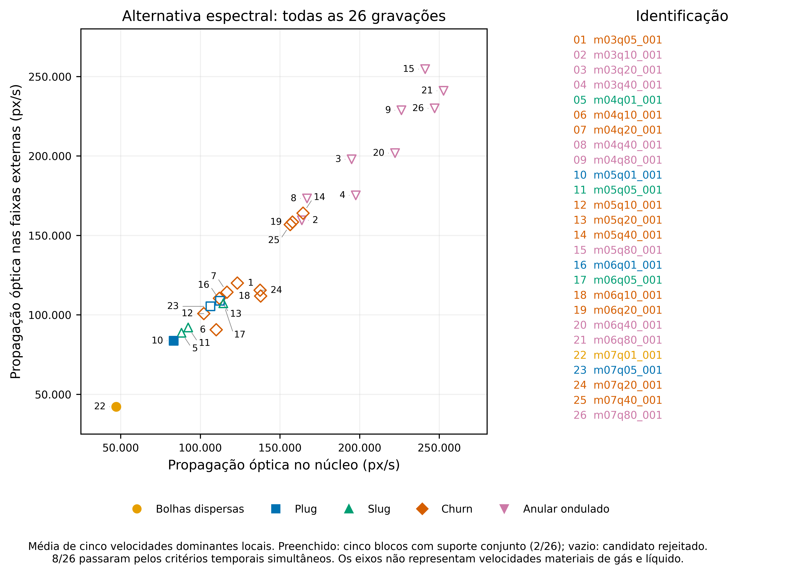

# Alternativa espectral adversarial: propagação regional

**Resultado:** foram calculadas 26 coordenadas completas, mas somente **8/26 pares** passaram pelos controles temporais e **2/26** permaneceram após os controles de frequência, posição axial e saturação. A alternativa não completou 26 pares sustentados nem identificou velocidades materiais das fases. Os dois pares finais foram m05q01_001 (Plug) e m07q01_001 (bolhas dispersas).



## Hipótese nova

Em vez do pico da correlação média de toda a gravação, estimou-se uma velocidade dominante em cada um de cinco blocos temporais disjuntos. Para um campo I(x,t)=F(x-vt), a energia de Fourier se concentra em f_t=-v f_x, incluindo a periodicidade temporal decorrente da amostragem. Procurou-se essa direção no espectro de cada bloco. Essa definição permite variação de velocidade entre blocos, sem exigir a antiga concordância de velocidade constante nos intervalos de 1/2/4 quadros.

Usaram-se as mesmas regiões em todas as gravações: núcleo 35:54, faixa superior externa 18:29 e inferior externa 60:71. Os perfis foram derivados das imagens nativas anteriormente e foram reutilizados com hash registrado. Cada região foi descrita pela média de cinco máximos espectrais locais, com peso igual por bloco. A parede foi definida como a média das duas regiões externas: não se exigiu igualdade entre as duas, e sua diferença ficou salva. Essa média descreve duas regiões; não pressupõe um filme simétrico ou velocidade líquida média.

## Regras fixas e controles

Nenhum parâmetro, faixa ou método foi selecionado por gravação, classe ou proximidade ao gráfico desejado. Por isso não houve seleção de hiperparâmetros que precisasse de separação treino/teste. Todos os resultados continuam exploratórios; o conjunto não é uma validação externa.

- Busca de −80 a +80 px/quadro, passo de 0,25; faixa espacial principal 1/256–1/32 ciclo/pixel.
- Remoção da média temporal de cada bloco e da média espacial de cada quadro; janela Hann nos dois eixos; exclusão do zero temporal e seus vizinhos imediatos.
- Score: fração de energia em uma faixa de três bins temporais sobre a direção candidata, normalizada por frequência espacial e ponderada pela raiz da energia dessa frequência.
- Suporte por bloco: desvio dinâmico ≥1 nível de cinza; |v|≥1; máximo fora do limite da busca; score≥0,10 e ≥máximo de 19 embaralhamentos+0,03; margem≥0,03 contra direções fora de max(3 px/quadro,15% de |v|); reversão com erro≤0,25 px/quadro.
- Suporte temporal por região: pelo menos quatro de cinco blocos com suporte e quatro com o mesmo sinal.
- Critérios completos: também pelo menos quatro blocos concordando com **ambas** as faixas alternativas 1/512–1/64 e 1/128–1/16, e com **ambas** as metades axiais da imagem, dentro de max(3 px/quadro,25% de |v|); saturação≤20%.

**Correção adversarial:** a regra inicial contava os critérios separadamente e poderia aceitar conjuntos de blocos diferentes. A regra final exige que transporte, bandas, metades axiais e saturação passem **no mesmo bloco e simultaneamente nas três regiões** em pelo menos quatro de cinco blocos. Os resultados marginais originais permanecem em `marginal_temporal_supported` e `marginal_robust_supported`. A triagem temporal passou de 13 pares marginais para 8 simultâneos. As duas gravações finais passaram nos cinco blocos; portanto, essa correção não alterou a contagem de dois pares com critérios completos neste conjunto.

O CSV preserva separadamente a média candidata dos cinco blocos e a média apenas dos blocos conjuntamente aceitos (`accepted_core_signed_px_s`, `accepted_wall_signed_px_s`). A média dos cinco blocos só recebe suporte quando **todos os cinco** passam; esse é o preenchimento da figura. Médias parciais com menos de quatro blocos são apenas diagnósticos numéricos.

Esses limites são critérios empíricos de diagnóstico, não erro experimental conhecido nem nível de significância. Os 19 embaralhamentos são controles negativos; não se declarou p-valor. Faixas e metades axiais selecionam estruturas diferentes: discordância limita a representatividade de uma única velocidade, sem provar que todos os candidatos estejam errados.

## Resultados dos testes

Foram avaliadas 78 regiões, 390 blocos, **7.410 controles de ordem temporal embaralhada**, três faixas espectrais e duas posições axiais. Dos 390 blocos, **300** passaram pelos critérios temporais, **348** concordaram entre faixas e **288** entre metades axiais. As **390 reversões** concordaram com a troca de sinal. Essa última propriedade confirma a convenção matemática, sem provar movimento material.

As translações sintéticas conhecidas −51, −31,8, −17,3, −6,7 e +23,75 px/quadro apresentaram erro máximo **0,05 px/quadro**; duas camadas com texturas independentes a −35 e −14 px/quadro foram recuperadas separadamente. O sinal estacionário, o constante e os quadros aleatórios foram rejeitados como transporte. Um controle com cinco velocidades sucessivas recuperou a média −21 px/quadro.

No controle com movimentos simultâneos a −12 e −38 px/quadro, o algoritmo escolheu −12 px/quadro; isso não equivale à média −25, nem identifica uma fase. Os sinais usaram multiplicadores iguais, mas não tinham energia exatamente igual. A pontuação depende da energia, das janelas e da largura espectral: mesmo uma direção bem definida pode esconder outra velocidade. Esse é um limite essencial do observável dominante.

## Interpretação adversarial

A mudança de estimador produziu uma nuvem visualmente próxima da diagonal para muitas gravações. Isso é compatível com influência compartilhada de interfaces, ondas ou padrões de brilho nas regiões e não demonstra igualdade das velocidades materiais. Em particular, não é legítimo chamar o núcleo de gás e as faixas externas de líquido somente por localização.

Os valores mudaram em relação ao pico da correlação média; ambas as estatísticas também atribuem pesos diferentes às estruturas e ao tempo. A tabela `spectral_vs_ncc.csv` mantém todas essas diferenças, sem escolher o resultado mais conveniente. Exemplo: m04q01 mudou de aproximadamente −34.492 para −88.200 px/s no núcleo. A alternativa passou pelos controles temporais nesse caso, mas falhou nos controles completos. Não há base para promover a nova estimativa como correção física da anterior.

**Conclusão:** o modelo temporalmente variável é uma opção legítima para estudar propagação óptica local. Os resultados executados não justificam substituir as 26 coordenadas por velocidades de gás e líquido aceitas. A cobertura só parece completa quando se mantêm candidatos que falharam nos diagnósticos.

## Verificação e reprodução

`spectral_finish.py` reimplementou o cálculo espectral usando NumPy, sem importar o estimador: **249,990 valores** de curvas foram conferidos, com diferença máxima **2.98e-08**, compatível com o armazenamento float32 das curvas. Também conferiu critérios dos 390 blocos, máximos dos controles salvos, 78 agregações regionais, 26 pares, unidades e escopo. Não refez as imagens experimentais nem validou a identidade material.

```sh
OPENBLAS_NUM_THREADS=1 OMP_NUM_THREADS=1 python3 -B src2/v15.1_gas_liquid_velocity/all_scenarios_adversarial/scripts/spectral_transport.py
OPENBLAS_NUM_THREADS=1 OMP_NUM_THREADS=1 python3 -B src2/v15.1_gas_liquid_velocity/all_scenarios_adversarial/scripts/spectral_finish.py
```

Dados completos: [pares](../results/spectral_pairs.csv), [regiões](../results/spectral_regions.csv), [blocos](../results/spectral_blocks.csv), [sintéticos](../results/spectral_synthetic.csv), [metadados](../results/spectral_metadata.json), [verificação](../results/spectral_verification.json).
