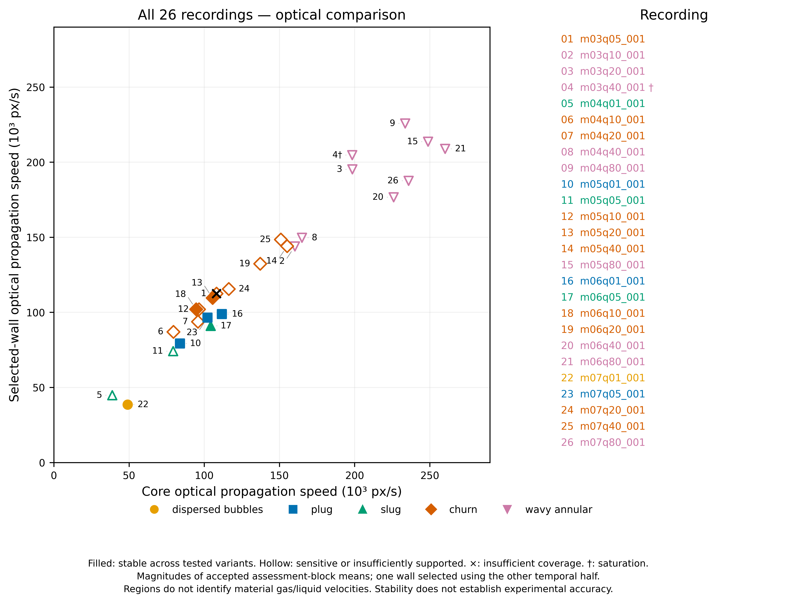
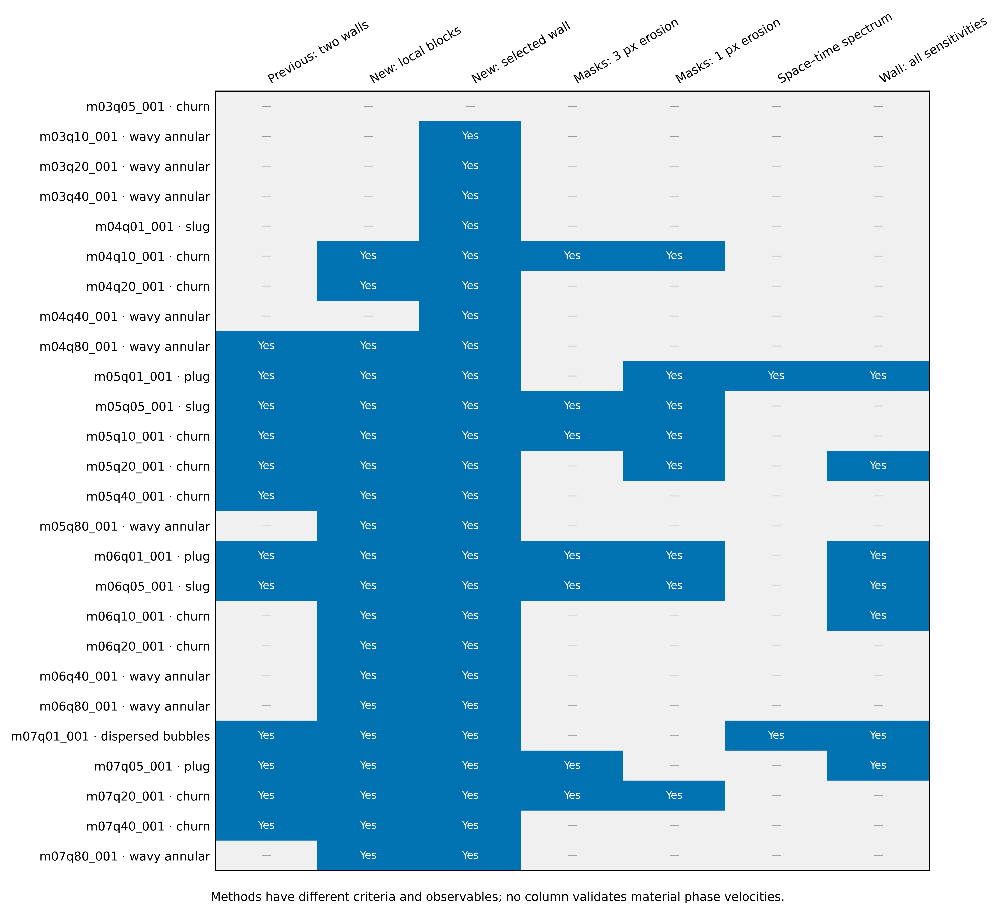

# EXECUTIVE SUMMARY — all recordings in one chart

**Updated on 24 October 2026 with the adversarial investigation.** [Previous version from 23 October](./EXECUTIVE_SUMMARY_2026-10-23.md).

**The chart now contains all 26 recordings: 25 meet the reference optical method’s support criteria, and 7 retain support and compatible coordinates across every tested sensitivity. No method independently identified both material gas and liquid velocities.** Coverage of optical motion increased; this does not validate 26 phase-velocity pairs.

The exclusions remain m05q05_002, smooth annular flow and double classifications. The scope contains 26×501 native images: 13,026 images, 13,000 adjacent intervals and five patterns. The masked branch reread every image; regional and spectral branches reused profiles derived from those same sequences, with recorded provenance.

## 1. Requested layout: one point per recording

**X: core optical propagation speed. Y: optical propagation speed at one wall selected for observability.** Axes show magnitudes in 10³ px/s; the original signed means are negative, corresponding to leftward motion. Numbers identify recordings in the adjacent key. No pattern boundaries were drawn.

- **7 filled points:** support in the reference and all four sensitivities, with agreement of both coordinates.
- **18 hollow points:** reference support, but sensitivity to processing or the temporal half used.
- **1 hollow point with ×:** m03q05_001, with insufficient coverage. Its numerical value remains a candidate only.
- **†:** flags saturation in m03q40_001 beside number 4 and its recording key; it does not add a recording.

For m03q05, only 2/5 selection blocks and 1/5 assessment blocks had joint support, below the requirement of three in each half. Its coordinates use only 49 intervals from one block and are not an approved pair. For the 25 reference pairs, means use 147–245 of the original 500 intervals, always in the assessment half.

[Publication PDF](../all_scenarios_adversarial/figures/all_26_selected_wall_EN.pdf) · [SVG](../all_scenarios_adversarial/figures/all_26_selected_wall_EN.svg) · [Exact data for all 26 points](../all_scenarios_adversarial/results/final_all_26_plot_data.csv).

## 2. Observed coverage

| Pattern | Recordings | Two walls: previous reference | Two walls: local blocks | Selected wall: new reference | Stable across all sensitivities |
|---|---:|---:|---:|---:|---:|
| Dispersed bubbles | 1 | 1 | 1 | 1 | 1 |
| Plug | 3 | 3 | 3 | 3 | 3 |
| Slug | 3 | 2 | 2 | 3 | 1 |
| Churn | 10 | 5 | 9 | 9 | 2 |
| Wavy annular | 9 | 1 | 5 | 9 | 0 |
| **Total** | **26** | **12** | **20** | **25** | **7** |

Selecting one wall increased annular coverage, but none of the nine annular recordings remained stable across every sensitivity. This does not establish that all annular estimates are wrong; it prevents treating them as one speed independent of optical scale and temporal sample.

| Additional alternative | Result | Principal limitation |
|---|---|---|
| Texture inside masks, 3 px erosion | 20 finite pairs; 7 with support | Candidate pixels do not certify material identity |
| Same analysis, 1 px erosion | 23 finite pairs; 8 with support | Closer to interfaces; only 6 pairs pass both erosions with compatible speeds |
| Space–time spectral direction | 26 candidate pairs; 2 with complete criteria | Frequency and position sensitivity; dominant motion can hide another component |
| Weighting one global motion by gas/liquid occupancy | 26 numerical pairs in the exploratory variant | Two weightings of the same signal are not independent phase correspondences |

Methods use different criteria and observables. Their outputs were not mixed recording by recording to fill the main chart. All earlier branches of this investigation remain separate diagnostics.

## 3. What changed and why previous analysis lost coverage

Requiring constant velocity throughout a recording could reject transport that varied over time. In a synthetic control with 300 intervals at −8 and 200 at −24 px/frame, the true mean was **−14.4000**, the mean of estimated displacements was **−14.4001**, but the peak of the mean correlation gave **−7.9877 px/frame**. The aggregate peak favored the most frequent mode. This establishes a possible bias in the earlier statistic; it does not quantify errors in the real recordings.

The regional alternative estimated motion in ten short blocks and combined only blocks with local evidence. Requiring both walls supplied 20/26 pairs, including five annular recordings. Allowing one observable wall defined a different quantity, with selection checked in another temporal half, and supplied 25/26 reference pairs.

For the main figure, core rows are 35:54 and candidate wall rows are 18:29 and 60:71, with exclusive stop indices. The wall was selected in the first five blocks by supported-block count, with mean correlation strength breaking ties. Selection was frozen before evaluating the last five blocks. Pattern and expected speed did not enter selection.

**The audit corrected background sharing between the halves:** the temporal background was estimated only from the selection half and frozen for assessment. Coordinates are interval-weighted means over jointly accepted assessment blocks. Each block supplies a local correlation peak; the result is not the mean of all individual displacements, the entire recording or the complete liquid film.

## 4. Sensitivity retained in the principal result

Every alternative had to pass its own criteria and retain **both** coordinates within max(2 px/frame, 20% of the reference coordinate’s magnitude), converting the tolerance by FPS when expressed in px/s.

| Sensitivity relative to the corrected reference | Support and agreement of both coordinates |
|---|---:|
| Swap selection and assessment halves | 22/26 |
| Profiles without temporal-background subtraction | 24/26 |
| Axial high-pass filtering, Gaussian scale 32 px | 22/26 |
| Axial high-pass filtering, Gaussian scale 8 px | 8/26 |
| **All simultaneously** | **7/26** |

The 8 px test remains in the principal decision. Seven replaces the count of eight from the shared-background exploration. These sensitivities change optical content and, for the half swap, the temporal sample and possibly the selected wall. Disagreement does not prove matching error; agreement does not prove physical accuracy. These variations were not interpreted as confidence intervals.

The coverage criterion was also varied while retaining the local max(2 px/frame, 20%) tolerance and recomputing wall selection:

| Minimum joint blocks in each half | 1/5 | 2/5 | 3/5 — reference | 4/5 | 5/5 |
|---|---:|---:|---:|---:|---:|
| Supported pairs | 26 | 25 | 25 | 22 | 14 |

Reducing the requirement to one block produces 26 numerical approvals, but does not make m03q05’s isolated block representative of the recording. Keeping three blocks and tightening the local tolerance to max(2 px/frame, 10%) reduces coverage from 25 to 19. Counts therefore depend on explicit empirical criteria. The one-block option was not adopted to obtain approval for every chart point. [Sensitivity data](../all_scenarios_adversarial/results/reporting_gate_sensitivity_counts.csv); reproduce with [gate_sensitivity.py](../all_scenarios_adversarial/scripts/gate_sensitivity.py).

## 5. Why the axes still cannot be called gas and liquid velocity

A control with exact masks, unseeded uniform interiors and shared illumination moving at +12 px/frame produced **+12.00005 px/frame in both regions**, passing the optical controls. The algorithm correctly recovered illumination transport. The example demonstrates that correct masks and good correspondence alone do not establish material velocity; it does not establish that this mechanism explains the real results.

Mask complements, occupancy weighting, film-wave conversion and conservation were also tested. Complementary masks repeated interface information; mass conservation admitted multiple velocity pairs; converting wave celerity to film speed required additional closure. None supplied two independent material measurements for every recording.

**px/s** remains the principal unit because FPS is known and the axial m/pixel scale is uncalibrated. The earlier conditional geometric conversion does not resolve phase identification. See the [calibration and literature review](calibration_review.md).

## 6. Verification and conclusion

The [final verification record](../all_scenarios_adversarial/results/final_verification.json) consolidates checks of the corrected version and final artifacts.

Executed controls covered synthetic translation, acceleration, multiple velocities, absent texture, periodicity and illumination; checks of frame intervals, positions, shuffling, selection and aggregation; and numerical reconstruction with separate implementations. Criteria are empirical support rules, not experimental error rates. These recordings had already informed method development; even the corrected temporal separation is not validation on new experiments.

For an all-recording presentation, use the principal figure as an exploratory optical comparison, preserving support symbols and regional axis names. For a comparison with the same core-and-two-wall definition throughout, the local-block alternative supplied 20 supported pairs; selecting one wall increased coverage but changed the observable.

**The request to place all 26 recordings in one chart is fulfilled as an optical comparison, with rejection and sensitivity visible. The request for 26 validated pairs of material gas and liquid velocities remains unfulfilled by the tested methods.**

Evidence: [protocol](../all_scenarios_adversarial/PROTOCOL.md), [final metrics](../all_scenarios_adversarial/results/final_summary_metrics.json), [per-recording sensitivities](../all_scenarios_adversarial/results/final_sensitivity.csv), [adversarial review](../all_scenarios_adversarial/findings/adversarial_identifiability_PT_BR.md), [regional review](../all_scenarios_adversarial/findings/block_independent_review.md), [masked analysis](../all_scenarios_adversarial/findings/phase_local_review.md), [spectral analysis](../all_scenarios_adversarial/findings/spectral_review.md), [initial regional verification](../all_scenarios_adversarial/results/independent_block_verification.json), [method verification](../all_scenarios_adversarial/results/adversarial_new_methods.json), [masked verification](../all_scenarios_adversarial/results/phase_local_verification.json), [spectral verification](../all_scenarios_adversarial/results/spectral_verification.json), [PT-BR captions](FIGURE_CAPTIONS_PT_BR.md) and [reproduction](../all_scenarios_adversarial/README.md).
