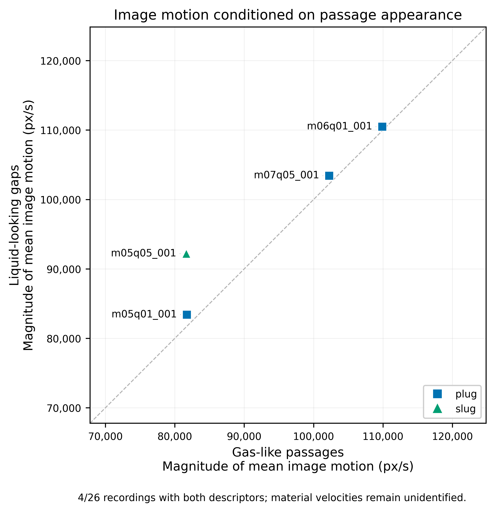
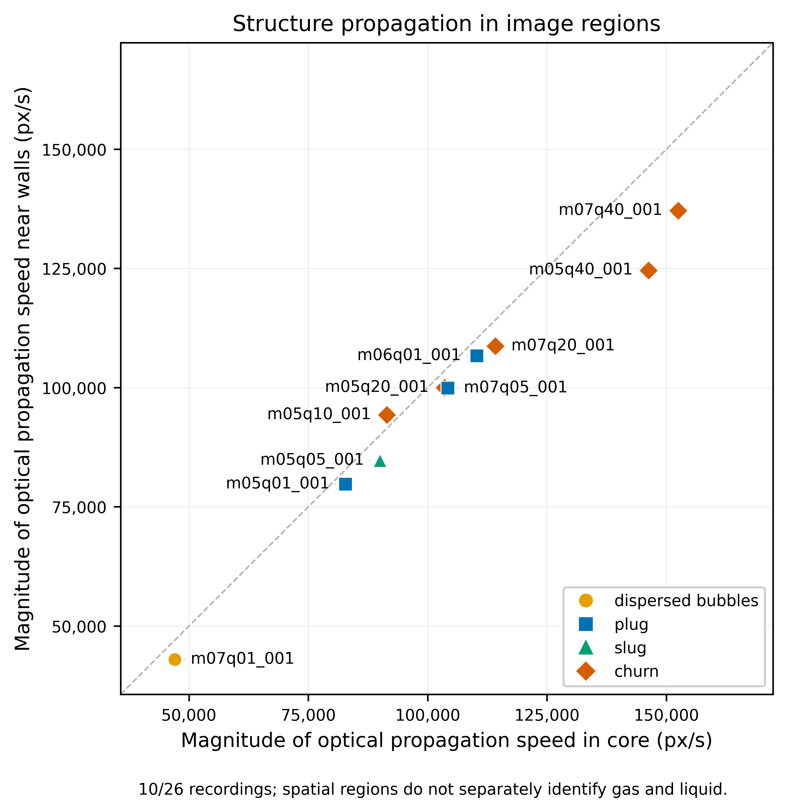
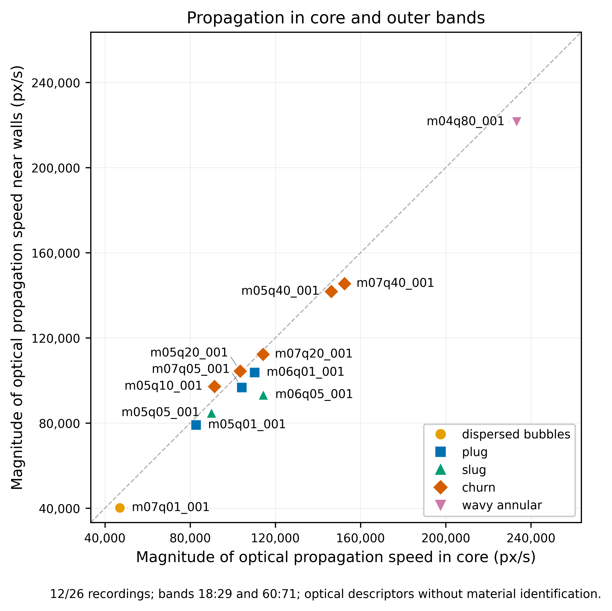
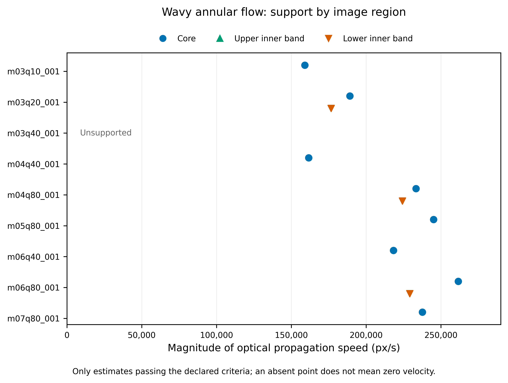

# EXECUTIVE SUMMARY — v15.1: optical motion and gas–liquid comparison

**Use px/s for the principal results.** Native frame timing was confirmed, but no axial m/pixel calibration was found. The analysis supports passage comparisons in **4/26 recordings**, regional comparisons in **10/26**, and core optical propagation in **8/9 annular recordings** under the final criteria. None independently identifies both material or superficial phase velocities.

The original exclusions remain: m05q05_002, smooth annular and double classifications. The 26 recordings contain 501 native images each: 13,026 images and 13,000 adjacent intervals. Each record spans only 71–125 ms.

## 1. Requested comparison: one point per supported recording

The horizontal axis is the magnitude of signed mean image motion during gas-like passages; the vertical axis uses liquid-looking gaps. All accepted displacements in these four comparisons are leftward. The dashed line marks equal magnitudes and is not a pattern boundary. The coordinates are not Jg and Jl.

| Recording | Pattern | Gas-appearance mean, px/s | Liquid-appearance mean, px/s | Ratio of means | Gas/liquid pairs |
|---|---|---:|---:|---:|---:|
| m05q01_001 | plug | -81,739 | -83,413 | 0.980 | 273/59 |
| m05q05_001 | slug | -81,660 | -92,199 | 0.886 | 253/56 |
| m06q01_001 | plug | -109,885 | -110,484 | 0.995 | 245/31 |
| m07q05_001 | plug | -102,242 | -103,426 | 0.989 | 221/42 |

The existing reference was preserved and reaggregated directly from pairs: agreement across v14 thresholds 0.60/0.70/0.80, a liquid-appearance guard, episodes of at least five frames and lag-2 consistency. Each passage type required at least 20 pairs and three episodes. Appearance was classified in a 24×53-pixel window; motion correlation used a 536-pixel template that may include both phases.

Equal weighting of episodes gives ratios 0.983, 0.935, 0.988, 1.008 in the same order. The last crosses unity. This sensitivity prevents a conclusion about which material phase is faster. Previous interior/adaptive-patch tests still establish no validated material pair; unmarked detector pixels are not verified liquid.

## 2. Spatial alternative: core and near-wall regions

New normalized correlations used every native image in five radial bands. The reference uses core rows 35:54, upper 24:35 and lower 54:65, with Python-exclusive stop indices. The near-wall coordinate averages upper/lower propagation estimates only when both are supported and agree. Each band estimate is the peak displacement of the mean correlation curve divided by elapsed time: **it is not the arithmetic mean of pair velocities**.

Tests used lags of 1, 2 and 4 frames, five temporal blocks and 19 shuffled-order controls at each lag. Adversarial review found weak peaks at some longer lags. Final reporting additionally requires peak strength/control separation at every lag, time-reversal consistency and consistency at two additional axial template positions. Initial decisions remain saved for comparison. These are support/consistency criteria, not physical accuracy bounds.

## 3. Special handling of annular flow

The fixed outer-band alternative supplied **12/26 pairs**, covering all five patterns and one annular recording: m04q80, with core −233,283 px/s and outer-band average −221,429 px/s. It used the same definition for every recording, without mixing bands case by case. The inner-band reference supplied 10 pairs and no annular pair. Higher coverage does not establish greater physical accuracy.

Mean correlation recovered coherent core brightness/structure propagation in 8 annular recordings, with magnitudes from 159,038 to 261,603 px/s. Near-wall bands were more sensitive to lag and location. The absence of phase-exclusive texture prevents assigning these values to gas or liquid material velocity.

Alternatives also tested outer bands 18:29 and 60:71 and upper/lower gradient positions as interface candidates. Each alternative follows a fixed rule rather than being selected separately to fill missing plot points. Film-wave celerity differs from film mean material speed: in h_t+[q(h)]_x=0, c=dq/dh while the material mean is q/h. No universal conversion factor was imposed. m03q40 remains flagged for saturation.

**Remaining limitation:** high-pass filtering at Gaussian scale 8 pixels changed four of the eight annular core estimates beyond the declared tolerance; scale 32 agreed in all eight. In m03q10 the celerity changed from −31.81 to −10.19 px/frame. The estimated celerity depends on the optical scale emphasized by preprocessing; a persistent peak does not automatically identify material velocity. No gradient-location pair survived the requirement for strong evidence at every lag.

## 4. Coverage and difficult cases

| Pattern | Recordings | Passage pairs | Inner-band pairs | Outer-band pairs | Supported core regions |
|---|---:|---:|---:|---:|---:|
| dispersed bubbles | 1 | 0 | 1 | 1 | 1 |
| plug | 3 | 3 | 3 | 3 | 3 |
| slug | 3 | 1 | 1 | 2 | 2 |
| churn | 10 | 0 | 5 | 5 | 6 |
| wavy annular | 9 | 0 | 0 | 1 | 8 |

Plug offers the strongest passage-comparison support. Slug runs m04q01 and m06q05 lack sufficient liquid-looking intervals under the reference rule; relaxing the gate changes the sampled mixture. Dispersed-bubble tracking remains a separate observable: 38 candidate chains, 1,038 object intervals and mean −43,904 px/s at threshold 0.70. Several objects can contribute to the same frame interval. Churn has overlapping contours and mixed appearance that obstruct phase identification.

All 26 recordings remain in the [status table](../results/all_run_status.csv) and [coverage panel](../figures/all_run_availability_EN.png). The [all-candidate diagnostic](../figures/all_regional_candidates_EN.png) marks rejected results with hollow symbols and saturation with ×. In that diagnostic, the wall coordinate retains the average of two peaks even when they disagree; these points are not accepted estimates. Missing velocities were not filled from another pattern or with zero.

## 5. Conversion to m/s and rejected inference

A fresh audit inspected 78 camera files, metadata from 13,026 JPEGs and 104 workbooks. Native FPS and 1:1 pixel aspect are documented; lens/reference/correction metadata supply no m/pixel calibration. ScaleFactor=1 belongs to disabled voltage channels. Dias reports 13.68 µm/pixel for a different campaign, so that value was not transferred.

v_image = displacement_px × FPS / frame_interval_count

The optional geometric conversion uses s=0.001/53=18.8679 µm/pixel. It assumes that the 1 mm physical diameter corresponds to the 53 radial cells and that this scale also applies axially despite tube refraction. The [conditional m/s chart](../figures/gas_liquid_passages_conditional_m_s_EN.png) multiplies the same four pairs by that factor; it supplies no additional validation.

An inlet-enthalpy-free alternative rearranged G=ρg α ug+ρl(1−α)ul using recorded mass flow, native geometry and an optical proxy substituted for ug. **702 cases** were evaluated; all were rejected as material velocities. The baseline algebraic liquid value reached **1,150.44 m/s**, and changing the segmentation threshold alone varied some results by up to **6.29 times**. These are outputs of an invalidated assumption test, not measured flow speeds. A nearly zero liquid-area denominator amplifies the result; unmatched averaging and unverified material identity invalidate the interpretation.

The supplied example uses superficial velocities: Jg=Qg/A and Jl=Ql/A. FPS supplies neither Qg nor Ql. Dias computed those quantities from mass flux and vapor quality; de Oliveira describes a subcooled inlet. Equations and original pages were checked in the [calibration and literature review](calibration_review.md).

## 6. Recommendation and validation limits

Publish the passage plot in px/s with its full definition, and keep the regional map as a separate analysis. For annular flow, mean correlation with the extended checks provides the strongest support for studying core optical propagation; mean liquid material velocity remains unidentified. No physical-accuracy winner or universal per-pattern ratio was established.

Independent verification checked classifications, acceptance rules, unit conversions and aggregation of the 13,000 saved pair records; it did not independently rematch the original images. It also recomputed occupancy and geometry for all 39,078 saved masks with a separate algorithm and the 702 mass-stress cases, without importing their generating modules. Synthetic, reversal, location and shuffle checks assess numerical consistency and correspondence. They do not validate material identity, optical scale or experimental error. English and PT-BR figures use identical numerical data and are exported as PDF/SVG and 600-dpi PNG. Frame intervals and blocks are not independent experimental repetitions.

Evidence: [adversarial review](adversarial_method_review.md), [independent verification](../results/independent_verification.json), [passage plot data](../results/paper_passage_plot_data.csv), [regional plot data](../results/paper_regional_plot_data.csv), [paper captions in PT-BR](FIGURE_CAPTIONS_PT_BR_2026-10-23.md), and [reproduction](../README.md).
