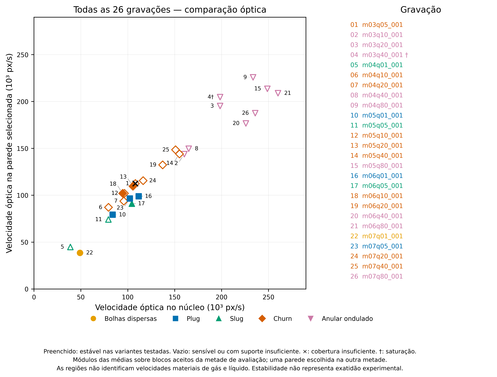
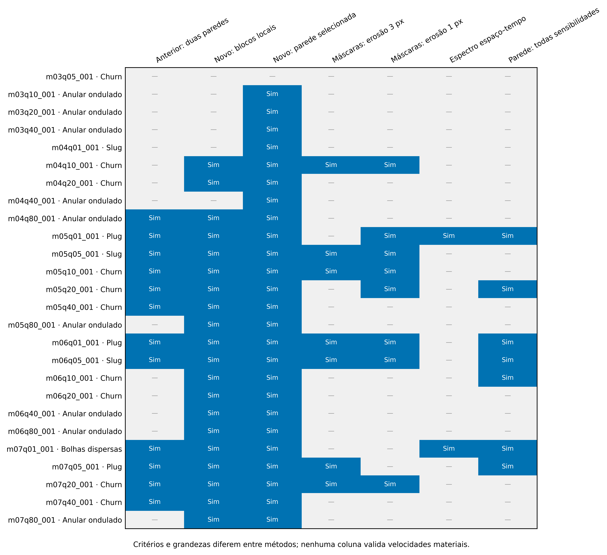

# RESUMO EXECUTIVO — todos os cenários no mesmo gráfico

**Atualizado em 24/10/2026 com a investigação adversarial.** [Versão anterior de 23/10](./EXECUTIVE_SUMMARY_PT_BR_2026-10-23.md).

**Foi obtido um gráfico com as 26 gravações: 25 têm suporte no método óptico de referência e 7 mantêm suporte e coordenadas compatíveis em todas as sensibilidades testadas. Nenhum método identificou independentemente as duas velocidades materiais de gás e líquido.** O ganho é real em cobertura de movimento óptico; não constitui validação de 26 pares de velocidades de fase.

Foram mantidas as exclusões de m05q05_002, anular liso e classificações duplas. O escopo contém 26×501 imagens nativas: 13.026 imagens, 13.000 intervalos adjacentes e cinco padrões. O ramo mascarado releu todas as imagens; os ramos regional e espectral reutilizaram os perfis derivados dessas mesmas sequências, com proveniência registrada.

## 1. Resultado solicitado: um ponto por gravação

**X: velocidade óptica no núcleo. Y: velocidade óptica em uma parede selecionada por observabilidade.** Os eixos mostram módulos em 10³ px/s; as médias originais têm sinal negativo, correspondente ao movimento para a esquerda. Os números identificam as gravações na chave lateral. Não foram desenhadas fronteiras entre padrões.

- **7 pontos preenchidos:** suporte na referência e nas quatro sensibilidades, com concordância das duas coordenadas.
- **18 pontos vazios:** suporte na referência, mas sensibilidade ao processamento ou à metade temporal usada.
- **1 ponto vazio com ×:** m03q05_001, com cobertura insuficiente. O valor numérico permanece apenas como candidato.
- **†:** identifica saturação em m03q40_001, junto ao número 4 e à identificação lateral; não acrescenta uma gravação.

Em m03q05, somente 2/5 blocos da seleção e 1/5 da avaliação tiveram suporte conjunto, abaixo do mínimo de três em cada metade. Suas coordenadas usam apenas 49 intervalos de um bloco; não são um par aprovado. Nos 25 pares de referência, as médias usam 147–245 dos 500 intervalos originais, sempre na metade de avaliação.

[PDF para publicação](../all_scenarios_adversarial/figures/all_26_selected_wall_PT_BR.pdf) · [SVG](../all_scenarios_adversarial/figures/all_26_selected_wall_PT_BR.svg) · [Dados exatos dos 26 pontos](../all_scenarios_adversarial/results/final_all_26_plot_data.csv).

## 2. Cobertura efetivamente obtida

| Padrão | Gravações | Duas paredes: referência anterior | Duas paredes: blocos locais | Parede selecionada: referência nova | Estáveis em todas as sensibilidades |
|---|---:|---:|---:|---:|---:|
| Bolhas dispersas | 1 | 1 | 1 | 1 | 1 |
| Plug | 3 | 3 | 3 | 3 | 3 |
| Slug | 3 | 2 | 2 | 3 | 1 |
| Churn | 10 | 5 | 9 | 9 | 2 |
| Anular ondulado | 9 | 1 | 5 | 9 | 0 |
| **Total** | **26** | **12** | **20** | **25** | **7** |

A seleção de uma parede ampliou a cobertura dos anulares, mas nenhum dos nove permaneceu estável em todas as sensibilidades. Não se concluiu que todas as estimativas anulares estejam erradas; o resultado impede tratá-las como uma velocidade única, independente da escala óptica e da amostra temporal.

| Alternativa adicional | Resultado | Limitação principal |
|---|---|---|
| Textura dentro de máscaras, erosão de 3 px | 20 pares finitos; 7 com suporte | Pixels candidatos não certificam identidade material |
| Mesma análise, erosão de 1 px | 23 pares finitos; 8 com suporte | Maior proximidade das interfaces; somente 6 pares passam nas duas erosões com velocidades compatíveis |
| Direção do espectro espaço–tempo | 26 pares candidatos; 2 com critérios completos | Sensibilidade à frequência e à posição; movimento dominante pode ocultar outro |
| Ponderar um movimento global pela ocupação de gás/líquido | 26 pares numéricos na variante exploratória | Duas ponderações do mesmo sinal não são duas correspondências de fase |

Critérios e grandezas diferem entre métodos. Não se combinaram seus resultados por gravação para preencher o gráfico principal. Todos os ramos anteriores desta investigação permanecem como diagnósticos separados.

## 3. O que mudou e por que a análise anterior perdia cobertura

A exigência de uma velocidade constante durante toda a gravação podia rejeitar transporte que variava no tempo. Em um controle sintético com 300 intervalos a −8 e 200 a −24 px/quadro, a média verdadeira foi **−14,4000**, a média dos deslocamentos estimados foi **−14,4001**, mas o pico da correlação média indicou **−7,9877 px/quadro**. O pico agregado privilegiou o modo mais frequente. Esse exemplo comprova um possível viés da estatística anterior; não quantifica o erro das gravações reais.

A alternativa regional estimou movimento em dez blocos curtos e combinou somente os blocos com evidência local. Exigir suporte nas duas paredes forneceu 20/26 pares, incluindo cinco anulares. Permitir uma parede observável constituiu uma grandeza diferente, com escolha verificável em outra metade temporal, e forneceu 25/26 pares de referência.

Na figura principal, núcleo é a faixa 35:54; as paredes candidatas são 18:29 e 60:71, com limite final exclusivo. A parede foi escolhida nos primeiros cinco blocos pelo número de blocos com suporte, com desempate pela força média da correlação. A escolha foi congelada antes dos últimos cinco blocos. O padrão e a velocidade esperada não participaram da seleção.

**A auditoria corrigiu o compartilhamento do fundo entre as metades:** o fundo temporal passou a ser estimado somente na metade de seleção e foi congelado na avaliação. As coordenadas são médias ponderadas pelo número de intervalos dos blocos conjuntamente aceitos na avaliação. Cada bloco fornece um pico local de correlação; o resultado não é a média de todos os deslocamentos individuais, do vídeo inteiro ou do filme líquido completo.

## 4. Sensibilidade que permanece no resultado principal

Cada alternativa precisou passar por seus próprios critérios e manter **ambas** as coordenadas dentro de max(2 px/quadro, 20% do módulo da coordenada de referência), convertendo a tolerância pelo FPS quando expressa em px/s.

| Sensibilidade em relação à referência corrigida | Suporte e concordância das duas coordenadas |
|---|---:|
| Troca das metades de seleção e avaliação | 22/26 |
| Perfis sem subtração do fundo temporal | 24/26 |
| Passa-altas axial, escala gaussiana de 32 px | 22/26 |
| Passa-altas axial, escala gaussiana de 8 px | 8/26 |
| **Todas simultaneamente** | **7/26** |

O teste de 8 px foi mantido na decisão principal. O valor de 7 substitui a contagem de 8 da exploração com fundo compartilhado. As sensibilidades mudam conteúdo óptico e, na troca das metades, a amostra temporal e eventualmente a parede escolhida. Discordância não prova erro de correspondência; concordância não prova exatidão física. Não se interpretaram essas variações como intervalos de confiança.

Também se variou o critério de cobertura, mantendo a tolerância local de max(2 px/quadro, 20%) e recalculando a seleção da parede:

| Mínimo de blocos conjuntos em cada metade | 1/5 | 2/5 | 3/5 — referência | 4/5 | 5/5 |
|---|---:|---:|---:|---:|---:|
| Pares com suporte | 26 | 25 | 25 | 22 | 14 |

Reduzir o mínimo a um bloco produz 26 aprovações numéricas, mas não torna o bloco isolado de m03q05 representativo da gravação. Mantendo três blocos e tornando a tolerância local mais estrita, max(2 px/quadro, 10%), a cobertura cai de 25 para 19. Portanto, as contagens dependem de critérios empíricos explícitos. A opção de um bloco não foi adotada para completar a aprovação do gráfico. [Dados desta sensibilidade](../all_scenarios_adversarial/results/reporting_gate_sensitivity_counts.csv); reprodução por [gate_sensitivity.py](../all_scenarios_adversarial/scripts/gate_sensitivity.py).

## 5. Por que os eixos ainda não podem ser chamados de gás e líquido

Um controle com máscaras exatas, interiores sem traçadores e iluminação compartilhada deslocando-se a +12 px/quadro produziu **+12,00005 px/quadro nas duas regiões**, passando pelos controles ópticos. O algoritmo recuperou a iluminação corretamente. O exemplo demonstra que máscara correta e boa correspondência não identificam, por si só, velocidade material; não demonstra que esse fenômeno explique os resultados reais.

Também foram testadas máscaras e complementos, ponderações por ocupação, conversões de onda de filme e conservação. Máscaras complementares repetiram a informação de interface; conservar massa deixou múltiplos pares possíveis; converter onda em velocidade do filme exigiu um fechamento adicional. Nenhuma opção forneceu duas medições materiais independentes para todas as gravações.

Mantiveram-se **px/s** porque o FPS é conhecido e a escala axial em m/pixel não foi calibrada. A conversão geométrica condicional anterior não resolve a identificação das fases. Ver [calibração e literatura](calibration_review.md).

## 6. Verificação e conclusão

O [registro final de verificação](../all_scenarios_adversarial/results/final_verification.json) consolida as conferências da versão corrigida e dos artefatos finais.

Foram executados controles sintéticos de translação, aceleração, múltiplas velocidades, falta de textura, periodicidade e iluminação; verificações de intervalos, posições, embaralhamento, seleção e agregações; e reconstruções numéricas por implementações separadas. Os critérios são empíricos de suporte, não taxas de erro experimental. As imagens já haviam sido exploradas no desenho dos métodos; nem a separação temporal corrigida constitui validação em novos experimentos.

Para apresentar todos os cenários, recomenda-se a figura principal como comparação óptica exploratória, mantendo os símbolos de suporte e os nomes regionais dos eixos. Para uma comparação com a mesma definição de núcleo e ambas as paredes em todas as gravações, a alternativa de blocos locais forneceu 20 pares sustentados; a seleção de uma parede ampliou a cobertura, mas mudou a grandeza observada.

**A solicitação de reunir os 26 cenários em um gráfico foi atendida como comparação óptica, com as rejeições e sensibilidades visíveis. A solicitação de 26 pares validados de velocidades materiais de gás e líquido permanece não atendida pelos métodos testados.**

Evidências: [protocolo](../all_scenarios_adversarial/PROTOCOL.md), [métricas finais](../all_scenarios_adversarial/results/final_summary_metrics.json), [sensibilidades por gravação](../all_scenarios_adversarial/results/final_sensitivity.csv), [auditoria adversarial](../all_scenarios_adversarial/findings/adversarial_identifiability_PT_BR.md), [revisão regional](../all_scenarios_adversarial/findings/block_independent_review.md), [análise mascarada](../all_scenarios_adversarial/findings/phase_local_review.md), [análise espectral](../all_scenarios_adversarial/findings/spectral_review.md), [verificação independente dos blocos](../all_scenarios_adversarial/results/independent_block_verification.json), [verificação dos métodos](../all_scenarios_adversarial/results/adversarial_new_methods.json), [verificação mascarada](../all_scenarios_adversarial/results/phase_local_verification.json), [verificação espectral](../all_scenarios_adversarial/results/spectral_verification.json), [legendas](FIGURE_CAPTIONS_PT_BR.md) e [reprodução](../all_scenarios_adversarial/README.md).
