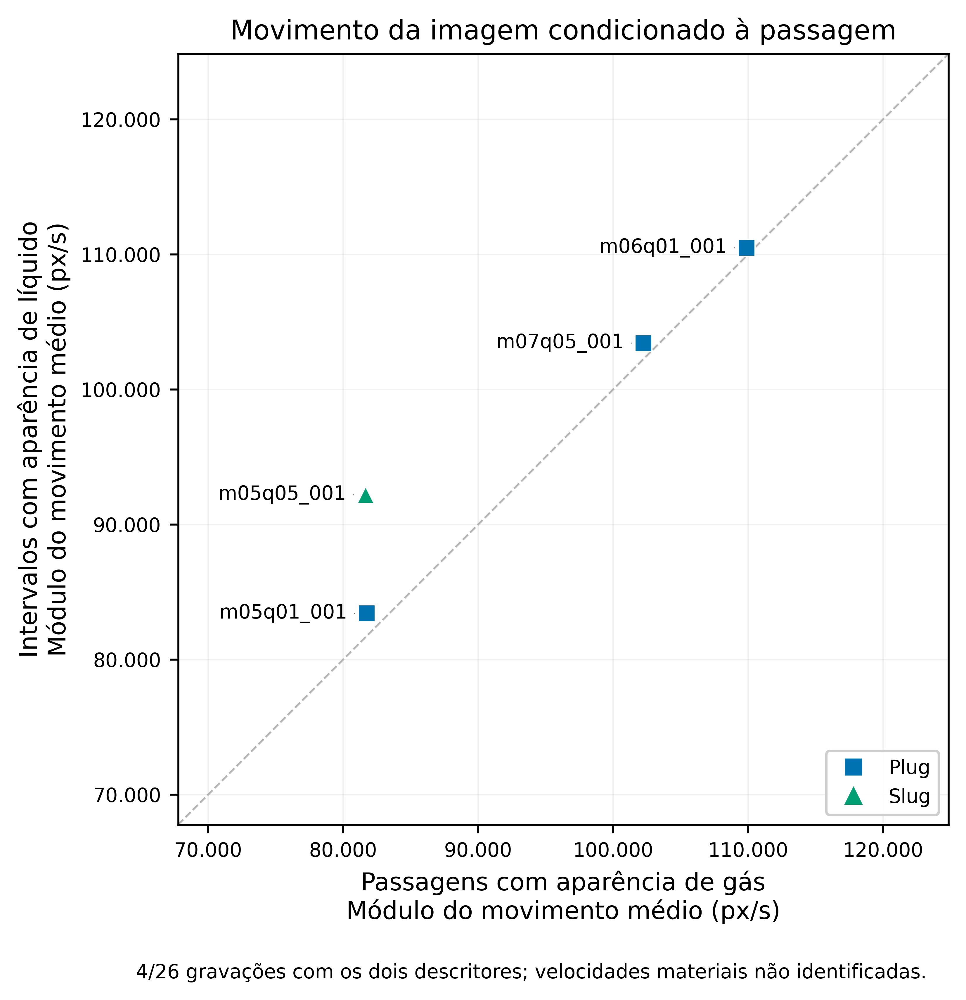
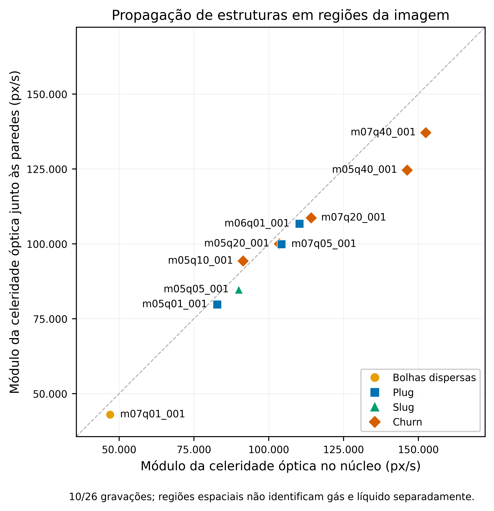
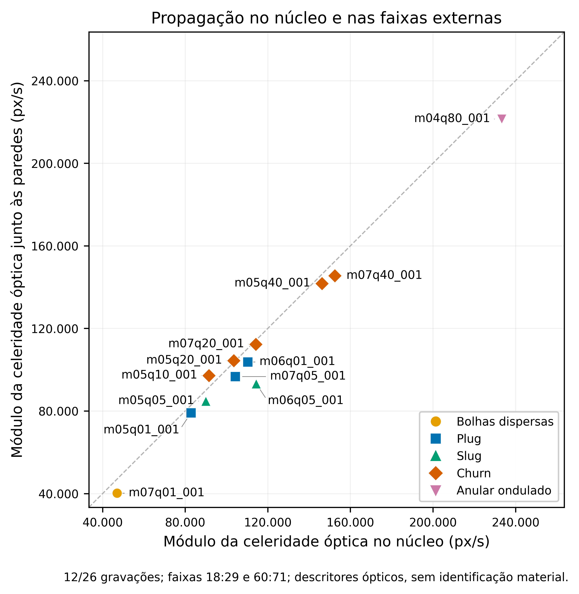
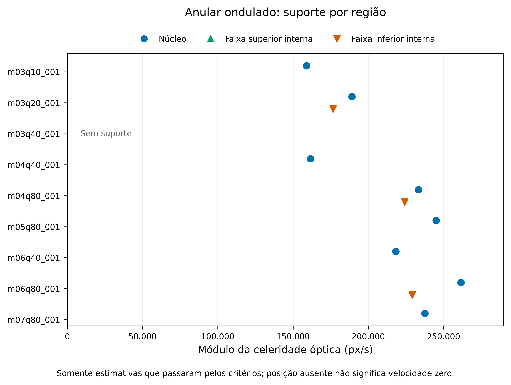

# RESUMO EXECUTIVO — v15.1: movimento óptico e comparação gás–líquido

**A unidade principal recomendada é px/s.** A taxa de aquisição foi confirmada, mas não foi encontrada calibração axial em m/pixel. A análise produziu comparações por passagem em **4/26 gravações** e comparações entre regiões em **10/26**. No anular, **8/9 núcleos** apresentaram propagação óptica com suporte nos critérios finais. Nenhum desses resultados identifica, por si só, duas velocidades materiais ou superficiais independentes.

Foram mantidas as exclusões: m05q05_002, anular liso e classificações duplas. As 26 gravações contêm 501 imagens nativas cada, totalizando 13.026 imagens e 13.000 intervalos adjacentes. Os registros duram somente 71–125 ms.

## 1. Comparação solicitada: um ponto por gravação com suporte

O eixo horizontal representa o módulo da média com sinal do movimento durante passagens com aparência de gás; o vertical, durante intervalos com aparência de líquido. Todos os deslocamentos aceitos das quatro comparações apontam para a esquerda. A linha tracejada indica módulos iguais e não delimita padrões. Os pontos não representam Jg e Jl.

| Gravação | Padrão | Média no gás aparente, px/s | Média no líquido aparente, px/s | Razão das médias | Pares gás/líquido |
|---|---|---:|---:|---:|---:|
| m05q01_001 | Plug | -81.739 | -83.413 | 0,980 | 273/59 |
| m05q05_001 | Slug | -81.660 | -92.199 | 0,886 | 253/56 |
| m06q01_001 | Plug | -109.885 | -110.484 | 0,995 | 245/31 |
| m07q05_001 | Plug | -102.242 | -103.426 | 0,989 | 221/42 |

A referência foi preservada e reagregada diretamente dos pares: concordância dos limiares v14 0,60/0,70/0,80, verificação da aparência líquida, episódios de pelo menos cinco quadros e consistência no intervalo de dois quadros. Exigiram-se pelo menos 20 pares e três episódios por tipo de passagem. A classificação ocorreu em uma janela de 24×53 pixels; a correlação do movimento utilizou uma região de 536 pixels de comprimento que pode conter ambas as fases.

A média com peso igual por episódio fornece razões 0,983, 0,935, 0,988, 1,008, na mesma ordem. A última cruza a unidade. Essa sensibilidade impede concluir qual fase material foi mais rápida. Os testes anteriores de regiões internas e janelas adaptativas continuam sem um par material validado; pixels não marcados pelo detector não são líquido confirmado.

## 2. Alternativa espacial: núcleo e regiões junto às paredes

A nova correlação normalizada foi calculada para todas as imagens em cinco faixas radiais. A referência usou núcleo 35:54, faixa superior 24:35 e inferior 54:65; são fatias Python com limite final exclusivo. A coordenada junto à parede é a média das celeridades superior e inferior, somente quando ambas têm suporte e concordam. A estimativa de cada faixa é o deslocamento do pico da curva média de correlação, dividido pelo intervalo temporal: **não é a média aritmética das velocidades dos pares**.

Foram testados intervalos de 1, 2 e 4 quadros, cinco blocos temporais e 19 embaralhamentos da ordem temporal em cada intervalo. A revisão adversarial identificou picos fracos em alguns intervalos maiores. O critério final também exigiu força e separação dos controles em todos os intervalos, consistência da reversão temporal e de duas posições axiais adicionais. As decisões do critério inicial foram preservadas para comparação. Esses critérios avaliam suporte e consistência, não exatidão física.

## 3. Tratamento especial dos anulares

A alternativa fixa de faixas externas forneceu **12/26 pares**, incluindo todos os cinco padrões e uma gravação anular: m04q80, com núcleo −233.283 px/s e média das faixas externas −221.429 px/s. Ela usou a mesma definição em todas as gravações; não combinou faixas diferentes caso a caso. A referência com faixas internas forneceu 10 pares e nenhum anular. Cobertura maior não estabelece maior exatidão física.

A correlação média recuperou propagação coerente do brilho/estrutura no núcleo de 8 gravações anulares, com módulos entre 159.038 e 261.603 px/s. As faixas junto às paredes foram mais sensíveis ao intervalo e à posição. A falta de textura exclusiva de uma fase continua impedindo chamar esses valores de velocidade do gás ou do líquido.

Também foram testadas faixas externas 18:29 e 60:71 e posições de gradientes superior/inferior como candidatos de interface. As alternativas foram aplicadas por uma regra fixa, e não escolhidas individualmente para completar o gráfico. A celeridade de uma onda de filme não equivale à velocidade média do filme: em um modelo h_t+[q(h)]_x=0, c=dq/dh, enquanto a média material é q/h. Não foi adotado um fator universal de conversão. m03q40 permaneceu sinalizado por saturação.

**Limitação remanescente:** a filtragem passa-altas com escala gaussiana de 8 pixels mudou quatro dos oito resultados anulares de núcleo além da tolerância declarada; com 32 pixels, os oito concordaram. Em m03q10, a celeridade mudou de −31,81 para −10,19 px/quadro. A celeridade estimada depende da escala óptica enfatizada pelo pré-processamento; um pico persistente não identifica automaticamente a velocidade material. Nenhum par baseado nas posições de gradiente permaneceu após exigir evidência forte em todos os intervalos.

## 4. Cobertura e casos difíceis

| Padrão | Gravações | Pares por passagem | Faixas internas | Faixas externas | Núcleos com suporte |
|---|---:|---:|---:|---:|---:|
| Bolhas dispersas | 1 | 0 | 1 | 1 | 1 |
| Plug | 3 | 3 | 3 | 3 | 3 |
| Slug | 3 | 1 | 1 | 2 | 2 |
| Churn | 10 | 0 | 5 | 5 | 6 |
| Anular ondulado | 9 | 0 | 0 | 1 | 8 |

Plug oferece o melhor suporte para a comparação por passagem. Em slug, m04q01 e m06q05 não fornecem intervalos líquidos suficientes pela regra de referência; relaxar o limiar muda a mistura amostrada. Em bolhas dispersas, o rastreamento de objetos isolados foi mantido como observável separado: 38 trajetórias candidatas, 1.038 intervalos de objetos e média −43.904 px/s no limiar 0,70. Vários objetos podem contribuir no mesmo intervalo entre quadros. Em churn, contornos sobrepostos e mistura visual prejudicam a identificação de fases.

As 26 gravações permanecem na [tabela de situação](../results/all_run_status.csv) e no [painel de cobertura](../figures/all_run_availability_PT_BR.png). O [gráfico diagnóstico com todas as candidatas](../figures/all_regional_candidates_PT_BR.png) apresenta resultados rejeitados com marcadores vazios e saturação com ×. Nesse diagnóstico, a coordenada de parede conserva a média dos dois picos até quando discordam; esses pontos não são estimativas aceitas. Não foram preenchidas velocidades ausentes por valores de outro padrão ou por zero.

## 5. Conversão para m/s e inferência rejeitada

A auditoria nova inspecionou 78 arquivos de câmera, metadados de 13.026 JPEGs e 104 planilhas. FPS e proporção 1:1 dos pixels estão registrados; parâmetros de lente, referência e correção óptica não fornecem m/pixel. O campo ScaleFactor=1 pertence a canais de tensão desativados. A escala 13,68 µm/pixel de Dias pertence a uma campanha diferente e não foi transferida.

v_imagem = deslocamento_px × FPS / intervalo_em_quadros

A conversão geométrica opcional usa s=0,001/53=18,8679 µm/pixel. Ela pressupõe que o diâmetro físico de 1 mm corresponda aos 53 pixels radiais e que essa escala também valha axialmente, apesar da refração no tubo. O [gráfico condicional em m/s](../figures/gas_liquid_passages_conditional_m_s_PT_BR.png) multiplica os mesmos quatro pares por esse fator; não oferece validação adicional.

Para testar uma alternativa sem entalpia de entrada, rearranjou-se G=ρg α ug+ρl(1−α)ul usando vazão registrada, geometria nativa e movimento óptico substituído por ug. Foram calculados **702 casos**, todos rejeitados como velocidades materiais. No cenário de referência, a velocidade líquida algébrica atingiu **1.150,44 m/s**; a variação apenas do limiar alterou alguns resultados em até **6,29 vezes**. Esses são resultados de um teste de hipóteses inadequadas, não medidas de escoamento. A área líquida quase nula amplifica o resultado; médias não sincronizadas e identidade material não verificada invalidam a interpretação.

O gráfico de referência usa velocidades superficiais: Jg=Qg/A e Jl=Ql/A. FPS não fornece Qg nem Ql. Dias calculou essas quantidades a partir de G e título de vapor; o artigo de de Oliveira descreve entrada sub-resfriada. As equações e as páginas originais foram verificadas na [revisão de calibração e literatura](calibration_review.md).

## 6. Recomendação e limites da validação

Recomenda-se publicar o gráfico por passagem em px/s com sua definição completa, acompanhado do mapa regional como análise distinta. Para anular, a correlação média com verificações ampliadas é a opção mais sustentada para estudar propagação óptica no núcleo; a velocidade média do líquido continua sem identificação. Não foi estabelecido um método vencedor em exatidão física nem uma razão universal por padrão.

A verificação independente conferiu classificações, critérios de aceitação, conversões e agregações dos 13.000 registros de pares salvos; não refez o rastreamento original de imagens. Também recalculou a ocupação e a geometria das 39.078 máscaras salvas por outro algoritmo e os 702 casos do teste de massa, sem importar os geradores correspondentes. Os testes sintéticos, de reversão, de posição e de embaralhamento avaliam consistência numérica e correspondência. Não validam fase material, escala óptica ou erro experimental. As figuras usam os mesmos dados em inglês e PT-BR e foram exportadas em PDF/SVG e PNG de 600 dpi. Os intervalos e blocos não são repetições experimentais independentes.

Evidências: [revisão adversarial](adversarial_method_review.md), [verificação independente](../results/independent_verification.json), [dados dos pontos por passagem](../results/paper_passage_plot_data.csv), [dados dos pontos regionais](../results/paper_regional_plot_data.csv), [legendas para o artigo](FIGURE_CAPTIONS_PT_BR_2026-10-23.md) e [reprodução](../README.md).
