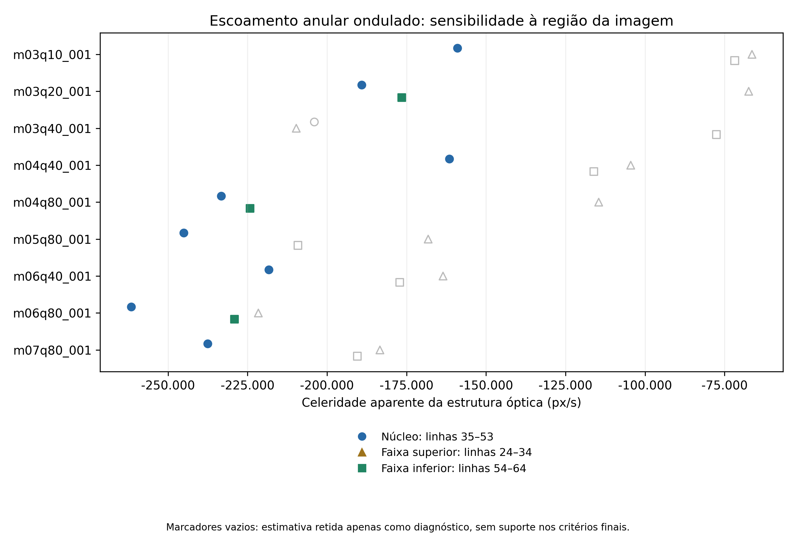
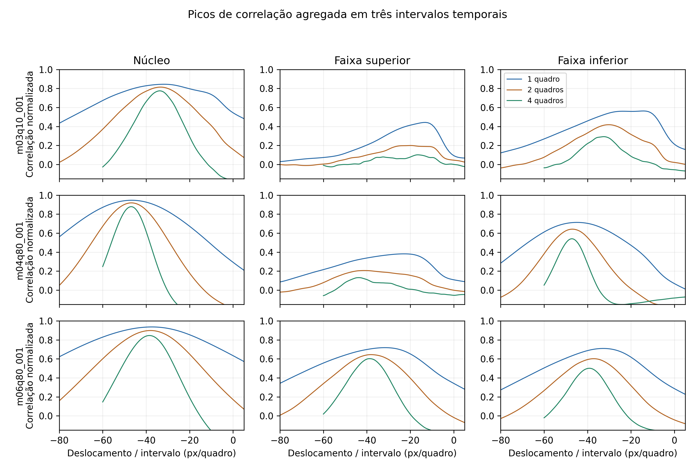

# Spatial propagation and special annular handling

**Aggregating normalized image correlations recovers a supported core optical celerity in 8/9 annular recordings under the final checks. It does not establish gas or liquid material velocity.** Spatial core/near-wall pairs are available in 10/26 recordings with the fixed inner-band definition, and 12/26 with the fixed outer-band alternative. Neither descriptor is a superficial gas/liquid velocity map.

## What was calculated

All 501 native images were used in each of the 26 retained recordings. The source configurations were independently checked for matching native FPS and consecutive frame IDs. The nine wavy-annular recordings also received upper/lower brightness-gradient tracking. No masks, inlet assumptions, flow-rate fit or pixel-to-length conversion enters these computations.

| Profile | Half-open image-row interval | Observable |
|---|---|---|
| Core | 35:54 | Mean grayscale profile along the image |
| Inner upper/lower bands | 24:35 and 54:65 | Separate mean grayscale profiles |
| Outer upper/lower bands | 18:29 and 60:71 | Separate mean grayscale profiles closer to lumen limits |
| Upper/lower gradient locations, annular only | 22:42 and 45:67 | Locations of strongest signed radial intensity gradients after smoothing |

The five grayscale-region definitions are fixed across all 26 runs. Their spatial names do not certify which material fills the projected image region. In annular flow, a central optical ray can also traverse the near and far liquid films. A gradient location can follow a shadow or reflection instead of the material interface.

For each profile, its 501-frame temporal mean at each axial coordinate was subtracted. A source template x=240:776 (536 pixels) was normalized and compared against all equal-width target windows over ±240 pixels. Per-pair NCC uses peak≥0.60, competing-peak margin≥0.03 beyond ±5 pixels, adequate texture and an interior search peak.

The alternative averages the full normalized correlation curves over all texture-qualified pairs before locating a peak. Its output is a **peak-derived propagation celerity**, not an arithmetic average of instantaneous displacement estimates. This can resolve coherent broad structures rejected by individual competing-peak margins; it can also privilege the dominant optical mode.

## Reporting checks and adversarial tightening

Baseline gates require at least 250 texture-qualified adjacent pairs, ensemble peak≥0.10, a peak at least 0.03 above the largest of 19 shuffled-order peaks, nonzero interior-search motion, ≤20% saturated regional pixels, lag-2/4 celerities within max(2 px/frame,20%) of lag 1, and agreement in at least four of five temporal blocks. The edge candidates additionally exclude >20% weak gradients or edge-search-boundary picks. These are diagnostic gates, not confidence limits.

The adversarial review identified that matching lag speeds alone was insufficient: the longer-lag correlation peak itself could be weak. Final recommended support therefore also requires peak≥0.10 and peak≥the same-lag maximum shuffled peak+0.03 at each lag (1, 2 and 4 frames), correct reversed-time celerity within tolerance, and agreement under both alternative axial source starts x=160 and x=320. Those templates keep width 536 and use their full valid asymmetric shift ranges. Baseline decisions remain saved separately.

The wall descriptor is the equal arithmetic average of the upper and lower **regional celerities**, available only if both regions pass, both directions agree, and their difference is ≤max(2 px/frame,25% of their average magnitude). A spatial pair additionally needs supported core motion in the same direction. No run-specific mixture of inner/outer/gradient definitions is used.

## Scope and support

| Pattern | Runs | Inner-band pairs, baseline/final | Outer-band pairs, baseline/final |
|---|---:|---:|---:|
| dispersed bubbles | 1 | 1/1 | 1/1 |
| plug | 3 | 3/3 | 3/3 |
| slug | 3 | 1/1 | 2/2 |
| churn | 10 | 5/5 | 5/5 |
| wavy annular | 9 | 0/0 | 1/1 |

## Every annular recording

| Run | Core celerity px/s | Core final support | Upper/lower inner final support | Outer-band spatial pair | Gradient spatial pair |
|---|---:|---|---|---|---|
| m03q10_001 | -159,038 | True | False/False | False | False |
| m03q20_001 | -189,128 | True | False/True | False | False |
| m03q40_001 | withheld | False | False/False | False | False |
| m04q40_001 | -161,551 | True | False/False | False | False |
| m04q80_001 | -233,283 | True | False/True | True | False |
| m05q80_001 | -245,082 | True | False/False | False | False |
| m06q40_001 | -218,296 | True | False/False | False | False |
| m06q80_001 | -261,603 | True | False/True | False | False |
| m07q80_001 | -237,589 | True | False/False | False | False |

The hollow markers retain nonreportable estimates as diagnostic evidence only. Missing supported coordinates must not be replaced with these estimates in a main velocity scatter. Negative values indicate leftward propagation.

The gradient-location alternative has one baseline candidate (m04q40), but **zero** final supported pairs: the longer-lag evidence is too weak. The final outer-band alternative supplies one annular spatial pair, m04q80, with core celerity −233,283 px/s and the mean of two outer-band celerities −221,429 px/s. Its inner-band alternative fails. This dependence on region definition must remain visible in any comparison.

High-pass scale 8 changes the selected core celerity beyond the declared 20%/2 px-per-frame tolerance in four of the eight otherwise supported annular recordings: m03q10, m03q20, m04q40 and m07q80. For example, m03q10 changes from −31.81 to −10.19 px/frame. Scale 32 retains agreement in all eight. These results identify an optical-scale dependence; they do not determine which optical mode follows the gas material.

## Interpretation and limitations

- The aggregate method recovers strong, persistent core brightness propagation where the earlier pair-level sharpness rule supplied very little support. For example, m06q80 has zero accepted individual core pairs, yet its aggregate peak is stable across lag, temporal block, source position and reversal checks. This is evidence for a coherent optical structure, not validated gas material tracking.
- The inner near-wall bands can contain multiple scales with different apparent propagation. Their maxima may move from one mode to another when the temporal gap changes. This is why core support alone does not create a second phase velocity.
- The outer-band alternative and gradient-location alternative are reported consistently as separate analyses. Any annular pair appearing only under an alternative definition is definition-sensitive, not a repaired gas/liquid slip measurement.
- High-pass sensitivity at Gaussian scales 8 and 32 and a raw-profile alternative are saved. They change the optical structure being emphasized. A different celerity is method/scale sensitivity, not an error against physical ground truth.
- Core and wall image signals can respond to the same moving boundary. Different or similar regional celerities do not prove independent phase-material velocities. Bubble/film/interface wave propagation, projected illumination and refraction remain possible sources.
- m03q40 remains withheld for core saturation. A surviving dark outer strip does not restore the lost core information.
- Native recording durations are only 71–125 ms; overlapping pairs and blocks are not independent experimental repeats. The shuffle maxima are null diagnostics, not calibrated significance levels or uncertainty intervals.

## Reproduction and arithmetic checks

Run python3 -B src2/v15.1_gas_liquid_velocity/scripts/annular_motion.py, then scripts/annular_report.py at the same absolute base. The --pilot option retains the two original pilot cases separately.

Saved checks reproduce 224,368 pair/summary operations, 148 region rows, 444 lag rows, 8436 shuffled trials and 888 supplementary checks. Diagnostic correlation arrays are packed as float32; full-precision reported values remain in CSVs. The maximum reconstructed shift difference from this packing is 0.000184 px. These checks do not establish phase truth or physical accuracy.

Tables: [all regional outputs](../results/annular_region_summary.csv), [consistent pair variants](../results/annular_variant_pairs.csv), [lag support](../results/annular_lag_summary.csv), [all shuffle trials](../results/annular_null_trials.csv), [source/reversal/preprocessing sensitivity](../results/annular_additional_checks.csv), [temporal blocks](../results/annular_block_summary.csv), [metadata and synthetic controls](../results/annular_metadata.json), and [verification](../results/annular_verification.json).
