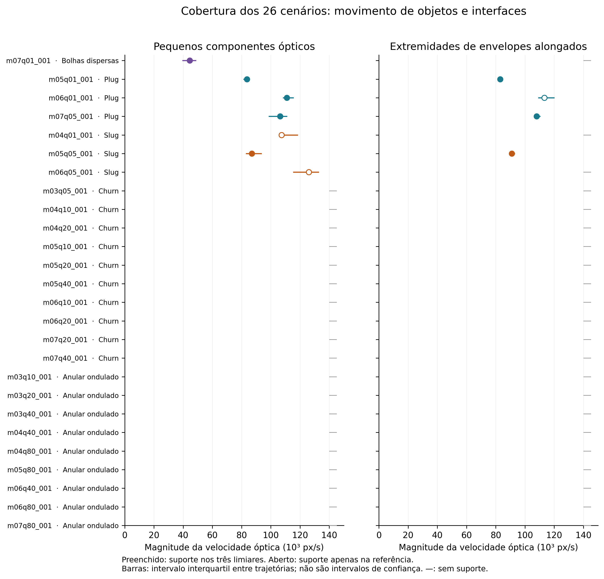
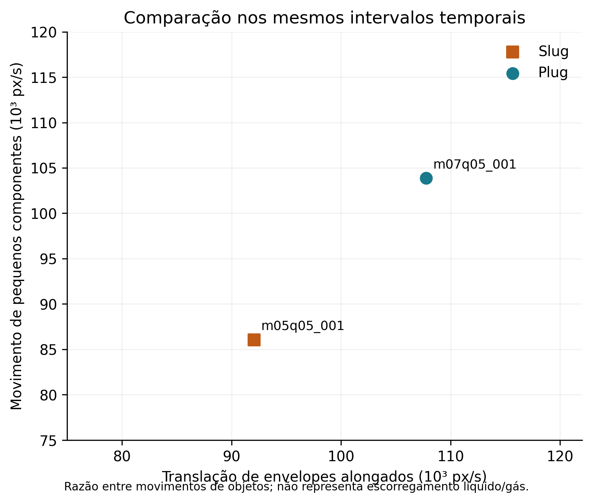
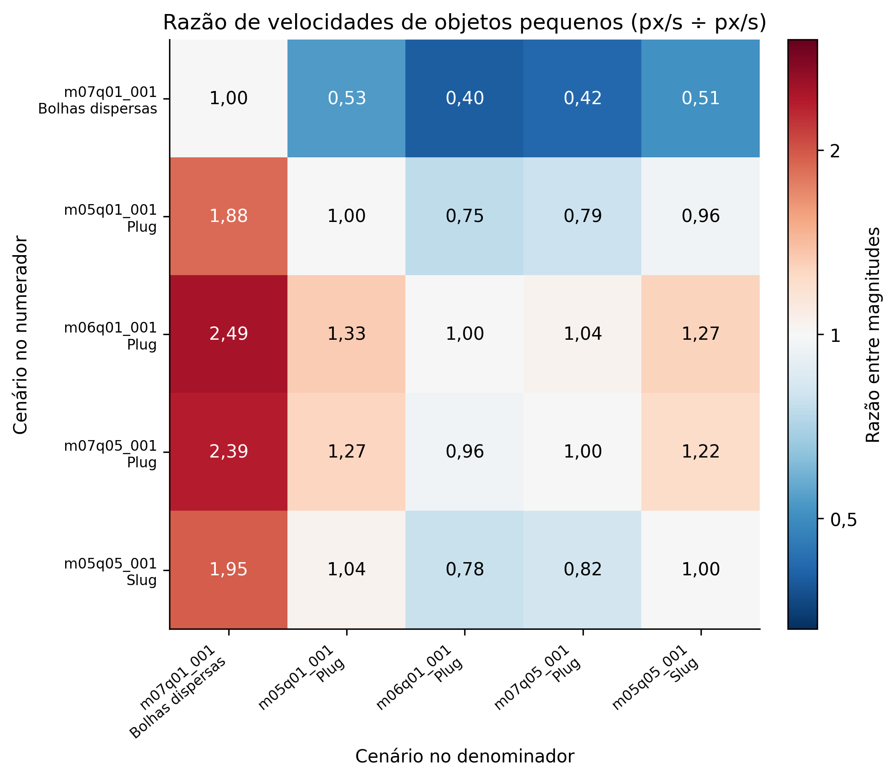

# EXECUTIVE SUMMARY — v15.2

**Conclusion: the investigation recovered object and interface motion, but did not identify two independent liquid/gas material velocities. The requested liquid/gas velocity result, including relative values across all patterns, was not achieved with the available data and tested methods. Missing velocities were not filled.**

The study covered 26 eligible recordings and 13,026 native images, preserving the requested exclusions. Primary units are px/s. Negative velocities move toward decreasing image columns; speed figures show magnitudes of those selected motions. Native FPS is documented. Axial metres per pixel and relative magnification across recordings remain independently unverified.

## Main results

| Result | Recordings | Meaning |
|---|---:|---|
| Motion-resolved small objects | 7/26 at reference; **5/26** stable across thresholds | Translation of segmented components, not validated liquid tracers. |
| Robust elongated-envelope endpoints | 4/26 at reference; **3/26** stable | Celerity of gas-candidate structures. |
| Small objects and elongated envelopes on common intervals | **2/26** stable | Two object-population motions; not phase slip. |
| Interface-conditioned residual texture | 2/26 at erosion 3 px; 4/26 at erosion 1 px | No recording retained five common blocks across all four background/erosion options. |
| Identified material liquid/gas pairs | **0/26** | A validated complete chart of those quantities is unavailable. |

Here, **small object means a small mask component**, not necessarily an entire bubble. Native examples include components covering only part of a larger bubble outline. Disabling open-envelope filling does not guarantee a physically closed outline. Consequently, small/envelope comparisons may still share interface information rather than follow two independent material tracers.

## Figures and auditable results

All recordings appear in the coverage figure. A dash means unsupported, not zero speed. Filled markers pass support and agreement at thresholds 0.60/0.70/0.80; open markers pass only the reference. Bars show between-track spread, not experimental uncertainty. Annular texture was not mixed with bubble translation to complete coordinates.

| Recording | Pattern | Small objects (10³ px/s) | Elongated envelopes (10³ px/s) | Small/envelope ratio on common intervals |
|---|---|---:|---:|---:|
| m03q05_001 | churn | — | — | — |
| m03q10_001 | wavy annular | — | — | — |
| m03q20_001 | wavy annular | — | — | — |
| m03q40_001 | wavy annular | — | — | — |
| m04q01_001 | slug | — | — | — |
| m04q10_001 | churn | — | — | — |
| m04q20_001 | churn | — | — | — |
| m04q40_001 | wavy annular | — | — | — |
| m04q80_001 | wavy annular | — | — | — |
| m05q01_001 | plug | 83.72 | 83.03 | — |
| m05q05_001 | slug | 87.08 | 91.00 | 0.935 |
| m05q10_001 | churn | — | — | — |
| m05q20_001 | churn | — | — | — |
| m05q40_001 | churn | — | — | — |
| m05q80_001 | wavy annular | — | — | — |
| m06q01_001 | plug | 111.00 | — | — |
| m06q05_001 | slug | — | — | — |
| m06q10_001 | churn | — | — | — |
| m06q20_001 | churn | — | — | — |
| m06q40_001 | wavy annular | — | — | — |
| m06q80_001 | wavy annular | — | — | — |
| m07q01_001 | dispersed bubbles | 44.54 | — | — |
| m07q05_001 | plug | 106.43 | 107.91 | 0.964 |
| m07q20_001 | churn | — | — | — |
| m07q40_001 | churn | — | — | — |
| m07q80_001 | wavy annular | — | — | — |

The main table retains threshold-stable results only. Object/envelope columns are medians over their separately selected trajectories. The ratio instead aggregates fitted velocities present on common time intervals; it is not the quotient of those two medians.

**m05q05_001 (slug):** ratio **0.9345**, segmentation sensitivity **0.9345–0.9924**, using 120/500 reference intervals. **m07q05_001 (plug):** **0.9639**, sensitivity **0.9444–0.9817**, using 133/500 intervals. These ranges are not confidence intervals. Fits use whole trajectories; only aggregation is restricted to common intervals. Near-unity ratios do not establish negligible phase slip: the small candidates can themselves be bubbles.

A common small-object definition supports ten comparisons between five recordings: three within plug and seven between recordings of different patterns. These are descriptive comparisons of selected object populations, not liquid speeds, causal pattern effects, or full gas-phase means. Physical interpretation requires equal axial magnification. A single dispersed-bubble recording supplies no between-recording replication for that pattern.

## Tested options and selection

Closed-contour tracking recovered small objects but failed on large plug/slug contours. Wall-connected shadows compromised geometry. Axial core-envelope tracking recovered menisci, but localization jumps defeated the original trajectory gates. Robust Theil–Sen fits to both endpoints, with deformation and temporal-half agreement checks, recovered three threshold-stable recordings. This is the most useful tested option for **elongated-envelope translation** in that subset, not a validated gas material mean.

The additional motion screen removed 29 reference candidates with near-zero motion or insufficient fitted travel. Visual examples recur near image column 370 across recordings, consistent with fixed optical structure. Original tables retain them. Selection, segmentation, weighting and object-population changes remain potential biases.

The interface-distance predictor removed specified synthetic halos while preserving independent interior textures. Shared moving illumination nevertheless passed both masks without material transport. Real rectangular mask errors also propagated into residual texture. Residual subtraction supported the same pair counts as the fixed background (2/26 and 4/26), in different subsets, and did not identify an additional liquid observable. None of the nine wavy-annular recordings had a supported residual pair under the main rule.

Zero-size extrapolations compared constant, linear, quadratic and radial-adjusted quadratic models. Temporal-group validation purged training trajectories that shared native intervals with test trajectories. Size/speed associations depended on model and recording. Even predictive fit cannot identify the intercept as liquid motion without a justified slip model, size calibration and optical depth information. No intercept was promoted to a phase velocity.

Conservation gives **alpha_body <= U_liquid_piston/c_bubble <= 1** only for a rigid cell, a gas-free piston, valid geometry and film mean speed between zero and bubble speed. The prespecified closed-large-object application found **zero eligible trajectories**, so no liquid bounds were assigned. Robust menisci improve axial translation but retain substantial radial mask contact, sometimes apparent alpha_body=1. This does not establish film thickness or validate the geometry. A whole-cell liquid mean additionally requires identification of the complete cell.

## Validation and limitations

Controls covered known translation, localization noise, growth, acceleration, stationarity, ambiguous correspondence, time reversal and shared illumination. Maximum residual-method error on the prescribed synthetic velocities was 0.015875 px/frame; this is not experimental accuracy. Forty-five saved real peaks were checked by direct Pearson calculation, maximum difference 8.05e-8. Independent trajectory and detection checks document their exact scope separately.

Recordings last only 71–125 ms; exposures span 43.4–66.0% of a frame interval. Refraction, out-of-plane overlap, saturation and selection of easy objects remain. Agreement of algorithms or ratios does not identify material transport. The de Oliveira and Dias papers obtain velocities/slip through thermodynamic reduction or closure, and do not validate these image motions as the two material phase velocities.

**Recommendation:** retain well-defined bubble/envelope translation and optical comparisons as the results supported by this dataset. Leave material liquid/gas fields missing. Filling every point would require additional unvalidated assumptions and must not be presented as measured or identified phase slip.

## Files

- [Final 26-recording table](../results/final_per_run_status.csv), [common-interval ratios](../results/paired_object_consensus.csv), [between-recording comparisons](../results/inter_recording_object_ratios.csv).
- [Protocol and option history](PROTOCOL.md), [residual review](residual_review_PT_BR.md), [physical/literature review](physical_identifiability_review_PT_BR.md), [conditional-bound application](conditional_piston_PT_BR.md).
- [Native moving-object examples](../figures/moving_object_examples_PT_BR.png), [stationary-candidate audit](../figures/object_stationary_audit.png), [complete extrapolations](../results/zero_size_extrapolation.csv).
- [Reproduction](../README.md), [final verification](../results/final_verification.json). Main figures are provided in Portuguese as 300-dpi PNG and vector PDF/SVG.
