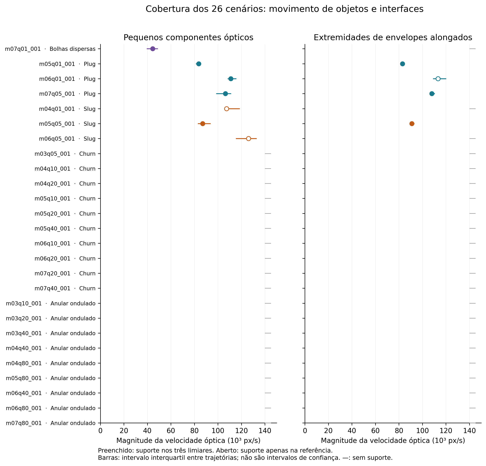
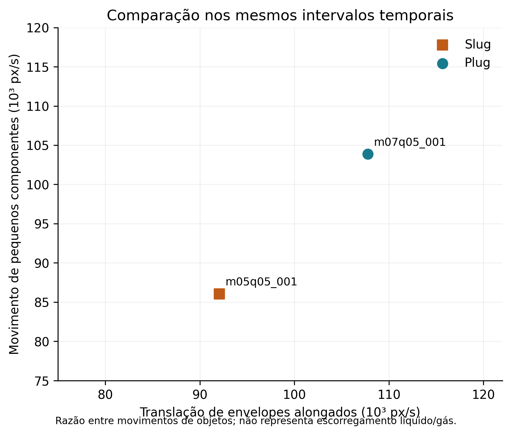
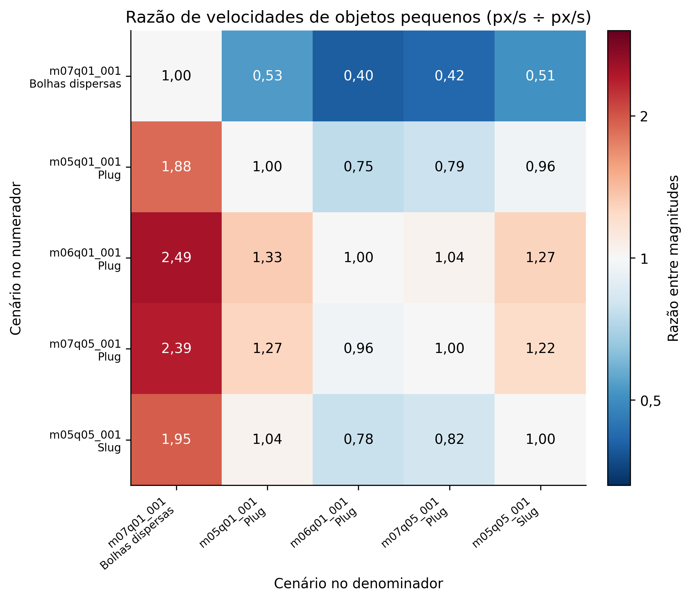

# EXECUTIVE SUMMARY — v15.2 (PT-BR)

**Conclusão: a investigação recuperou movimentos de objetos e interfaces, mas não identificou dois movimentos materiais independentes de líquido e gás. O objetivo de obter velocidades líquido/gás, mesmo relativas para todos os padrões, não foi alcançado com os dados e métodos testados. Nenhuma velocidade ausente foi preenchida.**

Foram analisados 26 cenários e 13,026 imagens nativas, preservando as exclusões solicitadas. As unidades principais são px/s; valores negativos indicam movimento para colunas menores. Os gráficos de velocidade usam magnitudes, pois os resultados selecionados se deslocam nesse sentido. O FPS é documentado; a escala axial em metros por pixel e a magnificação relativa entre gravações permanecem sem confirmação independente.

## Resultados principais

| Resultado | Cenários | Significado |
|---|---:|---|
| Objetos pequenos com movimento resolvido | 7/26 na referência; **5/26** estáveis nos três limiares | Translação de componentes segmentados; não são traçadores líquidos validados. |
| Envelopes alongados, ajuste robusto das extremidades | 4/26 na referência; **3/26** estáveis | Celeridade de estruturas candidatas a gás. |
| Comparação de objetos pequenos e envelopes nos mesmos intervalos | **2/26** estáveis | Razão entre movimentos de duas populações de objetos, não escorregamento de fases. |
| Textura após subtração condicionada à interface | 2/26 com erosão de 3 px; 4/26 com erosão de 1 px | Nenhum cenário manteve cinco blocos comuns nas quatro opções de fundo/erosão. |
| Pares materiais líquido/gás identificados | **0/26** | Não há gráfico completo validado com essas duas grandezas. |

Nesta análise, **objeto pequeno significa um componente pequeno da máscara**, não necessariamente uma bolha inteira. A inspeção dos exemplos nativos mostrou componentes que cobrem somente parte do contorno de uma bolha maior. Desabilitar o preenchimento de envelopes abertos não garante um contorno físico fechado. Portanto, até a comparação pequena/envelope pode compartilhar informação da interface; não representa dois traçadores materiais independentes.

## Gráficos e resultados auditáveis

Todos os cenários aparecem nessa figura de cobertura. Traço indica ausência de suporte, não velocidade zero. Símbolos preenchidos indicam suporte e concordância nos limiares 0,60/0,70/0,80; os abertos têm suporte somente na referência. As barras representam dispersão entre trajetórias, não incerteza experimental. Não se misturou textura anular com velocidade de bolhas para completar pontos.

| Cenário | Padrão | Objetos pequenos (10³ px/s) | Envelopes alongados (10³ px/s) | Razão pequena/envelope nos intervalos comuns |
|---|---|---:|---:|---:|
| m03q05_001 | Churn | — | — | — |
| m03q10_001 | Anular ondulado | — | — | — |
| m03q20_001 | Anular ondulado | — | — | — |
| m03q40_001 | Anular ondulado | — | — | — |
| m04q01_001 | Slug | — | — | — |
| m04q10_001 | Churn | — | — | — |
| m04q20_001 | Churn | — | — | — |
| m04q40_001 | Anular ondulado | — | — | — |
| m04q80_001 | Anular ondulado | — | — | — |
| m05q01_001 | Plug | 83,72 | 83,03 | — |
| m05q05_001 | Slug | 87,08 | 91,00 | 0,935 |
| m05q10_001 | Churn | — | — | — |
| m05q20_001 | Churn | — | — | — |
| m05q40_001 | Churn | — | — | — |
| m05q80_001 | Anular ondulado | — | — | — |
| m06q01_001 | Plug | 111,00 | — | — |
| m06q05_001 | Slug | — | — | — |
| m06q10_001 | Churn | — | — | — |
| m06q20_001 | Churn | — | — | — |
| m06q40_001 | Anular ondulado | — | — | — |
| m06q80_001 | Anular ondulado | — | — | — |
| m07q01_001 | Bolhas dispersas | 44,54 | — | — |
| m07q05_001 | Plug | 106,43 | 107,91 | 0,964 |
| m07q20_001 | Churn | — | — | — |
| m07q40_001 | Churn | — | — | — |
| m07q80_001 | Anular ondulado | — | — | — |

A tabela principal mostra apenas resultados estáveis nos três limiares. As medianas de objetos/envelopes usam suas próprias trajetórias selecionadas. A razão usa outra agregação: médias das velocidades ajustadas que estão presentes nos mesmos intervalos temporais. Por isso, não deve ser calculada dividindo as duas medianas dessa tabela.

Em **m05q05_001 (slug)**, a razão foi **0,9345**, com sensibilidade de **0,9345–0,9924** e 120/500 intervalos na referência. Em **m07q05_001 (plug)**, foi **0,9639**, sensibilidade **0,9444–0,9817**, em 133/500 intervalos. São envelopes de sensibilidade à segmentação, não intervalos de confiança. Os ajustes usam as trajetórias inteiras; apenas sua agregação foi restrita aos intervalos comuns. Proximidade de 1 não demonstra ausência de escorregamento líquido/gás: os pequenos candidatos também podem ser bolhas.

A mesma definição de movimento de objetos pequenos permitiu dez comparações entre cinco gravações: três dentro do grupo plug e sete entre gravações de padrões diferentes. São comparações descritivas de populações selecionadas de objetos. Não são velocidades líquidas, efeitos causais do padrão nem médias de toda a fase gasosa. Interpretá-las como razões físicas requer magnificação axial comum; a gravação única de bolhas dispersas não permite estimar variabilidade entre repetições desse padrão.

## O que foi testado e qual opção funcionou melhor

O detector de contornos fechados recuperou objetos pequenos, mas rejeitou as trajetórias grandes de plug/slug. Sombras conectadas à parede comprometiam sua geometria. A alternativa de rastrear intervalos axiais do núcleo recuperou meniscos, mas os saltos de localização reprovavam o ajuste original. O ajuste robusto Theil–Sen das duas extremidades, com controles de deformação e concordância temporal, recuperou os três resultados estáveis apresentados. É a opção mais útil aqui para **translação de envelopes alongados**, dentro desse subconjunto; não foi validada como média material de gás.

O filtro adicional de movimento removeu 29 candidatos de referência quase imóveis ou com percurso ajustado insuficiente. A inspeção encontrou exemplos persistentes perto da coluna 370 em diferentes vídeos, compatíveis com estrutura óptica fixa. Foram preservados nas tabelas originais e excluídos da comparação de objetos em movimento. Mudanças de população, limiar e ponderação permanecem fontes de viés.

A subtração da contribuição prevista pela distância à interface removeu halos sintéticos especificados e preservou duas texturas independentes. Porém, uma iluminação móvel compartilhada passou pelos critérios nas duas máscaras mesmo sem transporte material. Em imagens reais, erros retangulares da máscara também foram transferidos ao resíduo. O novo método deu o mesmo número de pares apoiados que o fundo fixo (2/26 e 4/26), com conjuntos diferentes; não demonstrou identificação adicional de líquido. Nenhum dos nove anulares ondulados teve par residual apoiado na regra principal.

Também foram testadas extrapolações de velocidade para tamanho aparente zero: constante, linear, quadrática e quadrática com posição radial. A validação retirou grupos temporais e eliminou do treinamento trajetórias que compartilhassem intervalos com o grupo de teste. A associação tamanho/velocidade variou entre cenários e modelos. Mesmo um bom ajuste não identifica seu intercepto como líquido: tamanho tridimensional, deslizamento, refração e profundidade não estão determinados. Os interceptos ficaram fora dos resultados de velocidade de fase.

A conservação oferece o limite **α_b ≤ U_l,pistão/c_bolha ≤ 1**, condicionado a célula rígida, pistão sem gás, geometria correta e filme com 0 ≤ U_f ≤ c_bolha. A aplicação prespecificada a contornos grandes encontrou **0 trajetórias elegíveis**; nenhum limite líquido foi atribuído. Os meniscos robustos melhoraram a translação axial, mas mantiveram contato de máscara com as paredes e, em alguns casos, α_b=1 aparente. Isso não confirma espessura do filme nem autoriza reaproveitar a mesma máscara como geometria validada. A média de toda a célula ainda exigiria sua identificação completa.

## Validação, limitações e decisão

Foram usados controles sintéticos de translação, ruído de localização, crescimento, aceleração, imagem estacionária, ambiguidade, reversão temporal e iluminação compartilhada. O resíduo recuperou as velocidades sintéticas prescritas com erro máximo de 0,015875 px/quadro; isso é erro nesse controle, não acurácia experimental. Quarenta e cinco picos reais foram recalculados diretamente por Pearson, com diferença máxima de 8,05×10⁻⁸. A auditoria independente também verificou trajetórias, correspondências, decisões e redetecções; os relatórios completos preservam suas coberturas e limitações.

As gravações duram apenas 71–125 ms. Exposição ocupa 43,4–66,0% de um intervalo. Há refração, sobreposição fora do plano, saturação e seleção dos objetos mais fáceis. Concordância de algoritmos, máscaras e razões não substitui um traçador material. de Oliveira e Dias calculam velocidades/escorregamento mediante redução termodinâmica ou fechamento; os PDFs não validam essa atribuição a movimentos das imagens atuais.

**Recomendação:** conservar translação de bolhas/envelopes e comparações ópticas bem definidas como resultados desta base. Para líquido/gás materiais, manter os campos ausentes. Preencher todos os pontos exigiria hipóteses adicionais não validadas; não seria correto apresentar esse preenchimento como medição ou como razão de fase determinada.

## Arquivos

- [Tabela final dos 26 cenários](../results/final_per_run_status.csv), [razões em intervalos comuns](../results/paired_object_consensus.csv), [comparações entre gravações](../results/inter_recording_object_ratios.csv).
- [Protocolo e histórico das opções](PROTOCOL.md), [revisão de resíduos](residual_review_PT_BR.md), [revisão física e literatura](physical_identifiability_review_PT_BR.md), [aplicação dos limites](conditional_piston_PT_BR.md).
- [Objetos pequenos nos quadros reais](../figures/moving_object_examples_PT_BR.png), [auditoria de objetos quase imóveis](../figures/object_stationary_audit.png), [extrapolações completas](../results/zero_size_extrapolation.csv).
- [Reprodução](../README.md), [verificação final](../results/final_verification.json). Figuras principais: PNG de 300 dpi e versões vetoriais PDF/SVG; texto em PT-BR.
