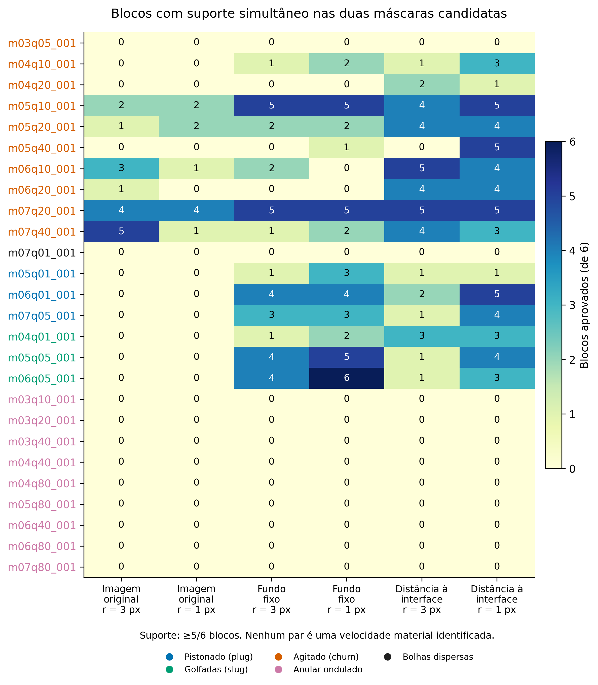
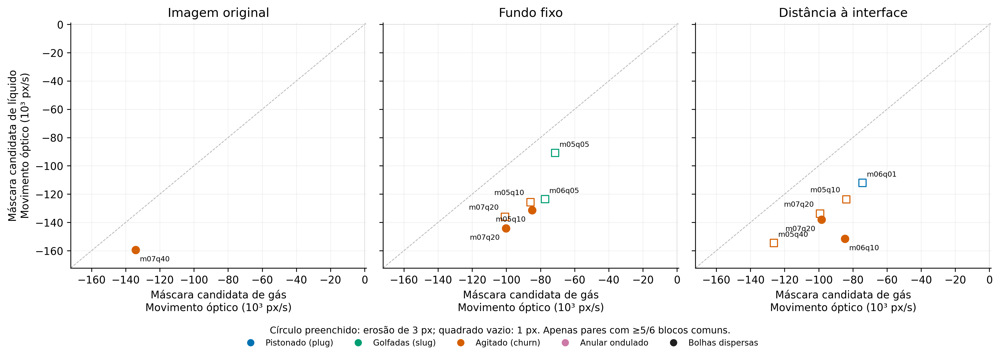

# Resultado da subtração condicionada à interface

Foram processados os **26 registros, 13.026 imagens nativas**, com 312 combinações de registro, fase candidata, tratamento e erosão. O resultado é uma avaliação de movimento óptico condicionado a regiões, não uma identificação de velocidades materiais. **Nenhum par material líquido/gás foi identificado por esta análise.**

## Resultado observado

| Tratamento | Pares com erosão de 3 px | Pares com erosão de 1 px |
|---|---:|---:|
| Imagem original | 1/26 | 0/26 |
| Fundo fixo | 2/26 | 4/26 |
| Distância à interface | 2/26 | 4/26 |

Cada par precisou ter suporte simultâneo nas duas máscaras em pelo menos cinco dos seis blocos. Foram avaliados 1.872 blocos de fase, 5.616 estimativas por atraso e 5.616 controles embaralhados. A subtração por distância à interface produziu 2 pares na referência; a imagem original produziu 1, e o fundo fixo treinado na outra metade produziu 2. Esses números não medem acurácia física.

O mapa mostra todos os registros, incluindo ausências. Uma célula com poucos blocos pode indicar textura escassa, ambiguidade, saturação, mudança de forma, inconsistência entre atrasos ou falta de separação do controle embaralhado. A ausência não foi substituída por zero nem por uma velocidade obtida de outra região.

| Registro | Tratamento | Erosão (px) | Gás candidato (px/s) | Líquido candidato (px/s) | Razão com sinal | Intervalos usados |
|---|---|---:|---:|---:|---:|---:|
| m05q05_001 | Fundo fixo | 1 | -71433.7 | -90888.8 | 0.786 | 412/500 |
| m05q10_001 | Fundo fixo | 3 | -84948.2 | -131285.4 | 0.647 | 413/500 |
| m05q10_001 | Fundo fixo | 1 | -85819.5 | -125750.3 | 0.682 | 413/500 |
| m05q10_001 | Distância à interface | 1 | -83791.7 | -123684.0 | 0.677 | 413/500 |
| m05q40_001 | Distância à interface | 1 | -126245.4 | -154534.3 | 0.817 | 413/500 |
| m06q01_001 | Distância à interface | 1 | -74374.1 | -112012.6 | 0.664 | 413/500 |
| m06q05_001 | Fundo fixo | 1 | -77297.7 | -123511.6 | 0.626 | 495/500 |
| m06q10_001 | Distância à interface | 3 | -84618.1 | -151571.8 | 0.558 | 412/500 |
| m07q20_001 | Fundo fixo | 3 | -100212.3 | -144191.8 | 0.695 | 413/500 |
| m07q20_001 | Distância à interface | 3 | -98271.9 | -138059.7 | 0.712 | 412/500 |
| m07q20_001 | Fundo fixo | 1 | -100776.8 | -136019.4 | 0.741 | 412/500 |
| m07q20_001 | Distância à interface | 1 | -99201.4 | -133860.0 | 0.741 | 412/500 |
| m07q40_001 | Imagem original | 3 | -134194.6 | -159454.2 | 0.842 | 413/500 |

Os valores com sinal correspondem ao eixo horizontal da imagem: negativo significa deslocamento para colunas menores. A razão divide os dois movimentos ópticos candidatos, calculados nos mesmos blocos, e só foi emitida quando o denominador teve magnitude superior a 2 px/quadro. Não é razão de velocidades materiais nem escorregamento das fases. Os arquivos CSV preservam também resultados sem suporte; esses valores não foram promovidos ao gráfico.

A linha tracejada do gráfico indica apenas igualdade numérica dos dois movimentos ópticos. Não é uma relação física ajustada aos dados.

## O que os controles demonstraram

As texturas sintéticas independentes foram recuperadas pelos três tratamentos. No controle adicional, a interface deslocou-se a +12 px/quadro enquanto as texturas interiores prescritas se deslocaram a −17,3 e −7,4 px/quadro. A subtração dinâmica preservou as duas velocidades: o maior erro absoluto, incluindo a inversão temporal, foi **0.015875 px/quadro**. Esse erro pertence somente ao sinal sintético prescrito.

Nos quatro casos fase/halo sem textura material — interface móvel e interface deformável, gás e líquido candidatos — a imagem original aprovou 4/4, o fundo fixo 4/4 e o resíduo por distância 0/4. O modelo conseguiu remover esse mecanismo dentro da família sintética testada. Esses halos foram deliberadamente construídos com uma lei de intensidade em função da distância compatível com o preditor; não representam toda óptica possível do tubo.

**A iluminação móvel compartilhada passou pelos critérios nas duas regiões e nos três tratamentos**, com velocidade aparente de aproximadamente +12 px/quadro, apesar de não representar transporte material. A subtração dinâmica não resolveu esse contraexemplo. Portanto, separar a interface e obter duas correlações consistentes ainda não certifica duas velocidades de fase.

Interiores constantes foram rejeitados. Alterar somente as intensidades da metade de avaliação não modificou suas previsões além de arredondamento de ponto flutuante; o maior desvio observado foi 1.53e-05 unidades de intensidade. O cálculo FFT foi comparado a Pearson calculado diretamente em cinco deslocamentos; diferença máxima 3.71e-08. A auditoria reconstruiu todas as 1.872 decisões de blocos e os 156 pares finais, verificou os pesos temporais, a razão e os metadados das 26 máscaras.

Doze combinações adicionais de imagem estacionária ou quadros aleatórios independentes com máscara móvel foram rejeitadas. Além dos controles sintéticos, 45 picos de correlação salvos foram recalculados diretamente a partir das imagens nativas de três registros, com os três tratamentos, duas máscaras candidatas quando definidas e os três atrasos. A maior diferença de Pearson foi 8.05e-08, e a maior diferença de desvio-padrão foi 1e-06 unidades de intensidade. Esses resultados verificam a implementação e o alinhamento dos dados; não fornecem verdade experimental para velocidade.

## Limitações e decisão

O tratamento por distância é útil como teste adversarial de contaminação por interface: ele removeu halos especificados e preservou texturas independentes no controle sintético. O ganho observado não autoriza chamar o resíduo de líquido ou gás material. Refração, iluminação e deformação podem permanecer; o modelo também pode remover textura real correlacionada com a geometria. As classes pouco povoadas exigiram interpolação; a maior fração de pixels de avaliação nessa condição foi 0.32%, registrada por metade no inventário do preditor.

A inspeção de quadros reais mostrou uma limitação adicional concreta. No [quadro 200 de m07q01_001](../figures/residual_example_m07q01_001.png), a máscara herdada contém recortes retangulares sem bolha fechada correspondente no fundo visualmente uniforme. O preditor atribui intensidade a esses recortes; a subtração introduz suas bordas no resíduo. Portanto, um erro de segmentação pode gerar textura residual artificial. Este resultado não foi ocultado nem interpretado como traçador. No [quadro 200 de m04q80_001](../figures/residual_example_m04q80_001.png), a máscara líquida de raio 3 está ausente, embora haja bastante variação óptica: o processamento não cria uma segunda fase observável a partir dessa variação. No [quadro 200 de m05q10_001](../figures/residual_example_m05q10_001.png), boa parte da máscara candidata de líquido consiste em regiões pequenas junto às interfaces. São três inspeções ilustrativas, não uma anotação de verdade de referência dos 13.026 quadros.

O treinamento em outra metade foi aplicado somente aos preditores de intensidade desta investigação. As máscaras e sua referência radial foram herdadas da análise anterior; a separação não representa validação externa da segmentação ou de toda a cadeia de processamento.

Como sensibilidade direcionada ao problema de topologia, m07q01_001 foi processado novamente com as máscaras de contornos fechados já calculadas na investigação anterior, mantendo todos os critérios. Essa execução adicional de 12 combinações não foi misturada aos resultados principais dos 26 registros. Nenhuma combinação forneceu um par aprovado. A máscara candidata de gás teve zero blocos aprovados nas seis opções; a de líquido teve seis blocos com fundo fixo e somente dois após subtração por distância, nos dois raios de erosão. As velocidades ópticas com fundo fixo foram -43247.6 px/s (raio 3) e -42916.0 px/s (raio 1), mas não há um traçador líquido identificado que autorize essa interpretação material. O ajuste topológico evita determinadas máscaras abertas; ele não transforma a textura restante em transporte líquido. Os resultados completos estão na [sensibilidade de contornos fechados](../results/residual_closed_m07q01_summary.csv).

Os três tratamentos não foram combinados para escolher a alternativa que completasse mais pontos. A tabela de [sensibilidade do suporte](../results/residual_support_sensitivity.csv) mostra os efeitos de exigir de um a seis blocos, mas a regra principal permaneceu cinco. A [estabilidade conjunta](../results/residual_all_options_stability.csv) exige os mesmos blocos em todos os tratamentos e erosões, para evitar comparar janelas diferentes. Ela também apresenta separadamente as quatro opções de subtração de fundo, sem exigir que a imagem original seja aprovada: 0 registros tiveram cinco blocos comuns e concordância dos dois movimentos nesse conjunto de quatro opções. A amplitude entre estimativas precisou ficar abaixo de max(2 px/quadro, 20% da magnitude média), para cada fase candidata.

A comparação numérica com a v15.1 não é direta: aqui houve treinamento na outra metade, seis blocos, decisões por bloco e média ponderada de velocidades de blocos comuns. Na v15.1, outras regras e agregações foram usadas. Uma redução de suporte não prova pior rastreamento, assim como um aumento não prova maior acurácia.

Permanece válida a distinção entre **movimento de textura candidata**, **velocidade de um objeto identificável** e **velocidade média material da fase**. Esta análise fornece o primeiro; seu resultado isolado não sustenta o terceiro, nem mesmo em forma relativa intra ou inter padrão. Razões dentro de um registro cancelam somente uma escala espacial comum. Entre registros, ainda faltam confirmação de magnificação comum, mesma população de traçadores e representatividade temporal. Os 501 quadros cobrem somente 71–125 ms.

## Reprodução e arquivos

Executar, nesta ordem: `python3 scripts/residual_motion.py`, `python3 scripts/residual_challenge.py`, `python3 scripts/residual_closed_contour.py`, `python3 scripts/residual_visual_check.py`, `python3 scripts/residual_real_check.py` e `python3 scripts/residual_report.py`, a partir da pasta desta investigação. Os scripts também funcionam chamados por seus caminhos completos.

- [Protocolo](residual_protocol_PT_BR.md).
- [Pares por registro](../results/residual_pairs.csv), [blocos](../results/residual_blocks.csv), [atrasos](../results/residual_lags.csv), [controles](../results/residual_nulls.csv).
- [Resultados sintéticos](../results/residual_synthetic.csv) e [desafio independente](../results/residual_challenge.csv).
- [Recomputação direta com imagens reais](../results/residual_real_numerical_check.csv).
- [Fontes e hashes](../results/residual_inputs.csv), [metadados](../results/residual_metadata.json), [auditoria](../results/residual_audit.json).
- Figuras em PNG, PDF e SVG, com texto em PT-BR.
