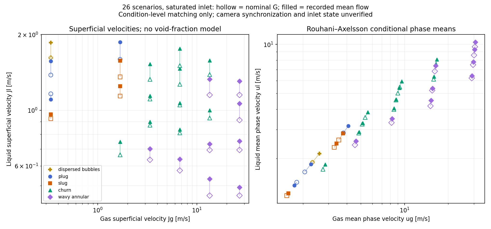
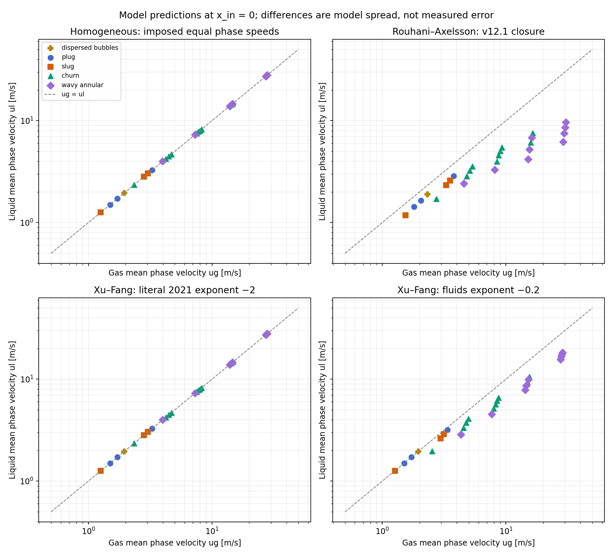

# Historical conditional model summary

**This is the earlier thermodynamic/model investigation.** The [current executive summary](EXECUTIVE_SUMMARY.md) reports the later phase-passage image-motion results in px/s and dimensionless ratios. The model predictions below retain their actual m/s units and explicit inlet/property/closure assumptions; they are not measured phase velocities or converted pixel results.

**We corrected the comparison and tested the alternatives. The results are conditional estimates; actual gas and liquid phase velocities are not yet validated.** No defensible experimental accuracy percentage or unique best physical closure can be inferred from these records.

The analysis uses **26 acquisitions**: 1 dispersed-bubble, 3 plug, 3 slug, 10 churn and 9 wavy-annular. It excludes m05q05_002, smooth annular and all double classifications. Saturated m03q40 remains in the thermodynamic calculation and is flagged as unsupported for optical interpretation.

## Conditional gas × liquid model predictions

**Use the documented recorded mass flow for a condition-level alternative, alongside the nominal-G baseline.** Processed values match the original LabVIEW files. However, condition names alone do not establish synchronization with each video. The suffix-free m05q05 sensor blocks cannot distinguish camera _001 from excluded _002; their mean is only a condition-level sensitivity input. Both baselines assume saturated liquid at the heated inlet, net nominal heating, R600a at 27 °C and a 1 mm tube.

The table reports **medians across acquisitions**, in m/s. Jg/Jl are superficial velocities. ug/ul are **Rouhani–Axelsson (RA) predictions** using recorded mean flow; they are not measured phase speeds. RA is a provisional reporting reference, not an experimentally established winner.

| Pattern | n | Jg, either G source | Jl, nominal G | Jl, recorded flow | ug, recorded flow + RA | ul, recorded flow + RA |
|---|---:|---:|---:|---:|---:|---:|
| dispersed bubbles | 1 | 0.336 | 1.618 | 1.858 | 2.592 | 2.135 |
| plug | 3 | 0.336 | 1.381 | 1.568 | 2.266 | 1.841 |
| slug | 3 | 1.681 | 1.138 | 1.245 | 3.401 | 2.462 |
| churn | 10 | 6.725 | 1.079 | 1.104 | 8.615 | 4.327 |
| wavy annular | 9 | 13.449 | 0.694 | 0.733 | 16.399 | 6.416 |

Jg does not change with G under the assumed zero-inlet-quality energy balance: G cancels algebraically. This is model structure, not experimental confirmation. Between-pattern differences also reflect different heat/mass-flux conditions and unequal sample counts. Three displayed decimals facilitate reproducibility; they do not imply measurement precision.

Full tables: [26 acquisitions and both baselines](velocity_results.md), [recorded-flow CSV](../results/recorded_flow_conditional_velocities_per_run.csv), [nominal CSV](../results/conditional_velocities_per_run.csv).

## What the investigation changed

1. **The legacy arithmetic reproduces.** All 280 displayed per-run values and 90 summary values agree with independent recomputation. The defects are scope, interpretation and unsupported accuracy claims. Superficial liquid velocity is not liquid material speed, and a slip model cannot repair missing inlet enthalpy.
2. **Measured-flow evidence exists.** The owner identifies Voltage_1 as g/s in the original LabVIEW data; the similarly named src2 image-derived columns are zero placeholders. We verified 241,000 samples against 241 original files. Recorded mean G differs from the nominal lookup by **-5.01% to +16.85%**. Temporal camera pairing and instrument calibration remain unresolved.
3. **Phase velocity depends strongly on the closure.** Four closures and 13 input scenarios produce **1,352 calculations**. At nominal G, the largest liquid-velocity ratio between tested closures is **4.40×**. This is model spread, not an error bar.
4. **Inlet uncertainty is decisive.** Assuming only 1 K of inlet subcooling makes **4/26** nominal-G cases fall outside the two-phase equilibrium domain. Those cases are flagged, not clipped into apparently valid velocities.
5. **The source literature is not a ground-truth table.** Published x/alpha/slip combinations are inconsistent. The closest paper prints a Xu–Fang exponent of −2, while a pinned secondary implementation uses −0.2. Both are tested separately; the original correlation paper remains unavailable.

Xu–Fang's secondary-source Froude limit is exceeded by **11/26 nominal-G** and **15/26 recorded-flow** cases. No published error percentage is transferred to these predictions.

## Which optical option worked best in these tests?

**Signed normalized cross-correlation after subtracting the temporal background, without high-pass filtering**, is the preferred candidate for further validation. It offers the broadest numerical support among the tested methods; this does not establish physical accuracy.

| Optical method | Passing adjacent pairs / 13,000 | Runs with ≥50% passing pairs |
|---|---:|---:|
| Raw-profile NCC | 6,223 | 15/26 |
| Background-subtracted NCC | 7,528 | 18/26 |
| Background-subtracted + high-pass NCC | 3,928 | 6/26 |
| Phase-only correlation, high-pass | 6,608 | 11/26 |

The preferred candidate passes **7,528/13,000 pairs**. Excluding saturated images from supported interpretations leaves **17/26 supported recordings and zero wavy-annular recordings**. Different estimator thresholds and preprocessing affect acceptance; coverage is not an accuracy score.

Synthetic translations favor NCC over phase-only correlation for the constructed textures/noise, but do not simulate all real interface deformation. All four methods use native timing; crop/lag tests preserve rejected and low-support outcomes. Results stay in **px/frame and px/s**. A structure speed cannot independently supply both liquid and gas phase speeds, even after a pixel-to-mm calibration.

Optical results: [preferred candidate](../results/optical_preferred_candidate_per_run.csv), [full investigation and synthetic results](optical_investigation.md). Files named optical_primary_pairs/optical_per_run preserve the high-pass reference experiment, not the preferred candidate.

## Unresolved inputs and validation limits of this model investigation

- **Unknown inlet enthalpy and net heat input:** obtain these, plus the absolute state at the camera, to determine vapor quality and superficial velocities.
- **Flow-to-video matching:** establish which LabVIEW interval belongs to each acquisition and verify the engineering-unit calibration.
- **Independent phase reference:** validate volumetric void fraction or measure phase-resolved velocity with an appropriate averaging convention. Inserting v14 spatial image alpha is not sufficient; its unvalidated geometry and crop sensitivity can produce extreme velocities.
- **Optical scale and tracking:** calibrate axial length and validate feature correspondence. Annular motion remains poorly supported by the tested optical methods.
- **Source conflict:** obtain the original Xu–Fang equation or author clarification before an authoritative attribution.

This historical investigation produced the conditional superficial comparison, an explicitly assumed RA phase estimate with closure sensitivity, and a separate optical structure-motion diagnostic. The later [current executive summary](EXECUTIVE_SUMMARY.md) evaluates image-motion descriptors using the available dataset. **A measured-accuracy winner remains undetermined.**

Details: [method and equations](method_comparison.md), [legacy audit](legacy_audit.md), [mass-flow audit](massflow_review.md), [literature](literature_review.md), [reproduction](../README.md).
