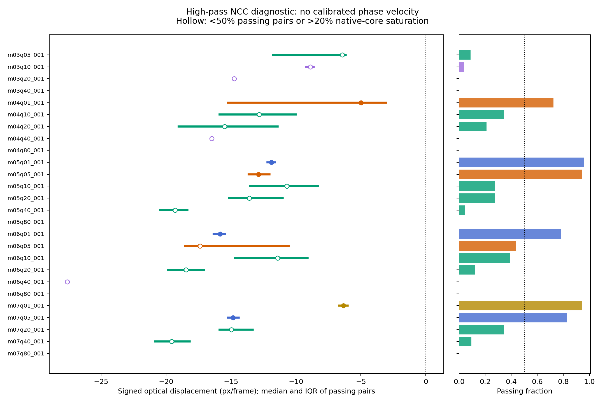
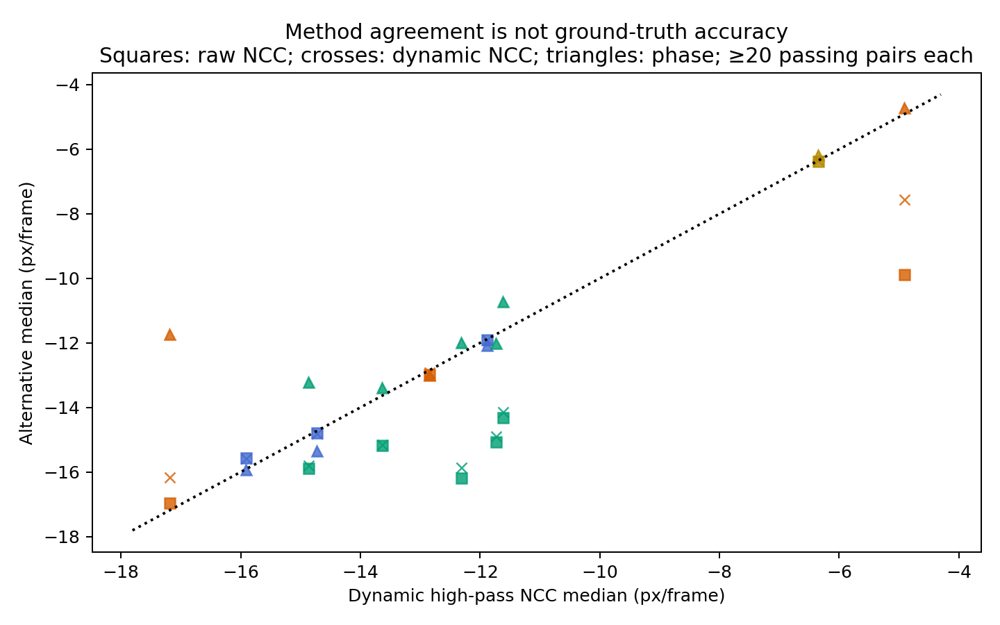
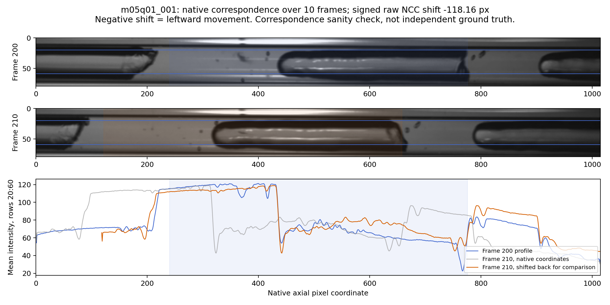

# Native-frame optical displacement investigation

**These are structure/interface displacements, not independently measured liquid or gas phase velocities.** No verified axial pixel scale was found. Multiplying by the per-acquisition camera rate gives px/s, not m/s.

The analysis retains 26 acquisitions, excludes the five requested runs/categories before processing, and uses all 13,000 adjacent native-frame pairs for the primary estimate. No stitched panorama is used. The supplied labels are unchanged.

## Methods and fixed checks

- Primary: signed, normalized correlation of a fixed central template with equal-length candidate windows. Positive is motion to the right from frame A to B. Search ±240 px; no forced positive shift. Parabolic peak interpolation supplies a subpixel estimate.
- Profile preprocessing: average rows 20:60, subtract the per-pixel temporal mean over the acquisition, then subtract a Gaussian blur (σ=8 px). This suppresses stationary illumination and broad intensity gradients, but may also remove persistent structures.
- Alternatives: raw-profile NCC, temporal-mean-subtracted NCC without high-pass filtering, and Hann-windowed, zero-padded phase-only correlation on the dynamic high-pass profile. Sensitivity uses rows 10:70, 20:60 and 25:55; temporal lags 1, 2 and 4; 100 evenly spaced starting frames per acquisition and variant. At lag 4 the same ±240 px search permits at most ±60 px/frame: boundary hits flag this restricted range.
- A passing NCC pair has peak ≥0.60, a ≥0.03 margin over the strongest competitor outside ±5 px, profile standard deviation ≥1 gray level, and a peak more than 2 px from the search boundary. Phase-only thresholds are peak ≥0.08 and margin ≥0.02 with the same texture/boundary rules. These fixed heuristic rules are **not** probability/confidence estimates and have different acceptance rates across methods.
- Native-core saturation means gray level ≥250 in rows 20:60, averaged over all frames; >20% is flagged. A correlation can pass despite saturated images. Runs with <50% passing primary pairs are flagged, retained, and not silently given representative velocity status.

## Reference high-pass results

The reference high-pass NCC diagnostic passes on 3,928/13,000 pairs (30.2%). 20/26 acquisitions have <50% passing pairs; 1 have >20% native-core saturation. These rates assess numerical support, not physical accuracy.

| Acquisition | Pattern | Passing pairs | Median passing px/frame | IQR px/frame | Median passing px/s | Flags |
|---|---|---:|---:|---:|---:|---|
| m03q05_001 | churn | 44/500 | -6.442 | -11.786–-6.170 | -32211.3 | low coverage |
| m03q10_001 | wavy annular | 19/500 | -8.894 | -9.214–-8.631 | -44470.4 | low coverage |
| m03q20_001 | wavy annular | 1/500 | -14.761 | -14.761–-14.761 | -59042.3 | low coverage |
| m03q40_001 | wavy annular | 0/500 | nan | nan–nan | nan | low coverage, saturation |
| m04q01_001 | slug | 362/500 | -4.988 | -15.239–-3.063 | -34916.3 | — |
| m04q10_001 | churn | 173/500 | -12.849 | -15.881–-10.017 | -64246.2 | low coverage |
| m04q20_001 | churn | 105/500 | -15.484 | -19.021–-11.417 | -77419.4 | low coverage |
| m04q40_001 | wavy annular | 1/500 | -16.479 | -16.479–-16.479 | -82394.3 | low coverage |
| m04q80_001 | wavy annular | 0/500 | nan | nan–nan | nan | low coverage |
| m05q01_001 | plug | 480/500 | -11.897 | -12.193–-11.604 | -83276.2 | — |
| m05q05_001 | slug | 471/500 | -12.879 | -13.636–-12.034 | -90151.4 | — |
| m05q10_001 | churn | 138/500 | -10.696 | -13.555–-8.319 | -74870.1 | low coverage |
| m05q20_001 | churn | 139/500 | -13.600 | -15.141–-11.035 | -95200.9 | low coverage |
| m05q40_001 | churn | 24/500 | -19.309 | -20.483–-18.366 | -135165.8 | low coverage |
| m05q80_001 | wavy annular | 0/500 | nan | nan–nan | nan | low coverage |
| m06q01_001 | plug | 391/500 | -15.844 | -16.334–-15.479 | -110905.3 | — |
| m06q05_001 | slug | 219/500 | -17.390 | -18.562–-10.557 | -121732.2 | low coverage |
| m06q10_001 | churn | 194/500 | -11.412 | -14.695–-9.114 | -79882.4 | low coverage |
| m06q20_001 | churn | 60/500 | -18.477 | -19.841–-17.084 | -129338.6 | low coverage |
| m06q40_001 | wavy annular | 1/500 | -27.622 | -27.622–-27.622 | -193351.3 | low coverage |
| m06q80_001 | wavy annular | 0/500 | nan | nan–nan | nan | low coverage |
| m07q01_001 | dispersed bubbles | 472/500 | -6.337 | -6.665–-6.015 | -44358.8 | — |
| m07q05_001 | plug | 415/500 | -14.839 | -15.235–-14.405 | -103875.7 | — |
| m07q20_001 | churn | 172/500 | -14.972 | -15.872–-13.333 | -104802.3 | low coverage |
| m07q40_001 | churn | 47/500 | -19.572 | -20.868–-18.179 | -137000.7 | low coverage |
| m07q80_001 | wavy annular | 0/500 | nan | nan–nan | nan | low coverage |

| Method (all adjacent pairs) | Passing pairs / 13,000 | Runs with ≥50% passing pairs |
|---|---:|---:|
| ncc_raw | 6223 | 15 / 26 |
| ncc_dynamic | 7528 | 18 / 26 |
| ncc_dynamic_highpass | 3928 | 6 / 26 |
| phase_dynamic_highpass | 6608 | 11 / 26 |

Different passing rates do not establish relative accuracy: high-pass filtering discards broad profiles, while raw profiles can follow illumination and large interfaces. Phase and NCC thresholds are not on the same scale. All signed medians are given in the saved full-method table.

IQR is observed temporal spread among accepted pairs, not an uncertainty interval for the true motion. Temporal-background subtraction, the texture threshold and rejection can preferentially select short interface passages, especially in bubbly or intermittent flows. A median of accepted displacements is not a volume- or mass-weighted phase velocity.

## Synthetic estimator verification

Five independent Gaussian-smoothed random profiles, nine signed translations (including fractions of a pixel and ±170 px), and additive independent noise levels of 0, 2 and 10 gray levels were tested. Profile signal standard deviation is 25 gray levels. Ground truth is known **only in these constructed translations**; deformation, occlusion and multiphase topology are absent. Featureless pairs fail the quality gate for both methods.

| Estimator | Noise σ | n | MAE px | 95th percentile absolute error px | Within 1 px |
|---|---:|---:|---:|---:|---:|
| ncc | 0 | 45 | 0.0013 | 0.0028 | 100.0% |
| ncc | 2 | 45 | 0.0182 | 0.0392 | 100.0% |
| ncc | 10 | 45 | 0.1439 | 0.3550 | 100.0% |
| phase | 0 | 45 | 0.0214 | 0.0763 | 100.0% |
| phase | 2 | 45 | 0.4186 | 0.8218 | 100.0% |
| phase | 10 | 45 | 0.6718 | 1.6364 | 80.0% |

These tests verify implementation/sign and illustrate behavior under translation. They cannot rank physical velocity accuracy on the acquisitions.

## Method and crop/lag sensitivity

| Alternative to dynamic high-pass NCC | Jointly passing sampled pairs | Median of per-run median absolute differences (px/frame) |
|---|---:|---:|
| ncc_raw | 694 | 0.232 |
| ncc_dynamic | 768 | 0.232 |
| phase_dynamic_highpass | 691 | 0.753 |

Agreement uses the intersection of each method’s passing pairs. This selects easier pairs and must not be read as an unbiased accuracy estimate. Each row in [optical_method_agreement.csv](../results/optical_method_agreement.csv) preserves run-specific support and differences. [optical_sensitivity.csv](../results/optical_sensitivity.csv) preserves all 36 method/crop/lag variants per run. [optical_full_method_summary.csv](../results/optical_full_method_summary.csv) also compares all four methods on every adjacent frame pair.

## Preferred optical candidate and limits

Prefer temporal-mean-subtracted NCC without high-pass filtering as the candidate for further optical validation: it gives the broadest numerical support under the common NCC gate (7,528/13,000 pairs; 18/26 runs with at least half passing, including saturated m03q40_001). Only 17/26 runs meet both coverage and the saturation rule; none is wavy annular. This selection is based on coverage, not proven physical accuracy. High-pass filtering reduces support to 3,928 pairs and 6/26 runs; retain that baseline as a sensitivity diagnostic rather than declaring its more selective estimates more accurate. Raw NCC and phase-only correlation expose preprocessing dependence. The [preferred-candidate per-run CSV](../results/optical_preferred_candidate_per_run.csv) contains its signed medians, frame rates, IQRs and quality flags. All 13,000 underlying adjacent-pair records, including rejected pairs, are retained in [optical_preferred_candidate_pairs.csv](../results/optical_preferred_candidate_pairs.csv). No method is declared the most accurate real-data estimator because there is no displacement or phase-velocity ground truth.

The native-frame comparison uses m05q01_001 frames 200 and 210. Their broad intensity structure moves to smaller axial pixel coordinates; the translated profiles overlay closely. The exact signed shift is recorded in [optical_visual_correspondence.json](../results/optical_visual_correspondence.json). This confirms correspondence and sign only; the same images generate the NCC estimate, so the overlay is not independent ground truth. This 10-frame illustration has NCC=0.959 but competitor margin=0.0228, below the adjacent-pair margin threshold 0.03; it is not presented as passing that gate.

A tracked shadow, bubble nose, interface wave, or shared brightness pattern travels at a structure celerity. It need not equal either phase-average velocity, and a single axial brightness profile cannot separate simultaneous liquid and vapor velocity fields. Liquid-phase velocity would require tracers/phase-resolved velocimetry or independently measured superficial flux and cross-sectional void fraction. A literature camera pixel scale is not proof that this dataset has the same magnification; the native metadata must be calibrated independently. The use of an apparent tube diameter would also require distortion and axial/radial scale validation.

Existing pipeline_v11.py uses the reverse correlation orientation relative to its positive-right docstring and clamps shifts to ≥1 pixel. Therefore saved panorama strip widths are unsuitable as an unbiased signed velocity record; this analysis recomputes displacements directly from native images.

Reproduce: `python3 -B src2/v15_gas_liquid_velocity/scripts/optical_investigation.py`. Input fingerprints, actual FPS values, sequence counts, fixed thresholds and synthetic results are saved in [metadata](../results/optical_metadata.json) and [per-run results](../results/optical_per_run.csv). Hashes cover config bytes, sorted filenames and native-frame content hashes.

[Saved-result verification](../results/optical_validation.json) independently recomputes all 13,000 reference and 13,000 preferred-candidate pixel-rate conversions, reaggregates preferred-candidate quality gates, coverage, medians and IQRs from the saved pairs, checks the 936 sensitivity rows and 17 unsaturated preferred candidates, and compares an FFT NCC result with brute-force NumPy correlation on a known signed shift.
