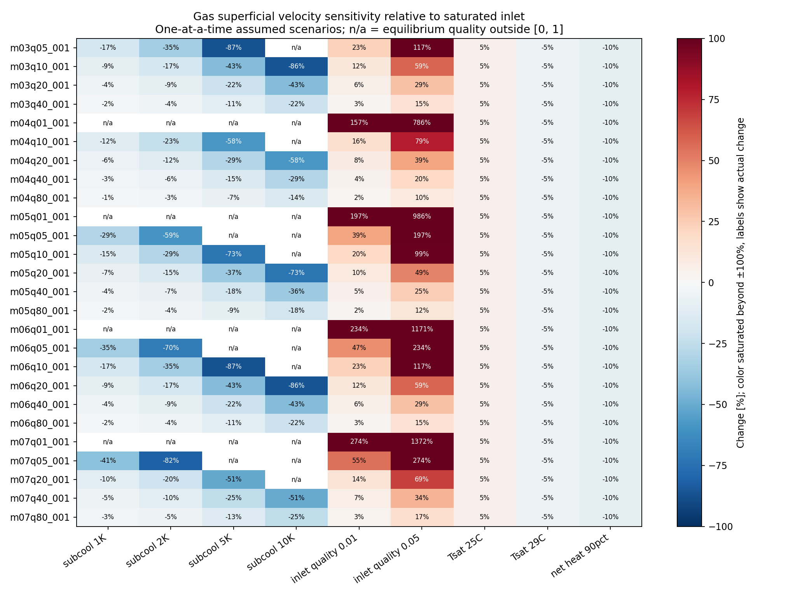

# Historical conditional model velocity results

These are the earlier model tables. See the [current executive summary](EXECUTIVE_SUMMARY.md) for the phase-passage analysis in px/s and dimensionless ratios, or the [historical model summary](conditional_model_summary.md) for this calculation and its assumptions.

All velocities below are conditional predictions in m/s. Reference assumptions: x_in = 0, eta = 1, R600a at 27 °C, D = 1 mm and heated length 265 mm. RA is the reporting reference. Full-precision CSVs retain all four closures, sensitivity scenarios and Froude flags.

## Recorded-mean-flow alternative, by acquisition

Flow input is documented in g/s and verified against the original LabVIEW values. Matching to the video is by condition name only. The averaging and instrument limitations apply to every row.

| Acquisition | Pattern | G [kg/m²s] | x | Jg | Jl | alpha RA | ug RA | ul RA | S RA |
|---|---|---:|---:|---:|---:|---:|---:|---:|---:|
| m03q05_001 | churn | 426.16 | 0.03807 | 1.681 | 0.748 | 0.5921 | 2.839 | 1.833 | 1.549 |
| m03q10_001 | wavy annular | 417.09 | 0.07779 | 3.362 | 0.702 | 0.7249 | 4.638 | 2.551 | 1.818 |
| m03q20_001 | wavy annular | 414.66 | 0.15649 | 6.725 | 0.638 | 0.8179 | 8.222 | 3.504 | 2.347 |
| m03q40_001 | wavy annular | 421.40 | 0.30797 | 13.449 | 0.532 | 0.8827 | 15.236 | 4.537 | 3.358 |
| m04q01_001 | slug | 530.42 | 0.00612 | 0.336 | 0.962 | 0.2118 | 1.587 | 1.220 | 1.301 |
| m04q10_001 | churn | 524.69 | 0.06184 | 3.362 | 0.898 | 0.6909 | 4.867 | 2.905 | 1.675 |
| m04q20_001 | churn | 524.05 | 0.12382 | 6.725 | 0.838 | 0.7934 | 8.476 | 4.054 | 2.091 |
| m04q40_001 | wavy annular | 531.78 | 0.24405 | 13.449 | 0.733 | 0.8637 | 15.571 | 5.381 | 2.894 |
| m04q80_001 | wavy annular | 529.65 | 0.49006 | 26.898 | 0.493 | 0.9232 | 29.136 | 6.416 | 4.541 |
| m05q01_001 | plug | 607.93 | 0.00534 | 0.336 | 1.103 | 0.1926 | 1.746 | 1.366 | 1.278 |
| m05q05_001 | slug | 698.78 | 0.02322 | 1.681 | 1.245 | 0.4942 | 3.401 | 2.462 | 1.381 |
| m05q10_001 | churn | 658.23 | 0.04929 | 3.362 | 1.142 | 0.6533 | 5.146 | 3.293 | 1.563 |
| m05q20_001 | churn | 649.45 | 0.09991 | 6.725 | 1.066 | 0.7682 | 8.754 | 4.600 | 1.903 |
| m05q40_001 | churn | 677.84 | 0.19146 | 13.449 | 1.000 | 0.8427 | 15.960 | 6.355 | 2.511 |
| m05q80_001 | wavy annular | 672.12 | 0.38618 | 26.898 | 0.753 | 0.9035 | 29.770 | 7.801 | 3.816 |
| m06q01_001 | plug | 862.45 | 0.00376 | 0.336 | 1.568 | 0.1484 | 2.266 | 1.841 | 1.231 |
| m06q05_001 | slug | 879.83 | 0.01844 | 1.681 | 1.576 | 0.4456 | 3.773 | 2.842 | 1.328 |
| m06q10_001 | churn | 869.40 | 0.03732 | 3.362 | 1.527 | 0.6021 | 5.584 | 3.838 | 1.455 |
| m06q20_001 | churn | 867.15 | 0.07483 | 6.725 | 1.464 | 0.7292 | 9.222 | 5.404 | 1.707 |
| m06q40_001 | wavy annular | 858.69 | 0.15114 | 13.449 | 1.330 | 0.8201 | 16.399 | 7.393 | 2.218 |
| m06q80_001 | wavy annular | 842.04 | 0.30825 | 26.898 | 1.063 | 0.8855 | 30.375 | 9.283 | 3.272 |
| m07q01_001 | dispersed bubbles | 1021.76 | 0.00318 | 0.336 | 1.858 | 0.1297 | 2.592 | 2.135 | 1.214 |
| m07q05_001 | plug | 1039.94 | 0.01560 | 1.681 | 1.868 | 0.4099 | 4.101 | 3.165 | 1.296 |
| m07q20_001 | churn | 1029.11 | 0.06305 | 6.725 | 1.759 | 0.7031 | 9.564 | 5.925 | 1.614 |
| m07q40_001 | churn | 994.08 | 0.13055 | 13.449 | 1.577 | 0.8048 | 16.711 | 8.078 | 2.069 |
| m07q80_001 | wavy annular | 974.31 | 0.26640 | 26.898 | 1.304 | 0.8738 | 30.784 | 10.330 | 2.980 |

## Nominal-G baseline, by acquisition

This reproduces the old model after the requested exclusions. It is not fitted or calibrated to the images.

| Acquisition | Pattern | G [kg/m²s] | x | Jg | Jl | alpha RA | ug RA | ul RA | S RA |
|---|---|---:|---:|---:|---:|---:|---:|---:|---:|
| m03q05_001 | churn | 380 | 0.04269 | 1.681 | 0.664 | 0.6128 | 2.744 | 1.714 | 1.601 |
| m03q10_001 | wavy annular | 380 | 0.08538 | 3.362 | 0.634 | 0.7376 | 4.559 | 2.416 | 1.887 |
| m03q20_001 | wavy annular | 380 | 0.17076 | 6.725 | 0.575 | 0.8263 | 8.138 | 3.310 | 2.458 |
| m03q40_001 | wavy annular | 380 | 0.34153 | 13.449 | 0.456 | 0.8911 | 15.093 | 4.190 | 3.602 |
| m04q01_001 | slug | 510 | 0.00636 | 0.336 | 0.925 | 0.2176 | 1.545 | 1.182 | 1.308 |
| m04q10_001 | churn | 510 | 0.06362 | 3.362 | 0.871 | 0.6953 | 4.836 | 2.859 | 1.691 |
| m04q20_001 | churn | 510 | 0.12723 | 6.725 | 0.812 | 0.7964 | 8.444 | 3.988 | 2.117 |
| m04q40_001 | wavy annular | 510 | 0.25447 | 13.449 | 0.694 | 0.8672 | 15.509 | 5.223 | 2.969 |
| m04q80_001 | wavy annular | 510 | 0.50894 | 26.898 | 0.457 | 0.9265 | 29.033 | 6.213 | 4.673 |
| m05q01_001 | plug | 640 | 0.00507 | 0.336 | 1.162 | 0.1856 | 1.811 | 1.426 | 1.270 |
| m05q05_001 | slug | 640 | 0.02535 | 1.681 | 1.138 | 0.5125 | 3.281 | 2.334 | 1.405 |
| m05q10_001 | churn | 640 | 0.05070 | 3.362 | 1.108 | 0.6582 | 5.108 | 3.243 | 1.575 |
| m05q20_001 | churn | 640 | 0.10139 | 6.725 | 1.049 | 0.7700 | 8.733 | 4.561 | 1.915 |
| m05q40_001 | churn | 640 | 0.20278 | 13.449 | 0.931 | 0.8478 | 15.863 | 6.116 | 2.594 |
| m05q80_001 | wavy annular | 640 | 0.40556 | 26.898 | 0.694 | 0.9075 | 29.641 | 7.501 | 3.952 |
| m06q01_001 | plug | 760 | 0.00427 | 0.336 | 1.381 | 0.1635 | 2.057 | 1.650 | 1.246 |
| m06q05_001 | slug | 760 | 0.02135 | 1.681 | 1.357 | 0.4766 | 3.527 | 2.593 | 1.360 |
| m06q10_001 | churn | 760 | 0.04269 | 3.362 | 1.327 | 0.6276 | 5.358 | 3.564 | 1.503 |
| m06q20_001 | churn | 760 | 0.08538 | 6.725 | 1.268 | 0.7477 | 8.993 | 5.027 | 1.789 |
| m06q40_001 | wavy annular | 760 | 0.17076 | 13.449 | 1.150 | 0.8321 | 16.164 | 6.846 | 2.361 |
| m06q80_001 | wavy annular | 760 | 0.34153 | 26.898 | 0.913 | 0.8937 | 30.098 | 8.588 | 3.504 |
| m07q01_001 | dispersed bubbles | 890 | 0.00365 | 0.336 | 1.618 | 0.1448 | 2.322 | 1.892 | 1.228 |
| m07q05_001 | plug | 890 | 0.01823 | 1.681 | 1.594 | 0.4431 | 3.794 | 2.863 | 1.325 |
| m07q20_001 | churn | 890 | 0.07291 | 6.725 | 1.505 | 0.7254 | 9.271 | 5.481 | 1.691 |
| m07q40_001 | churn | 890 | 0.14582 | 13.449 | 1.387 | 0.8165 | 16.472 | 7.557 | 2.180 |
| m07q80_001 | wavy annular | 890 | 0.29164 | 26.898 | 1.150 | 0.8811 | 30.528 | 9.673 | 3.156 |

## Model comparison at nominal G: median predicted phase speeds

| Pattern | Homogeneous ug = ul | RA ug / ul | XF secondary −0.2 ug / ul | Literal 2021 −2 ug / ul |
|---|---:|---:|---:|---:|
| dispersed bubbles | 1.954 | 2.322 / 1.892 | 1.956 / 1.954 | 1.954 / 1.954 |
| plug | 1.717 | 2.057 / 1.650 | 1.720 / 1.716 | 1.717 / 1.717 |
| slug | 2.819 | 3.281 / 2.334 | 2.958 / 2.636 | 2.819 / 2.819 |
| churn | 7.655 | 8.589 / 4.275 | 8.113 / 5.424 | 7.655 / 7.654 |
| wavy annular | 14.599 | 16.164 / 6.213 | 15.199 / 9.985 | 14.599 / 14.598 |

## Input sensitivity relative to nominal saturated-inlet baseline

Percent ranges span the 26 acquisitions. Invalid two-phase equilibrium cases are counted and omitted from numerical percent ranges, never treated as zero velocity. These are hypothetical one-at-a-time tests, not statistical uncertainty bounds.

| Scenario | Out-of-domain cases | Jg change [%] | Jl change [%] | RA ug change [%] | RA ul change [%] |
|---|---:|---:|---:|---:|---:|
| saturated_inlet | 0/26 | +0.00 to +0.00 | +0.00 to +0.00 | +0.00 to +0.00 | +0.00 to +0.00 |
| subcool_1K | 4/26 | -40.97 to -1.47 | +0.76 to +1.52 | -19.85 to -1.33 | -16.71 to -0.26 |
| subcool_2K | 4/26 | -81.83 to -2.93 | +1.52 to +3.04 | -39.67 to -2.65 | -34.76 to -0.53 |
| subcool_5K | 7/26 | -86.99 to -7.30 | +3.88 to +7.56 | -59.55 to -6.62 | -51.53 to -1.38 |
| subcool_10K | 12/26 | -86.41 to -14.50 | +8.07 to +15.02 | -70.10 to -13.22 | -58.70 to -2.96 |
| inlet_quality_0.01 | 0/26 | +1.96 to +274.31 | -2.04 to -1.00 | +1.77 to +43.48 | +0.34 to +36.05 |
| inlet_quality_0.05 | 0/26 | +9.82 to +1371.56 | -10.18 to -5.02 | +8.83 to +216.44 | +1.55 to +148.63 |
| Tsat_25C | 0/26 | +5.03 to +5.03 | -0.46 to +0.24 | +0.49 to +4.98 | +0.31 to +2.29 |
| Tsat_29C | 0/26 | -4.71 to -4.71 | -0.25 to +0.46 | -4.67 to -0.43 | -2.21 to -0.26 |
| net_heat_90pct | 0/26 | -10.00 to -10.00 | +0.04 to +10.36 | -9.12 to -1.59 | -5.13 to -1.39 |
| recorded_flow_mean | 0/26 | -0.00 to +0.00 | -5.04 to +17.16 | -3.62 to +11.60 | -4.22 to +12.87 |
| recorded_flow_median | 0/26 | -0.00 to +0.00 | -5.06 to +17.19 | -3.63 to +11.63 | -4.23 to +12.90 |
| recorded_flow_trimmed10 | 0/26 | -0.00 to +0.00 | -5.03 to +17.18 | -3.62 to +11.61 | -4.21 to +12.89 |

## Image-alpha hybrid stress test

For m07q01_001, combining nominal energy-model Jg with v14 image alpha=0.001836 yields ug=183.13 m/s and S=112.99. These are **unvalidated hybrid outputs, not accepted phase-velocity estimates**. Saturated m03q40 has no hybrid velocity result. Other cases can yield S < 1; this alone is not a proof of impossibility. The test cannot determine whether inlet quality, optical geometry, sampling or closure is responsible.

[All hybrid cases and diameter assumptions](../results/image_alpha_diagnostics.csv). See [method comparison](method_comparison.md) for averaging and sensitivity limits.

## Reproducibility and exclusions

[Scenario inventory](../results/scenario_inventory.csv) preserves all 31 folder identities, the five exclusion reasons, native timing and input hashes. Every reported velocity comparison uses only the same 26 selected acquisitions. Synthetic dataset folders are not experimental scenarios. Group CSVs contain min/max/mean/median; summaries are descriptive statistics over the sampled conditions.
