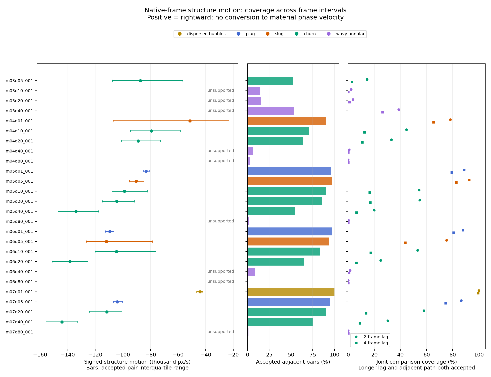
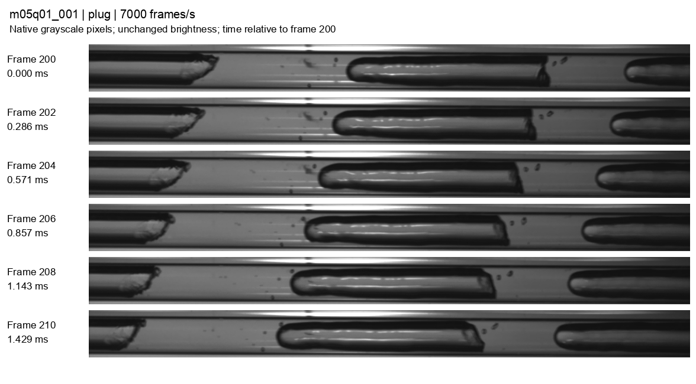

# EXECUTIVE SUMMARY — Motion between native frames

**Yes: the 501 native frames support estimates of moving image structures in px/frame and px/s. They do not establish two independent liquid and gas material velocities.** This evaluation uses the existing images and native camera rates, without inlet-state assumptions, mass-flow matching, or a physical pixel scale.

The original scope is preserved: **26 recordings**, excluding m05q05_002, smooth annular and double classifications. All retained recordings contain consecutive frame identifiers 0–500. The two camera configuration formats agree: 18 recordings at 7,000 fps, six at 5,000 fps and two at 4,000 fps. Each recording therefore spans **0.07143–0.125 s**, with 500 adjacent comparisons. Those overlapping comparisons are not 500 independent experimental repeats.

## Results of the feasibility tests

| Test | Actual result | Interpretation |
|---|---|---|
| Whole-profile adjacent-frame correlation | 7,528/13,000 accepted pairs; 17/26 recordings pass coverage and saturation gates | Many image structures have measurable displacement; this is initial numerical support. |
| Compare frame gaps of 1, 2 and 4 | 38,896 comparisons; 7/26 recordings pass the declared temporal diagnostics | Stronger evidence for persistent structure motion; two of these seven remain materially sensitive to region/selection. |
| Local 2-D patches with reciprocal matching | 3,880/7,800 background-subtracted tracks accepted | Reveals local motion and spatial variability; individual matches do not imply one common velocity across the image. |
| Annular local patches | 434/2,700 accepted tracks, but only 10/450 sampled pairs with distributed agreement; no annular recording meets the reporting gate | Isolated annular events can be matched; a representative annular velocity remains unsupported by these tests. |
| Visual multi-frame review | Six recordings, covering all five retained patterns | Clear bubble/plug/slug examples translate left; churn and annular examples show stronger deformation or correspondence ambiguity. |

**The 17-recording initial-support result must not be described as 17 validated velocities.** Longer frame gaps reduce correspondence support, especially in churn. The local multi-window gate asks a stricter, different question; its low reporting count does not mean the other recordings contain no trackable features.

Plotted values are signed accepted-pair medians. Horizontal bars are the accepted-pair interquartile range, not measurement confidence intervals. Positive x is rightward, so these negative values describe motion toward smaller image coordinates. Unsupported annular estimates are withheld from the velocity panel. The right panel shows joint comparison coverage, including its denominator; agreement based on very few accepted events must not appear to be strong evidence.

## Recordings passing the temporal diagnostic

These are structure-motion candidates. The table retains all seven temporal passes, including the two with large selection sensitivity. Numeric rounding is for readability and does not assert instrument precision.

| Recording | Pattern | Accepted adjacent pairs | Median px/frame | Median px/s | Accepted-variant median span (%) |
|---|---|---:|---:|---:|---:|
| m04q01_001 | slug | 452/500 | -7.362 | -51,536 | 36.37 |
| m05q01_001 | plug | 479/500 | -11.886 | -83,199 | 2.42 |
| m05q05_001 | slug | 486/500 | -12.917 | -90,418 | 2.46 |
| m06q01_001 | plug | 487/500 | -15.646 | -109,525 | 4.55 |
| m06q05_001 | slug | 469/500 | -15.986 | -111,902 | 19.41 |
| m07q01_001 | dispersed bubbles | 500/500 | -6.321 | -44,248 | 2.08 |
| m07q05_001 | plug | 476/500 | -14.896 | -104,271 | 4.50 |

The final column is the maximum minus minimum median among previously tested ROI/lag variants with at least 50% accepted pairs, divided by the magnitude of the baseline median. The variants accept different frame subsets. This is sensitivity to analysis/selection, not velocity error or an uncertainty bound.

**Recommended first reporting candidates:** m07q01_001, m05q01_001, m05q05_001, m06q01_001 and m07q05_001. Their supported-variant median spans are approximately 2.1–4.5%. This recommendation is based on the observed diagnostics, not a new accuracy-validation gate. m05q01 has eight of nine ROI/lag variants above the 50% coverage gate; the remaining variant has 49%, so it is not uniformly supported under every setting.

**Keep m04q01_001 and m06q05_001 explicitly qualified:** their supported-variant spans are 36.37% and 19.41%. Passing pairwise temporal checks does not make a selected per-recording median invariant to which interfaces and frame pairs are accepted.

## Concrete evidence of frame displacement

The plug sequence shows recognizable interfaces at frames 200, 202, 204, 206, 208 and 210. The displayed 10-frame interval lasts 1.429 ms at 7,000 fps. Across the complete recording, the accepted adjacent-pair median is −11.886 px/frame, giving −83,199 px/s. The short contact sheet illustrates correspondence; the reported median uses all accepted adjacent comparisons across the 501-frame recording.

For any matched feature, image velocity is displacement in pixels multiplied by capture rate and divided by the number of frame intervals. A 2-frame displacement must be divided by two. Capture rate is taken from each native configuration, not from the resampled 4,000-Hz workbook signals or camera playback rate.

## What can be claimed

- Report **observed axial structure/interface motion in px/s** by scenario, with accepted coverage, temporal checks, region sensitivity and spreads.
- Describe identifiable objects as bubble translation or interface/wave propagation when their correspondence is supported. A global brightness-profile shift is more generally an aggregate structure-motion estimate.
- Preserve rejected pairs and unsupported scenarios. No representative annular speed is reported from the present tested methods.
- Keep cross-scenario comparisons in image coordinates. Physical speed rankings require consistent magnification; equal pixel dimensions do not prove an equal length scale.
- Treat the observed motion as a short-record summary. The available sequence durations do not establish long-term operating variability.

## What remains unidentified

**Separate liquid and gas material velocities remain unidentified.** The visible boundaries belong to both phase masks. Tracking a liquid plug boundary measures an interface, not a liquid parcel. The visual review did not establish liquid tracers in its six examples. A successful patch match can follow a bubble, reflection, refractive texture or wave, and does not supply phase mass/volume weighting. These quantities also differ from superficial gas/liquid velocities.

Changing to px/s removes the need for a verified mm/pixel scale for the reported observable. It does not establish phase identity, physical speed, or measurement accuracy. Finite exposure, changing shape, saturation and spatially varying motion remain relevant. The apparent displacement during the exposure is stored as a diagnostic estimate, not a measured blur length.

## Verification and deliverables

Independent reaggregation checked **307,619 numeric values** across the baseline, temporal and local-patch outputs. Scope, rates, all pixel-rate conversions, summary statistics and declared decision rules reproduce. Synthetic translated textures verify sign and basic numerical behavior. These checks establish computational consistency; there is no independent experimental velocity reference.

Details: [temporal methods and all 26 results](temporal_review.md), [local 2-D checks](local_patch_review.md), [native visual review](visual_review.md), [independent review](independent_review.md), and [reproduction](../README.md). All scripts, CSVs and figures are stored within this evaluation. Earlier v15 results and the source data are preserved.
