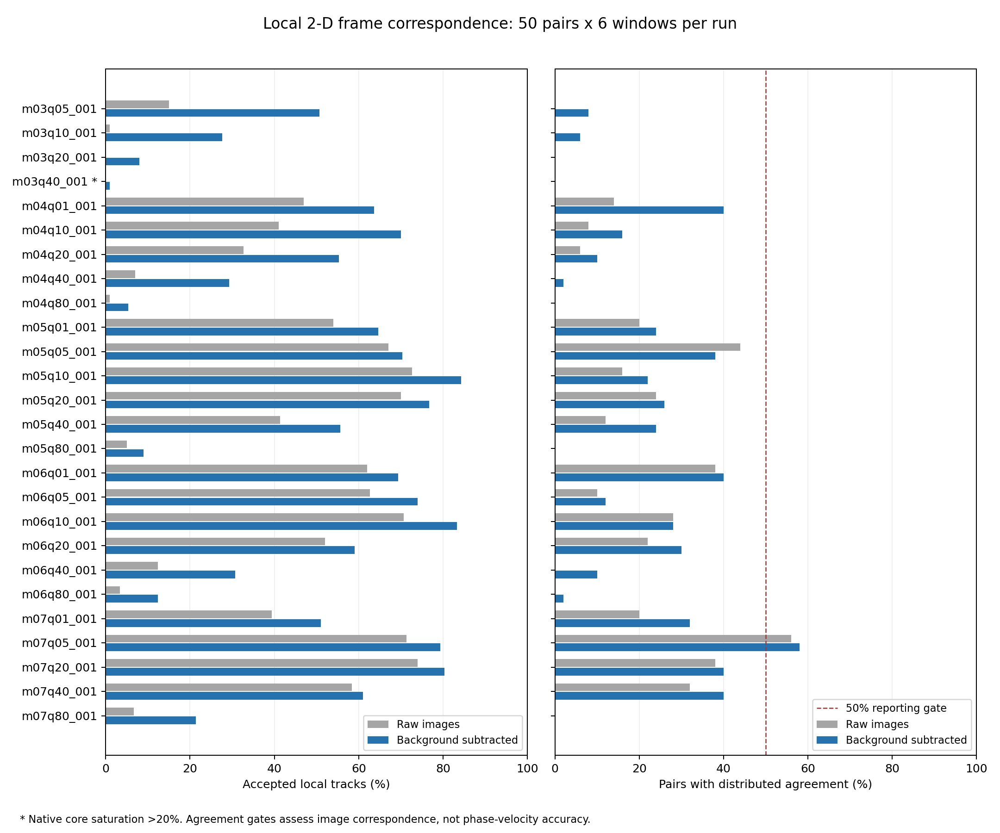

# Local two-dimensional frame-motion evaluation

**Executive finding:** local 2-D tracking recovers individual annular interface/texture displacements, but does not establish a representative annular speed. It adds spatial-consistency evidence; it does not identify separate liquid and gas material velocities.

## Method and scope

All 501 native frames in each of the 26 retained recordings supply the temporal mean background. The test uses 50 evenly spaced adjacent pairs (indices 0–499) and six fixed 160×16-pixel windows: x origins 220 and 636, y origins 12, 32 and 52. Coordinates are zero-based. Raw images and temporal-background-subtracted images are compared at identical locations and times. There are 15,600 local tracking attempts across the two methods.

Full 2-D normalized correlation searches ±96 px axially and ±4 px vertically. Positive displacement means increasing image coordinate. Gates fixed before inspecting results are peak correlation ≥0.60, peak margin ≥0.03 over competitors outside ±5 axial/±2 vertical pixels, texture standard deviation ≥1 gray level, and no search-boundary hit. Reverse tracking starts from the matched integer location; both directions must pass and return within 1 px. Saturated pixels (gray level ≥250) may occupy at most 20% of either matched patch. The vertical search is intentionally narrow for the axial geometry, and can reject larger transverse motions.

**Distributed agreement:** at least three accepted patches cover both axial positions and at least two radial positions; every accepted axial shift is within max(2 px, 20% of the absolute median) of the median. The illustrative run-reporting gate requires ≥50% of sampled pairs with distributed agreement and whole-run core saturation ≤20%. These are heuristic correspondence checks, not confidence levels or physical validation.

## Results

| Method | Accepted tracks | Agreement pairs | Runs passing reporting gate | Annular accepted tracks | Annular agreement pairs |
|---|---:|---:|---:|---:|---:|
| raw | 2902/7800 | 194/1300 | 1/26 | 109/2700 | 0/450 |
| background_subtracted | 3880/7800 | 254/1300 | 1/26 | 434/2700 | 10/450 |

Only m07q05_001 (plug) meets this distributed-agreement reporting gate: 28/50 raw pairs and 29/50 background-subtracted pairs. Its medians over those selected pairs are −101,377 and −101,407 px/s, respectively. The negative sign means movement to smaller axial coordinates.

**No annular recording meets this gate.** Background subtraction provides 434 accepted local annular tracks out of 2,700 attempts, with ten agreement pairs: m03q10 (3), m04q40 (1), m06q40 (5), m06q80 (1). These sparse local events do not establish a representative annular speed. Saturated m03q40 remains flagged.

This spatial-agreement criterion is substantially stricter than the previous global-profile criterion. The 1/26 result does not mean only one recording has trackable motion, and does not directly invalidate the previous 17/26 profile-supported recordings. Distinct bubbles, fronts and waves may move differently, while a global profile returns an aggregate shift. Small windows also contain less information and lose features more readily.

| Run | Pattern | Background-subtracted accepted tracks / 300 | Agreement pairs / 50 |
|---|---|---:|---:|
| m03q05_001 | churn | 152 | 4 |
| m03q10_001 | wavy annular | 83 | 3 |
| m03q20_001 | wavy annular | 24 | 0 |
| m03q40_001 | wavy annular | 3 | 0 |
| m04q01_001 | slug | 191 | 20 |
| m04q10_001 | churn | 210 | 8 |
| m04q20_001 | churn | 166 | 5 |
| m04q40_001 | wavy annular | 88 | 1 |
| m04q80_001 | wavy annular | 16 | 0 |
| m05q01_001 | plug | 194 | 12 |
| m05q05_001 | slug | 211 | 19 |
| m05q10_001 | churn | 253 | 11 |
| m05q20_001 | churn | 230 | 13 |
| m05q40_001 | churn | 167 | 12 |
| m05q80_001 | wavy annular | 27 | 0 |
| m06q01_001 | plug | 208 | 20 |
| m06q05_001 | slug | 222 | 6 |
| m06q10_001 | churn | 250 | 14 |
| m06q20_001 | churn | 177 | 15 |
| m06q40_001 | wavy annular | 92 | 5 |
| m06q80_001 | wavy annular | 37 | 1 |
| m07q01_001 | dispersed bubbles | 153 | 16 |
| m07q05_001 | plug | 238 | 29 |
| m07q20_001 | churn | 241 | 20 |
| m07q40_001 | churn | 183 | 20 |
| m07q80_001 | wavy annular | 64 | 0 |

## Comparison with the previous global profile

The following comparison uses only the identical sampled pairs passing both local and global gates. It selects easier examples; the global estimate is not independent ground truth.

| Local method | Jointly passing pairs | Median absolute difference (px/frame) | 90th percentile (px/frame) |
|---|---:|---:|---:|
| raw | 183 | 0.645 | 2.410 |
| background_subtracted | 222 | 0.710 | 2.941 |

## Verification and limitations

Five known synthetic 2-D translations, including fractional shifts, pass with maximum Euclidean displacement error 0.095995 px. Uniform images are rejected. One FFT peak agrees with direct Pearson correlation to 5.55e-16. These limited translation tests verify sign, normalization and arithmetic; they do not recreate multiphase deformation or reflections.

The saved-result verifier reproduces every local-track acceptance gate, pair gate, run summary and px/s conversion from CSVs. Consecutive frame IDs and agreement between both camera-config FPS values are checked. Camera clock and magnification are not independently calibrated.

Background subtraction can alter persistent structures. A patch can follow refractive texture, an interface or a wave; these need not follow gas or liquid material. The same moving boundary can occur in both phase masks. Spatial agreement provides no phase mass/volume weighting. Reported spreads describe selected motion events, not measurement uncertainty.

Recommendation: keep global-profile results as candidate structure-motion summaries subject to temporal/ROI checks, use local patches to reveal spatial inconsistency and illustrate particular events, and leave representative annular speeds unsupported. Do not relabel image regions as measured liquid and gas velocities.

Reproduce by running scripts/local_patch_motion.py, then scripts/local_patch_report.py, with python3 -B from the repository environment.

Outputs: [tracks](../results/local_patch_tracks.csv), [pairs](../results/local_patch_pairs.csv), [run summary](../results/local_patch_summary.csv), [metadata and synthetic checks](../results/local_patch_validation.json), [saved arithmetic verification](../results/local_patch_saved_verification.json).
