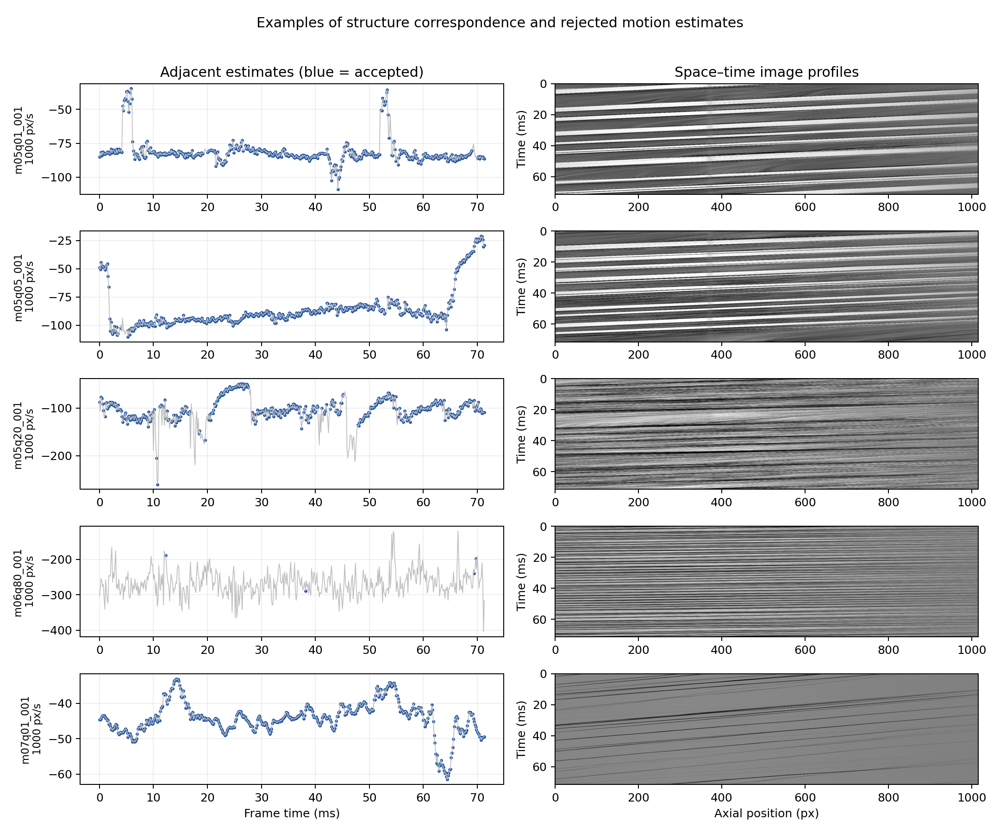

# Temporal consistency of native-frame motion

The preferred v15 normalized-correlation implementation was reapplied directly to all 501 native images per retained recording. Its original 13,000 adjacent comparisons reproduce exactly, including all 7,528 acceptance decisions and per-run medians. Images remain at 80×1016 pixels. Profiles average rows 20:60; each axial pixel has its 501-frame temporal mean subtracted. No high-pass filter, panorama, forced-positive displacement or physical length conversion is used.

## Fixed correspondence and diagnostic rules

A fixed 536-pixel central template is compared against equal-length candidate windows over ±240 pixels. An accepted comparison requires normalized correlation ≥0.60, margin ≥0.03 over the strongest candidate outside ±5 pixels, profile standard deviation ≥1 gray level, and a peak more than 2 pixels inside the search limit. Native central-band saturation at grayscale ≥250 must occupy no more than 20% of the recording for a run-level reporting candidate.

The same profile method is applied at lags 1, 2 and 4 to every possible pair: 500+499+497=1,496 comparisons per recording and 38,896 total. For a longer gap, its displacement divided by the lag is compared with the mean of the intervening adjacent displacements. Both the longer comparison and every adjacent comparison on that path must pass to enter the joint diagnostic.

A joint comparison agrees if the difference is ≤max(1 px/frame, 15% of the absolute adjacent-path mean). A run passes the temporal diagnostic if its adjacent coverage is ≥50%, saturation ≤20%, each of lags 2 and 4 has joint coverage ≥25%, and at least 80% of each lag’s joint comparisons agree. These thresholds were fixed before this computation. They are transparent heuristic diagnostics, not accuracy levels.

Long-gap and adjacent templates cover changing spatial content. Their disagreement can represent genuine spatial heterogeneity, deformation or different structures as well as correspondence failure. Fixed-window reversed comparisons are also saved; because their central templates are spatially distinct, these are reversal-sensitivity diagnostics, not reciprocal tracking of an identical patch. The separate local 2-D experiment performs matched-location reciprocal checks.

## Results for every retained recording

| Recording | Pattern | Adjacent accepted (%) | Lag-2 joint coverage (%) | Lag-4 joint coverage (%) | Lag-2 agreement (%) | Lag-4 agreement (%) | Temporal diagnostic |
|---|---|---:|---:|---:|---:|---:|---|
| m03q05_001 | churn | 52.0 | 14.4 | 2.8 | 87.5 | 71.4 | not passed |
| m03q10_001 | wavy annular | 15.0 | 2.2 | 0.0 | 81.8 | — | not passed |
| m03q20_001 | wavy annular | 16.0 | 3.6 | 1.0 | 100.0 | 100.0 | not passed |
| m03q40_001 | wavy annular | 54.0 | 38.7 | 26.4 | 100.0 | 98.5 | not passed; saturated |
| m04q01_001 | slug | 90.4 | 78.2 | 65.4 | 96.2 | 93.2 | pass |
| m04q10_001 | churn | 70.6 | 44.7 | 12.5 | 94.6 | 77.4 | not passed |
| m04q20_001 | churn | 63.6 | 33.1 | 10.7 | 93.3 | 69.8 | not passed |
| m04q40_001 | wavy annular | 6.4 | 0.8 | 0.0 | 0.0 | — | not passed |
| m04q80_001 | wavy annular | 3.2 | 0.0 | 0.0 | — | — | not passed |
| m05q01_001 | plug | 95.8 | 88.8 | 79.3 | 98.6 | 98.7 | pass |
| m05q05_001 | slug | 97.2 | 92.6 | 82.7 | 98.5 | 98.1 | pass |
| m05q10_001 | churn | 89.8 | 54.3 | 16.5 | 97.4 | 80.5 | not passed |
| m05q20_001 | churn | 85.2 | 54.7 | 16.9 | 97.8 | 82.1 | not passed |
| m05q40_001 | churn | 54.8 | 19.8 | 6.4 | 94.9 | 78.1 | not passed |
| m05q80_001 | wavy annular | 1.6 | 0.2 | 0.0 | 100.0 | — | not passed |
| m06q01_001 | plug | 97.4 | 87.8 | 80.7 | 97.7 | 95.8 | pass |
| m06q05_001 | slug | 93.8 | 75.4 | 43.7 | 94.9 | 89.4 | pass |
| m06q10_001 | churn | 83.4 | 53.1 | 17.3 | 96.6 | 79.1 | not passed |
| m06q20_001 | churn | 64.8 | 24.8 | 6.2 | 91.1 | 67.7 | not passed |
| m06q40_001 | wavy annular | 8.4 | 1.4 | 0.6 | 57.1 | 0.0 | not passed |
| m06q80_001 | wavy annular | 0.8 | 0.0 | 0.0 | — | — | not passed |
| m07q01_001 | dispersed bubbles | 100.0 | 100.0 | 99.4 | 99.8 | 99.0 | pass |
| m07q05_001 | plug | 95.2 | 86.6 | 74.6 | 99.3 | 98.7 | pass |
| m07q20_001 | churn | 90.0 | 57.9 | 13.7 | 99.0 | 88.2 | not passed |
| m07q40_001 | churn | 75.0 | 30.3 | 9.1 | 93.4 | 64.4 | not passed |
| m07q80_001 | wavy annular | 1.2 | 0.0 | 0.0 | — | — | not passed |

A dash means no jointly accepted comparisons. Agreement percentages use only the jointly accepted subset; coverage uses all possible comparisons for that lag. The 15% tolerance and gate percentages must not be described as confidence or measured error.

The space–time panels use all 501 mean profiles after background subtraction. Their slopes visualize structure motion; no independent slope estimator is fitted here. Gray time-series points/lines retain rejected estimates; blue points indicate accepted adjacent comparisons.

Five deterministic synthetic motion sequences at three lags verify the expected shift sign and px/frame calculation, with maximum error below 0.1 px/frame on these particular translated textures. Constant images are rejected. The synthetic check does not model multiphase deformation or establish real-data error.

Full results: [all pairs](../results/temporal_pairs.csv), [per-run summaries](../results/temporal_per_run.csv), [input hashes, thresholds and checks](../results/temporal_metadata.json), [independent verification](../results/independent_verification.json).
