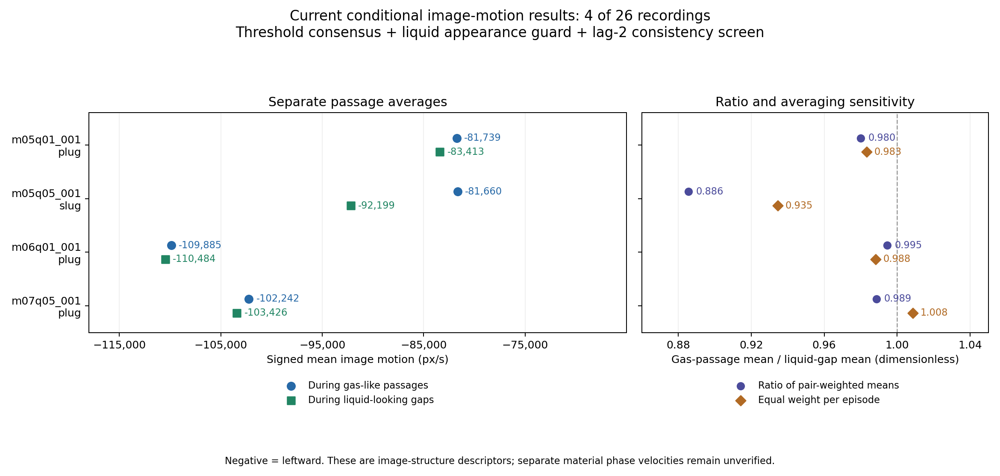
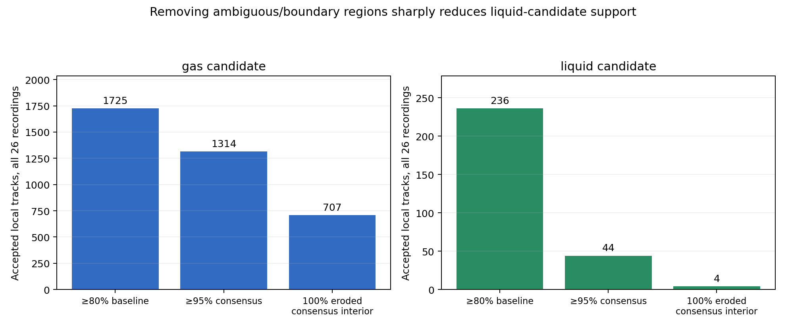
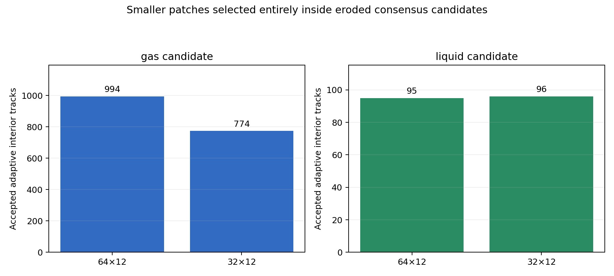
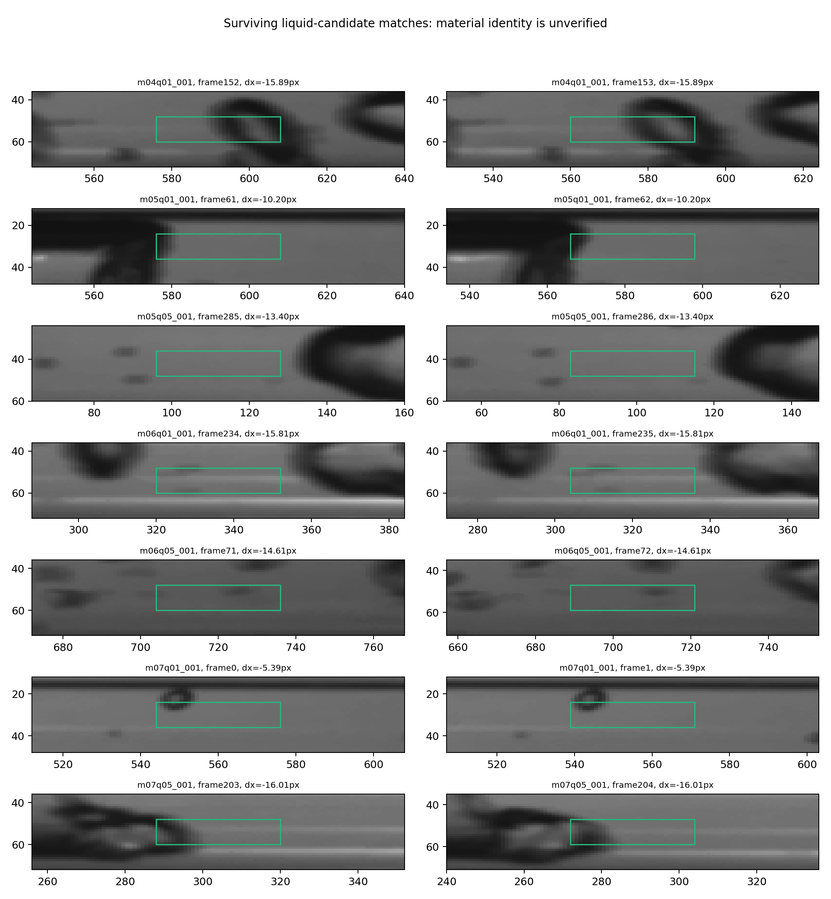
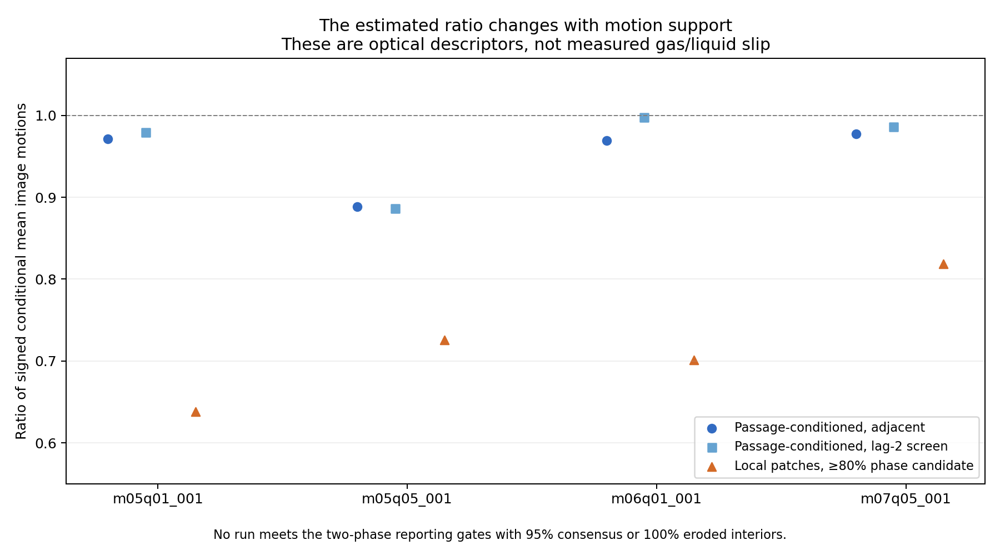
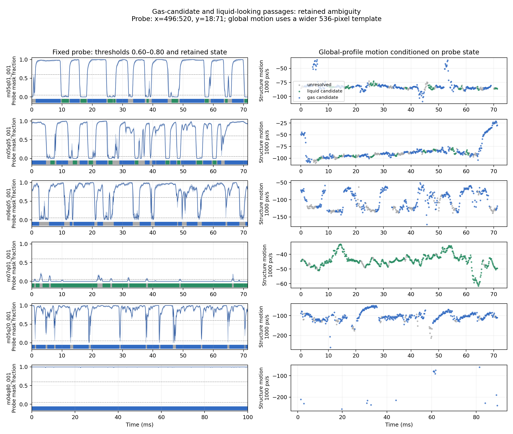
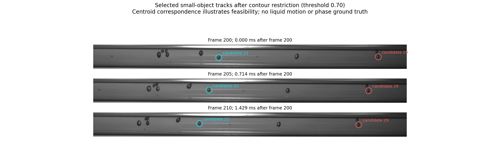

# EXECUTIVE SUMMARY — Gas-passage and liquid-gap conditioned motion

**The proposed split is useful as a conditional image-motion descriptor for some plug/slug recordings. It does not establish a material gas/liquid velocity ratio.** We applied v14 phase candidates to all 501 native frames in each of the 26 retained scenarios, computed separate signed means during inferred gas-object and liquid-looking-gap passages, and tested whether ratios survive stricter phase identification and motion support.

The original exclusions remain: m05q05_002, smooth annular and mixed classifications. Native capture rates are retained. No inlet-state assumptions, thermodynamic quality, circular void reconstruction or mm/pixel scale enter these calculations. A common image scale cancels within a per-recording ratio, but phase identification and phase-dependent optical effects remain unresolved.

## Main result: four conditional passage ratios

The reporting reference uses agreement among v14 thresholds 0.60/0.70/0.80, a liquid-reference appearance guard, episodes of at least five frames, and a lag-2 motion-consistency screen. Each side of a ratio needs at least 20 accepted adjacent pairs and three accepted episodes. A near-zero liquid mean, opposite signs or high saturation withholds the ratio. These are explicit feasibility gates, not confidence levels.

Gas dominance means at least 60% inferred-gas area in a 24×53-pixel fixed probe; liquid-looking means at most 5%. Other frames remain unresolved. The underlying global correlation template is 536 pixels long and can include both phases. Therefore the two averages describe global structure motion during different local appearances, not phase-pure motion.

| Recording | Pattern | Mean during gas-like passages (px/s) | Mean during liquid-like gaps (px/s) | Ratio of means | Accepted pairs, gas/liquid | Accepted episodes, gas/liquid |
|---|---|---:|---:|---:|---:|---:|
| m05q01_001 | plug | -81,739 | -83,413 | 0.980 | 273/59 | 9/8 |
| m05q05_001 | slug | -81,660 | -92,199 | 0.886 | 253/56 | 13/9 |
| m06q01_001 | plug | -109,885 | -110,484 | 0.995 | 245/31 | 15/6 |
| m07q05_001 | plug | -102,242 | -103,426 | 0.989 | 221/42 | 18/8 |

Positive image velocity is rightward; all means above are leftward. R is mean(image motion during gas-like passages) divided by mean(image motion during liquid-like gaps). Ratios below 1 do not demonstrate that liquid material travels faster than gas material. These are selected, overlapping image-motion observations from records only 71–125 ms long.

The chart uses exactly the reporting reference and four rows above: consensus_reference_guard with lag2_confirmed. The left panel reports signed image motion in **px/s**; the right panel reports a **dimensionless ratio**. No physical length conversion is applied. [Full-precision plotted values](../results/conditional_passage_velocities.csv) and [SVG](../figures/conditional_passage_velocities.svg) are retained. Episode-equal ratios show averaging sensitivity, not uncertainty intervals.

All three plug recordings contribute descriptors; only one of the three slug recordings does. Their selected per-pattern medians are saved in [conditional_ratio_by_pattern.csv](../results/conditional_ratio_by_pattern.csv), with denominators. There is no supported universal velocity ratio for each of the five patterns.

## The decisive identification check

The passage method labels time at a narrow probe. We separately required the actual source and matched destination patches to stay within the same phase candidate. The existing fixed 160×16-pixel, reciprocal 2-D tracks were tested under three progressively stricter phase rules. Background-subtracted results across all 26 recordings are:

| Fixed-patch phase rule | Accepted gas-candidate tracks | Accepted liquid-candidate tracks | Recordings with both means meeting ratio gates |
|---|---:|---:|---:|
| ≥80% phase candidate at threshold 0.70 | 1,725 | 236 | 5 |
| ≥95% same phase across all three thresholds | 1,314 | 44 | 0 |
| 100% inside consensus, with a 3-pixel boundary exclusion | 707 | 4 | 0 |

All four surviving strict liquid-candidate matches are in m07q01_001. Their weak visible features are not established liquid tracers. The disappearance of support is consistent with boundary/ambiguous-texture dependence; it also reflects smaller admissible areas and changed sampling. It does not prove that every earlier match was an interface or that liquid was stationary. Smaller adaptively located patches are evaluated separately in [the adaptive-patch review](adaptive_patch_review.md).

### Tested remedy: smaller, adaptively located interior patches

A second experiment selects up to two highest-texture source patches wholly inside each eroded consensus phase candidate, before looking at their target match. It uses 50 fixed adjacent pairs per recording, 64×12- and 32×12-pixel templates, reciprocal matching, and requires the matched target to remain wholly inside the same phase candidate.

| Adaptive size | Accepted gas-candidate tracks | Accepted liquid-candidate tracks | Recordings meeting both-phase ratio gates |
|---|---:|---:|---:|
| 64×12 | 994 | 95 | 0/26 |
| 32×12 | 774 | 96 | 0/26 |

Of the liquid-candidate tracks, 78/95 and 79/96 respectively occur in the dispersed recording, which has no accepted gas-interior patches in this test. Smaller/adaptive patches improve interior-match availability compared with the fixed-window test, but do not supply sufficient observations of both candidate phases in any recording under the declared gates. Size and placement both change, so this does not isolate either factor causally. Selected liquid-looking texture can still be an unresolved bubble or reflection; material identity remains unverified.

**Direct visual failure of phase purity:** some accepted liquid-candidate boxes overlap visible bubble-like contours or blurred interfaces, including m04q01 frame 152, m05q01 frame 61 and m07q05 frame 203. They pass the mask-interior rule despite apparent missed outlines; the raw image does not establish liquid material inside those boxes. Unmarked shadow components should remain unknown unless liquid appearance is independently supported; mask consensus alone cannot repair a shared false negative.

Even the looser local ratios differ materially from the temporal split. For example, m05q01 gives 0.971 under consensus adjacent temporal gating but 0.638 with ≥80%-candidate local patches; at ≥95% consensus it has insufficient observations for a reported ratio. The local and global estimators sample different content and use different weighting. Their disagreement is method/selection sensitivity, not an independent velocity error estimate.

This method-sensitivity figure uses consensus without the liquid-reference appearance guard for its temporal points. It therefore differs from the guarded reporting reference in the headline table and chart; it is a comparison of alternative sampling rules.

## Averaging and probe sensitivity

The requested arithmetic average over accepted pairs weights long, trackable passages more heavily. Equal weighting of episode means gives a different quantity. For the four main rows above, episode-equal ratios are respectively:

| Recording | Pair-weighted ratio | Episode-equal ratio |
|---|---:|---:|
| m05q01_001 | 0.980 | 0.983 |
| m05q05_001 | 0.886 | 0.935 |
| m06q01_001 | 0.995 | 0.988 |
| m07q05_001 | 0.989 | 1.008 |

Neither convention automatically equals a phase-volume- or phase-mass-weighted velocity. In m07q05 the ratio crosses 1 when the weighting changes, which limits any claim about which phase is faster.

Moving the strict probe from the center to left/right locations gives 4/3/1 eligible adjacent descriptors and 4/3/0 with the lag-2 screen. The left probe lies outside the global source template; that variant explicitly tests remote time conditioning and cannot identify the phase inside the template. Changing the permitted liquid-candidate occupancy from ≤5% gas to ≤20% or ≤40% restores the two sensitive slug descriptors, but deliberately admits gas-containing, liquid-rich appearance. It does not recover pure-liquid material velocity.

## Difficulties, outliers and tested special handling

| Case | Observed difficulty | Defensible handling |
|---|---|---|
| Plug: m05q01, m06q01, m07q05 | Visible alternating objects/gaps; conditional ratios near 1, but spatial/weighting sensitivity remains | Retain gas-object/gap-conditioned descriptors with counts, transition exclusion and sensitivity. Do not call them slip. |
| Slug: m05q05 | Both phase-looking passages are available, but pair weighting gives 0.886 and episode weighting gives 0.935 | Report both averaging conventions. Inspect fronts, tails and entrained bubbles instead of treating the entire slug as pure liquid. |
| Slug: m04q01 and m06q05 | Strict liquid-looking intervals are sparse or absent; relaxed gates yield about 0.44 and 0.76 | Flag phase-assignment/sample-selection sensitivity. The low ratios are not a reason to delete data or proof of physical reverse slip. |
| Dispersed: m07q01 | Gas-majority probe misses small bubbles; native v14 can falsely fill a large right-edge region | Use an isolated-object detector and bubble trajectories; do not expect full-section gas-passing intervals. See tested repair below. |
| Churn | Gas-envelope fill covers complex interiors; no strict liquid-looking passages at the chosen probe | Retain mixed/unresolved regions and event-level interface tracks. Envelope consensus does not certify gas-only material. |
| Wavy annular | Continuous gas core and liquid film coexist; temporal alternation is absent | Evaluate spatial core/film/interface motion separately. A film-wave speed is not automatically liquid material speed. Withhold unsupported material ratios. |
| Saturated m03q40 | Lost optical detail can still produce nearly unanimous masks | Preserve the quality exclusion; do not impute a phase speed or fill missing information. |

### Dispersed-bubble repair and object tracking

At native-frame thresholds 0.60/0.70/0.80, the original dispersed gas-candidate area is 0.455%/15.184%/23.679%. Disabling only long open-envelope acceptance changes these to 0.455%/2.620%/3.627% and reduces threshold disagreement from 24.369% to 4.360%. The visible right-edge false fill disappears in reviewed examples. Residual shadows/missed bubbles remain, and smaller area is not proof of correct phase segmentation.

This restriction is unsuitable as a universal replacement: it also discards legitimate open/cropped long gas regions in plug and annular examples. A separate isolated-component-only probe gives a similar but distinct 2.593% dispersed mask; those two alternatives must not be conflated.

Selected small-object tracking after the closed-envelope restriction yields **38 candidate chains and 1,038 retained object intervals** at threshold 0.70, with mean −43,904 px/s and median −42,906 px/s. Multiple objects can contribute to one frame interval. This supports candidate bubble translation, not liquid velocity or a material gas/liquid ratio. Filters select persistent isolated objects and omit mergers, small and cropped objects.

## Why complementary masks cannot provide slip

Gas and liquid candidate masks share the same interface. For L=1−B, their mean-subtracted signals differ only by sign, so normalized correlations of each mask pair have the same displacement. A known-translation control produces +17 px for both masks and ratio 1. That result follows from the shared interface even though no liquid parcel was tracked. It does not force the experimental grayscale conditional ratios to 1; it explains why a binary-mask split alone supplies no independent phase velocities.

## Recommendation

**Use the proposed analysis as gas-object/gap-conditioned image motion for the supported plug/slug scenarios, and keep bubble-object motion as a separate dispersed-flow observable.** Preserve unresolved states, per-scenario counts, weighting/probe sensitivity and missing ratios. Do not force one ratio per pattern, and do not promote these ratios to experimentally measured gas/liquid slip.

The most useful phase-identification improvements are native-frame corrections for the dispersed detector, separation of obvious objects from unresolved churn envelopes, explicit transition exclusion, and templates fitted within the actual candidate region. The adaptive-patch test addresses whether fixed patch dimensions unnecessarily discard short liquid gaps. Even a successful interior image match needs identifiable material-following texture before its velocity can be assigned to liquid parcels.

## Verification and provenance

Independent verification reaggregated **1,177,284 numeric values** for the native masks, phase states, 130,000 passage comparisons, episode means, local phase assignments, ratios and probe/gate sensitivity, with zero discrepancy. It reconstructed the liquid-reference guard from all 13,026 original images and used an independent spatial minimum filter for erosion. These are arithmetic/provenance checks, not phase-label or velocity-accuracy validation.

Adaptive results additionally pass a separate [mask-membership and arithmetic verification](../results/adaptive_independent_verification.json), covering all 5,862 selected patches, 5,200 phase/frame/size opportunities, 104 phase summaries and 52 ratio decisions. The adaptive experiment changes template placement and size while preserving the stricter candidate-interior requirements.

All 39,078 native threshold masks, original classifications, scripts, data tables and plots are retained under this directory. Current v14 code uses the owner-confirmed lumen rows 18:71; older v14 executive-summary wording still mentions a 60-pixel diameter. This analysis uses the current mask geometry and no void-area conversion. Original data and prior v14/v15 artifacts are preserved.

Details: [native masks](native_phase_masks.md), [visual audit](phase_visual_review.md), [closed-contour/object probe](closed_contour_review.md), [adaptive patches](adaptive_patch_review.md), [independent audit](independent_review.md), and [reproduction](../README.md).
