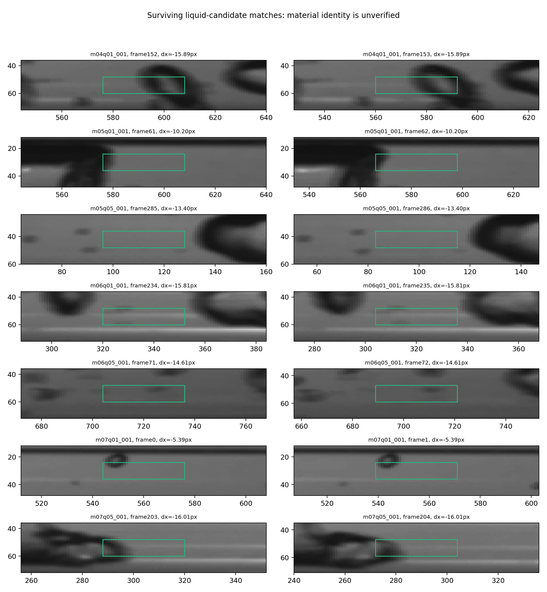
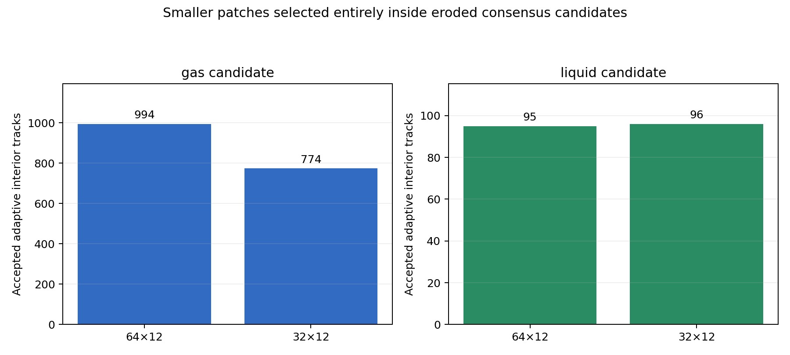

# Adaptive interior-patch feasibility

**This experiment tests whether the earlier fixed patch size/placement unnecessarily removed liquid-candidate observations.** It uses smaller source patches selected wholly inside eroded consensus masks before matching. These remain optical phase candidates, not material tracers.

Each recording supplies50 fixed adjacent pairs. Source grid x=96..920 in steps of32, y=24/36/48/56, filtered so the search window fits. Per phase and size, up to two nonoverlapping highest-texture patches are selected before looking at the target match. Gas requires agreement of all three masks; liquid candidates are outside all three within rows18:71. Both masks are eroded by a7×7 square. The entire source and matched destination patch must stay inside the same eroded phase candidate.

NCC uses ±64 axial/±4 radial pixels, peak≥0.60, competitor margin≥0.03, texture standard deviation≥1, no boundary hit, reciprocal matching within1px, and≤20% saturated pixels. Reverse searches that do not fit the frame are rejected. Source texture uses original intensity minus the full501-frame temporal background. No velocity enters source selection.

| Patch size | Gas-candidate accepted tracks | Liquid-candidate accepted tracks | Recordings with eligible two-phase descriptor |
|---|---:|---:|---:|
| 64×12 | 994 | 95 | 0/26 |
| 32×12 | 774 | 96 | 0/26 |

A descriptor requires≥20 accepted tracks and≥10 distinct sampled frames for each phase candidate, same nonzero mean direction, |liquid mean|≥1px/frame and no high whole-run saturation. The mean for each phase is the mean of its per-frame accepted-window means. These are information gates, not independent sample sizes or accuracy bounds.

| Recording | Size | Gas tracks / frames | Liquid tracks / frames | Ratio, if eligible |
|---|---|---:|---:|---:|
| m03q05_001 | 64×12 | 27/23 | 0/0 | — |
| m03q05_001 | 32×12 | 27/22 | 0/0 | — |
| m03q10_001 | 64×12 | 16/15 | 0/0 | — |
| m03q10_001 | 32×12 | 15/12 | 0/0 | — |
| m03q20_001 | 64×12 | 10/10 | 0/0 | — |
| m03q20_001 | 32×12 | 10/10 | 0/0 | — |
| m03q40_001 | 64×12 | 15/13 | 0/0 | — |
| m03q40_001 | 32×12 | 9/8 | 0/0 | — |
| m04q01_001 | 64×12 | 73/48 | 0/0 | — |
| m04q01_001 | 32×12 | 52/37 | 3/2 | — |
| m04q10_001 | 64×12 | 57/38 | 0/0 | — |
| m04q10_001 | 32×12 | 47/32 | 0/0 | — |
| m04q20_001 | 64×12 | 42/36 | 0/0 | — |
| m04q20_001 | 32×12 | 32/24 | 0/0 | — |
| m04q40_001 | 64×12 | 5/5 | 0/0 | — |
| m04q40_001 | 32×12 | 6/6 | 0/0 | — |
| m04q80_001 | 64×12 | 1/1 | 0/0 | — |
| m04q80_001 | 32×12 | 3/3 | 0/0 | — |
| m05q01_001 | 64×12 | 45/33 | 8/8 | — |
| m05q01_001 | 32×12 | 35/23 | 4/4 | — |
| m05q05_001 | 64×12 | 64/46 | 2/2 | — |
| m05q05_001 | 32×12 | 43/34 | 2/2 | — |
| m05q10_001 | 64×12 | 73/47 | 0/0 | — |
| m05q10_001 | 32×12 | 56/38 | 0/0 | — |
| m05q20_001 | 64×12 | 56/39 | 0/0 | — |
| m05q20_001 | 32×12 | 45/32 | 0/0 | — |
| m05q40_001 | 64×12 | 51/36 | 0/0 | — |
| m05q40_001 | 32×12 | 35/29 | 0/0 | — |
| m05q80_001 | 64×12 | 19/17 | 0/0 | — |
| m05q80_001 | 32×12 | 14/14 | 0/0 | — |
| m06q01_001 | 64×12 | 48/37 | 2/2 | — |
| m06q01_001 | 32×12 | 42/32 | 4/4 | — |
| m06q05_001 | 64×12 | 63/43 | 0/0 | — |
| m06q05_001 | 32×12 | 46/38 | 1/1 | — |
| m06q10_001 | 64×12 | 71/43 | 0/0 | — |
| m06q10_001 | 32×12 | 54/39 | 0/0 | — |
| m06q20_001 | 64×12 | 41/31 | 0/0 | — |
| m06q20_001 | 32×12 | 38/32 | 0/0 | — |
| m06q40_001 | 64×12 | 33/24 | 0/0 | — |
| m06q40_001 | 32×12 | 26/23 | 0/0 | — |
| m06q80_001 | 64×12 | 16/13 | 0/0 | — |
| m06q80_001 | 32×12 | 12/11 | 0/0 | — |
| m07q01_001 | 64×12 | 0/0 | 78/47 | — |
| m07q01_001 | 32×12 | 0/0 | 79/46 | — |
| m07q05_001 | 64×12 | 64/42 | 5/5 | — |
| m07q05_001 | 32×12 | 41/33 | 3/3 | — |
| m07q20_001 | 64×12 | 53/40 | 0/0 | — |
| m07q20_001 | 32×12 | 33/28 | 0/0 | — |
| m07q40_001 | 64×12 | 33/27 | 0/0 | — |
| m07q40_001 | 32×12 | 27/26 | 0/0 | — |
| m07q80_001 | 64×12 | 18/16 | 0/0 | — |
| m07q80_001 | 32×12 | 26/22 | 0/0 | — |

## Interpretation

Smaller adaptive patches test geometric availability separately from motion correspondence. Opportunity CSVs retain source-area absence, low texture, saturated source, matching failure, destination-phase failure and acceptance. Comparisons with the earlier160×16 fixed patches change both size and placement; they do not isolate one causal factor.

A surviving liquid-candidate match can follow an unresolved bubble or optical structure missed by segmentation. A high-purity inferred mask does not certify liquid parcel identity. Texture-based source selection is explicitly selective and can favor such residual objects. No material phase-velocity ratio is established here.

Synthetic translated textures at both patch sizes pass, with maximum displacement error 0.040807px. Constant inputs are rejected. These tests verify numerical behavior for constructed translations, not real-data phase accuracy.

Reproduce: python3 -B src2/v15_gas_liquid_velocity/phase_conditioned_motion/scripts/adaptive_phase_patches.py. Full outputs use the adaptive_ prefix.

## Observed support and visual limitations

Adaptive placement recovers more liquid-candidate matches than the earlier fixed160×16 boxes, so the earlier four matches were not a universal limit on possible image correspondence. Nevertheless, no recording satisfies the two-phase reporting criteria at either tested size. Most recovered liquid-candidate matches belong to the dispersed recording, for which no gas-candidate patch qualifies at these sizes.

| Patch size | Liquid-candidate phase/frame opportunities | No wholly interior source patch | Accepted liquid tracks in dispersed run | Accepted liquid tracks in all other runs |
|---|---:|---:|---:|---:|
| 64×12 | 1300 | 1094 | 78 | 17 |
| 32×12 | 1300 | 1041 | 79 | 17 |

The masks leave no eligible liquid interior at most tested phase/frame opportunities. Where candidate interiors exist, correspondence rejection also matters. This is a limitation of the tested segmentation/patch definition and observations; it does not prove that liquid is physically absent or stationary.

The surviving-example figure was visually inspected. Several nominal liquid-interior boxes visibly include part of a bubble-like contour or a nearby blurred interface: m04q01 frame152, m05q01 frame61, m07q01 frame0 and m07q05 frame203 are examples. Other boxes contain weak unidentified spots or brightness structure. This shows that even consensus plus erosion of these masks does not certify actual phase purity. These are targeted visual observations, not an annotated error-rate measurement.

Saved arithmetic and independently reconstructed mask-interior checks are available in [adaptive_verification.json](../results/adaptive_verification.json), reproduced by scripts/adaptive_verify.py.
