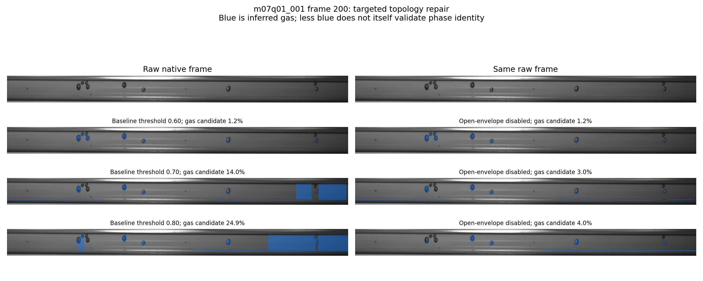
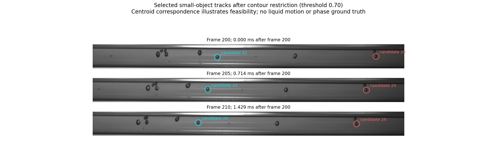

# Targeted closed-contour and dispersed-object probe

## Executive finding

**Disabling the long open-envelope fill partially repairs a conspicuous native-frame dispersed-bubble artifact.** It removes the large apparent right-edge gas block in the inspected frames, while preserving several recognizable small bubble candidates. Residual reflection/shadow candidates and missed bubbles remain. The same rule removes large amounts of legitimate open/cropped gas structure in other patterns, so it is not a universal replacement for v14.

An exploratory small-object tracker then produces persistent bubble-candidate motion near −6.1 to −6.3 px/frame in the dispersed recording. This supports a pattern-specific object-tracking path. It does not provide liquid parcel motion or a gas/liquid material velocity ratio.

## Controlled topology change

The current v14 silhouette function and frozen liquid-like reference were retained. Only min_open_interval was increased from 20 to 1,000,000 pixels, disabling acceptance solely because an open paired-shadow interval is long. Same-outline acceptance and the separate closed-component branch remain. Thresholds 0.60, 0.70 and 0.80 are tested. All 501 frames of m07q01_001 and 20 fixed equally spaced frames in each of the other 25 retained recordings were processed: 1,001 frames and 3,003 detector evaluations.

These are identical-frame baseline/alternative comparisons, not comparisons against phase truth. Every alternative mask is asserted to be a subset of its baseline mask. Lower area alone is not evidence of correctness.

| Threshold | Baseline projected gas (%) | Open-fill-disabled projected gas (%) | Baseline gas pixels removed (%) |
|---|---:|---:|---:|
| 0.60 | 0.455 | 0.455 | 0.00 |
| 0.70 | 15.184 | 2.620 | 82.74 |
| 0.80 | 23.679 | 3.627 | 84.68 |

Across the 501 dispersed frames, threshold disagreement decreases from **24.369% to 4.360% of lumen pixels**. This is improved internal consistency, not segmentation accuracy.

In inspected frames 200 and 210, the large right-edge block disappears. Thin lower reflection/shadow structures remain labeled at higher thresholds. Several obvious isolated bubble outlines remain, while some neighboring visible bubbles are missed or only partly outlined. No manual pixel-level ground truth was constructed.

## Why this requires pattern-specific handling

| Example | Baseline projected gas (%) | Open-fill-disabled projected gas (%) |
|---|---:|---:|
| m05q01_001 | 67.039 | 23.636 |
| m06q01_001 | 69.514 | 9.086 |
| m05q20_001 | 89.046 | 0.859 |
| m04q80_001 | 99.962 | 9.750 |

These examples use 20 sampled frames, not complete-record averages. Long gas objects, open annular cores and interfaces intersecting the crop can fail the closed-outline requirement. The large decreases therefore expose lost coverage as well as artifact suppression. A dispersed-object method may use this restriction, but it must not turn unmarked portions of plug/churn/annular images into certified liquid.

## Exploratory dispersed bubble-candidate trajectories

On the full 501-frame dispersed sequence, connected candidates must have area 15–1,000 pixels, width 3–60, height 3–35 and width/height ≤4, inside rows 20:69 and columns 10:1006. Adjacent matches use reciprocal nearest centroid distance, displacement ≤30 pixels, vertical displacement ≤5 pixels, area ratio 0.5–2.0, and a ≥2-pixel margin over competitors. A retained chain has at least five matched intervals and consecutive axial/vertical step changes no larger than 2 pixels. These transparent exploratory restrictions deliberately select persistent small objects; they are not validated detector-error bounds.

| Threshold | Candidate observations | Stable chains | Retained matched intervals | Median px/frame | Median px/s |
|---|---:|---:|---:|---:|---:|
| 0.60 | 1637 | 29 | 814 | -6.124 | -42,871 |
| 0.70 | 1625 | 38 | 1038 | -6.129 | -42,906 |
| 0.80 | 1944 | 49 | 1454 | -6.314 | -44,197 |

Multiple objects can be matched in one frame pair, so the interval counts can exceed 500. Chains can be fragments of the same physical bubble and are not proven independent experimental observations. Reported medians weight retained matched intervals, not whole bubbles or phase mass. The three thresholds select different candidates and chains.

The figure shows all threshold-0.70 stable chains that cover frames 200–210, with circles on their current centroid positions. These selected candidates visibly correspond to small moving features in the raw images. The consistency with previous broad-profile motion is not independent validation because both methods use the same images.

This special handling can recover a bubble-translation descriptor where a whole-cross-section gas-dominance gate misses dispersed events. **No liquid velocity is inferred from the background, and no material slip ratio is established.** Dark specks may remain ambiguous; touching, coalescing, cropped, tiny and deformed bubbles are omitted or fragmented. A vetted annotation set would be needed to quantify identification errors.

## Verification and reproduction

Mask-subset and packed-array roundtrip assertions pass. Saved per-frame gas fractions reproduce the per-run summaries. A known two-object translation verifies centroid direction and reciprocal matching. Saved link displacements, pixel rates, chain-stability gates and summary statistics are reaggregated by this report script. These checks establish computation consistency, not physical phase accuracy.

Run scripts/closed_contour_probe.py, scripts/closed_contour_bubble_tracks.py, then scripts/closed_contour_report.py using python3 -B.

Data: [topology summary](../results/closed_contour_summary.csv), [per-frame comparison](../results/closed_contour_frames.csv), [bubble-candidate summary](../results/closed_contour_bubble_summary.csv), [candidate links](../results/closed_contour_bubble_links.csv), [verification](../results/closed_contour_verification.json). Source images, reference and baseline masks were preserved.
