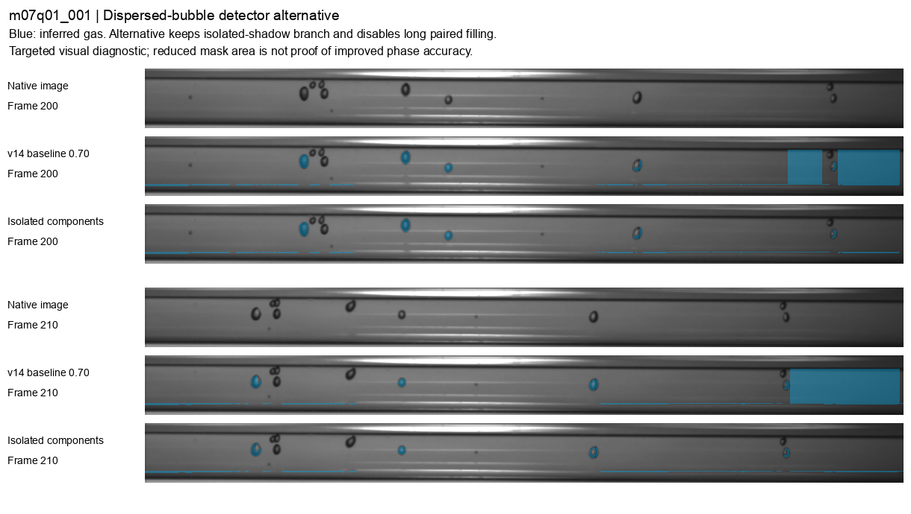

# Visual review of native phase identification

## Executive finding

**v14 can help identify obvious long gas objects and liquid-looking gaps, but a direct transfer to native frames does not reliably label every gas/liquid passage.** The native dispersed-bubble case exposes a large apparent false fill; churn envelopes can hide internal liquid; annular flow has simultaneous gas-core/liquid-film occupancy rather than alternating gas-only and liquid-only passages. The image complement of the inferred gas mask must remain **unmarked/possibly liquid**, not certified liquid.

This review inspected **16 fixed native frames from eight recordings**: frames 200 and 210 for five retained patterns, including the two previously sensitive slug cases and the saturated annular case. It is a targeted visual audit, not a blinded or independently annotated segmentation benchmark. It provides concrete failure examples, not an accuracy percentage.

## What was compared

The current v14 detector was applied with thresholds 0.60, 0.70 and 0.80, using its three-panorama liquid-like reference. The confirmed lumen is rows **18:71**, comprising 53 pixel cells. No circular area reconstruction is needed here. Source-code hashes, the exact reference, source-frame hashes and image dimensions are saved in [phase_visual_metadata.json](../results/phase_visual_metadata.json).

Each sheet shows raw stored intensities, the baseline gas-candidate mask, and consensus/disagreement across the three thresholds. Blue denotes an inferred gas silhouette; orange denotes threshold disagreement. Unmarked areas retain their native image appearance. The red fixed probe covers x=496:520 and y=18:71. Native pixels are not rescaled or contrast-normalized for these display panels.

## Concrete examples and difficulties

| Case | Direct visual evidence | Consequence for separate averages |
|---|---|---|
| [m05q01_001, plug](../figures/phase_visual_m05q01_001.png) | The detector follows the visible elongated object and leaves the adjacent liquid-looking gap largely unmarked. The probe is inside the long object in both displayed frames. | A gas-object/gap passage descriptor is plausible. The gap boundaries remain the same gas–liquid interfaces used by gas-object tracking. |
| [m05q05_001, slug](../figures/phase_visual_m05q05_001.png) | At frame 200 the fixed probe is in an unmarked gap; at frame 210 it is inside an elongated gas candidate. Smaller nearby objects and rear boundaries deform. | This is a useful example of temporal gating, provided interfaces and transitional frames are excluded. It does not identify liquid parcel speed inside the gap. |
| [m04q01_001, slug](../figures/phase_visual_m04q01_001.png) | The frame-200 probe lies in a narrow interval between nearby objects; the frame-210 probe is inside a long object. Small off-axis objects near the gap have threshold-dependent masks. | Short gap durations and neighboring interfaces can bias a velocity conditioned on a narrow probe when its correlation template covers a much wider image region. |
| [m06q05_001, slug](../figures/phase_visual_m06q05_001.png) | A long irregular object fills the probe in both frames. Upstream and trailing regions contain many smaller objects and changing interfaces. | An apparently clean gas-majority label can coexist with several independently moving interfaces. A global shift need not be the velocity of the material inside the probe. |
| [m07q01_001, dispersed bubbles](../figures/phase_visual_m07q01_001.png) | Several small bubble outlines are visible; some receive little or no mask. The baseline also fills a large right-edge block without a corresponding long gas-object outline in the raw image. | Gas-majority temporal gating can miss real small bubbles, while the open-envelope rule can manufacture large apparent gas passages. Object-level tracking requires a different treatment. |
| [m05q20_001, churn](../figures/phase_visual_m05q20_001.png) | Broad envelopes are filled as gas despite complex internal texture and multiple changing interfaces. Much of the filled interior agrees across thresholds. | Threshold agreement does not resolve entrained liquid or certify gas-only texture. Use mixed/uncertain labels where phase identity is not visually resolved. |
| [m04q80_001, wavy annular](../figures/phase_visual_m04q80_001.png) | The probe is fully masked at all three thresholds in both examples; a continuous core and surrounding film/interface structure are visible. | There are no distinct liquid-only passing intervals in these examples. Core and film occupy the section simultaneously; temporal phase alternation is the wrong decomposition for this geometry. |
| [m03q40_001, wavy annular](../figures/phase_visual_m03q40_001.png) | Broad saturated/bright regions receive nearly full gas masks with little threshold disagreement. | Segmentation agreement cannot restore information lost to saturation. This case must retain its optical-quality exclusion. |

For the fixed probe, baseline inferred-gas area fractions are **0.0% → 93.9%** between frames 200 and 210 in m05q05_001; **98.8% and 93.4%** in the two churn examples; and **100% in both annular m04q80 examples**. These percentages describe the mask within a projected probe window, not actual phase volume or mass fraction. The churn/annular values demonstrate why a large mask fraction alone does not establish a pure gas material measurement.

## Dispersed-bubble transfer outlier and a tested special treatment

The complete native-mask audit gives m07q01_001 a baseline projected gas-candidate fraction of **15.184%**, compared with **0.821%** in the saved v14 panorama result. The native threshold-0.60/0.70/0.80 fractions are **0.455%, 15.184% and 23.679%**; **24.369%** of native lumen pixels disagree across those thresholds. Native temporal sampling and reconstructed panorama spatial sampling differ, so their numerical difference is not a measured error rate. The raw/mask sheets nevertheless show a concrete apparent false fill at the right image edge.

An exploratory special treatment was tested on **all 501 frames of this dispersed-bubble recording**: retain v14's existing isolated-shadow-component and hole-filling branch, while disabling its long paired-shadow envelope fill. The baseline was independently recomputed for every frame and matched the newly saved native baseline masks exactly.

| m07q01_001 metric | v14 baseline at 0.70 | Isolated-component alternative |
|---|---:|---:|
| Mean projected gas-candidate area within rows 18:71 | 15.184% | 2.593% |
| Mean candidate area in right-edge region x=860:1016 | 81.567% | 3.080% |

In the displayed examples this removes the conspicuous large rectangular fill while retaining several isolated bubble candidates. **It does not prove that 2.593% is the correct gas fraction.** Some visible bubbles remain weakly detected and thin near-wall shadow candidates remain. Disabling open envelopes globally would also remove useful continuous-core/long-object candidates in other patterns. This is a targeted candidate for further evaluation, not a validated universal replacement. Exact per-frame values are saved in [phase_visual_dispersed_alternative.json](../results/phase_visual_dispersed_alternative.json).

## Recommended handling by observable

1. **Plug/slug passage descriptor:** define gas-object, liquid-looking-gap and transition/uncertain states at a fixed station. Require several persistent frames and agreement across threshold/reference variants. Place the motion template within the actual state being assigned; a narrow station label cannot automatically label a wide template containing both phases.
2. **Exclude shared-interface contamination:** erode confident interior masks and reject templates intersecting uncertain boundaries. Inspect the remaining texture. If support vanishes after removing interfaces, these tests no longer support a liquid-interior estimate; earlier matches may have followed interfaces or ambiguous texture. This does not prove that every earlier match was an interface or that liquid was stationary.
3. **Dispersed bubbles:** track individual identified objects rather than demanding that gas occupy most of the cross-section. Test the isolated-component alternative, near-wall artifact rejection and missed-object behavior. A liquid-looking background still requires identifiable material-following features to produce liquid velocity.
4. **Churn:** retain a mixed/uncertain class and permit local short tracks. Do not force all envelope interiors into gas and all unmarked holes into liquid. Merging/splitting and entrained structures can make phase assignment indeterminate.
5. **Annular:** separate spatial core/film/interface regions if they can be resolved. A film-wave speed remains a wave speed; it is not automatically liquid material velocity. If a phase has no adequate tracked observations, leave its mean and ratio undefined.
6. **Ratios:** require both denominators and numerators to have phase-appropriate observations, adequate independent events and stable sign. Report the ratio as conditional image-motion contrast unless material-phase correspondence has actually been demonstrated. Consensus across thresholds reduces one form of sensitivity; it does not establish phase truth.

No verified liquid tracers were identified in these selected raw frames. Small dark objects cannot be assigned to liquid material solely from appearance. These data may still support a useful gas-object/gap-conditioned motion descriptor, but its name and interpretation must follow what was actually tracked.

## Reproduction

Run from the repository root:

    python3 -B src2/v15_gas_liquid_velocity/phase_conditioned_motion/scripts/phase_visual_audit.py

The script writes eight comparison sheets and one dispersed-bubble alternative sheet, with selected-frame provenance and the full 501-frame alternative summary. It uses current v14 detector code directly and does not overwrite existing v14/v15 results, native images or the main packed masks. The selected raw displays and mask overlays were visually inspected. The exploratory alternative's baseline matches the main native archive at every dispersed-bubble frame.
