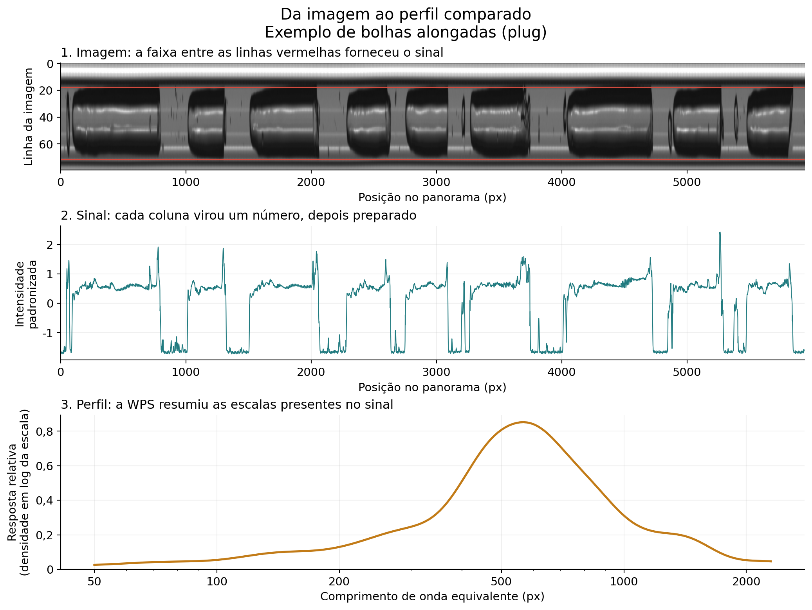
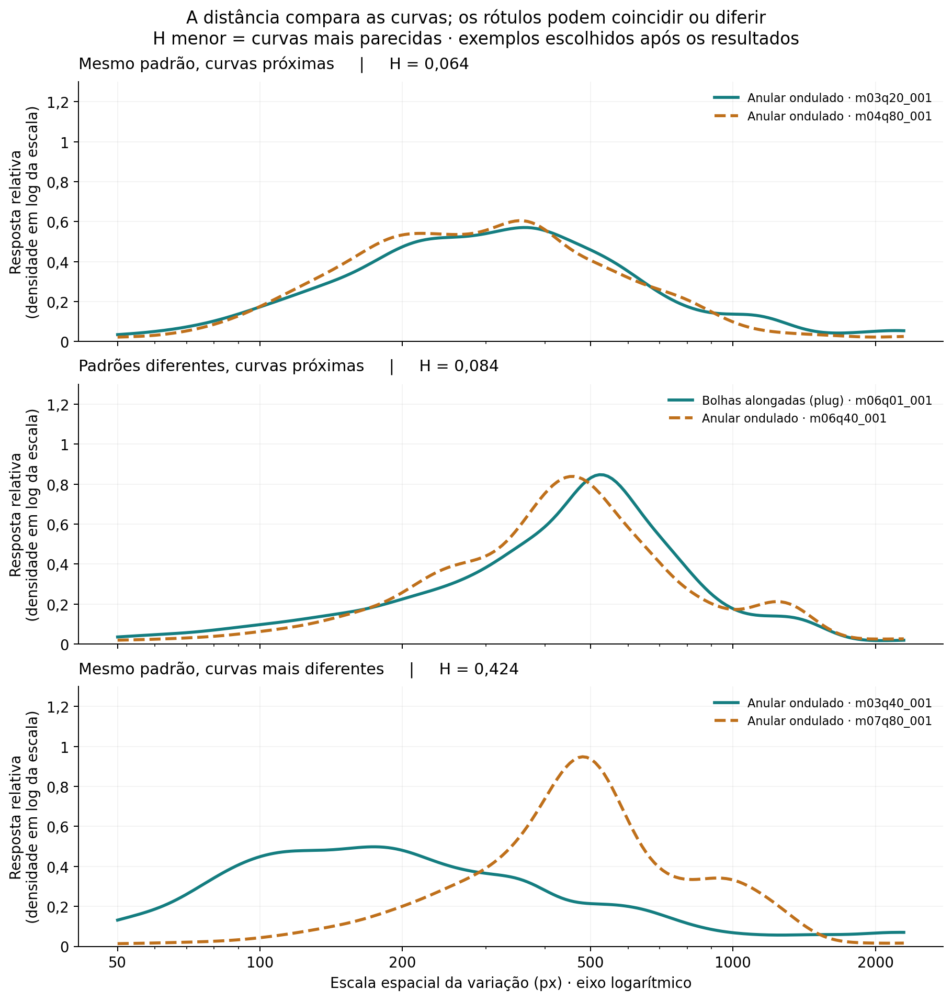
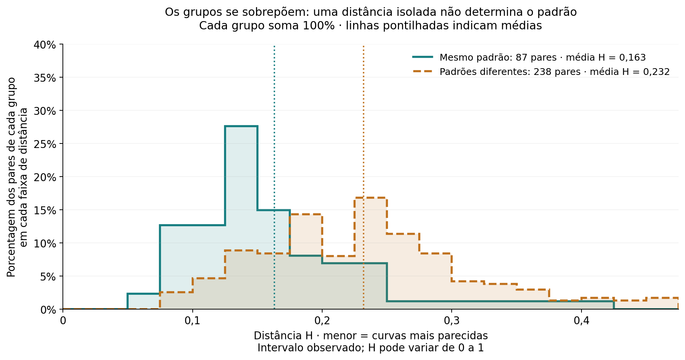
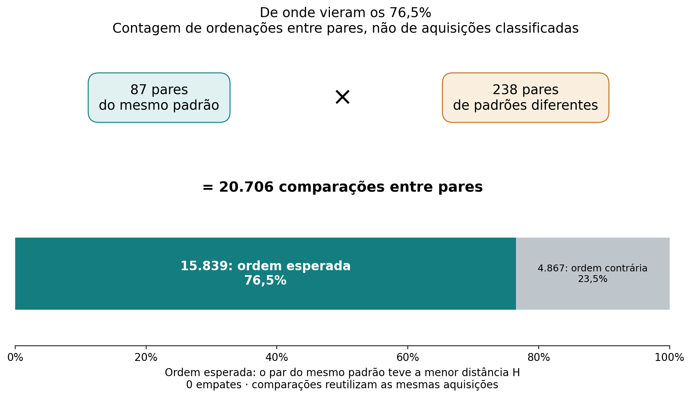
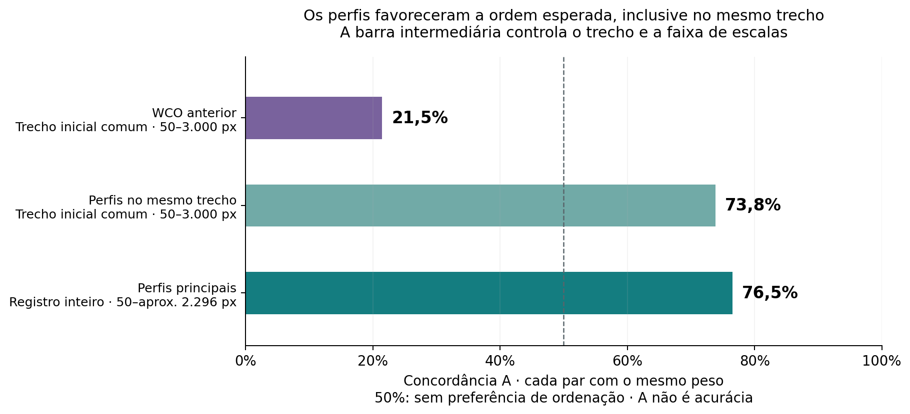

# Leitura guiada: das imagens à comparação entre padrões

**Os registros do mesmo padrão tenderam a apresentar curvas mais parecidas, mas houve exceções importantes.** A análise encontrou uma forma útil de descrever semelhanças neste conjunto. Ainda não demonstrou identificação automática dos padrões em novos experimentos.

O percurso de leitura é: **imagem → sinal → curva de escalas → distância entre duas curvas → comparação de todos os pares**. As siglas e os detalhes de reprodução aparecem depois dessa explicação.

## 1. Objetivo e dados da comparação

O estudo investigou se imagens de escoamentos com o mesmo padrão também se pareciam quando transformadas em curvas numéricas. Os padrões já estavam identificados na base. Esses rótulos foram usados para avaliar a semelhança calculada; o método não os descobriu automaticamente.

Uma **aquisição** é um registro experimental. Neste estudo, cada aquisição forneceu um panorama, uma imagem comprida montada com partes de imagens capturadas em momentos diferentes. Foram verificadas 31 entradas e mantidas as 26 aquisições previstas no protocolo, com as cinco exclusões anteriores.

| Padrão já atribuído à aquisição | Aquisições | Pares do mesmo padrão |
| --- | --- | --- |
| Bolhas dispersas | 1 | 0 |
| Bolhas alongadas (plug) | 3 | 3 |
| Golfadas (slug) | 3 | 3 |
| Agitado (churn) | 10 | 45 |
| Anular ondulado | 9 | 36 |

Um **par** contém duas aquisições. Com três aquisições de bolhas alongadas, por exemplo, foram possíveis três pares: primeira–segunda, primeira–terceira e segunda–terceira. Ao combinar as 26 aquisições, obtiveram-se **325 pares: 87 do mesmo padrão e 238 de padrões diferentes**. Uma aquisição participou de vários pares; por isso, 325 pares não equivalem a 325 experimentos independentes.

## 2. Da imagem à curva de escalas

Cada coluna do panorama foi resumida pela média dos tons de cinza das linhas 18–71, totalizando 54 linhas. A sequência dessas médias formou o sinal. Depois, inverteram-se as intensidades, retirou-se uma tendência linear e padronizou-se o sinal para reduzir diferenças globais de nível e amplitude.

Para resumir as variações, calculou-se a autocorrelação, que compara o sinal com cópias deslocadas dele próprio. Aplicou-se então a transformada wavelet, que examina oscilações de diferentes escalas. Dela foi extraída uma curva, chamada aqui **perfil de WPS alternativa**, no deslocamento zero. Esse deslocamento pertence à autocorrelação e não significa a primeira coluna da imagem: o cálculo utilizou o registro analisado.

**Leitura da figura 1, de cima para baixo:**

- **Imagem:** as linhas vermelhas delimitam a faixa utilizada. A posição horizontal indica onde está cada coluna do panorama.
- **Sinal:** a curva mostra as intensidades depois do preparo. O eixo horizontal ainda indica posição no panorama.
- **Perfil:** o eixo horizontal mudou de significado. Agora indica a escala espacial da variação, em pixels. À esquerda ficam variações mais curtas; à direita, mais longas.
- **Picos do perfil:** indicam escalas com maior resposta relativa. Um pico próximo de 500 px não localiza uma bolha na coluna 500 e não mede diretamente seu comprimento.

Cada perfil teve sua área ajustada para um, para comparar a distribuição da resposta entre escalas. A altura é uma **densidade relativa**, não uma porcentagem de energia em cada ponto. O eixo é logarítmico: distâncias iguais no desenho correspondem a razões iguais, como dobrar de 100 para 200 px ou de 500 para 1.000 px. A área foi calculada nesse eixo.

A faixa principal foi de **50 a aproximadamente 2.296 px**, definida pelo suporte geométrico do registro mais curto. Os dados não foram convertidos em milímetros ou hertz. O panorama foi exibido com proporção ajustada para leitura.

## 3. Distância entre duas curvas

Para transformar a diferença de forma em um número, aplicou-se a **distância de Hellinger, H**. Ela considera toda a curva normalizada na faixa escolhida, e não apenas o maior pico.

**H = 0 significa curvas idênticas; valores maiores indicam maior diferença.** O limite matemático é 1. Um H de 0,084 não significa 8,4% de erro nem 91,6% de chance de serem do mesmo padrão. Não foi definido um valor de corte para classificar aquisições.

**Leitura da figura 2:** cada painel contém duas curvas, uma por aquisição. No primeiro, duas aquisições anulares apresentaram curvas próximas. No segundo, bolhas alongadas e anular ondulado também apresentaram curvas próximas, apesar dos padrões diferentes. No terceiro, duas aquisições anulares apresentaram curvas mais diferentes. As cores e os traços distinguem as aquisições dentro de cada painel.

| Exemplo ilustrado | Aquisições | Distância H |
| --- | --- | --- |
| Mesmo padrão, curvas próximas | `m03q20_001` e `m04q80_001` | 0,064 |
| Padrões diferentes, curvas próximas | `m06q01_001` e `m06q40_001` | 0,084 |
| Mesmo padrão, curvas mais diferentes | `m03q40_001` e `m07q80_001` | 0,424 |

O contraste é concreto: o par de padrões diferentes teve H = **0,084**, menor que **0,424** do último par do mesmo padrão. Portanto, semelhança da curva não identifica o padrão em todos os casos. Esses três exemplos já haviam sido selecionados após os resultados para explicar seu comportamento; não representam a frequência de cada situação. Essa frequência exige olhar todos os pares.

## 4. Distribuição de todos os pares

**Leitura da figura 3:** o eixo horizontal mostra H; mais à esquerda significa curvas mais parecidas. Cada faixa agrupa distâncias próximas. O eixo vertical mostra a porcentagem dos pares de cada grupo naquela faixa. Cada grupo soma 100%, permitindo comparar grupos de tamanhos diferentes.

Os pares do mesmo padrão tiveram distância média **0,163**, contra **0,232** entre padrões diferentes. A tendência desejada apareceu, mas as duas distribuições se sobrepuseram: nas mesmas faixas de distância ocorreram os dois tipos de par. As médias assinaladas não são limites de classificação. O gráfico apresenta o intervalo observado; o intervalo matemático de H continua sendo de 0 a 1.

## 5. Significado dos 76,5%

A análise usou uma estatística chamada **concordância de ordenação, A**. Para entendê-la, considere uma comparação entre dois pares: um do mesmo padrão e outro de padrões diferentes. A ordem esperada ocorreu quando o primeiro teve a menor distância.

**Leitura da figura 4:** cada um dos 87 pares do mesmo padrão foi comparado a cada um dos 238 pares de padrões diferentes. Isso produziu **87 × 238 = 20.706 comparações entre pares**. Em **15.839**, o par do mesmo padrão teve a menor distância; em **4.867**, ocorreu a ordem contrária. Houve **0 empates**; a regra atribui meio crédito a cada empate.

**A = (15.839 + 0,5 × 0) / 20.706 = 76,5%.**

Portanto, 76,5% descreveu a frequência da ordenação esperada nessas comparações. **Não é a porcentagem de aquisições classificadas corretamente.** Nenhum classificador foi treinado nessa etapa. As 20.706 comparações reutilizaram os mesmos pares e aquisições, sem criar novas observações independentes.

Na escala de A, **50% significa ausência de preferência de ordenação**; acima disso, a ordem esperada predominou; abaixo disso, predominou a ordem contrária. Essa referência não é um teste de significância estatística.

## 6. Comparação com a análise anterior

A análise anterior, denominada **v16**, utilizou um escore de **coerência wavelet alternativa, WCO**. Ele resumiu a correspondência entre dois sinais em escalas e deslocamentos. A **v16.1** passou a comparar diretamente o formato dos perfis. A ideia é semelhante a comparar duas músicas pelo desenho no equalizador: distribuições parecidas de graves e agudos podem existir mesmo quando a sequência de notas é diferente. Nos dados estudados, as variações foram espaciais.

Os dois números têm sentidos diferentes: **na distância H, menor indica mais semelhança; no escore WCO, maior indica mais semelhança**. Por isso, seus valores brutos não foram comparados diretamente. A avaliou a ordenação produzida por cada método.

**Leitura da figura 5:** as barras representam A, e não H ou a WCO bruta. A barra intermediária é o controle de comparação: usou os mesmos trechos iniciais de cada par e a mesma faixa de 50–3.000 px da WCO. Seu resultado de **73,8%** mostrou que a vantagem de ordenação não dependeu apenas de utilizar registros inteiros ou de reduzir a faixa de escalas.

| Forma de comparação | Cada par com o mesmo peso | Padrões e combinações com pesos iguais |
| --- | --- | --- |
| WCO anterior: trecho inicial comum a cada par | 21,5% | 30,7% |
| Perfis: o mesmo trecho e a mesma faixa da WCO | 73,8% | 78,1% |
| Perfis principais: registros inteiros | 76,5% | 81,6% |

**As duas colunas respondem à mesma pergunta com pesos diferentes.** Na primeira, cada par recebeu peso igual. Isso deu muita influência a agitado e anular ondulado, que juntos forneceram 81 dos 87 pares internos. Na segunda, os quatro padrões com pares internos receberam o mesmo peso entre si; as dez combinações de padrões diferentes também receberam o mesmo peso entre si. Dentro de cada grupo, os pares dividiram esse peso igualmente. Os **81,6%** vieram dessa reponderação, sem treinamento ou inclusão de dados.

A WCO abaixo de 50% indicou uma ordenação contrária à expectativa de semelhança na direção prevista pelo protocolo. Isso não demonstrou ausência de informação nem inferioridade em qualquer possível classificador. Inverter a direção depois de observar o resultado mudaria a regra de avaliação.

## 7. Alcance e limites da evidência

**Houve uma tendência interna útil, com sobreposição e instabilidade.** Os pontos que delimitam essa conclusão são:

- **O resultado dependeu do trecho.** Em segmentos de 3.171 px, A foi 72,3% no início, 66,4% no centro e 71,9% no fim. Esse controle avaliou os perfis; não recalculou a WCO nesses segmentos fixos.
- **A vantagem não apareceu em todos os padrões.** Em golfadas, A por par foi 67,1% para os perfis e 69,1% para a WCO. Esse resultado local compara os pares internos de golfadas apenas aos pares entre padrões que envolvem golfadas.
- **A quantidade de aquisições foi desigual.** Bolhas dispersas tiveram somente uma aquisição, sem par interno para verificar repetibilidade. Ao retirar essa aquisição e recalcular os pesos, A balanceada caiu de 81,6% para 71,4%. As combinações que envolviam bolhas respondiam por 40% do peso dos controles balanceados.
- **O resultado dependeu das aquisições presentes.** Retirando uma aquisição por vez, A por par variou de 74,2% a 80,7%. Essa faixa mede influência dos dados; não é intervalo de confiança nem teste com dados novos.
- **Padrão e condições de coleta não foram separados.** Todos os panoramas anulares foram mais longos que os dos demais padrões. Comprimento, morfologia e condições operacionais podem contribuir para as diferenças observadas. As emendas dos panoramas e os deslocamentos estimados também permaneceram limitações.

**Conclusão para comunicar o resultado:** neste conjunto, a comparação do formato dos perfis colocou pares do mesmo padrão à frente de pares de padrões diferentes com maior frequência que o escore WCO, na direção definida pelo protocolo. A vantagem permaneceu ao utilizar os mesmos trechos de cada par. Os perfis foram úteis como descritores de semelhança, mas a sobreposição e a variação entre aquisições impediram concluir identificação automática ou desempenho em novos experimentos.

O ganho também não deve ser atribuído à correção numérica da v16: ao comparar perfis com a implementação anterior v5 e as mesmas escalas, A por par foi 76,5%, praticamente o mesmo resultado. A principal contribuição desta etapa foi a mudança da forma de comparar as aquisições.

## Complemento 1. Vocabulário e método

| Termo usado nos outros documentos | Significado nesta análise |
| --- | --- |
| Intrapadrão / entre padrões | Duas aquisições do mesmo padrão / de padrões diferentes. |
| Escala ou comprimento de onda equivalente, λ | Tamanho espacial de uma oscilação analisada, em pixels; não mede diretamente o comprimento de uma bolha. |
| Autocorrelação | Comparação do sinal com cópias deslocadas dele próprio. |
| Lag | Deslocamento entre sinais na correlação, em pixels; não é a posição dentro do panorama. |
| CWT | Transformada wavelet contínua: examina a resposta em diferentes escalas e deslocamentos. |
| WPS alternativa | Nesta formulação, módulo da CWT da autocorrelação. O módulo não foi elevado ao quadrado. O perfil principal utilizou sua coluna de lag zero. |
| WCS alternativa | CWT da correlação cruzada entre os dois sinais; conservou valores complexos. |
| WCO alternativa | Módulo da WCS ao quadrado, dividido pelo produto das duas WPS no lag zero. O escore anterior resumiu máximos por escala com pesos de WPS. |
| Normalização por área | Reajuste da curva para que a área em log(λ) seja um. Permitiu comparar proporções de resposta, sem tratar essas proporções como energia física. |
| Prefixo comum do par | Trecho inicial de cada sinal, com ambos recortados ao comprimento do menor registro do par. |
| COI / suporte geométrico | Regra de distância às bordas da correlação. Limitou a faixa principal, sem garantir estacionariedade ou ausência de efeitos de borda. |
| Sensibilidade | Repetição da avaliação com uma mudança específica, como posição do trecho, para observar a estabilidade do resultado. |

A implementação utilizou a formulação alternativa documentada no [relatório técnico](REPORT.md) e no [protocolo](PROTOCOL.md). Aplicou-se Morlet com parâmetro 6 e correlação dividida por N. Essa divisão foi uma adaptação declarada em relação ao estimador do artigo. Esses detalhes pertencem à reprodução do método; o raciocínio da leitura permanece imagem, perfil, distância e ordenação.

## Complemento 2. Leitura dos demais gráficos

| Gráfico original | Elemento a observar | Interpretação e cuidado |
| --- | --- | --- |
| [01: perfis dos cinco padrões](figures/01_perfis_cinco_padroes.png) | Linhas finas são aquisições; linha grossa é a mediana em cada escala; faixa cobre mínimo e máximo. | Examina a variação dentro de cada padrão. A mediana é um resumo, não o perfil de uma aquisição real. A faixa não é intervalo de confiança. |
| [02: comparação das referências](figures/02_comparacao_referencias.png) | Barras mostram A; traços pretos mostram a variação ao retirar uma aquisição. | Amplia a figura 5 com versões históricas e balanceamento. Os traços não são incerteza estatística estimada. |
| [03: matriz de distâncias](figures/03_matriz_distancias.png) | Cruze a linha de uma aquisição com a coluna de outra e consulte a escala de cores. | Cada célula contém H; cores claras indicam menor distância nessa paleta. A diagonal é zero porque compara cada aquisição consigo mesma; foi excluída dos 325 pares. |
| [04: sensibilidades](figures/04_sensibilidades.png) | Cada linha muda uma escolha da análise; círculo e quadrado usam pesos diferentes. | Avalia estabilidade. Variantes com faixas diferentes não são a mesma medida; nenhuma substituiu o método principal por ter resultado maior. |
| [05: resultado por padrão](figures/05_resultados_por_padrao.png) | Compare barras dentro do mesmo padrão. | Usa A local com controles balanceados. A ausência de barra para bolhas significa falta de pares internos, e não resultado zero. |
| [06: comprimento e distância](figures/06_comprimento_e_confundimento.png) | À esquerda, cada ponto é um par; à direita, cada ponto é uma aquisição. | Mostra associação com comprimento; não estabelece causa. |
| [07: panorama, sinal e perfis](figures/07_panorama_sinal_perfis.png) | Leia cada linha da imagem para o sinal e depois para o perfil. | Apresenta um exemplo predeterminado de cada padrão. A curva cinza é uma média em lags, diferente do perfil principal. |
| [08: casos desfavoráveis](figures/08_casos_desfavoraveis.png) | Compare as duas curvas de cada painel. | Reúne os mesmos casos explicados na figura 2 e informa também a WCO. H e escore WCO têm escalas e sentidos diferentes. |
| [09: controles sintéticos](figures/09_controles_sinteticos.png) | Compare sinais construídos com escalas ou fases diferentes. | Verifica o comportamento matemático; não acrescenta experimentos reais. |
| [Mapas WCS/WCO: exemplo de bolhas alongadas](figures/par_m05q01_001__m06q01_001.png) | Eixo horizontal: deslocamento; vertical: escala; cor: valor indicado na barra de cores. | Uma região clara indica maior resposta naquela escala e deslocamento, não a localização de uma bolha. A linha tracejada marca o limite geométrico. O máximo do mapa não é o escore ponderado nem A. |

## Complemento 3. Fontes e reprodução

Os valores e as novas figuras foram extraídos das tabelas já executadas: [perfis](results/profiles_normalized.csv), [todos os pares](results/all_pairs.csv), [ordenação](results/ranking_summary.csv), [resultados por padrão](results/ranking_by_pattern.csv) e [casos ilustrados](results/selected_cases.csv). As 20.706 comparações apenas tornam explícita a conta de A já utilizada, sem criar uma avaliação adicional.

O [registro das figuras didáticas](results/reading_guide.json) contém as contagens, as faixas do histograma e os hashes das fontes. Há versões PNG e PDF das novas figuras em [figures/leitura](figures/leitura). A versão [HTML](RESUMO_EXECUTIVO.html) incorpora as cinco figuras principais para leitura sem conexão; links para documentos complementares requerem a pasta original.

Para aprofundar: [comparação entre v16 e v16.1](conclusão.md), [relatório técnico](REPORT.md), [histórico da execução](PASSO_A_PASSO.md), [decisões](DECISIONS.md) e [comandos de reprodução](README.md). As conferências computacionais estão em [final_verification.json](results/final_verification.json); elas não substituem validação experimental independente.
