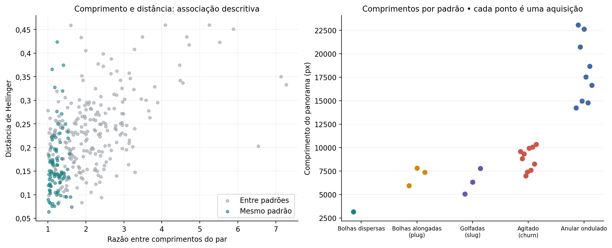
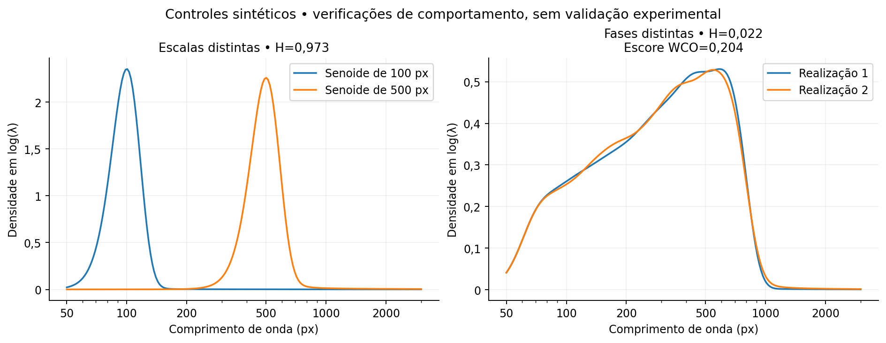

# Relatório de execução e resultados

## Contrato matemático e fonte primária

Foram conferidas visualmente as páginas impressas 411, 413 e 414 de Schuck Jr. e Bodmann (2019), capítulo 32, DOI 10.1007/978-3-030-16077-7_32, no [PDF local](../../assets/schuck-bardo-wavelet-coherence.pdf). As imagens preservadas constam da [auditoria da base](../v16_spatial2_18_71/EQUATION_AUDIT.md). A CWT adotou normalização 1/√a, Morlet π^(−1/4) exp(−t²/2) exp(i6t), e λ=4πa/(6+√38).

Para K=1, Pₓ(b,a)=|CWT(Rₓₓ)(b,a)|; Cₓᵧ(b,a)=CWT(Rₓᵧ)(b,a); Γₓᵧ(b,a)=|Cₓᵧ(b,a)|²/[Pₓ(0,a)Pᵧ(0,a)]. P é a WPS alternativa, C a WCS alternativa complexa e Γ a WCO alternativa. A correlação cruzada somou x[n+m] conjugado(y[n]); um atraso de y produziu lag negativo. O divisor N foi a adaptação enviesada já autorizada, distinta de N−|m| das Eqs. 32.21–32.23. Não houve ensemble entre aquisições, suavização convencional de Grinsted, alteração do denominador ou clipping.

## Fontes verificadas e reaproveitamento

Foram verificados 412 registros do manifesto da base e congelados hashes de 583 arquivos. Os 31 PNGs e 31 arquivos XLSX coincidiram com os hashes auditados. A extração 18–71 foi recalculada a partir de cada PNG e comparada exatamente ao sinal em cache; 20–59 foi conferida apenas como referência da planilha original. A reconstrução pixel a pixel e a estimação dos deslocamentos são evidências herdadas, não repetidas nesta execução. A reprodução computacional não comprova validade física da costura.

Reutilizaram-se perfis por aquisição e segmentos de N=3.171 da base indicada. A coluna de lag zero e a média integral de todas as 26 aquisições foram recalculadas para verificar o reaproveitamento: erros máximos 8.882e-16 e 4.441e-16, respectivamente. As médias com suporte geométrico ausentes na versão atual foram calculadas novamente. Os perfis de 350 combinações únicas de aquisição/comprimento atenderam aos 325 prefixos comuns por par. Não se confundiram perfis de registros inteiros com os prefixos desses pares.

## Representação, quadratura e domínio

Na faixa principal, uⱼ=log(λⱼ). Os pesos trapezoidais foram w₀=(u₁−u₀)/2, wⱼ=(uⱼ₊₁−uⱼ₋₁)/2 para pontos internos e para J pontos, w[J−1]=(u[J−1]−u[J−2])/2 na extremidade final. A área foi ΣwⱼPⱼ e as massas pⱼ=wⱼPⱼ/ΣwₖPₖ. A densidade desenhada foi Pⱼ/área. As massas, densidades, valores brutos, pesos e áreas estão em profiles_normalized.csv e profiles_raw.csv.

Hellinger foi √[Σ(√pⱼ−√qⱼ)²/2]. O cosseno foi 1−ΣwⱼPⱼQⱼ/√[(ΣwⱼPⱼ²)(ΣwⱼQⱼ²)]. A normalização adicional removeu a amplitude da WPS, embora o sinal já tivesse variância unitária. Nenhuma massa foi chamada fração de energia. Valores não finitos, negativos ou de área nula foram rejeitados.

A condição N−1≥√2a em lag zero do menor registro definiu a faixa principal de 187 pontos, 50–2.295,940454 px. A faixa conservadora teve 117 pontos, 50–543,851438 px, segundo 3a≤N/2. A faixa integral reteve os 200 pontos, 50–3.000 px. A borda superior principal foi geometricamente definida e não escolhida pelos rótulos. Há no máximo cerca de 1,38 comprimentos de onda da maior escala no menor registro; suporte geométrico não resolve a escassez de estruturas longas.

Para as médias em lag, as máscaras foram N−1−|b|≥√2a e |b|+3a≤N/2. Cada média dividiu a soma pelo número real de lags válidos; zero lags resultou em valor ausente, não zero artificial. As contagens completas estão em [lag_support_counts.csv](results/lag_support_counts.csv). A média conservadora foi comparada apenas em sua faixa comum menor. Esses controles foram novos e explícitos; os escores WCO herdados permaneceram sem restrição geométrica.

## Desfecho, pesos e referências

Para valores de semelhança S, A foi a média ponderada de 1[S_intra>S_entre]+0,5·1[S_intra=S_entre]. Usou-se S=−H ou −distância cosseno para perfis e S=escore WCO para a referência. A é equivalente à interpretação de ordenação de uma área ROC, sem classificador treinado ou limiar de decisão.

O peso por par deu o mesmo peso aos 87 pares internos e, separadamente, aos 238 controles. O peso balanceado deu 1/4 a cada padrão interno e 1/10 a cada combinação cruzada, dividindo igualmente entre pares dentro de cada grupo. Por padrão, usaram-se apenas seus pares internos e controles que o envolviam, com 1/4 para cada outro padrão. Esse resumo local não é a decomposição exata de A global, pois muda o conjunto de controles.

O escore WCO herdado foi Σa wₐ max_b Γ(b,a)/Σa wₐ, com wₐ=√[Pₓ,ref(0,a)Pᵧ,ref(0,a)] quando ambas as WPS atingiram 5% de seus próprios picos e os denominadores passaram o piso relativo 10⁻¹⁰; fora disso, peso zero. Os máximos vieram de todos os lags. Não é média simples de WCO nem nova equação de Schuck. A coluna exata foi weighted_scale_peak_power05. Pesos nativos 18–71 foram usados nas comparações entre implementações da base nova; pesos nativos 20–59 acompanharam a referência histórica. A comparação entre referências de entradas distintas não isolou somente a extração.

| Método | A por par | A balanceada | Média intra | Média entre |
| --- | --- | --- | --- | --- |
| WPS, registro inteiro | 0,764947 | 0,816347 | 0,163245 | 0,231868 |
| WPS, distância cosseno | 0,734618 | 0,808577 | 0,084794 | 0,158500 |
| WPS, faixa integral | 0,763112 | 0,805555 | 0,166378 | 0,236356 |
| WPS, faixa conservadora | 0,703033 | 0,769866 | 0,129102 | 0,182994 |
| Média em todos os lags | 0,700087 | 0,776909 | 0,194691 | 0,246052 |
| Média em lags sob COI | 0,702888 | 0,762634 | 0,199675 | 0,253659 |
| Média sob suporte conservador | 0,622332 | 0,707649 | 0,162645 | 0,193710 |
| WPS, linhas 30–49 | 0,721337 | 0,771942 | 0,189633 | 0,259600 |
| WPS, linhas 20–59 | 0,650053 | 0,727101 | 0,168321 | 0,207111 |
| WPS, somente remoção da média | 0,766396 | 0,814493 | 0,163123 | 0,231997 |
| Perfil v5, eixo nominal | 0,767604 | 0,820401 | 0,162776 | 0,232041 |
| Perfil v5, mesmas escalas a | 0,765092 | 0,816436 | 0,163312 | 0,231972 |
| Segmento inicial, 3.171 px | 0,723317 | 0,757682 | 0,215655 | 0,286505 |
| Segmento central, 3.171 px | 0,663576 | 0,745641 | 0,234845 | 0,287844 |
| Segmento final, 3.171 px | 0,718922 | 0,817730 | 0,202143 | 0,261022 |
| Perfil v16, prefixo de cada par | 0,738240 | 0,780669 | 0,174686 | 0,241616 |
| Perfil v5, prefixo de cada par | 0,740751 | 0,783665 | 0,174352 | 0,242016 |
| Escore WCO v16, linhas 18–71 | 0,214624 | 0,307430 | 0,187651 | 0,263539 |
| Escore WCO v5, linhas 18–71 | 0,215879 | 0,310033 | 0,184176 | 0,258799 |
| Escore WCO v5 original, linhas 20–59 | 0,263160 | 0,290853 | 0,192835 | 0,256171 |
| Escore WCO v16, linhas 20–59 | 0,261905 | 0,287465 | 0,196662 | 0,260910 |

As médias intra/entre são distâncias para os perfis e escores para WCO: **não são comparáveis numericamente entre essas duas famílias**. A é o desfecho comum.

| Comparação | ΔA por par | ΔA balanceada | Variação relativa A por par |
| --- | --- | --- | --- |
| WPS, registro inteiro versus Escore WCO v16, linhas 18–71 | 0,550324 | 0,508917 | 256,41% |
| WPS, registro inteiro versus Escore WCO v5 original, linhas 20–59 | 0,501787 | 0,525494 | 190,68% |
| Perfil v16, prefixo de cada par versus Escore WCO v16, linhas 18–71 | 0,523616 | 0,473239 | 243,97% |
| Perfil v5, prefixo de cada par versus Escore WCO v5, linhas 18–71 | 0,524872 | 0,473632 | 243,13% |
| WPS, registro inteiro versus Perfil v5, mesmas escalas a | -0,000145 | -0,000089 | -0,02% |

Variações relativas de A são razões aritméticas da mesma estatística, não porcentagens de melhora física ou de acurácia. A principal supera a referência WCO atual, mas o perfil v5 com o mesmo eixo atingiu desempenho praticamente idêntico. A razão de ganho não deve ser atribuída à correção numérica da Morlet.

## Variação por padrão, comprimento e posição

| Padrão | Pares intra | Perfil: A por par | Perfil: A balanceada | WCO: A por par |
| --- | --- | --- | --- | --- |
| Bolhas dispersas | 0 | Não estimável | Não estimável | Não estimável |
| Bolhas alongadas (plug) | 3 | 0,870 | 0,889 | 0,638 |
| Golfadas (slug) | 3 | 0,671 | 0,690 | 0,691 |
| Agitado (churn) | 45 | 0,804 | 0,858 | 0,374 |
| Anular ondulado | 36 | 0,694 | 0,764 | 0,010 |

| Comparação na mesma aquisição | H mediano | H máximo |
| --- | --- | --- |
| Segmento central, 3.171 px | 0,113 | 0,206 |
| WPS, linhas 20–59 | 0,053 | 0,204 |
| WPS, linhas 30–49 | 0,098 | 0,426 |
| Segmento final, 3.171 px | 0,105 | 0,228 |
| Segmento inicial, 3.171 px | 0,116 | 0,301 |
| WPS, somente remoção da média | 0,001 | 0,021 |
| Perfil v5, mesmas escalas a | 0,001 | 0,005 |

As distâncias entre segmentos e registro inteiro chegaram à ordem das distâncias entre aquisições: a posição afetou a representação. Todas as janelas foram recortadas antes do preparo, preservando 1 px/amostra, sem deformação dos eixos ou procura do trecho mais favorável. A aquisição curta de bolhas gerou três segmentos idênticos, que permaneceram uma única aquisição.

Todos os anulares apresentaram N≥14.224, enquanto os demais chegaram a N≤10.349. A associação descritiva H versus log da razão dos comprimentos foi 0,500. Não houve inferência causal nem teste de significância dessa correlação entre pares dependentes. O controle de comprimento igual reduziu parte da separação; não demonstrou ausência de outros fatores de confusão.

## Influência por aquisição e ausência de inferência indevida

Cada uma das 26 retiradas removeu a aquisição e todos os seus pares, deixando 300 pares. Os pesos foram recalculados. A principal por par variou de 0,742270 a 0,807263; a balanceada, de 0,713891 a 0,852670. A retirada de bolhas reduziu de dez para seis as combinações cruzadas e produziu o menor A balanceado. Não se eliminaram bolhas do método principal.

As retiradas mediram influência interna, não erro de generalização. Não houve treinamento, ajuste aos rótulos, intervalo de confiança com pares pseudorreplicados ou permutação de rótulos sem justificativa de permutabilidade. Condições operacionais não foram usadas como estratos estatísticos por falta de um desenho de réplicas independentes validado para esse fim. A seleção de exemplos desfavoráveis ocorreu após os resultados e foi identificada como tal.

## Controles e validação

O controle com componentes de 100 e 500 px produziu H=0,973135. A mudança global de amplitude produziu erro de H=1.549e-15. No controle de fases distintas, H=0,022222 e escore WCO=0,204476. Os espectros circulares eram iguais antes do preparo; a autocorrelação linear com bordas e a remoção de tendência não preservam necessariamente identidade exata dos perfis.

Os novos testes cobriram quadratura contra integral analítica, amplitude, identidade, suportes disjuntos, degenerescência, contagens de suporte, ordenação e atraso conhecido. A soma inversa de Fourier usada para calcular somente o lag zero foi comparada à CWT integral em N=3.171, 9.586 e 23.079; erro máximo inferior a 10⁻¹⁵. A otimização alterou o custo, não a equação. O lote principal durou 105,5 s, antes das figuras e da auditoria final; a estimativa prévia foi de 120–240 s.

## Limitações e conclusão

Persistiram as limitações do resumo executivo e da reconstrução v11. A auditoria herdada identificou 60/500 deslocamentos não positivos em m03q40_001 e 1/500 em m04q01_001; ambas permaneceram incluídas. Não foi provada a equivalência do panorama a uma fotografia espacial instantânea. Intensidade não foi convertida em fração de vazio. Pixels não foram convertidos em milímetros, frequência temporal ou velocidade.

O ganho de ordenação dos perfis foi claro dentro deste conjunto e persistiu no controle de prefixos por par. Houve perdas locais, dependência da posição e influência substancial do único registro de bolhas no balanceamento. Portanto, não demonstramos melhora robusta e geral entre condições experimentais, nem desempenho de classificação externa. As novas distâncias complementaram a WCS/WCO alternativa sem redefini-las.

As tabelas completas e scripts estão em [README.md](README.md). A execução, os resultados herdados e os novos cálculos foram separados em [PASSO_A_PASSO.md](PASSO_A_PASSO.md). A verificação final e os hashes constam de [final_verification.json](results/final_verification.json) e [artifact_manifest.json](results/artifact_manifest.json).
