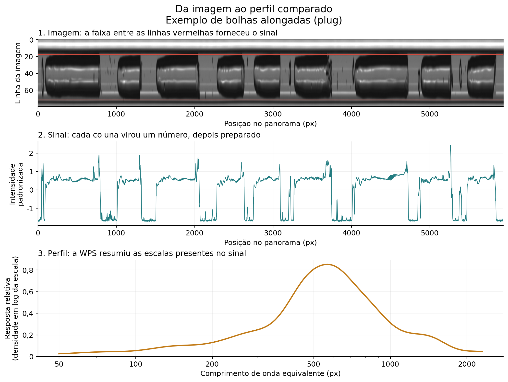
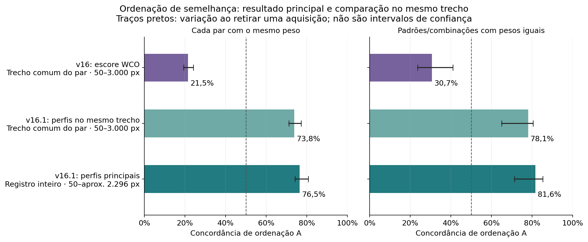
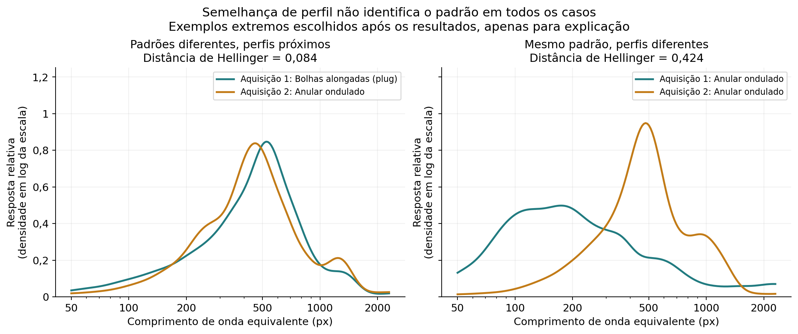

# Conclusão: comparação entre a v16 e a v16.1

**A v16.1 encontrou uma forma de comparar as aquisições mais compatível com a expectativa de que registros do mesmo padrão sejam semelhantes. A principal mudança foi comparar o formato dos perfis de WPS.** Os dados de entrada, o preparo principal e as fórmulas alternativas de wavelet foram mantidos.

O resultado sustentou o uso desses perfis como descritores para continuar a investigação. A análise permaneceu exploratória: não treinou um classificador nem demonstrou desempenho em novas aquisições independentes.

Neste documento, **v16** corresponde a `v16_spatial2_18_71` e **v16.1** a `v16.1_perfis_wps`. As marcações **IGUAL**, **DIFERENTE**, **NOVO** e **AMPLIADO** indicam o que mudou de uma análise para a outra. Foram selecionadas somente três figuras, ligadas ao procedimento, ao resultado principal e aos seus limites.

**1. Transformar a imagem em uma sequência de números [IGUAL]**

As duas análises partiram dos mesmos panoramas já montados. Em cada coluna da imagem, calculou-se a média dos tons de cinza das **linhas 18–71**, incluindo os dois limites. Cada coluna virou um número; a sequência desses números formou o sinal.

Isso permitiu estudar as variações ao longo da imagem sem comparar todos os pixels individualmente. Foram verificadas 31 entradas e mantidas as mesmas **26 aquisições**, distribuídas entre bolhas dispersas, bolhas alongadas, golfadas, agitado e anular ondulado. A v16.1 conferiu a extração, sem remontar os panoramas.

**2. Preparar o sinal para a análise [IGUAL]**

Mantiveram-se a inversão dos tons de cinza, a retirada da tendência linear e a padronização para média zero e desvio padrão igual a um. Uma tendência linear é uma subida ou descida gradual do sinal ao longo da imagem.

A analogia é ajustar o volume e o nível de referência de duas gravações antes de examinar suas oscilações. Esse preparo facilitou a comparação dos sinais, mas não corrigiu possíveis defeitos da montagem das imagens. No caso da WCO, uma simples mudança global de amplitude já se cancela na fórmula; padronizar não cria coerência.

**3. Identificar as escalas de variação [IGUAL]**

Primeiro, calculou-se a **autocorrelação**: uma cópia do sinal foi deslocada em relação à outra para medir como as variações se repetiam. Depois, aplicou-se a wavelet Morlet a essa autocorrelação, obtendo a **WPS alternativa**.

A wavelet funcionou como um conjunto de réguas onduladas de diferentes comprimentos. Algumas responderam mais a variações curtas; outras, a variações longas. Assim, foi possível descrever quais escalas se destacaram. Aqui, os comprimentos foram medidos em **pixels**, ao longo da imagem.

**A WPS e seus perfis já eram calculados na v16.** A inovação da v16.1 apareceu no uso desses perfis para comparar as aquisições.

**4. Mudar o tipo de semelhança procurada [DIFERENTE]**

| Na v16 | Na v16.1 |
| --- | --- |
| A análise relacionou dois sinais pela correlação cruzada e pela WCS. A WCO expressou essa relação de forma normalizada, em diferentes escalas e deslocamentos. | A análise principal comparou as curvas de WPS no deslocamento zero, uma curva para cada aquisição. |
| O escore resumiu os máximos de WCO por escala, com pesos que deram maior importância às escalas com maior resposta de WPS. | A semelhança passou a depender da distribuição relativa da resposta entre as escalas. |

Uma analogia útil é a comparação de músicas: a v16 procurou correspondência entre as gravações, admitindo deslocamentos; a v16.1 comparou seus desenhos no equalizador, isto é, a distribuição entre componentes graves e agudas. Duas músicas podem ter distribuições parecidas sem conter a mesma sequência de notas. Nos dados estudados, a comparação foi espacial, e não sonora.

O **deslocamento zero**, também chamado de *lag zero*, é o centro da autocorrelação. Ele não corresponde à primeira coluna da imagem: o perfil foi calculado a partir do sinal do registro analisado.

**5. Definir uma base comum para comparar os perfis [DIFERENTE + NOVO]**

Para comparar um par pela WCO, a v16 utilizou o início dos dois registros, com o comprimento do menor. A v16.1 utilizou cada registro inteiro em sua análise principal e adotou uma faixa comum de **50 a aproximadamente 2.296 pixels**, considerando o suporte geométrico do menor registro. A faixa anterior ia até 3.000 pixels.

Depois, normalizou-se cada perfil para ter **área total igual a um no eixo logarítmico das escalas**. É como comparar as proporções dos ingredientes de duas receitas, independentemente de uma receita render mais porções. O interesse passou a ser a forma relativa do perfil. Essas proporções não foram interpretadas como frações de energia física.

A escala logarítmica tratou de maneira comparável mudanças proporcionais, como passar de 100 para 200 pixels e de 500 para 1.000 pixels. A restrição de faixa foi uma precaução geométrica; ela não garantiu a eliminação de todos os efeitos das bordas.

**Leitura da figura 1:** no painel superior, as linhas vermelhas delimitam a faixa usada na extração. No painel central, cada posição horizontal corresponde à mesma posição do panorama, e a altura da curva representa a intensidade preparada. No painel inferior, o eixo horizontal mudou de significado: passou a representar o comprimento de onda equivalente, ou a escala da variação. Um pico indica uma escala com maior resposta relativa. **Ele não mede diretamente o comprimento de uma bolha.** O eixo vertical é uma densidade normalizada, não uma porcentagem em cada ponto. O panorama teve sua proporção de exibição ajustada para facilitar a leitura.

O exemplo foi a aquisição `m05q01_001`, de bolhas alongadas, já escolhida no protocolo anterior à avaliação.

**6. Transformar a diferença entre as curvas em um número [NOVO]**

Aplicou-se a **distância de Hellinger** aos perfis normalizados. Seu intervalo possível é de zero a um: **quanto menor a distância, mais parecidos os perfis**. Perfis idênticos tiveram distância zero.

Na analogia das receitas, a distância avaliou o quanto as proporções dos ingredientes diferiam. O método considerou o perfil completo na faixa escolhida, em vez de comparar apenas a posição do maior pico. Não se definiu um limite de distância para atribuir automaticamente um padrão.

**7. Verificar se os pares do mesmo padrão pareceram mais semelhantes [DIFERENTE]**

Foram comparados os mesmos **325 pares** já disponíveis na v16: **87 do mesmo padrão** e **238 de padrões diferentes**. A v16.1 avaliou os dois métodos por um critério comum, chamado **concordância de ordenação A**.

Imagine dois cartões: um contém duas aquisições do mesmo padrão; o outro, duas aquisições de padrões diferentes. A expectativa é que o primeiro cartão receba a maior semelhança. **A mediu a frequência com que essa ordem ocorreu**, atribuindo meio crédito a empates. Para WCO, valores maiores significaram maior semelhança; para Hellinger, valores menores significaram maior semelhança.

Apresentaram-se duas ponderações. Na primeira, cada par teve o mesmo peso. Na segunda, os padrões com pares internos e as combinações entre padrões tiveram pesos iguais dentro de seus respectivos grupos. Isso evitou que os padrões com muitas aquisições dominassem sozinhos o resultado. A ideia de balancear os pesos já existia na v16; o critério A foi acrescentado nesta comparação.

**Leitura da figura 2:** as barras mostram A, e a linha tracejada em 50% marca a ausência de preferência de ordenação. Acima dela, pares do mesmo padrão tenderam a parecer mais semelhantes. Abaixo dela, a tendência foi contrária. O painel esquerdo atribui peso igual aos pares; o direito equilibra padrões e combinações. Os traços pretos mostram quanto o resultado variou ao retirar uma aquisição por vez. Eles não são intervalos de confiança.

O resultado principal dos perfis foi **76,5% por par e 81,6% com balanceamento**, frente a **21,5% e 30,7%** do escore WCO. Esses números **não são porcentagens de acerto na classificação**.

A barra intermediária mostra o controle decisivo: usando os **mesmos trechos de cada par e a mesma faixa de 50–3.000 pixels** da WCO, os perfis alcançaram **73,8% e 78,1%**. Portanto, a vantagem nessa ordenação não dependeu apenas de usar registros inteiros ou reduzir a faixa de escalas. As regras de resumo de cada método continuaram diferentes, como previsto no protocolo.

**A WCO abaixo de 50% não demonstrou ausência de informação sobre os padrões.** Demonstrou que, neste conjunto, sua ordenação foi contrária à interpretação esperada de semelhança. Inverter essa direção depois de observar os resultados mudaria a regra de avaliação. Por isso, os valores apresentados não sustentaram uma afirmação de superioridade dos perfis para qualquer possível classificador.

**8. Conferir a estabilidade e os casos desfavoráveis [AMPLIADO]**

A v16 já avaliava mudanças na extração, no preparo e na posição do trecho. A v16.1 reaproveitou parte desses controles e examinou seus efeitos sobre a comparação por perfis. Também retirou uma aquisição por vez para medir sua influência; na v16, essa retirada havia sido usada na escolha do pré-processamento.

Os resultados essenciais dessas verificações foram:

- **O trecho escolhido fez diferença.** Com segmentos de mesmo comprimento, A por par foi 72,3% no início, 66,4% no centro e 71,9% no fim. Essa comparação avaliou a estabilidade dos perfis. A WCO não foi recalculada nesses três segmentos fixos; a comparação entre métodos no mesmo trecho foi a da barra intermediária da figura 2.
- **O ganho não ocorreu em todos os padrões e ponderações.** Em golfadas, A por par foi 67,1% com os perfis e 69,1% com WCO, embora a ponderação balanceada favorecesse os perfis.
- **Uma única aquisição teve influência relevante.** Ao retirar a única aquisição de bolhas dispersas, A balanceada passou de 81,6% para 71,4%. Esse padrão participou das comparações cruzadas, mas não teve uma segunda aquisição para avaliar semelhança dentro do próprio padrão.
- **A correção numérica da wavelet não explicou o ganho principal.** O controle com a implementação antiga, v5, nos mesmos valores de escala, produziu praticamente a mesma ordenação dos perfis. A evidência apontou principalmente para a mudança da representação e da comparação.

**Leitura da figura 3:** cada curva corresponde a uma aquisição. O eixo horizontal mostra as escalas espaciais, e o vertical mostra a resposta relativa normalizada. À esquerda, bolhas alongadas e anular ondulado apresentaram perfis próximos, com distância **0,084**, apesar dos rótulos diferentes. À direita, duas aquisições de anular ondulado apresentaram perfis mais distintos, com distância **0,424**.

Esses foram os casos extremos já selecionados depois das métricas: o par entre padrões mais próximo e o par do mesmo padrão mais distante. Serviram para explicar os limites, sem constituir uma validação adicional. Os identificadores e os valores completos constam em [selected_cases.csv](results/selected_cases.csv).

O comprimento dos registros também exigiu cuidado: todos os panoramas anulares foram mais longos que os dos outros padrões. Assim, morfologia, condições de aquisição e comprimento não foram separados causalmente. Além disso, vários pares compartilharam a mesma aquisição; 325 pares não equivaleram a 325 experimentos independentes.

**9. Delimitar a conclusão**

**Comparar a forma dos perfis de WPS foi mais compatível com a expectativa de semelhança dentro de um padrão do que usar o escore WCO na direção definida pelo protocolo, neste conjunto.** Essa vantagem permaneceu no controle que utilizou os mesmos trechos e a mesma faixa de escalas dos pares.

Os perfis forneceram uma representação útil para investigar padrões, mas houve sobreposição, variação entre trechos e influência de aquisições específicas. Os resultados não demonstraram identificação infalível de padrões, melhora geral em todas as classes ou desempenho em novas condições experimentais. A avaliação de classificação exige novas aquisições independentes e separação entre desenvolvimento e teste por aquisição.

**Conferência do método e das fórmulas**

Em 25/10/2026, foram confrontados o código, as tabelas e as páginas impressas **411, 413 e 414** de Schuck Jr. e Bodmann. A revisão adicional **não identificou erro de implementação nas fórmulas verificadas nem divergência numérica que exigisse corrigir os resultados apresentados**.

Foram conferidas as 31 extrações das imagens; os 26 perfis principais foram recalculados por uma soma temporal independente da CWT de produção; os 350 prefixos e os 325 escores de WCO foram recalculados a partir dos sinais. Também foram verificadas as distâncias principais, as 21 ordenações, os resultados por padrão e as 546 retiradas de aquisição nas duas ponderações. As diferenças ficaram na ordem do arredondamento numérico. A auditoria não refez a montagem dos panoramas nem validou fisicamente os rótulos.

Os pontos essenciais para interpretar corretamente as fórmulas foram:

| Item conferido | Formulação efetivamente utilizada |
| --- | --- |
| Wavelet | Morlet com parâmetro 6 e normalização da CWT por `1/√a`. |
| WPS alternativa | Módulo da CWT da autocorrelação, **sem elevar esse módulo ao quadrado**. |
| WCS e WCO alternativas | WCS complexa obtida da correlação cruzada; WCO igual ao módulo da WCS ao quadrado, dividido pelo produto das duas WPS **no deslocamento zero**. |
| Estimador de correlação | Divisão pelo comprimento `N`. Foi uma adaptação declarada e mantida: o artigo apresentou o divisor `N − |deslocamento|`. |
| Normalização e distância | Integração no logaritmo das escalas; massas não negativas com soma um; fórmula de Hellinger com raiz quadrada e fator `1/2`. |
| Avaliação | Direções de semelhança preservadas, pesos conferidos e meio crédito aos empates. A foi tratada como ordenação descritiva, sem atribuir independência aos pares. |

O emprego de uma realização por aquisição foi mantido. As regras de suporte, a normalização dos perfis, Hellinger e A foram escolhas desta análise, distintas das equações alternativas de Schuck. A conferência confirmou a execução dessas escolhas; não as transformou em validação física ou em teste externo.

Registros de apoio: [protocolo](PROTOCOL.md), [tabela principal de resultados](results/ranking_summary.csv), [resultados por padrão](results/ranking_by_pattern.csv), [auditoria adicional](results/conclusion_audit.json), [script da auditoria](scripts/verify_conclusion.py) e [origem dos dados das figuras](results/conclusion_figures.json). As três figuras também estão disponíveis em PDF em [figures/conclusao](figures/conclusao).
