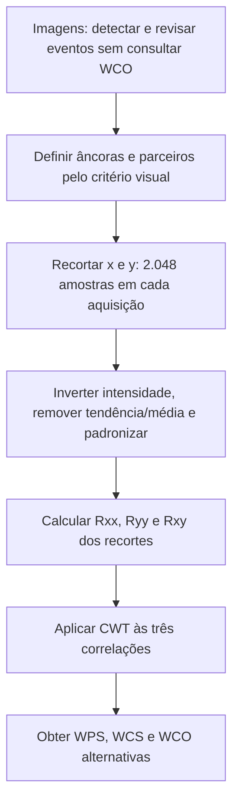

# Âncoras, recortes e autocorrelação na análise de eventos

Esta nota reúne a explicação do método executado em **v16.2_wco_eventos**, com base em **v16_spatial2_18_71**. As regras originais permanecem no [protocolo congelado](PROTOCOL.md). A seção sobre churn e anular descreve uma possibilidade de extensão **ainda não executada**; não altera o catálogo nem os resultados existentes.

## Onde a âncora entra

A âncora define a origem do recorte antes do preparo dos sinais e antes das correlações. A CWT é aplicada às correlações desses recortes. O método não procura uma posição que maximize a WCO.

Os sinais x e y vêm de eventos de aquisições diferentes nas comparações principais. Eles não são as metades esquerda e direita de um evento. Cada autocorrelação usa duas cópias do mesmo sinal; a correlação cruzada compara x com y.

## Evento, âncora e limites dos sinais

O sinal bruto de cada aquisição é a média das **54 linhas de 18 a 71 inclusive**, com indexação iniciada em zero:

$$I[p]=\frac{1}{54}\sum_{r=18}^{71}P[r,p].$$

P é a imagem em níveis de cinza e p é a coluna do panorama. A amostragem é **1 pixel por amostra**, sem conversão para milímetros ou tempo.

O detector e a revisão visual delimitam um evento no intervalo **[L, R)**. O início L é incluído; o fim R é exclusivo. Sua extensão é R−L e a âncora é:

$$c=\left\lfloor\frac{L+R}{2}\right\rfloor.$$

Para cada evento, o recorte tem **N=2.048** amostras:

$$[s,e)=[c-1024,\;c+1024),\qquad e-s=2048.$$

Para as aquisições A e B, os sinais ainda sem preparo são:

$$x_0[n]=I_A[c_x-1024+n],\qquad y_0[n]=I_B[c_y-1024+n],\quad n=0,\ldots,2047.$$

As posições globais dos dois recortes podem ser diferentes. Em cada recorte, a âncora ocupa o índice local **1.024**, e as posições relativas a ela vão de **−1.024 a +1.023 px**. O ponto c+1024 não pertence ao recorte.

O catálogo aceita eventos com extensão de 96 a 1.536 px, inteiros no segmento e com pelo menos 256 px de contexto de cada lado. Também exige 16 px adicionais disponíveis nas bordas da aquisição para as sensibilidades de deslocamento dos centros. Um evento sem contexto suficiente é rejeitado; não se preenche a imagem com observações artificiais para fazê-lo caber.

**Exemplo real, usado no caso favorável do resumo:** os dois eventos abaixo pertencem a **pistonado/bolhas alongadas (plug)**. Todas as coordenadas são colunas do respectivo panorama, com fim exclusivo.

| Sinal e evento | Limites do evento [L, R) | Âncora c | Limites do recorte [s, e) | Amostras |
| --- | --- | --- | --- | --- |
| x — m05q01_001_E005 | [2.752, 3.093) | 2.922 | [1.898, 3.946) | 2.048 |
| y — m06q01_001_E011 | [5.423, 5.836) | 5.629 | [4.605, 6.653) | 2.048 |

Esses números vêm do [catálogo de eventos](results/catalogo_eventos.csv). O exemplo favorável foi selecionado após o lote somente para ilustração; não definiu as regras nem os parceiros.

## Preparo dentro de cada recorte

Após recortar, a implementação calcula 255−I, remove a tendência linear, remove a média residual e divide pelo desvio padrão do próprio segmento. Isso produz os sinais preparados x e y. O ajuste de tendência do panorama inteiro não é reaproveitado no segmento. Não há redimensionamento do eixo, deformação temporal, janela de Hann ou alinhamento otimizado por WCO.

As sensibilidades previamente definidas repetem a avaliação com outra faixa vertical, remoção somente da média e deslocamentos de ±16 px dos centros. Os parceiros permanecem os mesmos; nenhuma variante substitui retrospectivamente o resultado principal por apresentar maior coerência.

## Como a autocorrelação é calculada

Para os sinais reais desta análise, a autocorrelação de x compara o recorte com uma cópia deslocada dele próprio:

$$R_{xx}[m]=\frac{1}{N}\sum_{\substack{0\leq n<N\\0\leq n+m<N}}x[n+m]x[n],\qquad N=2048.$$

Ryy é calculada da mesma forma usando somente y. A correlação cruzada é:

$$R_{xy}[m]=\frac{1}{N}\sum_{\substack{0\leq n<N\\0\leq n+m<N}}x[n+m]y[n].$$

Em cada lag m, entram somente os produtos entre amostras que se sobrepõem. A correlação é **linear, sem retorno circular entre as extremidades**. Para os sinais reais, Rxx e Ryy são simétricas em relação ao lag zero; Rxy não precisa ser simétrica.

| Lag m | Produtos sobrepostos | Divisor utilizado |
| --- | --- | --- |
| 0 | 2.048 | 2.048 |
| +100 ou −100 | 1.948 | 2.048 |
| +2.047 ou −2.047 | 1 | 2.048 |

O divisor permanece N, mesmo quando a sobreposição diminui. Esse é o estimador **enviesado 1/N**, adaptação explicitamente adotada no projeto; o artigo de Schuck usa N−|m| nas Eqs. 32.21–23. Os pontos de grandes lags têm pouca sobreposição e não ganham confiabilidade experimental por serem calculáveis.

Com a padronização utilizada, Rxx[0] e Ryy[0] ficam aproximadamente iguais a 1. Isso não obriga a WCO entre eventos diferentes a ser 1. O denominador da WCO usa os **coeficientes wavelet das autocorrelações no lag zero**, que dependem da escala; não usa simplesmente Rxx[0]Ryy[0].

A convenção cruzada é a da soma x[n+m]y[n]: se y estiver atrasado 100 amostras em relação a x, o controle de atraso conhecido produz o pico em **−100 px**.

## O que a CWT recebe e quais são seus eixos

Cada correlação completa tem **2N−1=4.095 amostras**, correspondentes aos lags inteiros de **−2.047 a +2.047 px**. O lag zero ocupa o índice **2.047** do vetor da correlação. Esse índice é diferente do índice **1.024** da âncora no sinal recortado.

Com uma realização por par, K=1, calculam-se:

$$P_x^{alt}(b,a)=|\mathrm{CWT}\{R_{xx}\}(b,a)|,\qquad P_y^{alt}(b,a)=|\mathrm{CWT}\{R_{yy}\}(b,a)|,$$

$$C_{xy}^{alt}(b,a)=\mathrm{CWT}\{R_{xy}\}(b,a),$$

$$\Gamma_{xy}^{alt}(b,a)=\frac{|C_{xy}^{alt}(b,a)|^2}{P_x^{alt}(0,a)P_y^{alt}(0,a)}.$$

A WPS alternativa usa módulo, sem quadrado. A WCS alternativa é complexa; seus gráficos mostram o módulo. A WCO tem numerador ao quadrado e denominador avaliado no lag zero para cada escala, sem clipping. Denominadores numericamente inválidos são marcados como ausentes, não como coerência zero.

**O eixo b dos mapas representa lag da correlação.** Ele não representa uma coluna do panorama nem a posição de uma estrutura dentro do recorte. A Morlet usa ω0=6; a conversão entre escala a e comprimento de onda é λ=4πa/(6+√38).

| Grandeza | Limite/domínio nesta execução | Significado |
| --- | --- | --- |
| Evento visual | [L, R), extensão de 96 a 1.536 px | Intervalo anotado pela regra óptica |
| Sinal x ou y | 2.048 amostras; posição relativa −1.024…+1.023 px | Evento e contexto ao redor da própria âncora |
| Correlação completa | 4.095 lags; −2.047…+2.047 px | Deslocamentos entre cópias dos sinais |
| Comprimentos de onda | 200 valores logarítmicos de 50 a 1.024 px | Escalas examinadas pela CWT |
| Resumo principal da WCO | 65 lags; −32…+32 px | Média por escala e depois entre escalas válidas |

Os **±32 px do resumo são deslocamentos da correlação**. Não significam recortar apenas 65 pixels da imagem ao redor da âncora. Todos os dados do segmento participam das correlações; a CWT também combina lags vizinhos segundo a escala. O resumo principal não procura o máximo sobre todos os deslocamentos.

O domínio principal satisfaz a regra geométrica de suporte declarada no protocolo. A média com suporte conservador é um diagnóstico separado, em outro domínio. Essas regras e o preenchimento computacional usado na FFT não criam amostras observadas, não aumentam o tamanho experimental e não constituem testes de significância.

## O que a âncora muda e as limitações

A âncora determina quais amostras entram no recorte e coloca os eventos em posições relativas próximas antes de calcular a correlação cruzada. Apenas mudar o nome da origem de um mesmo recorte não altera sua autocorrelação. Mover o recorte pode alterá-la, pois muda o conteúdo e o contexto disponíveis.

A análise caracteriza o **segmento contextualizado**. Em 22 dos 26 segmentos aceitos, há pelo menos outro evento aceito dentro do contexto; estruturas menores ou rejeitadas também podem estar presentes. Há sobreposição entre segmentos. Assim, uma WCO alta não pode ser atribuída exclusivamente ao evento central, nem eventos sobrepostos podem ser contados como réplicas independentes. A agregação é feita primeiro por par de aquisições.

Os limites por intensidade são operacionais e não constituem interfaces físicas calibradas. A mudança de limiar de 60 para 55/65 deslocou uma fronteira em até 40 px. As perturbações de centro de ±16 px não cobrem toda essa incerteza. Também permanecem as costuras dos panoramas e a ausência de calibração espacial física.

## Possível extensão a churn e anular — ainda não executada

Não há impedimento matemático para calcular as mesmas correlações e CWT em recortes de churn ou anular. O problema observado foi **definir uma âncora e uma equivalência visual reproduzíveis**. A regra atual de estruturas alongadas delimitadas não estabeleceu eventos aceitos nesses padrões. As dez aquisições de churn e as nove de anular já participam do atlas e dos controles de recortes fixos; não participam dos resultados de eventos ancorados.

Um novo piloto poderia investigar marcos de ondulações visíveis no anular e transições locais de textura no churn, quando distinguíveis nas imagens. Essas são hipóteses de anotação a avaliar, não eventos já comprovados. Um pico de intensidade isolado não certifica uma estrutura física equivalente.

O procedimento de extensão precisaria:

1. Inspecionar imagens e quadros de origem e estabelecer uma definição operacional específica, com evidência visual, incerteza, qualidade mínima e rejeições.
2. Definir âncoras e parceiros sem usar WPS/WCS/WCO para escolher os casos. Se só houver um marco local, explicitar que o objeto passa a ser uma região ancorada nesse marco, sem alegar fronteiras físicas de um evento isolado.
3. Verificar se a média das linhas 18–71 representa a estrutura escolhida. Uma mudança do observável ou do comprimento do recorte deve ser predefinida, documentada e acompanhada de controles comparáveis; não se escolhe a faixa ou janela que maximiza WCO em cada par.
4. Congelar a nova regra e o catálogo em outra versão. Os resultados atuais já são conhecidos; uma continuação no mesmo conjunto permanece exploratória.
5. Avaliar cobertura, estabilidade das âncoras, recortes fixos, pares distintos e entre padrões, preservando a agregação por aquisição. Se não houver marcos reproduzíveis, relatar a limitação de observabilidade.

Essa proposta não demonstra que churn ou anular terão WCO maior. Os resultados existentes e o protocolo congelado permanecem válidos apenas para o escopo que foi efetivamente executado.

## Fontes dentro da entrega

- [Protocolo congelado](PROTOCOL.md): regras anteriores aos novos cálculos.
- [Catálogo](results/catalogo_eventos.csv): limites dos eventos e recortes, âncoras, padrão e contexto.
- [Observabilidade por aquisição](results/observabilidade.csv): inclusões e limitações de churn/anular.
- [Detecção e coordenadas](scripts/catalog_events.py): construção de âncora e segmento.
- [Preparo dos recortes e resumo](scripts/analysis_common.py): corte antes de preparar e domínio de lag.
- [Núcleo matemático](scripts/wavelet_core.py): correlações, CWT e denominador da WCO.
- [Passo a passo executado](PASSO_A_PASSO.md) e [resumo executivo](EXECUTIVE_SUMMARY.md): resultados e limitações.
