# Resumo executivo — âncoras e wavelets alternativas

Foi possível determinar âncoras ópticas e aplicar WPS, WCS e WCO alternativas em **todas as 19 aquisições elegíveis** de churn e anular ondulado. Foram selecionados **76 mínimos principais e 76 máximos de controle**, antes de calcular a nova WCO. Os 76 mínimos mantiveram correspondência local nas duas suavizações alternativas, com deslocamento máximo de 11 px; esse teste não repete a seleção completa por estrato. **O objetivo operacional foi atendido; não se demonstrou ganho robusto de coerência nem separação entre padrões.** Na análise principal, mínimos compatíveis superaram janelas fixas em 0,0283 no churn e 0,0044 no anular, abaixo da referência descritiva de 0,05.

<!-- AUDITORIA_ADVERSARIAL_INICIO -->
## Revisão adversarial: o que muda na leitura

**A estabilidade é local, condicionada às âncoras originais.** Ao repetir também a seleção por estrato, apenas **66/76 mínimos em σ=12** e **68/76 em σ=20** voltam a ser selecionados em até 64 px. Na faixa 30–49, são **55/76**. As perdas significam escolha de outro marco; não deslocamento do mesmo marco por milhares de pixels.

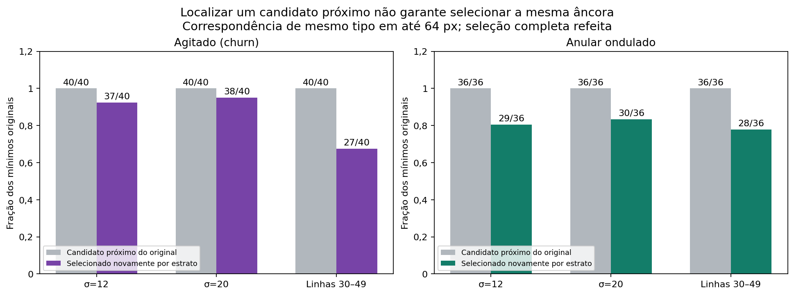

**O pequeno ganho depende de escolhas operacionais.** Em 100 sementes alternativas, o contraste anular − fixos variou de **-0,0137 a 0,0258**, sendo positivo em 80/100. No churn, variou de **0,0120 a 0,0477**, positivo em 100/100, sempre abaixo de 0,05. Slug não varia com a semente porque só existe um par equivalente; isso não constitui robustez. Os testes não redefiniram a semente original.

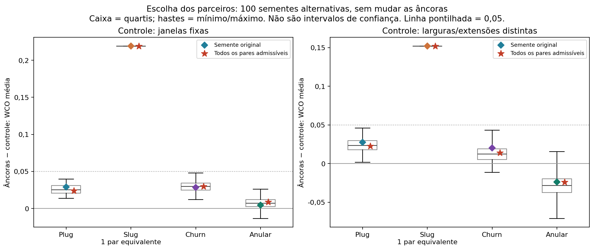

**Um ganho pequeno também apareceu sem evento físico comum.** Em 40 pares de sinais AR(1) independentes, com detector e seleção completos, âncoras tiveram média **0,2309** e fixos **0,2140**: diferença **0,0169**. É um diagnóstico posterior, sem calibração para os dados reais; não fornece valor-p nem deve ser subtraído do resultado experimental.

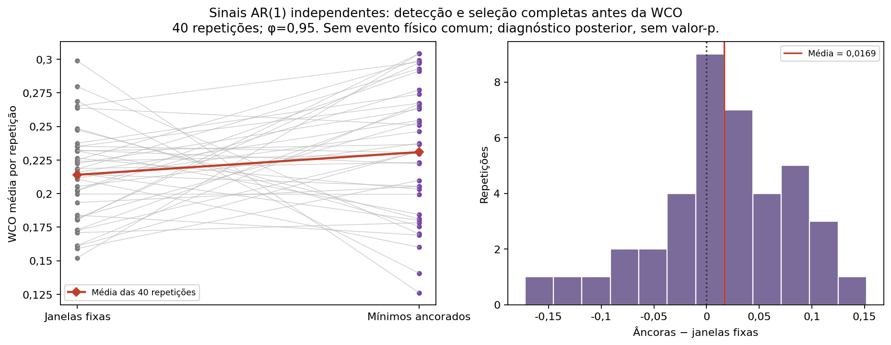

**Dados e fórmulas:** 31 panoramas reproduzidos pixel a pixel, 15.531 quadros e 15.500 deslocamentos conferidos; nenhum quadro inteiro duplicado por hash. A soma direta independente da CWT diferiu em no máximo 5,40e-15. A operação de costura de 2 px usa pesos [0,1] e duplica uma coluna do quadro seguinte, em vez de interpolar: sem ela, churn − fixos passou de 0,0283 para 0,0280 e anular de 0,0044 para 0,0046. Essa mudança pequena não valida fisicamente a montagem. O comentário de direção do deslocamento no v11 está invertido, e a fase complexa do legado refletido não deve ser comparada diretamente à principal; as magnitudes e os escores usados permanecem preservados.

Veja a [auditoria completa, com evidências, tratamento e pendências](AUDITORIA_ADVERSARIAL.md). Os protocolos congelados e os resumos históricos continuam disponíveis; a revisão acrescenta diagnósticos e corrige a interpretação, sem substituir os resultados principais.
<!-- AUDITORIA_ADVERSARIAL_FIM -->

Esta entrega estendeu **v16.2_wco_eventos** sobre a base **v16_spatial2_18_71**, mantendo os cálculos originais de plug/slug. O [resumo da etapa 1](EXECUTIVE_SUMMARY_ETAPA1.md) e seu [PDF original](RESUMO_EXECUTIVO_ETAPA1.pdf) foram preservados. O [PDF integrado](RESUMO_EXECUTIVO.pdf) apresenta a extensão primeiro e a etapa 1 como apêndice histórico.

## Qual padrão é qual

| Padrão global da aquisição | Aquisições elegíveis | Âncora usada | Situação nesta pasta |
| --- | --- | --- | --- |
| Bolhas dispersas | 1 | Sem comparação ancorada entre aquisições | Só atlas/referência fixa; sem repetição |
| Pistonado / bolhas alongadas (plug) | 3 | Centro do intervalo óptico alongado | Etapa 1: 20 eventos aceitos |
| Golfadas (slug) | 3 | Centro do intervalo óptico alongado | Etapa 1: 6 eventos aceitos |
| Agitado (churn) | 10 | Mínimo local de intensidade suavizada | Extensão: 40 mínimos + 40 máximos |
| Anular ondulado (wavy annular) | 9 | Mínimo local de intensidade suavizada | Extensão: 36 mínimos + 36 máximos |

**Churn é o padrão agitado; wavy annular é o anular ondulado.** As cores roxa e verde identificam esses padrões nos novos gráficos. Nas figuras de pares, **x usa linha contínua; y, tracejada**. Cada painel informa o padrão, a aquisição, a âncora e os limites do sinal. As cores dos mapas representam seus valores numéricos, conforme a barra lateral.

## Como conseguimos determinar as âncoras

Da média das linhas **18–71 inclusive**, foram encontrados mínimos e máximos após suavização gaussiana **σ=16 px**, usada somente na detecção. Em cada um de quatro estratos espaciais, selecionou-se o extremo de maior proeminência, respeitando suporte e separação. Proeminência mínima: max(3 níveis de cinza; 25% de P95−P5); largura à meia proeminência: 16–512 px. Dos **1.365 candidatos**, foram mantidas **152 âncoras**, sem consultar WPS/WCS/WCO.

Cada sinal usa **[c−1024, c+1024)**: 2.048 amostras da média original, sem o filtro gaussiano de detecção. A âncora está no índice local 1.024; ela se torna posição relativa zero. Os mínimos de intensidade tendem a aparecer como elevações após a inversão 255−I, sujeitas à remoção de tendência. A CWT alternativa recebe Rxx, Ryy e Rxy desses recortes, e não a sequência de coordenadas das âncoras.

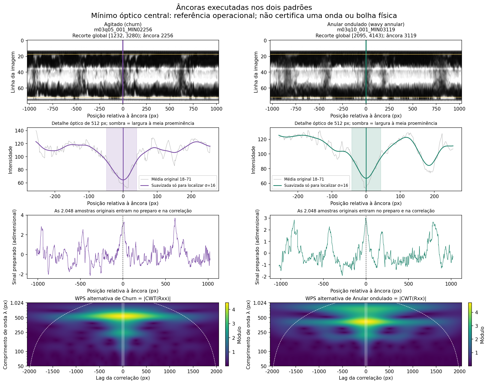

*Exemplos predefinidos: primeiro mínimo selecionado da primeira aquisição de cada padrão. A sombra no detalhe óptico é a largura à meia proeminência, não um contorno físico. O eixo de posição do sinal difere do lag dos mapas.*

## Cobertura e correspondência local

| Padrão / âncoras principais | σ=12: correspondências / mediana / máximo | σ=20: correspondências / mediana / máximo | Faixa 30–49: mediana / máximo |
| --- | --- | --- | --- |
| Agitado (churn) | 40/40; 1,5 / 11 px | 40/40; 1,0 / 6 px | 10,0 / 47 px |
| Anular ondulado (wavy annular) | 36/36; 1,0 / 3 px | 36/36; 1,0 / 4 px | 3,0 / 11 px |

Todos os **76 mínimos principais** permaneceram localizáveis em σ=12 e σ=20 ao procurar candidatos próximos dos centros originais. Esse é um teste condicionado ao catálogo original, sem repetir a escolha de maior proeminência por estrato. Nos máximos, houve três ausências em σ=20. Ao trocar apenas a faixa de detecção para 30–49, os 76 mínimos continuaram localizáveis, mas o churn mostrou mudanças de até 47 px; esse diagnóstico não reposicionou a variante wavelet 30–49, que conservou os centros principais.

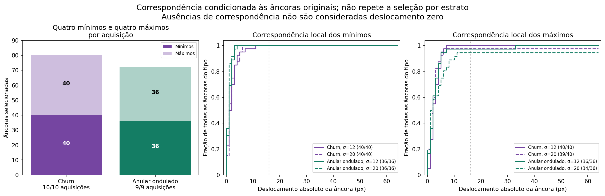

## O que mudou na WCO

Foram congelados **830 pares de âncoras** entre aquisições: mínimos de larguras compatíveis, mínimos de larguras distintas e mínimo × máximo. A escolha de até dois pares por combinação de aquisições/grupo usou hash determinístico, sem procurar a maior WCO. Primeiro foi calculada a média por par de aquisições; depois, a média do padrão. **A coluna WCO das âncoras muda entre controles porque a interseção de aquisições pode mudar.**

| Padrão | Controle | WCO das âncoras | WCO do controle | Diferença | Pares de aquisições | Fração positiva |
| --- | --- | --- | --- | --- | --- | --- |
| Agitado (churn) | Janelas fixas | 0,2403 | 0,2120 | 0,0283 | 45 | 64,4% |
| Agitado (churn) | Mínimos de larguras distintas | 0,2498 | 0,2296 | 0,0202 | 29 | 55,2% |
| Agitado (churn) | Mínimo × máximo | 0,2403 | 0,2174 | 0,0229 | 45 | 57,8% |
| Anular ondulado (wavy annular) | Janelas fixas | 0,2250 | 0,2205 | 0,0044 | 34 | 55,9% |
| Anular ondulado (wavy annular) | Mínimos de larguras distintas | 0,2113 | 0,2352 | -0,0238 | 13 | 46,2% |
| Anular ondulado (wavy annular) | Mínimo × máximo | 0,2250 | 0,2159 | 0,0091 | 34 | 64,7% |

**Churn:** diferença pequena frente a fixos (0,0283) e frente a mínimos distintos (0,0202). **Anular ondulado:** diferença quase nula frente a fixos (0,0044) e negativa frente a mínimos distintos (-0,0238). As médias principais não atingiram o efeito descritivo de 0,05. Esse limiar foi definido no protocolo; não é um teste estatístico nem um limiar físico.

A cobertura do contraste frente a fixos foi **45/45 pares possíveis no churn** e **34/36 no anular**. Frente a larguras distintas, caiu para **29/45** e **13/36**. Esses contrastes abrangem, respectivamente, **10/10** e **8/9 aquisições**. Fração de pares e fração de aquisições são denominadores diferentes: a referência de 2/3 da etapa 1 foi definida por aquisição, e não deve ser transferida silenciosamente para pares. A presença de âncoras nas 19 aquisições não elimina a limitação de parceiros comparáveis.

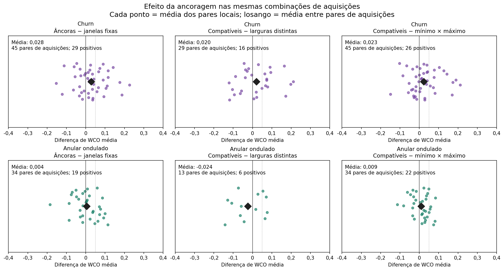

Entre **churn × anular**, o ganho sobre fixos foi 0,0321 em 89 pares de aquisições. Isso reforça que obter coerência em recortes ancorados não demonstra distinção entre classes; nenhuma acurácia de classificação foi estimada.

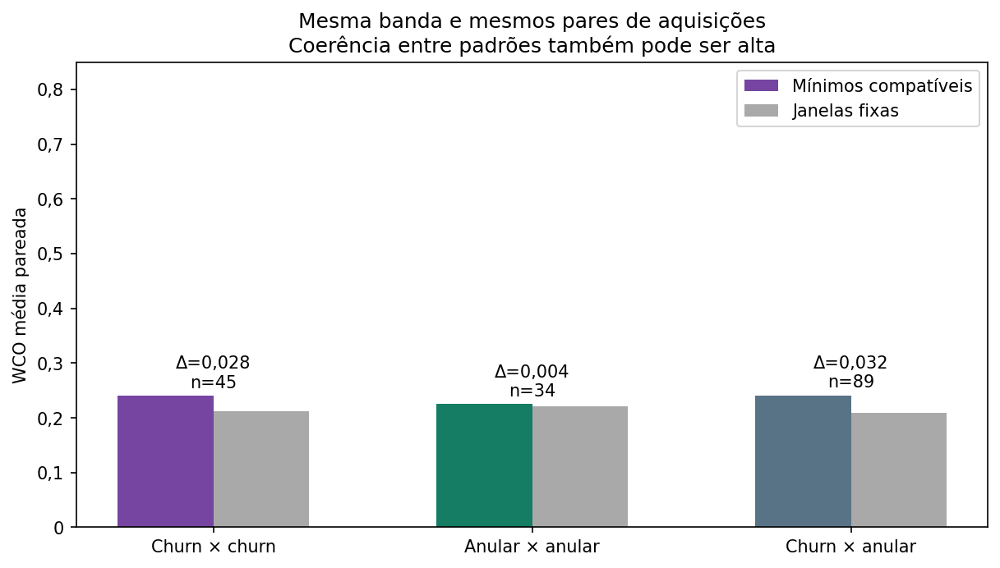

## Sensibilidades e influência das aquisições

| Variante | Churn: âncoras − fixos | Anular: âncoras − fixos |
| --- | --- | --- |
| Principal: linhas 18–71 | 0,0283 | 0,0044 |
| Linhas 30–49 | 0,0025 | 0,0039 |
| Remoção apenas da média | 0,0256 | 0,0034 |
| Centros x −16 / y +16 px | 0,0285 | 0,0063 |
| Centros x +16 / y −16 px | 0,0281 | 0,0043 |
| Detector σ=12 px | 0,0280 | 0,0045 |
| Detector σ=20 px | 0,0287 | 0,0044 |
| CWT da v5; mesmos recortes | 0,0285 | 0,0052 |

No churn, trocar a média 18–71 pela faixa 30–49 reduziu o contraste frente a fixos de **0,0283 para 0,0025**, mantendo os centros principais. A correspondência local sob mudanças de σ não garante repetibilidade da seleção completa nem estabilidade quando muda a representação vertical da imagem.

Os parceiros permaneceram congelados. Foram planejadas **6.640 avaliações ancoradas**: **6625 calculáveis** e **15 não estimáveis**, todas as ausências por falta de correspondência óptica na variante σ=20. Elas não viraram zeros nem centros originais. A [tabela no conjunto comum de pares](results/extensao_churn_anular/sensibilidade_conjunto_comum.csv) distingue alteração de valor de alteração de cobertura.

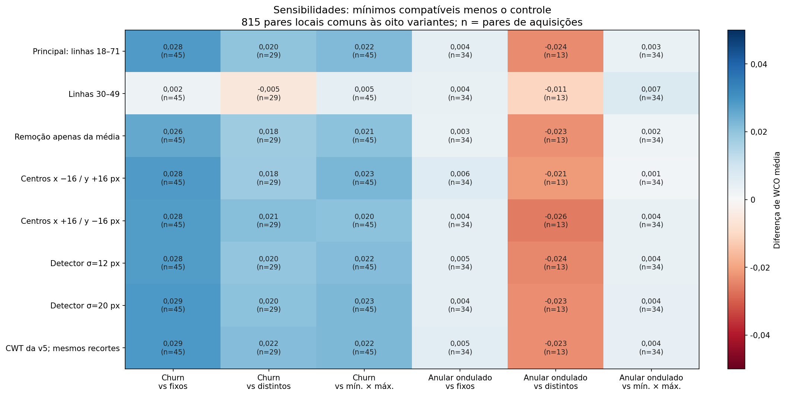

*O painel usa a interseção dos mesmos **815 pares locais** nas oito variantes, incluindo na linha principal. Apenas 15 pares de controle de polaridade foram retirados desse painel; por isso seu contraste principal de mínimo × máximo pode diferir da tabela com todos os pares. As comparações com fixos e larguras distintas mantêm os mesmos casos. [Dados do painel comum](results/extensao_churn_anular/sensibilidade_conjunto_global.csv).*

Ao retirar m03q40_001 do anular, a diferença frente a fixos passou de 0,0044 para **0,0089**, em 28 pares restantes. Cada retirada eliminou todos os pares incidentes na aquisição; as variações não são intervalos de confiança.

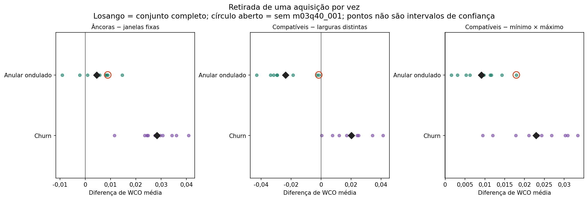

## Exemplos dos dois sinais e das três medidas wavelet

**“Maior/menor escore” ordena a WCO média dos pares de recortes.** Ambos os exemplos usam âncoras em **mínimos locais da intensidade suavizada**, por isso tendem a apontar para regiões escuras. O mínimo é local no perfil médio 18–71 após suavização; não precisa ser o pixel mais escuro da imagem. A seleção usa proeminência e estratos, sem consultar WCO. Após a inversão 255−I, essas depressões tendem a aparecer como picos no sinal preparado.

O escore compara os dois contextos de 2.048 amostras por suas correlações e CWT: média de WCO nas 200 escalas logarítmicas de 50–1.024 px e nos 65 lags de −32 a +32 px. Alinhar dois mínimos não garante que o restante dos sinais seja semelhante.

**Os extremos ilustrados são os dos 90 pares selecionados de churn e 66 de anular**, na variante principal e no grupo de mínimos de larguras compatíveis. A auditoria ampliou o universo e encontrou um churn menor (0,0793) e um anular maior (0,4476). As figuras mantêm os exemplos originais, agora com o universo explícito:

| Padrão | Universo | Pares | Menor WCO média | Maior WCO média |
| --- | --- | --- | --- | --- |
| Agitado (churn) | Amostra original das figuras | 90 | 0,0818 | 0,5007 |
| Agitado (churn) | Todos os admissíveis da auditoria | 484 | 0,0793 | 0,5007 |
| Anular ondulado (wavy annular) | Amostra original das figuras | 66 | 0,0945 | 0,4219 |
| Anular ondulado (wavy annular) | Todos os admissíveis da auditoria | 348 | 0,0945 | 0,4476 |

[Conferência dos IDs, recortes, mínimos ópticos e escores recalculados](results/extensao_churn_anular/verificacao_exemplos.json).

Os exemplos predefinidos usam o primeiro ID de par compatível. Os extremos abaixo foram escolhidos **somente depois dos resultados, para ilustração**, sem mudar o catálogo, o pareamento ou as conclusões médias. Cada figura mostra os dois recortes, os sinais preparados, as correlações, WPS de x/y, módulo da WCS e WCO. A média principal usa ±32 px de lag; o mapa integral conserva os lags ±2.047 px. Linhas brancas indicam suporte geométrico, sem significado de significância estatística.

Para manter a renderização leve, os mapas nos PNGs exibem um lag a cada 4 px fora da região ±64 px e todos os lags dentro dela. **Os cálculos e os arquivos NPZ preservam as 200 × 4.095 posições completas**, sem essa redução de apresentação.

### Agitado (churn) × Agitado (churn)

**Exemplo predefinido pelo primeiro ID: 0,3340.** x e y pertencem ambos a **Agitado (churn)**.

Par: `m03q05_001_MIN02256__m05q10_001_MIN04683`.

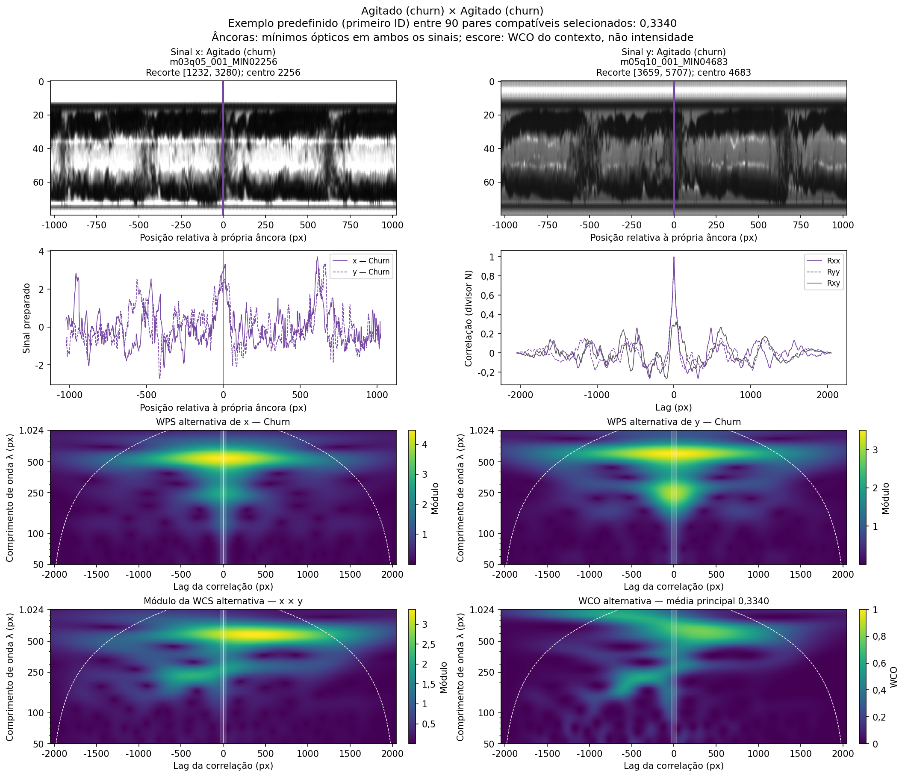

**Maior WCO média entre os pares selecionados; ilustração posterior: 0,5007.** x e y pertencem ambos a **Agitado (churn)**.

Par: `m04q20_001_MIN02009__m06q20_001_MIN06186`.

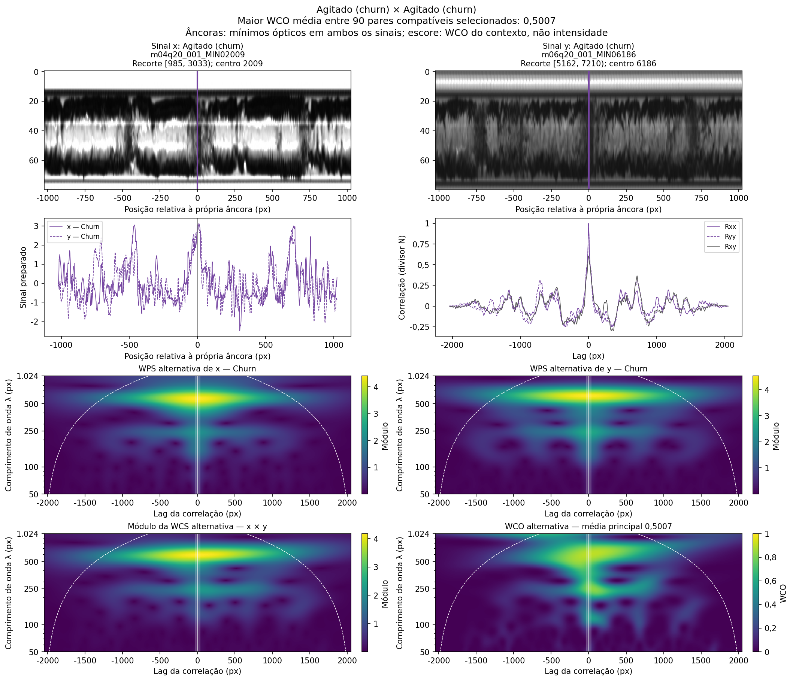

**Menor WCO média entre os pares selecionados; ilustração posterior: 0,0818.** x e y pertencem ambos a **Agitado (churn)**.

Par: `m04q20_001_MIN05074__m06q10_001_MIN03607`.

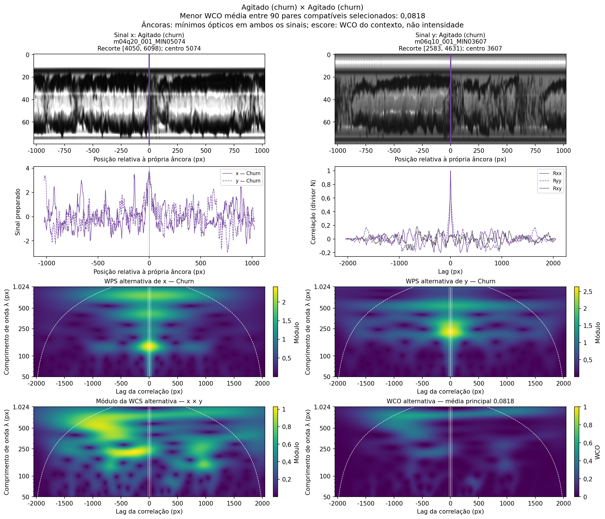

### Anular ondulado (wavy annular) × Anular ondulado (wavy annular)

**Exemplo predefinido pelo primeiro ID: 0,2575.** x e y pertencem ambos a **Anular ondulado (wavy annular)**.

Par: `m03q10_001_MIN03119__m04q80_001_MIN18780`.

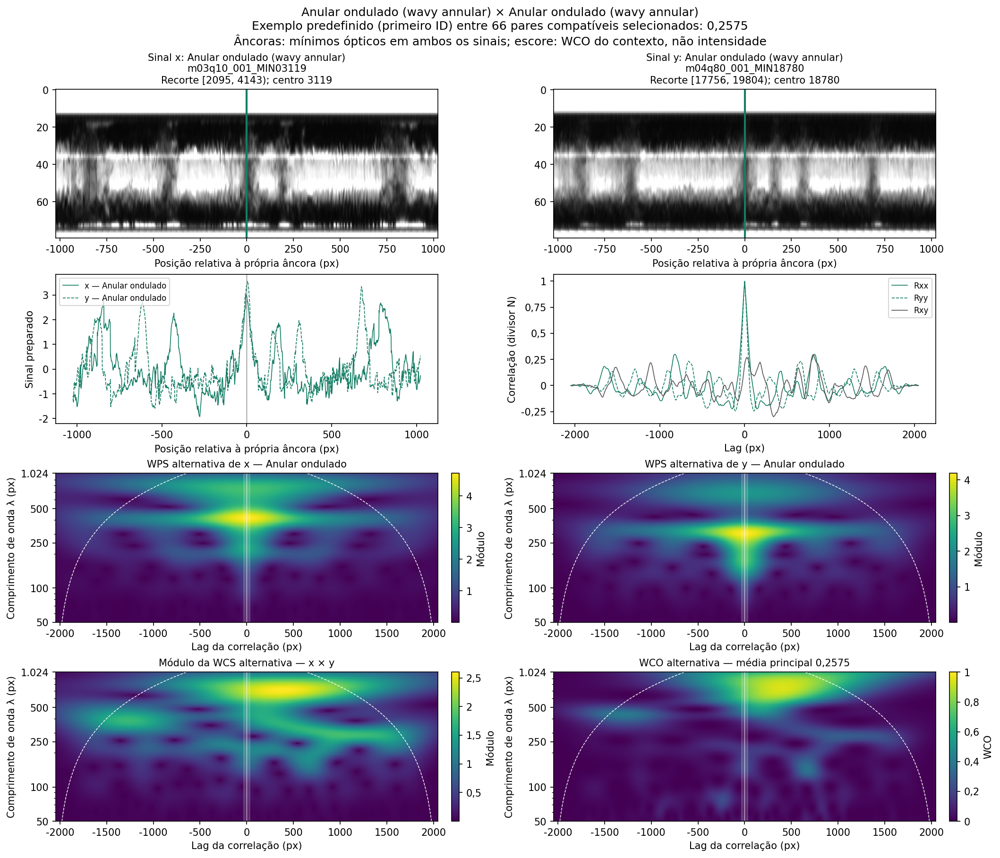

**Maior WCO média entre os pares selecionados; ilustração posterior: 0,4219.** x e y pertencem ambos a **Anular ondulado (wavy annular)**.

Par: `m04q80_001_MIN02779__m05q80_001_MIN11648`.

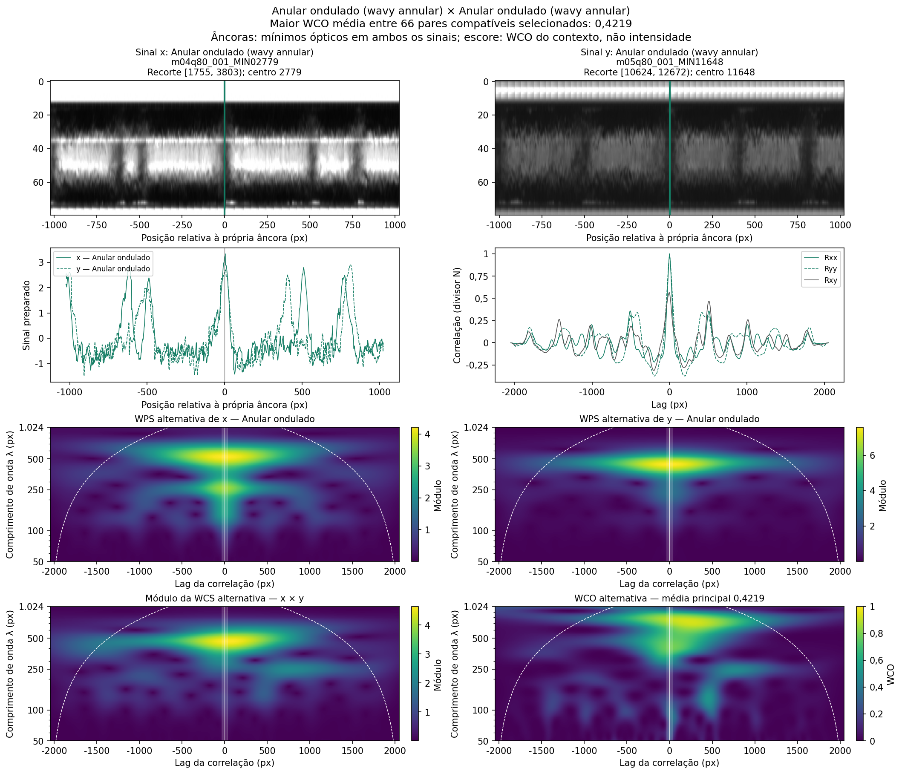

**Menor WCO média entre os pares selecionados; ilustração posterior: 0,0945.** x e y pertencem ambos a **Anular ondulado (wavy annular)**.

Par: `m04q80_001_MIN11728__m07q80_001_MIN15171`.

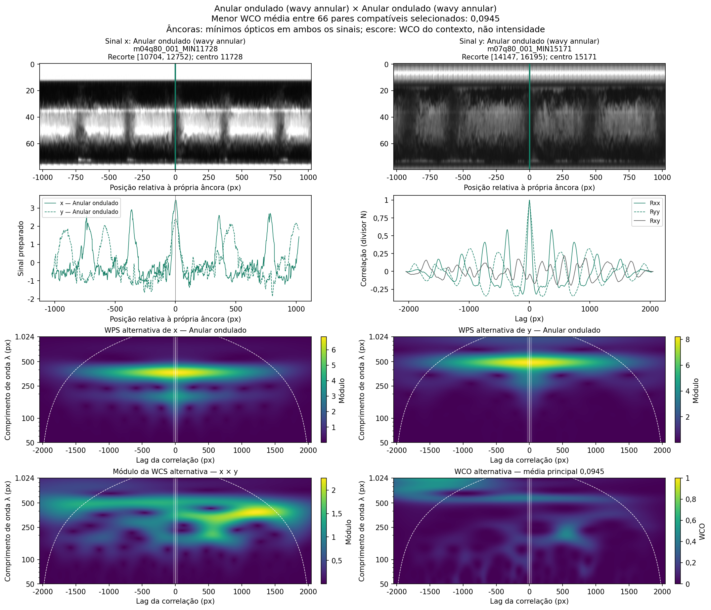

## Controles e limites de interpretação

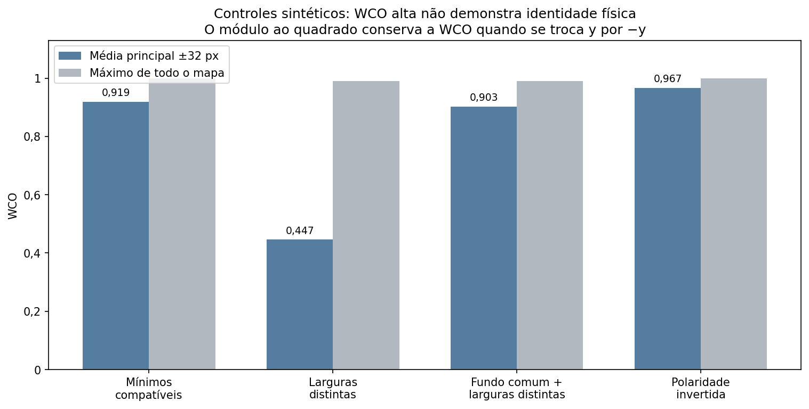

Os testes confirmaram WCO invariável ao trocar y por −y; a WCS muda de sinal. Portanto, mínimo × máximo não é um controle que obrigatoriamente deve apresentar WCO baixa. Fundo comum e periodicidade compartilhada também podem gerar coerência, sem equivalência física do marco central.

No controle sintético, mínimos de larguras distintas tiveram WCO média **0,4465**. Ao acrescentar o mesmo fundo periódico aos dois, a média passou a **0,9026**. A contribuição do contexto pode, portanto, dominar a interpretação do marco central.

- **Âncora óptica, identidade física não validada.** O mínimo marca uma depressão do perfil de intensidade; não mede espessura do filme nem identifica uma crista, bolha ou a mesma onda em aquisições diferentes. Os rótulos churn/anular são globais, herdados do inventário.
- **Seleção exploratória.** Regra desenvolvida em quatro aquisições piloto e aplicada no mesmo conjunto, já conhecido; revisão visual assistida por IA, sem especialista independente, concordância entre anotadores ou conjunto externo.
- **Montagem e contexto.** 10 das 152 âncoras caem nas zonas de mistura de 2 px das costuras; as outras 142 tiveram a coluna de origem conferida pixel a pixel. Cada contexto cruza 38–162 costuras. 143 recortes sobrepõem outro recorte selecionado e 120 contêm outro marco selecionado. Considerando só os 76 mínimos principais: 70 sobrepõem outro segmento, 60 contêm outro marco e 3 estão em mistura. Isso impede atribuir toda a WCO ao ponto central. As contagens de proximidade de costuras não são prova de artefato, pois as faixas de montagem são densas.
- **Aquisição com ressalva.** m03q40_001 conserva 60 deslocamentos não positivos herdados; 2 dos 152 contextos selecionados incluem deslocamentos não positivos. A análise principal mantém essa aquisição, e sua retirada é mostrada separadamente; os panoramas de entrada não foram substituídos.
- **Comparabilidade dos controles.** Mínimos compatíveis têm razão de larguras ≤1,50; distintos, ≥2,00. As larguras medem meia proeminência óptica. Mínimo × máximo pode diferir também em largura e forma, e a WCO é invariável à inversão global de sinal. Janelas fixas podem conter estruturas e não são negativos físicos garantidos.
- **Cobertura e dependência.** Os controles de larguras distintas existem em menos pares de aquisições, especialmente no anular. Cada contraste usa somente sua interseção de aquisições. Pares compartilham registros; não são réplicas independentes. Não foram calculados valores-p nem intervalos de confiança artificiais.
- **Domínio e potência.** N=2.048, K=1, correlação enviesada 1/N, λ de 50 a 1.024 px e lags principais ±32 px. A WPS alternativa usa módulo; WCO não recebe clipping. Validade numérica do denominador não equivale a potência confiável. Não há conversão para mm, Hz ou velocidade, nem validação de classificador.
- **Núcleo legado v5.** Dois mapas ancorados e um fixo apresentaram pequenas ultrapassagens de WCO=1, chegando a 1,006157. Todas ocorreram fora de ±32 px. A soma direta das correlações e a CWT por convolução temporal reproduziram os valores, com discrepância máxima de 3,04×10⁻¹³. Foram preservados sem clipping como limitação da variante discreta; a Morlet principal permaneceu ≤1. [Auditoria específica](results/extensao_churn_anular/auditoria_ultrapassagens_v5.json).

## O que permanece da etapa 1

Plug apresentou diferenças de **0,0275** frente a eventos distintos e **0,0289** frente a fixos, em três pares de aquisições. Slug apresentou **0,1520** e **0,2192**, sustentados por um único par equivalente; ao usar linhas 30–49, o contraste frente a distintos passou a **−0,0427**. Esses resultados continuam exploratórios. **Não foram combinados com churn/anular numa única estimativa**, pois a definição de âncora e de compatibilidade é diferente.

## Execução e rastreabilidade

As etapas concluídas somaram 36,4 minutos de cálculo. Esse total exclui a pausa e o tempo parcial dos diagnósticos interrompidos, que não foi cronometrado separadamente. O pico de memória do primeiro processo não foi salvo antes da pausa; o processo de retomada dos diagnósticos teve pico de 400 MiB. A estimativa inicial de aproximadamente 13–30 minutos ficou abaixo do tempo observado. O lote foi pausado por solicitação do usuário após salvar os pares ancorados e todas as referências fixas; a retomada refez somente os diagnósticos interrompidos. Foram reutilizadas 513 comparações fixas principais e calculadas 1.539 sensibilidades fixas, 152 autocomparações e 19 pares da mesma aquisição. As inspeções, figuras, redação e verificação final são etapas separadas. O núcleo matemático permaneceu idêntico ao da base e o cache reproduziu seus coeficientes exatamente nos testes.

Consulte o [passo a passo com limitações](PASSO_A_PASSO.md), a [explicação de âncoras/autocorrelação e limites de x/y](ANCORAS_E_AUTOCORRELACAO.md), o [protocolo da extensão](PROTOCOL_CHURN_ANULAR.md), os [resultados detalhados](RESULTS.md), o [catálogo completo](results/extensao_churn_anular/catalogo_ancoras.csv), a [verificação da extensão](results/extensao_churn_anular/verificacao_final.json) e as [instruções de reprodução](README.md).
