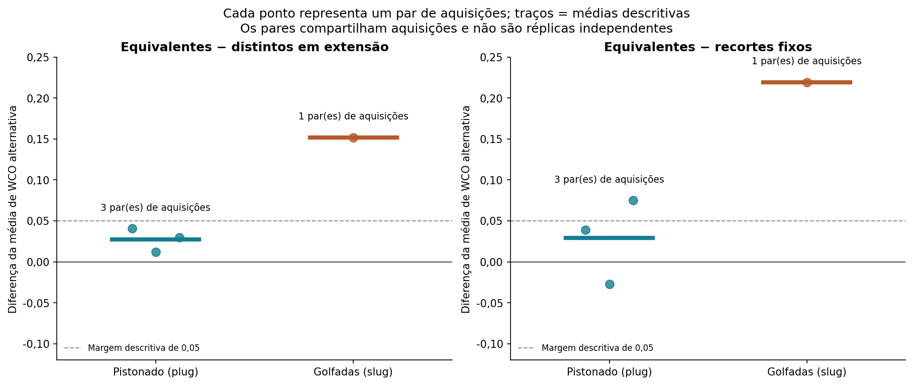
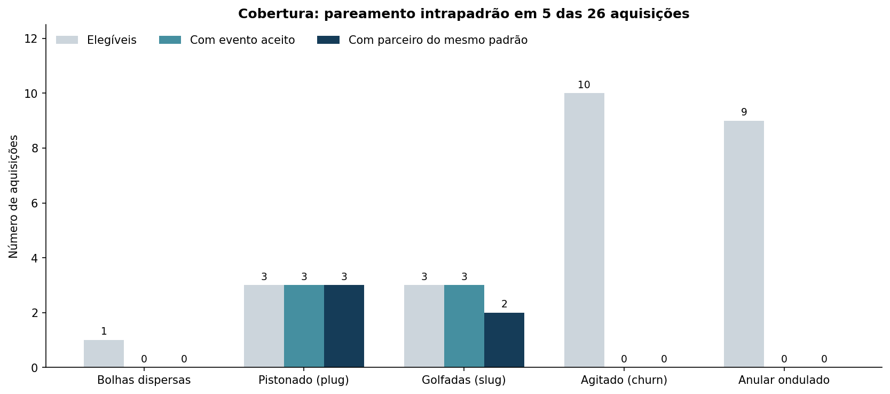
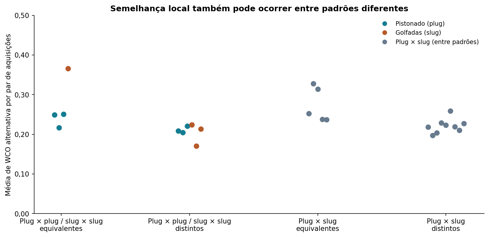
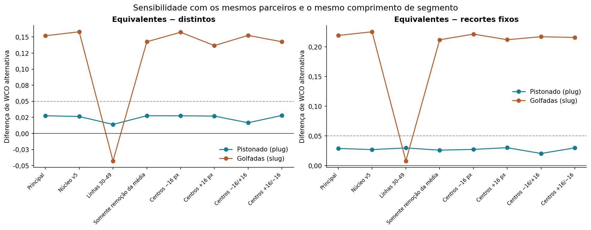
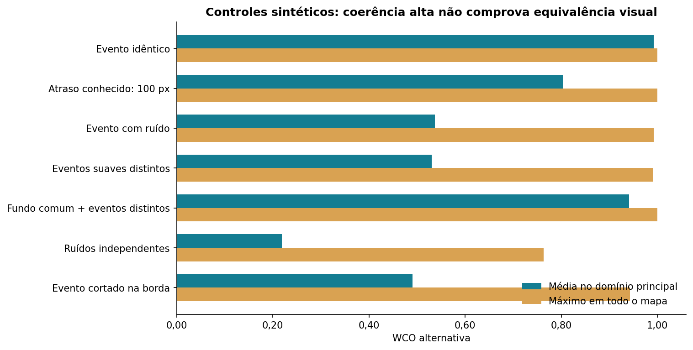
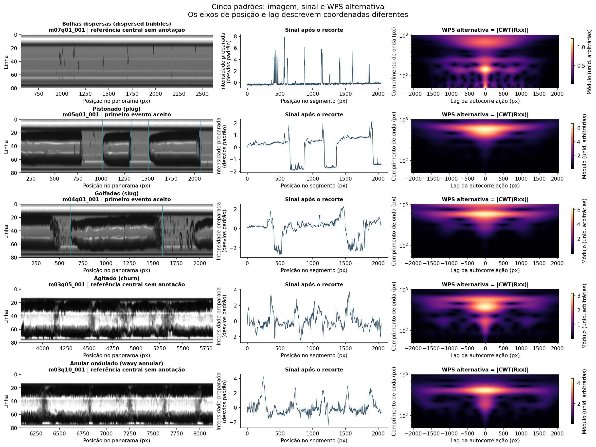
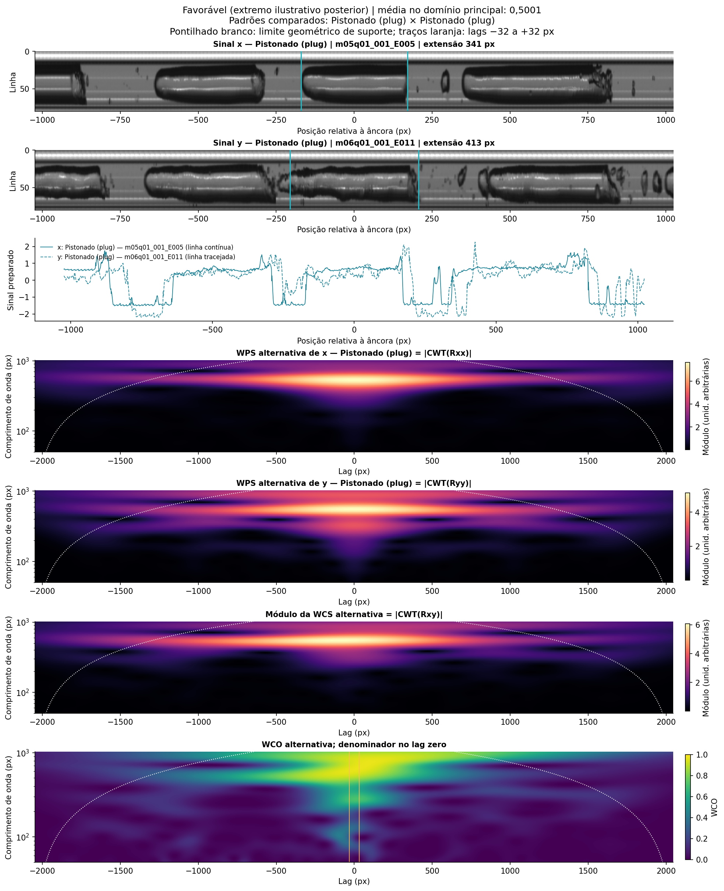
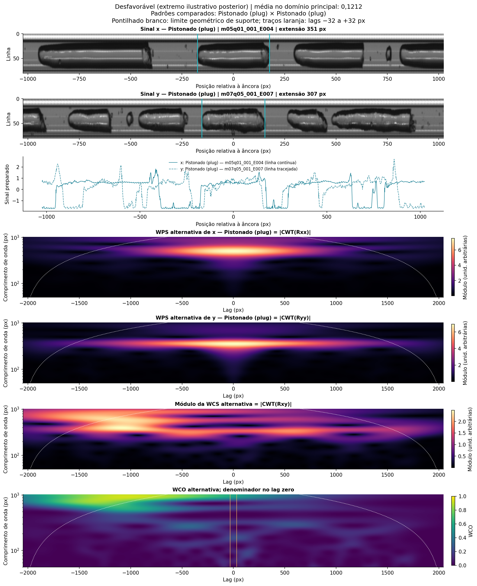
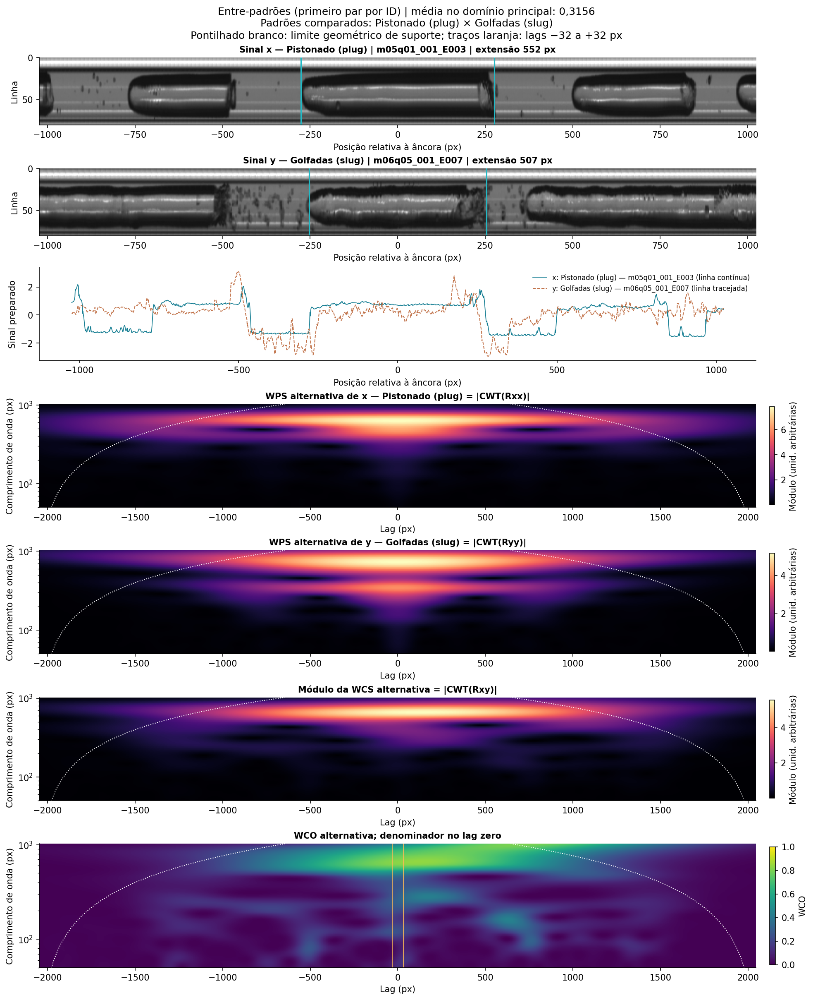

# Resumo executivo da comparação de eventos por wavelets

**Não conseguimos melhorar de forma convincente a alternative WCO com este protocolo em todo o escopo.** Para estruturas alongadas em pistonado (plug), o ganho sobre eventos de extensão distinta foi **0,0275**, uma **melhora marginal**. Em golfadas (slug), a diferença foi **0,1520**, mas dependeu de **um único par de eventos de duas aquisições** e se inverteu para **-0,0427** na faixa 30–49. O estudo fornece evidência exploratória restrita; não demonstra melhora geral, classificação dos padrões ou identidade física entre estruturas.

A execução usou a base solicitada **v16_spatial2_18_71**, com média das linhas **18–71 inclusive**, e preservou as equações alternativas de Schuck. O objetivo foi verificar se parear estruturas pela imagem, antes de observar a coerência, acrescentaria similaridade específica aos segmentos. A unidade calculada foi um segmento de **2.048 px centrado em um evento**, com contexto; ele pode conter estruturas vizinhas.

A [explicação de âncoras, limites dos sinais e autocorrelação](ANCORAS_E_AUTOCORRELACAO.md) detalha o processamento com um exemplo real e distingue o método executado da possível extensão a churn e anular.

## Identificação dos padrões

| Rótulo nos arquivos | Nome em português | Aquisições | Participação na análise |
| --- | --- | --- | --- |
| dispersed bubbles | Bolhas dispersas (dispersed bubbles) | 1 | Referências fixas e atlas; nenhum evento ancorado aceito |
| plug | Pistonado / bolhas alongadas (plug) | 3 | 20 eventos aceitos; comparação ancorada e referências fixas |
| slug | Golfadas (slug) | 3 | 6 eventos aceitos; comparação ancorada e referências fixas |
| churn | Agitado (churn) | 10 | Referências fixas e atlas; nenhum evento ancorado aceito |
| wavy annular | Anular ondulado (wavy annular) | 9 | Referências fixas e atlas; nenhum evento ancorado aceito |

**Plug e slug são rótulos diferentes nesta base:** plug corresponde ao pistonado/bolhas alongadas; slug corresponde a golfadas. Os nomes acima são os rótulos globais das aquisições, herdados do [inventário auditado](results/auditoria_entradas.csv). A categoria óptica do evento central não redefine o padrão da aquisição.

**Os resultados de eventos ancorados abaixo se referem somente a plug e slug.** Churn, anular ondulado e bolhas dispersas aparecem na cobertura, nas imagens e nas referências fixas. Nos gráficos de eventos, “entre padrões” significa especificamente **plug × slug**. Os controles fixos gerais incluem os cinco padrões.

Nos gráficos de contraste e sensibilidade, azul-petróleo identifica plug e laranja identifica slug. No gráfico de cobertura, as cores identificam grupos de inclusão. Nos mapas de WPS/WCS/WCO, as cores representam o valor da grandeza da barra lateral; o padrão está escrito no título. Os controles sintéticos são sinais artificiais, sem rótulo de escoamento.

## Resultado principal e sua cobertura

| Padrão | Pares de aquisições | Equivalentes | Distintos | Diferença | Diferença frente a recortes fixos |
| --- | --- | --- | --- | --- | --- |
| Pistonado (plug) | 3 | 0,2387 | 0,2112 | 0,0275 | 0,0289 |
| Golfadas (slug) | 1 | 0,3656 | 0,2136 | 0,1520 | 0,2192 |

As médias acima atribuem peso igual a cada par de aquisições, após resumir seus pares de eventos. Os controles distintos e fixos pertencem aos **mesmos pares de aquisições** dos equivalentes. Em plug foram 18 pares de eventos equivalentes, distribuídos pelos três pares possíveis de aquisições. Em slug, somente um dos três pares possíveis teve equivalentes; não é possível generalizar seu ganho às outras aquisições. As diferenças são absolutas na escala da WCO, não percentuais de acurácia.

Em plug, **um dos três pares de aquisições piorou** frente aos recortes fixos. A média positiva não representa melhora em todos os pares.

*Cada ponto representa um par de aquisições, com dependência entre pontos que compartilham registros. A linha de 0,05 é uma margem descritiva definida antes do cálculo; não é significância estatística nem requisito físico validado. Não foram produzidos intervalos de confiança artificiais a partir de eventos sobrepostos.*

Foram conferidas **31 entradas**, mantidas as **26 aquisições elegíveis** e as cinco exclusões anteriores. O detector propôs **163 intervalos alongados**; **26** foram aceitos em **6 aquisições** após revisão de morfologia e contexto. Apenas **5/26 aquisições (19,2%)** participaram de pares equivalentes intrapadrão. Essa é cobertura do protocolo, não a fração de todos os eventos físicos detectados.

| Padrão | Aquisições elegíveis | Eventos aceitos | Aquisições com equivalentes intrapadrão | Pares de eventos equivalentes |
| --- | --- | --- | --- | --- |
| Agitado (churn) | 10 | 0 | 0 | 0 |
| Bolhas dispersas | 1 | 0 | 0 | 0 |
| Pistonado (plug) | 3 | 20 | 3 | 18 |
| Golfadas (slug) | 3 | 6 | 2 | 1 |
| Anular ondulado | 9 | 0 | 0 | 0 |

*Zero eventos aceitos não significa ausência física de estruturas. A delimitação de eventos alongados não foi estabelecida para as texturas de churn/anular sob esta regra. Bolhas dispersas contém objetos pequenos e somente uma aquisição elegível, sem repetição intrapadrão independente.*

## Especificidade limitada do pareamento

O ganho em plug permaneceu pequeno frente a eventos distintos em extensão. O ganho de slug é um caso promissor, porém isolado. Entre plug e slug, eventos localmente equivalentes também superaram os distintos: diferença média **0,0642** nos **5 pares de aquisições** com ambos os grupos. Portanto, o critério pode refletir alguma semelhança local sem separar os rótulos globais.

*Os controles entre padrões também usam a mesma categoria alongada e a mesma regra de extensão. As distribuições são descritivas; conjuntos com coberturas diferentes não foram usados para atribuir um ganho de classificação.*

## Estabilidade e controles negativos

As mesmas coordenadas e os mesmos parceiros foram avaliados com a faixa 30–49, remoção apenas da média e perturbações de ±16 px nos centros. Os ganhos sobre eventos distintos, excluindo o núcleo v5, variaram assim:

| Padrão | Menor diferença | Maior diferença | Pares de aquisições |
| --- | --- | --- | --- |
| Pistonado (plug) | 0,0140 | 0,0281 | 3 |
| Golfadas (slug) | -0,0427 | 0,1574 | 1 |

**O ganho de slug não resistiu à mudança de faixa vertical:** com 30–49, equivalentes ficaram abaixo dos distintos em 0,0427. As variações de centro preservaram o sinal do contraste médio, mas não compensam essa dependência do observável óptico.

O controle sintético com **fundo comum e eventos distintos** atingiu média **0,9410**. Eventos suaves com larguras distintas atingiram **0,5302**, e seu máximo integral chegou a **0,9904**. Assim, WCO alta, especialmente um máximo isolado, não demonstra equivalência de eventos.

## Imagens e espectros dos cinco padrões

*De cima para baixo: bolhas dispersas — m07q01_001; pistonado (plug) — m05q01_001; golfadas (slug) — m04q01_001; agitado (churn) — m03q05_001; anular ondulado (wavy annular) — m03q10_001. Plug/slug: primeiro evento aceito da primeira aquisição em ordem alfabética. Demais padrões: referência central fixa, explicitamente sem anotação de evento. Os mapas usam o módulo da CWT da autocorrelação, sem elevá-lo ao quadrado. O eixo de posição do sinal não é o eixo de lag dos mapas. A banda de 50–1.024 px não pretende descrever todas as pequenas bolhas visíveis.*

## Casos favorável e desfavorável

Os dois exemplos abaixo são os extremos do escore intrapadrão **selecionados somente para ilustração após o lote**. Eles não definiram o catálogo nem os parceiros, e não representam desempenho típico.

| Exemplo | Sinal x: padrão e evento | Sinal y: padrão e evento |
| --- | --- | --- |
| Favorável | Pistonado (plug) — m05q01_001_E005 | Pistonado (plug) — m06q01_001_E011 |
| Desfavorável | Pistonado (plug) — m05q01_001_E004 | Pistonado (plug) — m07q05_001_E007 |
| Controle entre padrões | Pistonado (plug) — m05q01_001_E003 | Golfadas (slug) — m06q05_001_E007 |

As letras **x** e **y** identificam os dois sinais do par. Nas curvas, x usa linha contínua e y usa linha tracejada; ambas podem pertencer ao mesmo padrão. Os títulos de cada panorama e de cada WPS identificam o respectivo padrão e evento.

**Caso favorável: plug × plug — ambos os sinais são pistonado.**

*Par: m05q01_001_E005__m06q01_001_E011. A WCO usa numerador ao quadrado e denominador no lag zero. O máximo integral não é o resumo principal.*

**Caso desfavorável: plug × plug — ambos os sinais também são pistonado.**

*Par: m05q01_001_E004__m07q05_001_E007. Compartilhar a categoria visual e extensão semelhante não garantiu alta coerência em toda a banda. As linhas de suporte não são contornos de significância.*

**Controle entre padrões: plug × slug — x é pistonado (plug); y é golfadas (slug).**

*Controle entre padrões escolhido pelo primeiro ID, sem selecionar sua WCO. A aparência local não certifica o rótulo global.*

## Limitações que condicionam a conclusão

- **Poucas aquisições e seleção exploratória:** só três registros por padrão plug/slug; o conjunto já havia sido analisado. Não houve teste externo, validação por especialista independente ou medida entre anotadores.
- **Equivalência operacional limitada:** a seleção combinou categoria óptica revisada e extensão com razão ≤1,25. Ela não valida igualdade física, forma completa ou identidade de bolhas. **3 eventos aceitos ficaram sem parceiro equivalente entre aquisições.**
- **Contexto e dependência:** 22 dos 26 segmentos contêm ao menos outro evento aceito; estruturas rejeitadas ou menores também podem estar no contexto. Os segmentos se sobrepõem. Não é possível atribuir toda a WCO exclusivamente ao evento central.
- **Fronteiras e montagem:** variar o limiar de intensidade de 60 para 55/65 deslocou uma fronteira em até **40 px**. A perturbação de centros não cobre toda a incerteza morfológica. Os panoramas mantêm costuras e deslocamentos originais, inclusive os 60 não positivos de m03q40_001 e o caso de m04q01_001; não houve reconstrução física nova.
- **Escopo restrito:** churn e anular foram mantidos nos controles fixos e no atlas, com delimitação de eventos não estabelecida. Bolhas dispersas não oferece repetição entre aquisições. A inspeção de quadros foi amostral; não se afirma ausência de eventos em todos os quadros.
- **Grandezas distintas:** K=1, 1 px/amostra, sem mm/pixel, Hz ou velocidade inferidos. O divisor N é adaptação explícita de Schuck. O resumo de eventos é média em lags −32…+32 e ondas de 50–1.024 px; os escores antigos de máximos ponderados em 50–3.000 px não são diretamente comparáveis.
- **Peso das escalas:** pesos uniformes também incluem escalas de pouca potência, desde que numericamente válidas. A proteção do denominador evita divisões degeneradas; ela não estabelece confiabilidade experimental ou significância dessas escalas.

## Verificações e entrega

Passaram os controles de correlação por soma direta, convolução temporal independente da Morlet, padding, denominadores, recorte antes do preparo, self, atraso conhecido e núcleo literal do v5. O atraso de +100 px em y foi recuperado em **−100 px**. As **2.430 comparações** do lote principal/sensibilidades e mais **31 controles self/mesma aquisição** foram concluídos. O maior erro de recálculo da Eq. 32.17 no lote foi **0.00e+00**; nenhuma escala experimental foi descartada por denominador numérico nas versões Morlet. Esses testes verificam a implementação, não a validade física das fronteiras.

O lote de cálculo levou **6,6 minutos**, com pico de memória reportado de **270 MiB**. A estimativa prévia foi de 7–13 minutos. A revisão visual e a preparação do protocolo ocorreram antes desse lote; geração de figuras e verificação final são etapas separadas.

Veja o [passo a passo com limitações](PASSO_A_PASSO.md), o [protocolo congelado](PROTOCOL.md), as [decisões](DECISIONS.md), os [resultados detalhados](RESULTS.md), o [catálogo de eventos](results/catalogo_eventos.csv), as [instruções de reprodução](README.md) e a [verificação final](results/verificacao_final.json). Uma versão compacta para compartilhar está no [PDF do resumo executivo](RESUMO_EXECUTIVO.pdf).
