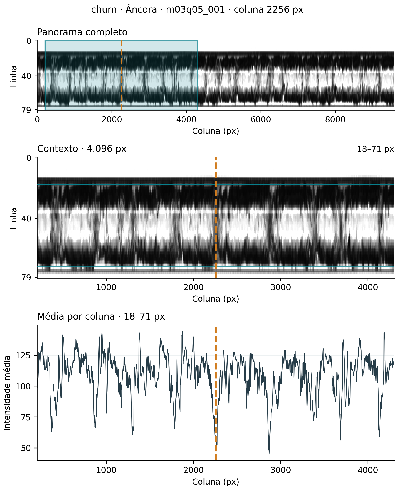
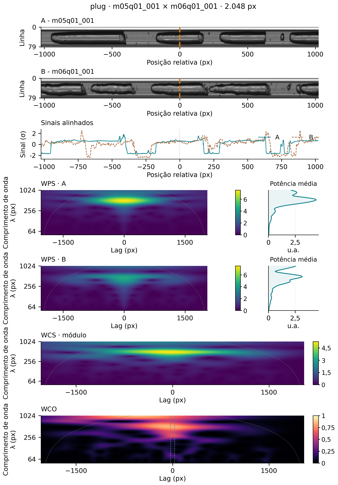
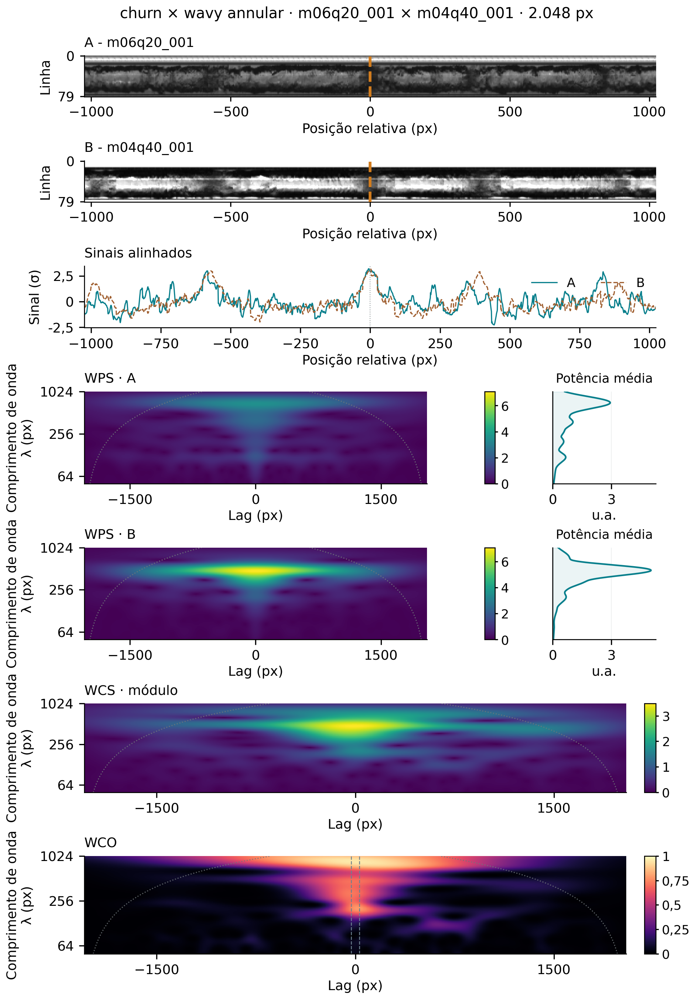
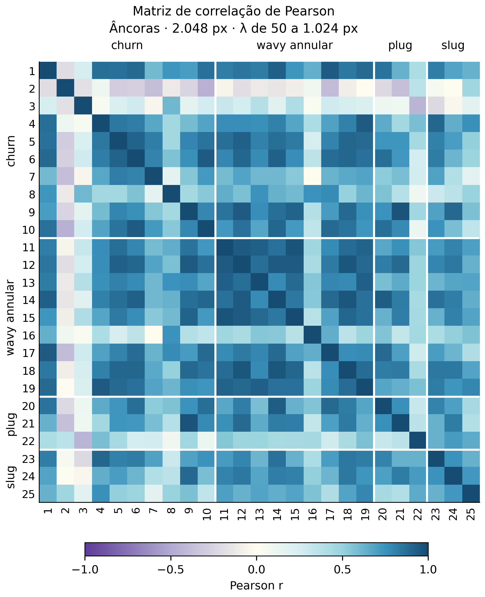
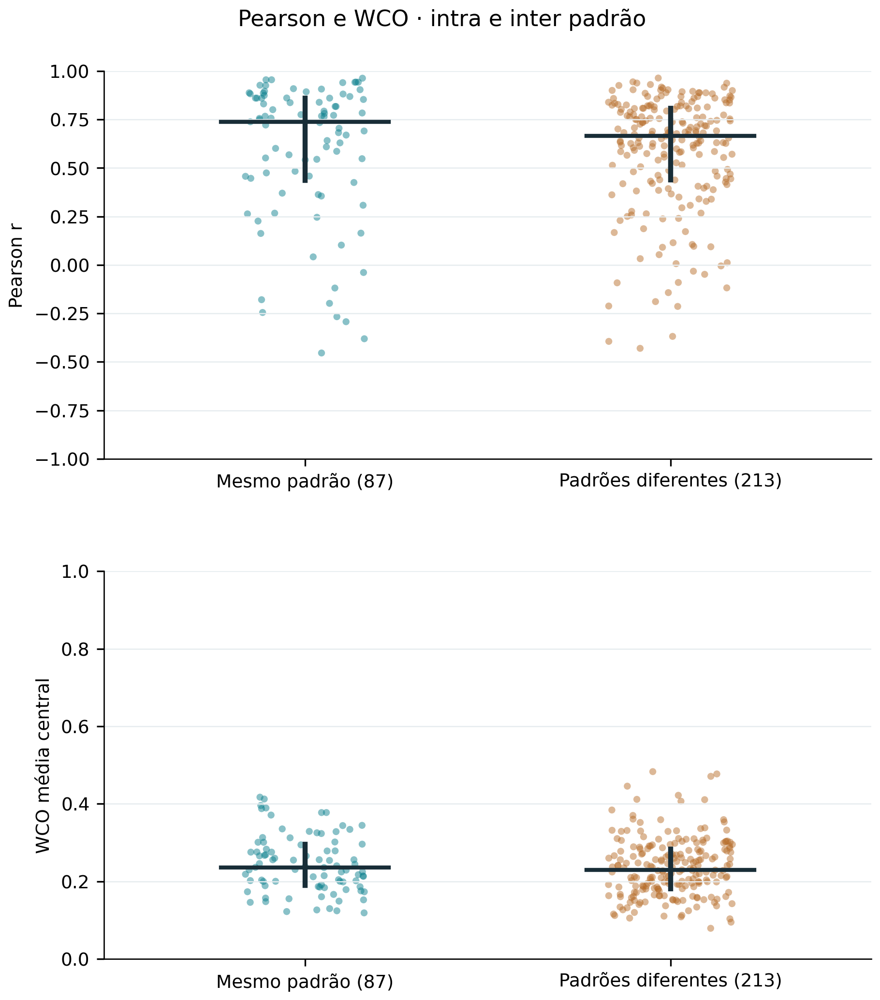

# Resumo executivo — âncoras, wavelets e correlação

**Foram analisados 25 ensaios, com uma âncora por ensaio, 87 pares intra padrão e 213 pares inter padrão. Houve diferenças locais, mas Pearson e WCO apresentaram sobreposição entre padrões: os resultados não demonstraram uma separação clara das quatro classes.**

## 01 — Âncoras e janelas

As âncoras foram escolhidas antes das wavelets, usando a média e a fração escura das linhas **18–71**. Em plug/slug, a seleção combinou eventos de morfologia aprovada visualmente na v16.2, estabilidade das fronteiras nos limiares 55/60/65 e contraste das extremidades. Em churn/wavy annular, venceu o vale mais proeminente em σ = 16, entre candidatos localizáveis também em σ = 12 e 20, com contexto completo.

Os 25 ensaios tiveram âncora válida. Os contextos nativos permaneceram nas imagens de `01_ancoras`. Para comparar qualquer par em condições iguais, utilizou-se o perfil comum de **2.048 px**, preservando o centro de cada âncora e as margens exigidas, sem reamostragem. Essa mesma janela foi usada nas estatísticas principais.

| Padrão | Ensaios | Contexto nativo | Pares intra | Pearson mediano | WCO central mediana |
| --- | ---: | ---: | ---: | ---: | ---: |
| plug | 3 | 2.048 px | 3 | 0,363 | 0,214 |
| slug | 3 | 2.048 px | 3 | 0,734 | 0,200 |
| churn | 10 | 4.096 px | 45 | 0,568 | 0,246 |
| wavy annular | 9 | 4.096 px | 36 | 0,860 | 0,230 |

O vale escolhido permaneceu localmente estável nos 19 ensaios de churn/wavy annular, com deslocamento máximo de **4 px**, abaixo da tolerância de 16 px. Entretanto, refazer todo o ranking com outro σ mudou o vencedor em **5 dos 19 contextos nativos**. Quatro centros também deixariam de ser os primeiros se a seleção fosse reiniciada diretamente em 2.048 px; foram preservados os vencedores nativos. Assim, “melhor âncora” depende das regras e da janela, sem significar um ótimo universal. A aprovação de forma em plug/slug ainda depende das anotações visuais.

## 02 — Comparações dentro do mesmo padrão

Os **87 pares** utilizaram Morlet, 200 comprimentos de onda de **50 a 1.024 px** e a correlação enviesada com divisor N. Foram mantidas as definições alternativas de Schuck–Bodmann: WPS como módulo da CWT da autocorrelação; WCS como CWT da correlação cruzada; WCO como seu módulo ao quadrado dividido pelas WPS individuais no lag zero. A curva **potência média** resumiu a WPS nos lags com suporte geométrico.

A WCO variou conforme a escala e o ensaio. A mediana das médias centrais dos pares intra foi **0,236**, com valores de 0,119 a 0,417. Faixas locais de alta coerência ocorreram mesmo quando a média foi baixa. A revisão visual anterior marcou 36 pares como favoráveis e 51 como desfavoráveis; esses rótulos não foram usados como taxa de acerto.

## 03 — Comparações entre padrões diferentes

Foram gerados todos os **213 pares**, sem misturar grades de 2.048 e 4.096 px. As WPS individuais previamente verificadas foram reutilizadas; apenas os termos cruzados de cada par precisaram ser calculados.

| Padrões diferentes | Pares | Pearson mediano | WCO central mediana |
| --- | ---: | ---: | ---: |
| plug × slug | 9 | 0,651 | 0,241 |
| plug × churn | 30 | 0,495 | 0,205 |
| plug × wavy annular | 27 | 0,633 | 0,202 |
| slug × churn | 30 | 0,577 | 0,219 |
| slug × wavy annular | 27 | 0,696 | 0,213 |
| churn × wavy annular | 90 | 0,733 | 0,255 |

A mediana inter da WCO média central foi **0,229**, próxima da intra (0,236); **101 dos 213 pares inter** atingiram ou superaram a mediana intra. Churn × wavy annular teve a maior mediana inter de WCO, inclusive acima das medianas internas de ambos os padrões. Isso dificultou distinguir essas classes por esse resumo.

O par churn **m06q20_001** × wavy annular **m04q40_001** apresentou a maior média central inter, **0,483**, ilustrada abaixo. No outro extremo, [slug m05q05_001 × wavy annular m07q80_001](../03_wavelets_inter/slug_wavy_annular_m05q05_001_m07q80_001_favoravel.png) apresentou **0,079**. São exemplos extremos do conjunto completo, não representantes escolhidos para resumir cada classe.

Nos nomes dos arquivos inter, **favoravel significa WCO predominantemente baixa**, conforme solicitado. A inspeção resultou em 137 favoráveis e 76 desfavoráveis. A avaliação considerou a localização e a extensão das faixas coerentes; não corresponde a um corte automático na média nem a significância estatística.

## 04 — Matriz de Pearson e sensibilidade

Reproduziu-se o descritor de `estatistica5`: **WPS no lag zero, em log, após retirada da tendência log-linear em função de λ**. O Pearson assinado comparou a forma desses resíduos, com um descritor fixo por ensaio. Não foi calculado diretamente sobre a WCO ou sobre a curva potência média.

Os números dos eixos estão identificados no [índice dos ensaios](../04_estatistica/INDICE_ENSAIOS.md). Roxo indica correlação negativa; creme, próxima de zero; azul, positiva. A diagonal e os pares espelhados foram excluídos dos resumos.

A mediana de Pearson foi **0,739 intra** e **0,665 inter**. Houve 9 pares intra e 13 inter com r negativo. **78 pares inter** atingiram ou superaram a mediana intra. Wavy annular teve a maior mediana interna (0,860); plug, a menor (0,363), com apenas três ensaios disponíveis nessa classe.

O maior r inter ocorreu em **churn m07q20_001 × plug m06q01_001: 0,964**. Nesse par, a WCO média central foi 0,180. Isso mostra a diferença entre os indicadores: forma espectral semelhante não exige coerência cruzada elevada junto ao alinhamento.

Na figura, cada ponto é um par; os traços indicam mediana e quartis. A **WCO média central** foi calculada nas 200 escalas e nos lags −32 a +32 px, todos com suporte válido. O resumo é descritivo e pode esconder faixas locais importantes.

Como controle, repetiu-se Pearson com os panoramas completos, mantendo a mesma faixa de λ. As medianas passaram a **0,834 intra** e **0,753 inter**. A mudança absoluta mediana de r foi **0,162**, chegando a **0,961**. O resultado dependeu do contexto espacial; comprimento e conteúdo mudaram juntos. A [figura de sensibilidade](../04_estatistica/sensibilidade_comprimento.png) e a [matriz de controle](../04_estatistica/matriz_pearson_completo.png) foram preservadas. A janela principal não foi substituída pelo resultado mais favorável.

## Confiabilidade e interpretação

**As verificações numéricas passaram.** Os 213 mapas inter foram confrontados com correlação direta e Morlet no domínio temporal; a maior diferença de WCO foi 1.80e-14. Os 300 coeficientes de cada matriz foram conferidos com SciPy e NumPy, com diferença máxima de 6.66e-16. As fontes, âncoras, precomputações individuais e resultados intra anteriores permaneceram intactos. Os PNGs foram verificados para inserção legível em A4 retrato, sem exportação em PDF.

A auditoria anterior já havia reconstruído os 25 panoramas a partir de 12.525 quadros e conferido os 44 contextos numéricos individuais. A coluna de costura coincidente com uma âncora de plug teve efeito pontual pequeno no teste realizado; isso não equivale a avaliar a remoção de todas as costuras.

O estudo permaneceu **descritivo, com K = 1 e um evento por ensaio**. Os 300 pares compartilham apenas 25 aquisições; não são 300 réplicas independentes. As maiores escalas têm poucas repetições no recorte. Não foram inferidas causalidade, significância ou acurácia de classificação. As âncoras e os mapas ficaram consistentes e reutilizáveis, mas Pearson e WCO, isoladamente nesses recortes, não bastaram para demonstrar distinção clara entre os padrões.

[Método, fórmulas e dados](../04_estatistica/METODOLOGIA.md) · [Auditoria das âncoras e intra](../intermediario/auditoria_lote_completo/relatorio.txt) · [Verificação inter](../intermediario/lote_inter/verificacao.json) · [Verificação estatística](../intermediario/estatistica/verificacao.json)
