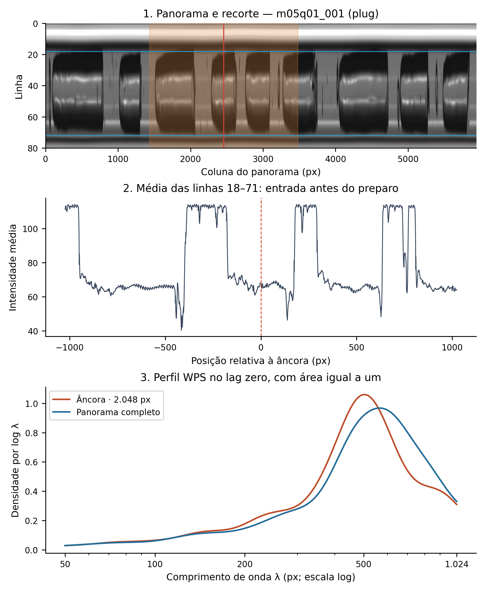
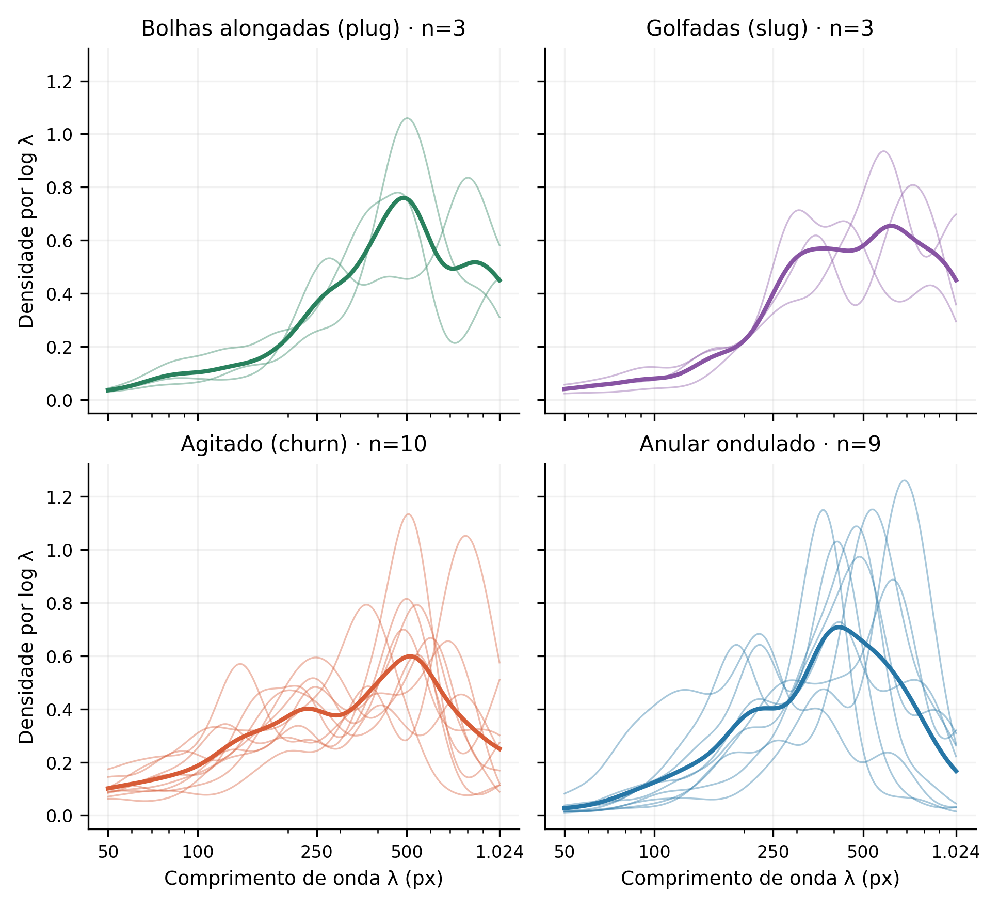
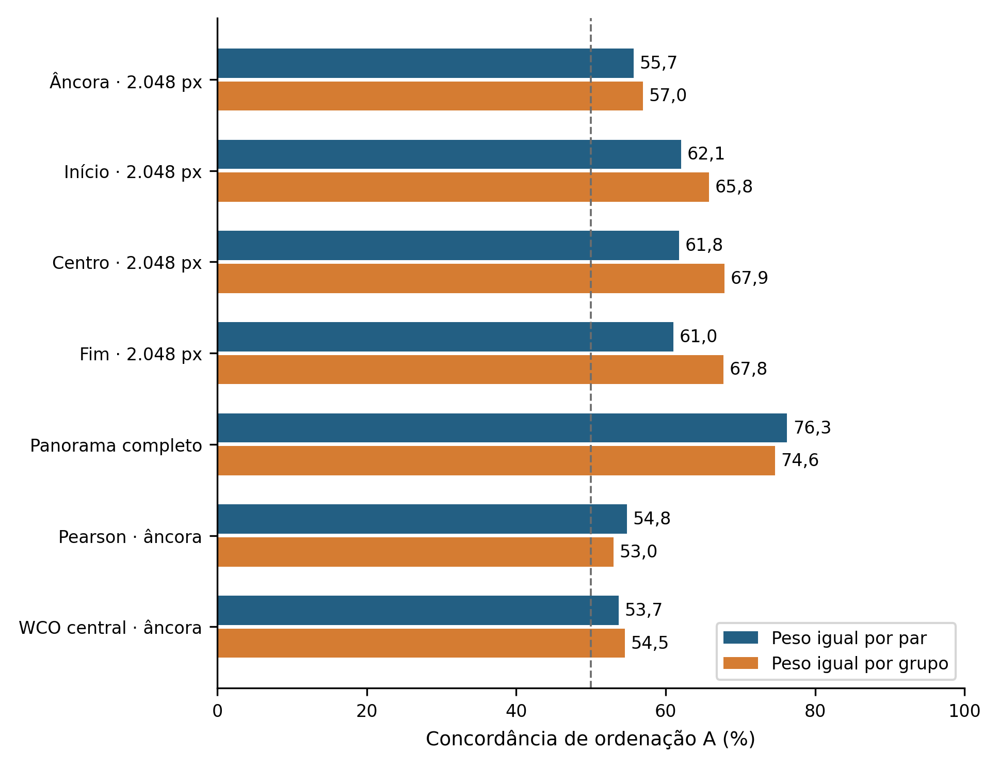
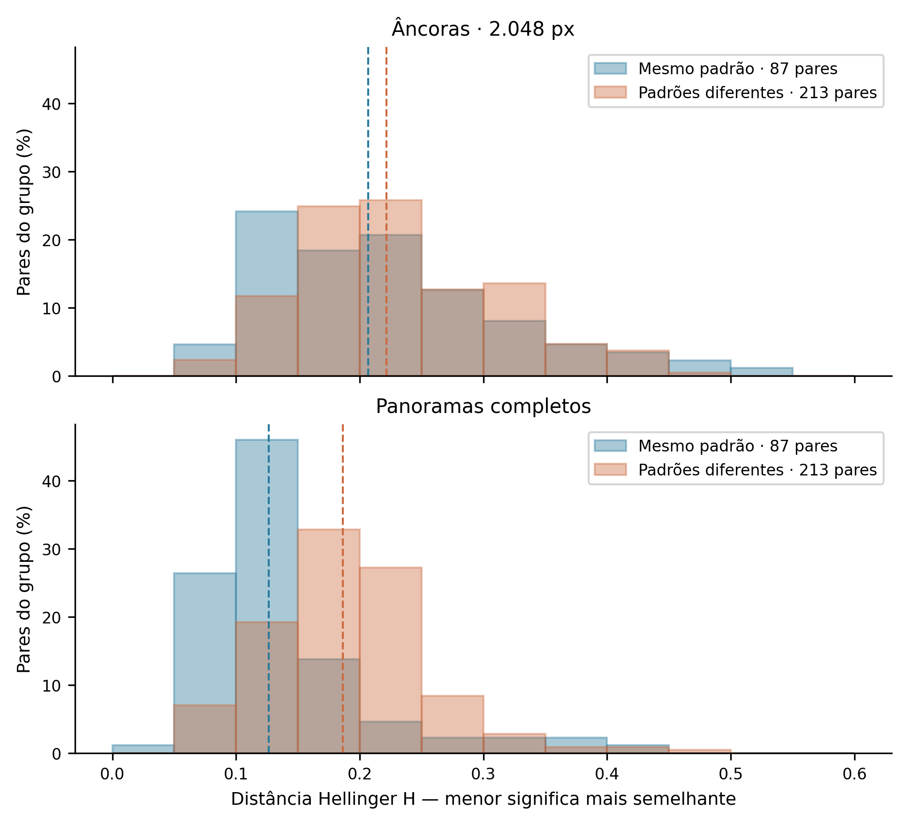
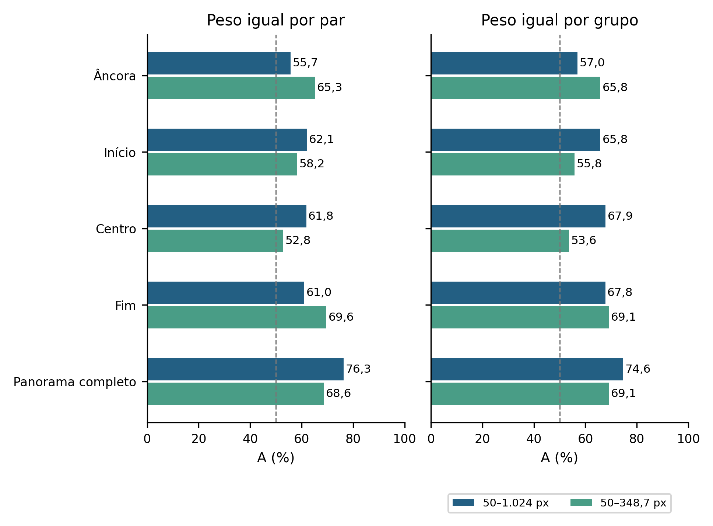
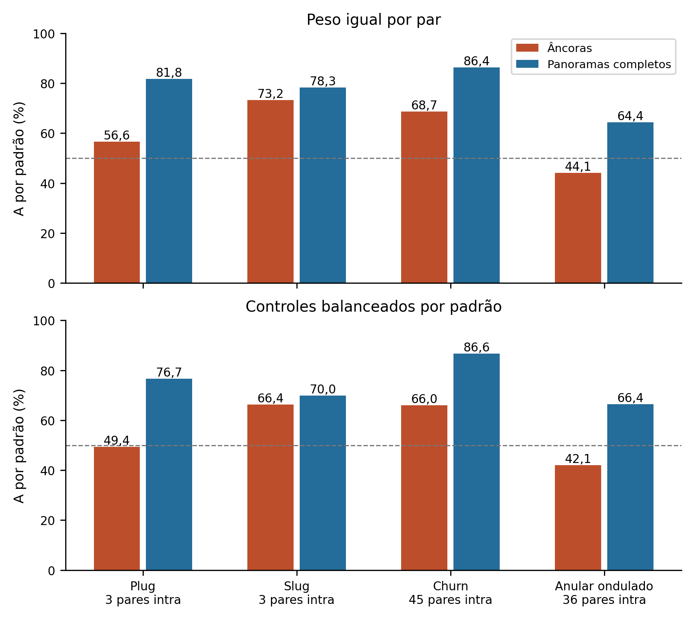

# Âncoras + perfis WPS: combinação coerente, sem melhora geral neste teste

Faz sentido combinar as duas etapas: a v16.3 seleciona o trecho e a v16.1 compara a forma de sua WPS. A análise executada, porém, não sustentou substituir os panoramas completos por uma única janela ancorada de 2.048 px. Na faixa de 50–1.024 px, A foi 55,7% nas âncoras e 76,3% nos panoramas completos. Os controles de início, centro e fim com o mesmo comprimento também superaram as âncoras.

A mede concordância de ordenação entre pares. Não é acurácia, probabilidade de classificação correta ou significância estatística.

## Como a proposta foi aplicada

O caminho foi: panorama → âncora congelada → recorte de 2.048 px → média por coluna das linhas 18–71 → preparo do sinal → autocorrelação → WPS no lag zero → área unitária em log λ → distância de Hellinger. A âncora define qual conteúdo entra no sinal. A normalização e a distância são as mesmas da v16.1.

Foram preservados 25 ensaios: 3 plug, 3 slug, 10 churn e 9 wavy annular. Cada um forneceu um perfil individual, independente do parceiro, formando 87 pares intra e 213 inter. A aquisição de bolhas dispersas da v16.1 não pertence ao catálogo de âncoras; por isso, foi excluída de todos os controles diretos. Os centros, regras ópticas e aprovações morfológicas vieram da v16.3, sem nova seleção.

Foi usada a WPS alternativa |CWT(Rxx)| no lag zero, sem elevar novamente ao quadrado. A curva de potência média sobre lags da v16.3 não é essa representação. Tampouco se aplicou outra wavelet sobre um perfil já calculado. O núcleo Morlet das duas versões é idêntico em bytes.



O sombreado marca os 2.048 px usados. A linha vertical marca a âncora e as horizontais delimitam a faixa de linhas. A WPS descreve todo o sinal recortado; λ não localiza uma estrutura no panorama. O panorama foi ajustado em proporção para leitura. Exemplo fixado pelo primeiro ID de plug, sem seleção pelo resultado.



Linhas finas: todos os ensaios. Linha grossa: média das densidades apenas para leitura. Cada distância foi calculada entre perfis individuais; essa média não é um modelo de classe. A escala vertical comum evidencia a variabilidade interna.

## Comparação principal em condições comuns

| Entrada do perfil Hellinger | A: peso igual por par | A: peso igual por grupo |
| --- | --- | --- |
| Âncora · 2.048 px | 55,7% | 57,0% |
| Início · 2.048 px | 62,1% | 65,8% |
| Centro · 2.048 px | 61,8% | 67,9% |
| Fim · 2.048 px | 61,0% | 67,8% |
| Panorama completo | 76,3% | 74,6% |

Todas essas linhas usam os mesmos ensaios, extração, preparo e 200 comprimentos de onda entre 50 e 1.024 px. Início, centro e fim foram cortados antes do preparo e têm os mesmos 2.048 px das âncoras. Assim, a vantagem dos controles de mesmo tamanho não pode ser explicada apenas por terem mais amostras. O panorama completo modifica comprimento e conteúdo simultaneamente; ele não isola o efeito do comprimento.

A diferença âncora menos panorama completo foi −20,5 pontos percentuais por par e -17,7 pontos na ponderação balanceada. H médio foi 0,224 intra e 0,234 inter nas âncoras; nos panoramas completos, 0,140 e 0,191, respectivamente. Menor H significa maior semelhança; essas médias não são limiares de classificação.



Todos usam os mesmos 25 ensaios e 50–1.024 px. As cinco primeiras linhas usam Hellinger; Pearson e WCO são referências da v16.3. Os valores representam A, tornando comparável a ordenação. A linha de 50% indica ausência de preferência; não é teste estatístico nem acurácia.



Cada histograma soma 100% dentro de seu grupo; as linhas tracejadas marcam medianas. As âncoras produziram maior sobreposição. O domínio matemático de H vai de 0 a 1; a figura mostra a faixa observada. Os pares compartilham aquisições.

A principal veio de 10.327 ordenações favoráveis, 8.204 contrárias e 0 empates, entre 87×213=18.531 comparações. Esses números reutilizam apenas 25 aquisições. Na ponderação balanceada, cada um dos quatro grupos intra e cada uma das seis combinações inter recebe peso igual; não são novas observações.

## O que os controles de estabilidade mostraram

| Entrada — faixa conservadora | A por par | A balanceada |
| --- | --- | --- |
| Âncora · 2.048 px | 65,3% | 65,8% |
| Início · 2.048 px | 58,2% | 55,8% |
| Centro · 2.048 px | 52,8% | 53,6% |
| Fim · 2.048 px | 69,6% | 69,1% |
| Panorama completo | 68,6% | 69,1% |

O suporte conservador 3a≤N/2 reteve 129 pontos, até λ=348,69 px. A das âncoras subiu para 65,3% / 65,8%. Nessa faixa, elas superaram início e centro, mas ficaram abaixo do fim e do panorama completo. Há informação útil e sensibilidade à banda; não há ganho geral da seleção por uma única âncora. A faixa conservadora foi definida por suporte, antes de calcular esses controles, e não substituiu a principal.



A faixa conservadora segue 3a≤N/2 e contém 129 pontos da grade original; as áreas foram normalizadas novamente. As âncoras melhoraram nessa faixa, mas não superaram o panorama completo nem o fim. As duas faixas foram preservadas, sem escolher a melhor após os resultados.

| Perturbação da âncora | A por par | A balanceada |
| --- | --- | --- |
| Âncora −16 px | 55,8% | 56,5% |
| Âncora · 2.048 px | 55,7% | 57,0% |
| Âncora +16 px | 55,6% | 56,3% |

Deslocar os centros em ±16 px alterou pouco o resultado na faixa principal. Essa checagem testa um pequeno erro de posição; não representa selecionar outro evento nem repetir a seleção completa. Os recortes perturbados não receberam uma nova aprovação morfológica. Na sensibilidade de métrica, o cosseno nas âncoras produziu 51,1% por par, também sem vantagem sobre Hellinger.

Retirando uma aquisição por vez, A das âncoras variou de 52,5% a 58,7%; a balanceada variou de 52,1% a 60,3%. Em todas as 25 retiradas pareadas, as âncoras permaneceram abaixo de início, centro, fim e panorama completo na faixa principal, nas duas ponderações. Essas são análises de influência, não intervalos de confiança nem validação preditiva.

## Resultados por padrão

| Padrão | Âncora: A por par | Completo: A por par | Âncora: A balanceada | Completo: A balanceada |
| --- | --- | --- | --- | --- |
| Bolhas alongadas (plug) | 56,6% | 81,8% | 49,4% | 76,7% |
| Golfadas (slug) | 73,2% | 78,3% | 66,4% | 70,0% |
| Agitado (churn) | 68,7% | 86,4% | 66,0% | 86,6% |
| Anular ondulado | 44,1% | 64,4% | 42,1% | 66,4% |

A desvantagem perante os panoramas completos apareceu nos quatro padrões. Anular ondulado teve o resultado mais desfavorável das âncoras. A maior A de slug não é evidência de vantagem da âncora: o controle completo do mesmo padrão também foi maior. Por padrão, os controles inter envolvem somente aquela classe; esses números não são a decomposição simples da A global.



Cada padrão foi avaliado contra os pares inter que o envolvem. A segunda ponderação dá o mesmo peso às três outras classes. Anular ondulado ficou abaixo de 50% nas âncoras. Plug e slug têm somente três aquisições cada.

## Relação com as análises anteriores

| Comparação nos mesmos 25 ensaios | A por par | A balanceada |
| --- | --- | --- |
| Hellinger nas âncoras · 50–1.024 px | 55,7% | 57,0% |
| Pearson residual nas âncoras · 50–1.024 px | 54,8% | 53,0% |
| WCO média central nas âncoras · 50–1.024 px | 53,7% | 54,5% |
| v16.1 original, restrita aos 25 · 50–2.295,94 px | 74,2% | 71,4% |

Hellinger ficou ligeiramente acima de Pearson e WCO no agregado das âncoras, mas a direção dessa vantagem não persistiu em todas as retiradas de aquisição. Isso não constitui melhora robusta. A WCO usada aqui é a média central da v16.3; não é o escore de máximos que obteve 21,5% na comparação antiga da v16.1.

Os 76,5% / 81,6% publicados na v16.1 usavam 26 ensaios, incluindo uma aquisição de bolhas dispersas. Restrita aos mesmos 25, aquela análise produz 74,2% / 71,4%, mas conserva uma faixa mais ampla. O controle direto desta nova análise é o panorama completo recalculado/conferido em 50–1.024 px: 76,3% / 74,6%. Não atribuímos à âncora mudanças de amostra ou de faixa.

## Interpretação e caminho recomendado

A combinação foi tecnicamente válida e relevante para testar a hipótese. Os resultados atuais desfavorecem uma única âncora de 2.048 px como substituta do panorama completo para esse descritor. O panorama completo continua sendo a referência mais promissora entre as entradas avaliadas na faixa principal. A v16.4 preserva uma análise exploratória com resultado desfavorável, útil para justificar essa decisão.

Uma explicação plausível é que um evento opticamente bem delimitado ou um vale proeminente não representa toda a diversidade do escoamento. A WPS da autocorrelação resume todo o recorte e perde informações de localização e fase; colocar uma estrutura no centro não torna o perfil específico daquela estrutura. Os controles sustentam a importância do conteúdo escolhido, mas não demonstram essa explicação causalmente.

Se a investigação continuar, o próximo passo mais informativo é comparar conjuntos de múltiplos eventos/janelas por aquisição, com a mesma cobertura e regra para todos os padrões, e avaliar a estabilidade entre esses eventos. Esse experimento ainda não foi executado. Uma avaliação de classificação futura precisará de seleção aplicável sem conhecer a classe e de separação por aquisição/condição experimental; os pares ou janelas da mesma aquisição não poderão atravessar treino e teste.

A seleção atual usa conhecimento do padrão: plug/slug dependem de eventos com morfologia aprovada, enquanto churn/anular usam vales. O presente estudo é descritivo, condicionado a esses rótulos. Os panoramas têm comprimentos desiguais, costuras e condições operacionais confundidas com os padrões. K=1, poucas réplicas em plug/slug e um evento por ensaio limitam qualquer generalização. λ está em pixels do panorama, sem calibração para milímetros, hertz ou comprimento físico de bolha.

## Verificação, arquivos e reprodução

A verificação numérica passou: 175 perfis de 7 condições, 19 representações/referências e 300 pares por método. Para os 150 recortes, a autocorrelação direta e a Morlet temporal foram confrontadas com o cálculo por FFT em todas as escalas; os 25 perfis completos temporais já auditados foram confrontados com a implementação da v16.1. A maior diferença de WPS foi 3.53e-14; a de A por formulações independentes foi 6.66e-16.

Foram congelados os hashes de 257 arquivos consumidos. Os 2251 arquivos das duas análises anteriores preservaram nomes, tamanhos e mtimes durante a execução, e os hashes das entradas foram reconferidos. Não foram refeitas a revisão morfológica, a montagem dos panoramas ou a auditoria dos 300 mapas WCO; suas verificações anteriores foram reutilizadas. Os mapas cruzados não foram recalculados.

| Arquivo | Conteúdo |
| --- | --- |
| PROTOCOLO.md / config.json | Regras e momento de definição dos controles |
| results/indice_ensaios.csv / recortes.csv | Âncoras, fontes e coordenadas de cada janela |
| results/perfis.npz / perfis_normalizados.csv | WPS, massas, densidades e áreas |
| results/pares.csv / concordancia.csv | Todos os pares e todos os resultados |
| results/por_padrao.csv / grupos_pares.csv | Desfechos por padrão e combinação |
| results/influencia_aquisicoes.csv / efeitos_pareados.csv | Retiradas de aquisição e diferenças sob a mesma retirada |
| results/verificacao.json / verificacao_perfis.csv | Controles numéricos e erros observados |
| results/entradas_congeladas.json / artefatos.json | Procedência das fontes e manifesto da entrega |
| figures/ | Seis figuras científicas PNG a 300 dpi |

```sh
PYTHONDONTWRITEBYTECODE=1 MPLCONFIGDIR=/tmp/v16_4_ancoras_wps_mpl python3 src2/v16.4_ancoras_perfils_wps/scripts/run_analysis.py
PYTHONDONTWRITEBYTECODE=1 MPLCONFIGDIR=/tmp/v16_4_ancoras_wps_mpl python3 src2/v16.4_ancoras_perfils_wps/scripts/render_results.py
PYTHONDONTWRITEBYTECODE=1 python3 src2/v16.4_ancoras_perfils_wps/scripts/verify_results.py
```

Executar a partir da raiz do projeto, com as dependências de requirements.txt. As pastas v16.1, v16.3 e data_processed devem permanecer disponíveis como irmãs. A segunda etapa apenas renderiza resultados existentes. As regras foram registradas após a triagem inicial dos perfis disponíveis; este estudo não é um pré-registro cego. Não foram alterados parâmetros para favorecer as âncoras.

## Todas as representações e referências

| Identificador reproduzível | A por par | A balanceada |
| --- | --- | --- |
| ancora_2048__hellinger_principal | 55,7% | 57,0% |
| ancora_2048__hellinger_conservador | 65,3% | 65,8% |
| ancora_2048__cosseno_principal | 51,1% | 51,3% |
| inicio_2048__hellinger_principal | 62,1% | 65,8% |
| inicio_2048__hellinger_conservador | 58,2% | 55,8% |
| centro_2048__hellinger_principal | 61,8% | 67,9% |
| centro_2048__hellinger_conservador | 52,8% | 53,6% |
| fim_2048__hellinger_principal | 61,0% | 67,8% |
| fim_2048__hellinger_conservador | 69,6% | 69,1% |
| panorama_completo__hellinger_principal | 76,3% | 74,6% |
| panorama_completo__hellinger_conservador | 68,6% | 69,1% |
| panorama_completo__cosseno_principal | 72,2% | 72,8% |
| ancora_menos16__hellinger_principal | 55,8% | 56,5% |
| ancora_menos16__hellinger_conservador | 63,7% | 65,2% |
| ancora_mais16__hellinger_principal | 55,6% | 56,3% |
| ancora_mais16__hellinger_conservador | 67,0% | 68,2% |
| v163_pearson_ancora | 54,8% | 53,0% |
| v163_wco_central | 53,7% | 54,5% |
| v161_principal_25 | 74,2% | 71,4% |
