# Conclusão executiva — v16_spatial2

**Os ganhos frente ao v5 foram marginais no escore principal. Não foi demonstrada melhora robusta e geral da similaridade nem separação convincente dos padrões.** A referência corrigida do v16 aumentou esse escore nos 87 pares, com ganho médio de apenas **+0.003827**. Entre as opções confirmadas, a mediana das linhas 20–59 teve o maior ganho médio com peso igual por par: **+0.006256**, mas **29 dos 87 pares pioraram**.

A faixa central 30–49, destacada no estudo anterior, ganhou **+0.002577** frente ao v5, mas ficou **0.001250** abaixo da referência corrigida na média dos 87 pares. Portanto, não é a melhor opção segundo essa ponderação. Todos esses números foram recalculados sem COI nem máscara conservadora.

## Atualização da apresentação e dos cálculos

Todos os gráficos foram refeitos com os nomes dos padrões em inglês e os demais textos em PT-BR, sem o cinza do COI, a linha da máscara conservadora ou as curvas de médias restritas a essas regiões. A média apresentada da alternative WPS foi calculada sobre todos os lags. Os escores de pré-processamento e o diagnóstico com fases aleatórias foram recalculados no plano completo; não houve alteração das equações de alternative WPS, alternative WCS e alternative WCO.

Remover essas restrições permite pesquisar máximos em mais posições e escalas. Um aumento em relação ao antigo escore com máscara, sozinho, não demonstra maior similaridade. Nesta atualização, o v5 e os candidatos foram comparados nos mesmos lags e comprimentos de onda nominais; o v5 manteve sua conversão antiga de escalas e seu preparo antes do corte, diferenças já auditadas. A versão anterior foi preservada no [arquivo histórico com máscaras](results/historico_com_mascaras.zip).

## O que foi efetivamente verificado

Foram lidos os dois PDFs solicitados e três referências metodológicas complementares, conferidas visualmente as equações de Schuck, reproduzidos exatamente os 31 panoramas e verificadas as planilhas. A análise experimental usa os 26 registros confirmados, com 87 pares intrapadrão e 238 controles entre padrões. As equações alternativas permaneceram em uso durante todos os experimentos.

As definições de **alternative WPS (32.14–32.15), alternative WCS (32.16) e alternative WCO (32.17)** foram preservadas. O estimador enviesado com 1/N continua sendo uma adaptação explícita: o artigo usa 1/(N−|m|) em 32.21–32.23. A versão literal não enviesada também foi calculada e apresentou instabilidade em grandes lags. O denominador da alternative WCO permanece no lag zero.

O v16 corrigiu a discretização da Morlet, a conversão de escala, a orientação do lag e o preparo após o corte comum. A versão corrigida respeitou os limites da alternative WCO nos testes e nos pares avaliados em todo o plano, sem limitar artificialmente os resultados a 1. **Essa correção matemática e numérica não comprova maior similaridade física entre registros.** A retirada das máscaras não foi responsável por essa correção.

## Comparação atual com o v5

Dez opções de pré-processamento foram recalculadas em 64 escalas, conservando as fórmulas. A referência 20–59, a faixa 30–49 e a mediana entre linhas foram conferidas em 200 escalas. A faixa 30–49 permaneceu como comparação definida no estudo anterior; não foi escolhida novamente a partir dos resultados sem máscaras.

| Opção | Média dos 87 pares | Diferença vs v5 | Pares com aumento | Pares com redução | Média balanceada por padrão |
| --- | --- | --- | --- | --- | --- |
| v5 | 0.192835 | +0.000000 | 0 | 0 | 0.224815 |
| Referência: linhas 20–59 | 0.196662 | +0.003827 | 87 | 0 | 0.228604 |
| Faixa central: linhas 30–49 | 0.195411 | +0.002577 | 52 | 35 | 0.235414 |
| Mediana das linhas 20–59 | 0.199091 | +0.006256 | 58 | 29 | 0.233077 |

O contraste intrapadrão menos entre padrões foi **-0.049867** para a faixa central e **-0.057643** para a mediana entre linhas. Os dois valores negativos indicam controles entre padrões com média maior, sem separação convincente neste escore.

Os resultados também dependeram do resumo do mapa: por exemplo, a média balanceada dos máximos integrais passou de **0.759** no v5 para **0.714** na faixa central, uma redução. Esse máximo é sensível a pontos extremos, inclusive às violações numéricas do v5. Não deve ser confundido com o escore ponderado da tabela nem interpretado isoladamente como medida da qualidade do método.

O ganho da mediana entre linhas sobre a referência corrigida foi somente **+0.002429**. A faixa central permaneceu mais favorável quando cada padrão recebeu o mesmo peso. Essa inversão entre ponderações é parte da limitação do resultado, não evidência de uma opção universalmente superior.

O escore é um resumo dos mapas, **não uma nova fórmula de WCO**: máximos por escala em todos os lags, ponderados pelas alternative WPS da referência no lag zero. O piso principal de 5% do pico dessas alternative WPS foi mantido, com verificações a 1% e 10%; não é um COI nem uma máscara geométrica. Os pesos brutos são fixos por par; a proteção de denominadores pode alterar sua normalização efetiva se uma variante tiver escalas numericamente inválidas. Essa ocorrência não foi quantificada. A triagem selecionou **Faixa central: linhas 30–49** pela regra declarada. A avaliação retirando uma aquisição usou exclusivamente as três opções fixadas e 200 escalas. As classes possuem poucas aquisições e os pares não são réplicas independentes.

## Diagnóstico condicional após a retirada das máscaras

O diagnóstico com 199 pares de fases aleatórias por exemplo também foi recalculado. A estatística atual foi o máximo da alternative WCO em todos os lags e nas 200 escalas, tanto nos pares observados quanto nos simulados. A tabela compara valores-p de **estatísticas com domínios diferentes**; os valores antigos são apenas uma referência histórica.

| Exemplo | Valor-p anterior, com máscara | Valor-p atual, plano completo |
| --- | --- | --- |
| churn | 0,035 | 0,515 |
| plug | 0,700 | 0,005 |
| slug | 0,380 | 0,275 |
| wavy annular | 0,970 | 0,855 |
| Controle entre padrões | 0,655 | 0,440 |

O indício anterior do exemplo churn não se manteve: o valor-p passou de 0,035 para 0,515. No exemplo plug, ocorreu o inverso, de 0,700 para 0,005. O segundo resultado indica um máximo incomum sob o modelo de fases aleatórias aplicado ao domínio completo. Ele não comprova identidade de eventos, ligação física entre aquisições ou separação dos padrões. Os cinco valores-p são condicionais ao modelo, sem decisão de rejeição corrigida entre exemplos; a resolução de Monte Carlo é 0,005. Não foram adicionados contornos de significância aos mapas.

Os máximos observados, os quantis simulados e as limitações do modelo estão em [RESULTS.md](RESULTS.md) e [null_diagnostic.csv](results/null_diagnostic.csv).

## Comprimento dos registros e janelas

**As janelas adicionais não são exigidas pelas equações de Schuck.** A análise principal usou o registro completo disponível, ou o prefixo comum de um par. O controle de segmentos de início, centro e fim permaneceu como diagnóstico separado de sensibilidade ao comprimento e à posição. A retirada do COI e da máscara conservadora não elimina possíveis efeitos de borda nem a menor quantidade de produtos que compõem a correlação em lags extremos.

## Figuras dos padrões e dos resultados

Os exemplos abaixo usam a entrada principal, média das linhas 20–59, e foram escolhidos pela ordem alfabética dos registros de cada padrão. São exemplos do conjunto, não os casos com maior coerência.

### plug — m05q01_001

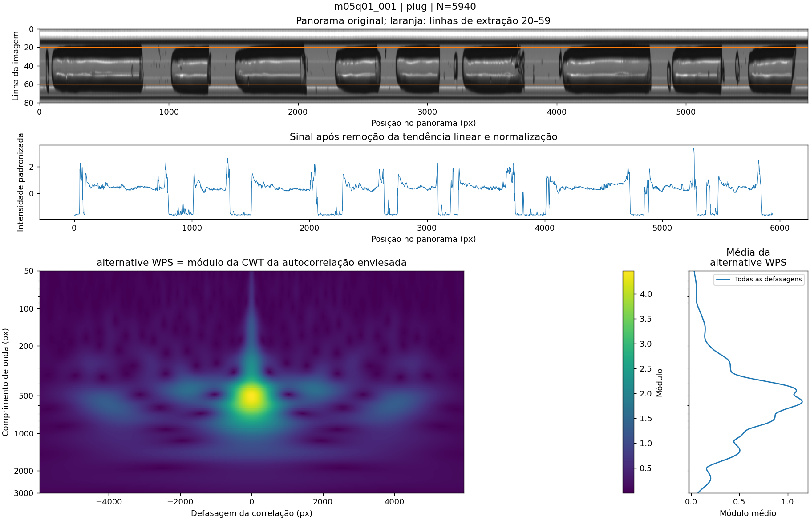

*Figura 1 — Panorama original, sinal analisado, alternative WPS e sua média em lag. O eixo do sinal é posição no panorama; o eixo do mapa wavelet é lag da autocorrelação. Eles não representam a mesma coordenada.*

### slug — m04q01_001

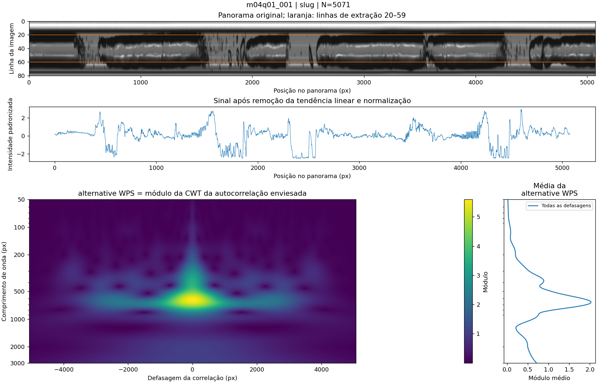

*Figura 2 — Exemplo slug com as mesmas definições e processamento. Um pico de alternative WPS descreve uma escala do sinal; não identifica automaticamente o comprimento de uma bolha.*

### wavy annular — m03q10_001

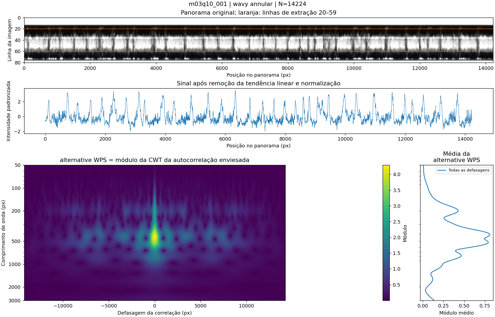

*Figura 3 — Exemplo de wavy annular. As escalas observadas e a aparência do panorama não demonstram, por si, alta alternative WCO entre aquisições independentes.*

### dispersed bubble — m07q01_001

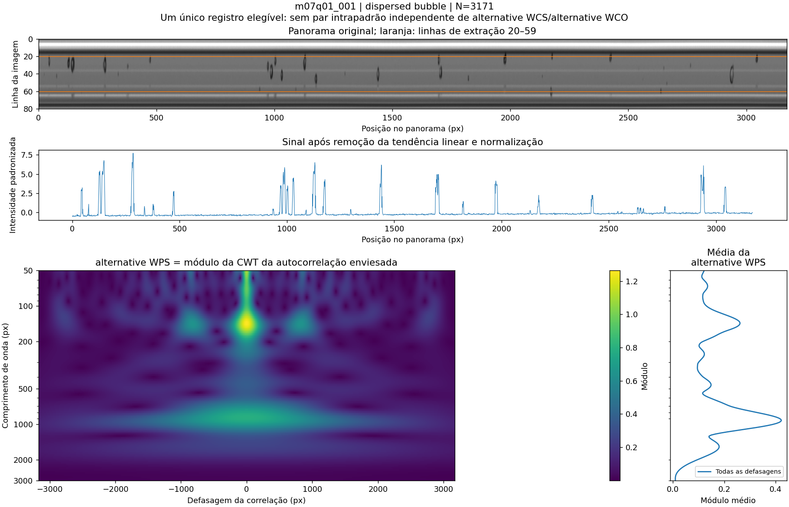

*Figura 4 — Exemplo de dispersed bubble, com o panorama, o sinal extraído e a alternative WPS. Há somente um registro elegível desse padrão no escopo confirmado; portanto, não existe um segundo registro independente para apresentar uma comparação intrapadrão de alternative WCS e alternative WCO.*

### churn — m03q05_001

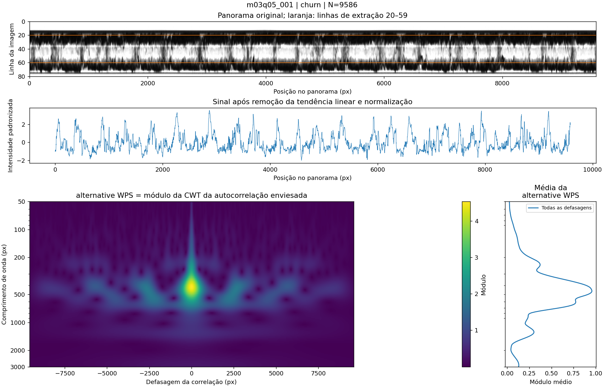

*Figura 5 — Exemplo churn com a mesma entrada e as mesmas equações alternativas. A média em lag e o valor no lag zero resumem aspectos diferentes da alternative WPS.*

### Comparação dos cinco padrões

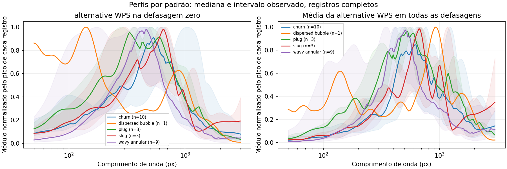

*Figura 6 — Mediana dos perfis normalizados por registro; as faixas mostram o mínimo e o máximo observados, não intervalos de confiança. A sobreposição entre padrões é visível. O padrão dispersed bubble tem somente um registro elegível. O perfil médio em lag inclui todos os lags.*

### Exemplos de alternative WCS e alternative WCO entre registros

As figuras 7–10 mostram o primeiro par em ordem alfabética de cada padrão com pelo menos duas aquisições elegíveis. Usam a implementação corrigida do v16, a correlação enviesada e a média original das linhas 20–59. No topo estão as alternative WPS individuais e suas médias sobre todos os lags; no centro, o módulo da alternative WCS; abaixo, a alternative WCO da Eq. 32.17, com denominador no lag zero. Os mapas exibem o plano completo, sem COI nem máscara conservadora.

#### plug — m05q01_001 × m06q01_001

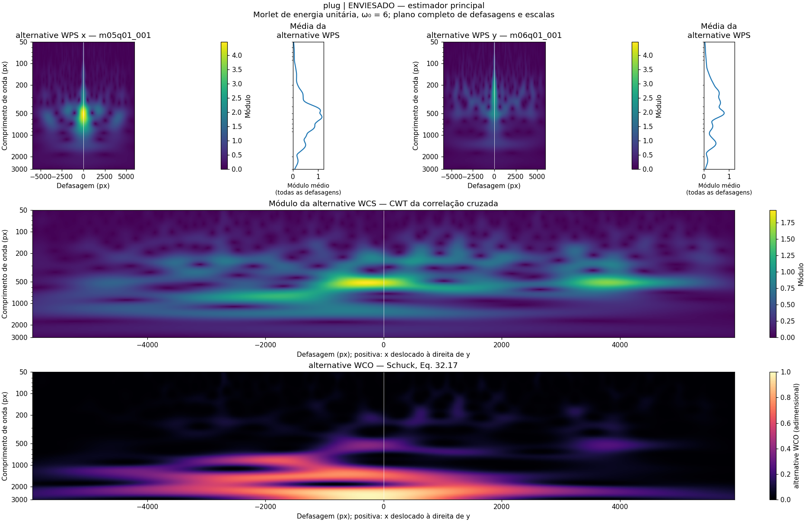

*Figura 7 — Comparação de duas aquisições plug. O mapa de alternative WCS mostra magnitude de correlação filtrada por escala; a alternative WCO normaliza essa magnitude pelas alternative WPS no lag zero.*

#### slug — m04q01_001 × m05q05_001

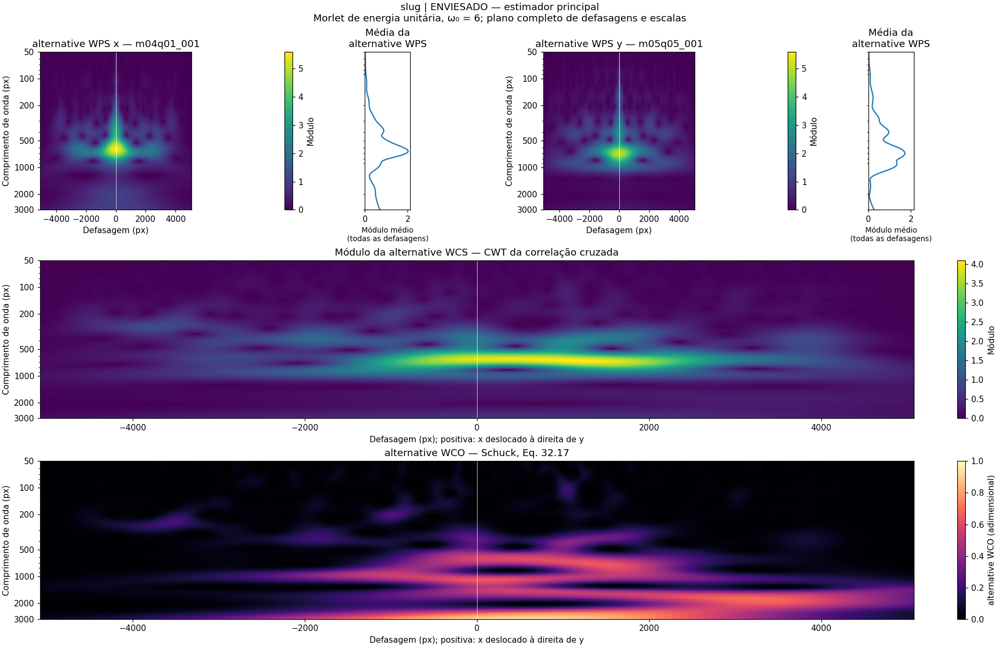

*Figura 8 — Comparação de duas aquisições slug. As regiões de maior alternative WCO indicam associação em lag e escala; não localizam uma mesma bolha nas duas aquisições independentes.*

#### churn — m03q05_001 × m04q10_001

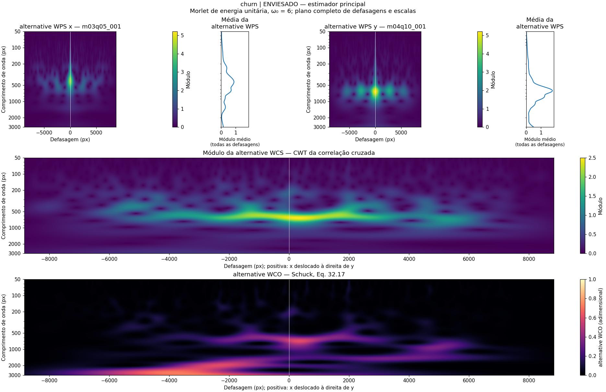

*Figura 9 — Comparação de duas aquisições churn. O exemplo apresenta os mapas calculados; a conclusão sobre ganhos e perdas frente ao v5 depende do conjunto de pares, não de um mapa isolado.*

#### wavy annular — m03q10_001 × m03q20_001

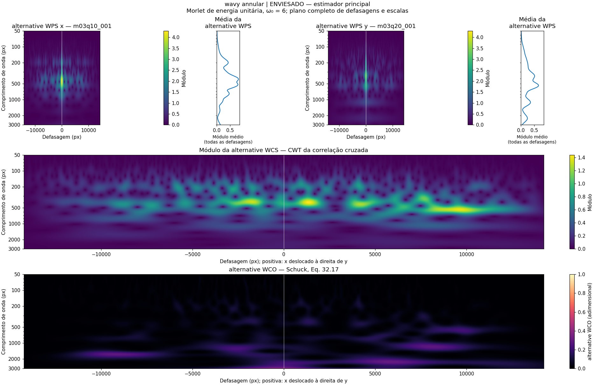

*Figura 10 — Comparação de duas aquisições de wavy annular. Compartilhar o rótulo do padrão não exige que a alternative WCO seja alta em todas as escalas ou defasagens.*

### Ganhos e perdas frente ao v5

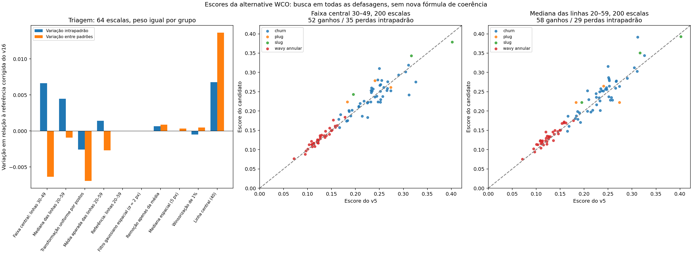

*Figura 11 — À esquerda, a triagem com 64 escalas compara as opções com a referência corrigida do v16. Ao centro, a faixa 30–49 é comparada ao v5 em 200 escalas: 52 pares acima da diagonal e 35 abaixo. À direita, a mediana entre linhas apresenta 58 aumentos e 29 reduções. Os eixos dos dois diagramas de dispersão têm os mesmos limites. Os escores usam todos os lags, sem COI nem máscara conservadora; não são novas fórmulas de coerência.*

## Decisão honesta

Recomenda-se a implementação corrigida como base matemática, reconhecendo o pequeno ganho sistemático no escore principal da entrada original. A mediana entre linhas e a faixa 30–49 permaneceram alternativas exploratórias: a primeira foi melhor na média por par; a segunda, na média com peso igual por padrão. **Os ganhos foram marginais e não sustentam a alegação de similaridade experimental robustamente maior ou de classificação melhor.**

O principal limite permanece: pertencer ao mesmo padrão não significa que duas aquisições independentes contenham os mesmos eventos ou a mesma organização espacial. Não seria correto forçar a coerência a subir por seleção de segmentos orientada pela própria coerência, deformação do eixo, redução artificial da banda ou mudança do denominador.

Os próximos caminhos continuam documentados apenas como planos: [v16.1](../v16.1/PLAN.md), comparação de perfis da alternative WPS, especialmente no lag zero; e [v16.2](../v16.2/PLAN.md), comparação de eventos equivalentes definidos por critérios de imagem antes de observar a coerência. Nenhuma dessas novas análises foi executada nesta atualização. A segunda responderia sobre eventos selecionados, não sobre a similaridade dos panoramas completos.

Detalhes: [equações conferidas](EQUATION_AUDIT.md), [experimento e comparação direta com v5](PREPROCESSING.md), [relatório metodológico](REPORT.md), [resultados gerais](RESULTS.md) e [galeria](figures/index.html).
