# Conclusão executiva — v16_spatial2_18_71

A ampliação da média de 20–59 para 18–71 diminuiu o escore médio de alternative WCO dos 87 pares intrapadrão de 0.196662 para 0.195636, diferença de -0.001026 (-0.52%), usando os mesmos pesos brutos da referência 20–59. Houve 41 aumentos, 46 reduções e 0 empates. Frente ao v5 original com entrada 20–59 (0.192835), a diferença da média 18–71 corrigida foi +0.002801 (+1.45%). 

O contraste balanceado intrapadrão menos entre padrões passou de -0.063051 para -0.059861. Não foi obtida uma melhora da média dos 87 pares ao ampliar a faixa principal. Os padrões com aumento da média foram plug, slug; com redução, churn, wavy annular. Com peso igual por padrão, a média intrapadrão passou de 0.228604 para 0.234430, variação de +0.005826.

Nesta execução, a piora na média dos 87 pares foi pequena. A vantagem numérica remanescente sobre o v5 original foi marginal em magnitude e não foi criada pela ampliação da faixa. O resultado é misto entre padrões; não sustenta uma melhora global da alternative WCO. Isso não implica mudanças pequenas em cada par: o exemplo plug predeterminado apresentou uma redução substancial do máximo integral, detalhada no diagnóstico do resumo executivo.

Na comparação entre implementações, usando os pesos nativos da referência 18–71, o escore médio dos 87 pares foi 0.184176 para a implementação v5 aplicada à nova entrada e 0.187651 para a referência corrigida de Schuck, diferença de +0.003474. O controle fixo 30–49 teve média 0.185980, com 49 aumentos e 38 reduções frente ao v5 aplicado a 18–71. A mediana da faixa 18–71 teve média 0.192501, com 47 aumentos e 40 reduções. A maior média por par entre as três opções confirmadas foi de Mediana das linhas 18–71. Esta comparação entre implementações e controles não mede, sozinha, a vantagem da nova faixa sobre a antiga 20–59.

## Efeito da extração 18–71 frente à análise anterior 20–59

Esta comparação preserva, em cada par, os pesos brutos e os pisos de alternative WPS da referência corrigida **20–59**. A análise anterior e a nova usam todos os lags, sem COI nem máscara conservadora. Assim, a troca da referência de potência causada pela nova extração não é contabilizada como ganho da faixa. Os mapas e as equações alternativas continuam sendo os de cada entrada; somente seu resumo é calculado com a mesma referência. Pesos brutos fixos só garantem pesos normalizados idênticos quando as escalas elegíveis também têm denominadores numericamente válidos em todas as opções comparadas; as contagens da proteção numérica desta execução estão em [PREPROCESSING.md](PREPROCESSING.md).

Na tabela, a faixa principal é 20–59 na coluna anterior e 18–71 na coluna nova. O controle 30–49 permanece exatamente na mesma posição nas duas análises. Ganhos/perdas são diferenças superiores a 1e−12 em módulo; diferenças menores são empates numéricos.

| Operação | Média dos 87 pares, 20–59 | Média dos 87 pares, 18–71 | Variação | Aumentos | Reduções | Empates |
| --- | --- | --- | --- | --- | --- | --- |
| Implementação v5 sobre a faixa principal | 0.192835 | 0.192020 | -0.000815 | 41 | 46 | 0 |
| Média da faixa principal; Schuck corrigido | 0.196662 | 0.195636 | -0.001026 | 41 | 46 | 0 |
| Controle fixo: média 30–49 | 0.195411 | 0.195411 | +0.000000 | 0 | 0 | 87 |
| Mediana entre as linhas da faixa principal | 0.199091 | 0.200907 | +0.001816 | 45 | 42 | 0 |

O escore do controle fixo 30–49 reproduziu a análise anterior, com diferença absoluta máxima de 0. Isso verifica a continuidade desse controle sob os mesmos pesos. A comparação da média corrigida de 18–71 com o v5 original inclui tanto a ampliação da faixa quanto as correções da implementação; a comparação entre as duas médias corrigidas isola a mudança de entrada.

### Efeito por padrão — média corrigida, pesos fixos de 20–59

| Padrão | Pares | Média 20–59 | Média 18–71 | Variação |
| --- | --- | --- | --- | --- |
| churn | 45 | 0.240848 | 0.237582 | -0.003266 |
| plug | 3 | 0.236329 | 0.245193 | +0.008863 |
| slug | 3 | 0.308429 | 0.326802 | +0.018373 |
| wavy annular | 36 | 0.128809 | 0.128142 | -0.000667 |

Padrões com aumento da média: **plug, slug**. Padrões com redução: **churn, wavy annular**. A média conjunta dos 87 pares atribui a cada padrão peso proporcional à sua quantidade de pares. A média balanceada atribui peso igual a cada um dos quatro padrões com pares e passou de **0.228604** para **0.234430**. Por isso as duas agregações podem variar em sentidos opostos. O padrão dispersed bubble possui uma única aquisição elegível e não entra nessas médias intrapadrão. As duas agregações foram mantidas; os pares continuam compartilhando aquisições.

### Sensibilidade ao resumo do mapa — média corrigida

| Resumo | Média dos 87 pares, 20–59 | Média dos 87 pares, 18–71 | Variação intra | Variação do contraste balanceado |
| --- | --- | --- | --- | --- |
| Máximos por escala, piso de 1% | 0.199966 | 0.199223 | -0.000744 | +0.003592 |
| Máximos por escala, piso de 5% | 0.196662 | 0.195636 | -0.001026 | +0.003190 |
| Máximos por escala, piso de 10% | 0.194852 | 0.194019 | -0.000833 | +0.003446 |
| alternative WCO no lag zero | 0.089638 | 0.089826 | +0.000188 | -0.000973 |
| Máximo no plano completo, sem pesos | 0.654949 | 0.658998 | +0.004049 | -0.018473 |

Os escores nas seções de pré-processamento abaixo usam os pesos nativos da referência **18–71**, fixos entre candidatos. Não devem ser subtraídos diretamente dos antigos escores 20–59 para atribuir um efeito à extração. As duas tabelas respondem a comparações distintas e mantêm as mesmas alternative WPS, alternative WCS e alternative WCO.

Dados da comparação: [pares com pesos fixos](results/band_comparison_pairs.csv), [resumos](results/band_comparison_summary.csv), [mudanças por resumo](results/band_change_summary.csv), [mudanças individuais](results/band_change_pairs.csv) e [verificação estruturada](results/band_comparison.json). Os pares compartilham aquisições; estas diferenças não constituem um teste independente de superioridade.

## Entrada e domínio recalculados

Todos os gráficos foram refeitos com os nomes dos padrões em inglês e os demais textos em PT-BR, sem COI nem máscara conservadora. A média apresentada da alternative WPS foi calculada sobre todos os lags. Os escores de pré-processamento e o diagnóstico com fases aleatórias foram recalculados no plano completo; não houve alteração das equações de alternative WPS, alternative WCS e alternative WCO.

A análise anterior com entrada 20–59 está preservada em [v16_spatial2](../v16_spatial2/EXECUTIVE_SUMMARY.md), também sem máscaras. Portanto, a comparação entre faixas não envolve uma retirada adicional de restrições. Nesta pasta, a implementação v5 e os candidatos foram comparados nos mesmos lags e comprimentos de onda nominais, usando a nova entrada; o v5 manteve sua conversão antiga de escalas e seu preparo antes do corte, diferenças já auditadas.

## O que foi efetivamente verificado

Foram mantidas as equações de Schuck conferidas visualmente na análise de origem. A auditoria desta pasta validou os hashes dos 31 panoramas existentes e das planilhas originais de 20–59; herdou a verificação anterior de reconstrução pixel a pixel, sem refazê-la. O novo sinal foi extraído diretamente das 54 linhas 18–71 dos PNGs. As planilhas originais não foram tratadas como dados da nova faixa. A análise experimental usa os 26 registros confirmados, com 87 pares intrapadrão e 238 controles entre padrões. As equações alternativas permaneceram em uso durante todos os experimentos.

A faixa 18–71 amplia a cobertura vertical pretendida do tubo. Seus limites estão ilustrados na [auditoria visual da extração](results/row_band_visual_audit.png), mas não representam uma segmentação fisicamente validada de todo o interior do tubo. Os panoramas continuam usando os deslocamentos estimados originalmente com as linhas 20–59; a nova faixa altera a extração do sinal, sem reconstruir as imagens. O experimento verifica o efeito dessa faixa declarada sobre as análises wavelet.

A ampliação acrescentou **2 linhas acima** (18–19) e **12 abaixo** (60–71). Antes de remover a tendência e normalizar, a média das 54 linhas é exatamente **(40/54) × média de 20–59 + (14/54) × média das linhas acrescentadas**. Portanto, a região anterior contribui com aproximadamente 74,1% e a região adicionada com 25,9% da intensidade bruta. A motivação é incluir mais da região interna visível, especialmente as partes inferiores das estruturas nos exemplos plug e slug; essa escolha não valida a posição exata das paredes nem garante uma melhora da alternative WCO.

Com a remoção da tendência linear e a padronização utilizadas, uma contribuição média das linhas acrescentadas que fosse constante ou afim na posição produziria o mesmo sinal preparado, salvo arredondamento numérico. Portanto, eventuais perdas não podem ser atribuídas simplesmente à diluição por uma intensidade estática de parede. As diferenças decorrem de variação espacial acrescentada, que pode envolver estruturas e efeitos ópticos; sua origem física não foi identificada nesta análise.

As definições de **alternative WPS (32.14–32.15), alternative WCS (32.16) e alternative WCO (32.17)** foram preservadas. O estimador enviesado com 1/N continua sendo uma adaptação explícita: o artigo usa 1/(N−|m|) em 32.21–32.23. A versão literal não enviesada também foi calculada e apresentou instabilidade em grandes lags. O denominador da alternative WCO permanece no lag zero.

O v16 corrigiu a discretização da Morlet, a conversão de escala, a orientação do lag e o preparo após o corte comum. A versão corrigida respeitou os limites da alternative WCO nos testes e nos pares avaliados em todo o plano, sem limitar artificialmente os resultados a 1. **Essa correção matemática e numérica não comprova maior similaridade física entre registros.**

## Comparação entre implementações na entrada 18–71

Dez opções de pré-processamento foram recalculadas em 64 escalas para a entrada 18–71, conservando as fórmulas. A referência 18–71, a faixa fixa 30–49 e a mediana entre as linhas 18–71 foram conferidas em 200 escalas. A linha 40 e a faixa 30–49 foram mantidas em suas posições anteriores para isolar o efeito da ampliação da entrada principal. A faixa 30–49 permaneceu como comparação definida no estudo anterior; não foi escolhida novamente a partir dos resultados sem máscaras.

| Opção | Média dos 87 pares | Diferença vs v5 | Pares com aumento | Pares com redução | Média balanceada por padrão |
| --- | --- | --- | --- | --- | --- |
| v5 aplicado a 18–71 | 0.184176 | +0.000000 | 0 | 0 | 0.244365 |
| Referência: linhas 18–71 | 0.187651 | +0.003474 | 87 | 0 | 0.249002 |
| Faixa 30–49 (controle fixo) | 0.185980 | +0.001804 | 49 | 38 | 0.246895 |
| Mediana das linhas 18–71 | 0.192501 | +0.008325 | 47 | 40 | 0.258232 |

O contraste intrapadrão menos entre padrões foi **-0.051861** para a faixa fixa e **-0.057757** para a mediana entre linhas. Todas as opções confirmadas apresentaram média entre padrões maior ou igual à intrapadrão neste escore.

Os resultados também dependeram do resumo do mapa: por exemplo, a média balanceada dos máximos integrais passou de **0.767** no v5 para **0.714** na faixa fixa, diferença de **-0.053584**. Esse máximo é sensível a pontos extremos, inclusive às violações numéricas do v5. Não deve ser confundido com o escore ponderado da tabela nem interpretado isoladamente como medida da qualidade do método.

A mediana entre linhas apresentou diferença de **+0.004850** frente à referência corrigida na média por par. A média balanceada por padrão está apresentada separadamente. Ponderações diferentes podem mudar a ordenação das opções e não comprovam superioridade universal.

O escore é um resumo dos mapas, **não uma nova fórmula de WCO**: máximos por escala em todos os lags, ponderados pelas alternative WPS da referência no lag zero. O piso principal de 5% do pico dessas alternative WPS foi mantido, com verificações a 1% e 10%; não é um COI nem uma máscara geométrica. Os pesos brutos são fixos por par; a proteção de denominadores pode alterar sua normalização efetiva se uma variante tiver escalas numericamente inválidas. Nenhuma combinação de par/opção teve escalas descartadas pelo denominador numérico nestes três lotes. As contagens estão em [PREPROCESSING.md](PREPROCESSING.md). A triagem selecionou **Transformação uniforme por postos** pela regra declarada. A avaliação retirando uma aquisição usou exclusivamente as três opções fixadas e 200 escalas. As classes possuem poucas aquisições e os pares não são réplicas independentes.

## Diagnóstico condicional nas duas faixas de extração

Foram recalculados 199 pares de fases aleatórias para cada um dos cinco exemplos. A estatística foi o máximo da alternative WCO em todos os lags e nas 200 escalas. Tanto a referência 20–59 quanto a nova extração 18–71 usaram esse domínio completo, sem COI nem máscara conservadora. Os sinais observados e simulados da nova faixa foram recalculados; os resultados antigos permaneceram na pasta de origem.

| Exemplo | Valor-p, entrada 20–59 | Valor-p, entrada 18–71 | Máximo observado, 20–59 | Máximo observado, 18–71 |
| --- | --- | --- | --- | --- |
| churn | 0,515 | 0,675 | 0.737048 | 0.698988 |
| plug | 0,005 | 0,625 | 0.983189 | 0.728363 |
| slug | 0,275 | 0,440 | 0.936308 | 0.909302 |
| wavy annular | 0,855 | 0,915 | 0.379333 | 0.370130 |
| Controle entre padrões | 0,440 | 0,820 | 0.923848 | 0.806814 |

**Uma mudança pequena na média dos 87 pares não significa que cada par mudou pouco.** No exemplo plug predeterminado, m05q01_001 × m06q01_001, o máximo no plano completo caiu de **0.983189** para **0.728363**, uma redução substancial de **0.254827**. Seu valor-p condicional passou de **0.005** para **0.625**. O par foi escolhido pela ordem dos registros, antes de observar esses resultados.

O escore ponderado desse mesmo par, usando os pesos fixos 20–59, passou de **0.275878** para **0.240592**. Já a média dos escores ponderados dos **3 pares de plug** aumentou de **0.236329** para **0.245193**, porque os outros pares compensaram a perda. O escore ponderado por escala, o máximo simples no plano e o valor-p condicional são resumos diferentes; a melhora da média de um padrão não exige melhora em todos os pares nem em todos esses resumos.

Os valores-p são condicionais ao modelo estacionário de fases aleatórias. A diferença entre dois valores-p não é um teste de superioridade de uma faixa de extração. Um máximo incomum nesse modelo não comprova identidade de eventos, ligação física entre aquisições ou separação dos padrões. A resolução de Monte Carlo é 0,005; não foi tomada uma decisão de rejeição corrigida entre os cinco exemplos e não foram adicionados contornos de significância aos mapas.

Os quantis simulados e as limitações estão em [RESULTS.md](RESULTS.md) e [null_diagnostic.csv](results/null_diagnostic.csv).

## Comprimento dos registros e janelas

**As janelas adicionais não são exigidas pelas equações de Schuck.** A análise principal usou o registro completo disponível, ou o prefixo comum de um par. O controle de segmentos de início, centro e fim permaneceu como diagnóstico separado de sensibilidade ao comprimento e à posição. A retirada do COI e da máscara conservadora não elimina possíveis efeitos de borda nem a menor quantidade de produtos que compõem a correlação em lags extremos.

## Figuras dos padrões e dos resultados

Os exemplos abaixo usam a entrada principal, média das linhas 18–71, e foram escolhidos pela ordem alfabética dos registros de cada padrão. São exemplos do conjunto, não os casos com maior coerência.

### plug — m05q01_001

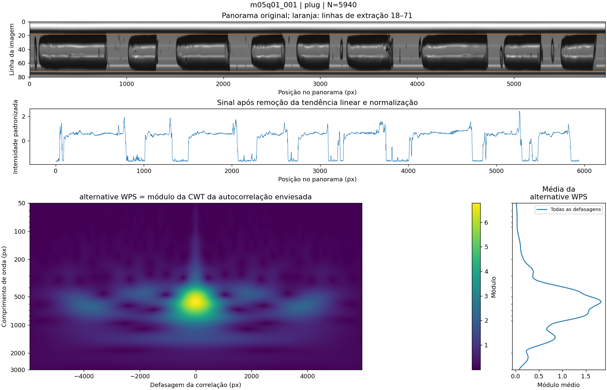

*Figura 1 — Panorama original, sinal analisado, alternative WPS e sua média em lag. O eixo do sinal é posição no panorama; o eixo do mapa wavelet é lag da autocorrelação. Eles não representam a mesma coordenada.*

### slug — m04q01_001

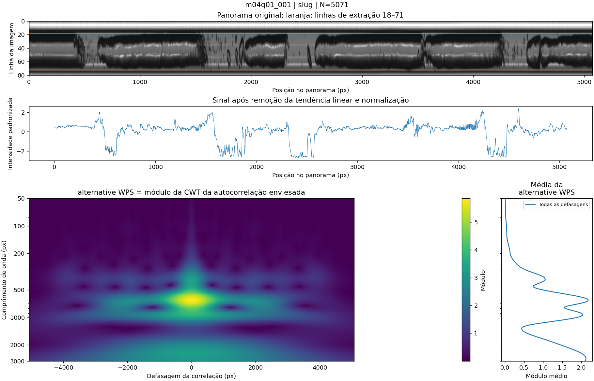

*Figura 2 — Exemplo slug com as mesmas definições e processamento. Um pico de alternative WPS descreve uma escala do sinal; não identifica automaticamente o comprimento de uma bolha.*

### wavy annular — m03q10_001

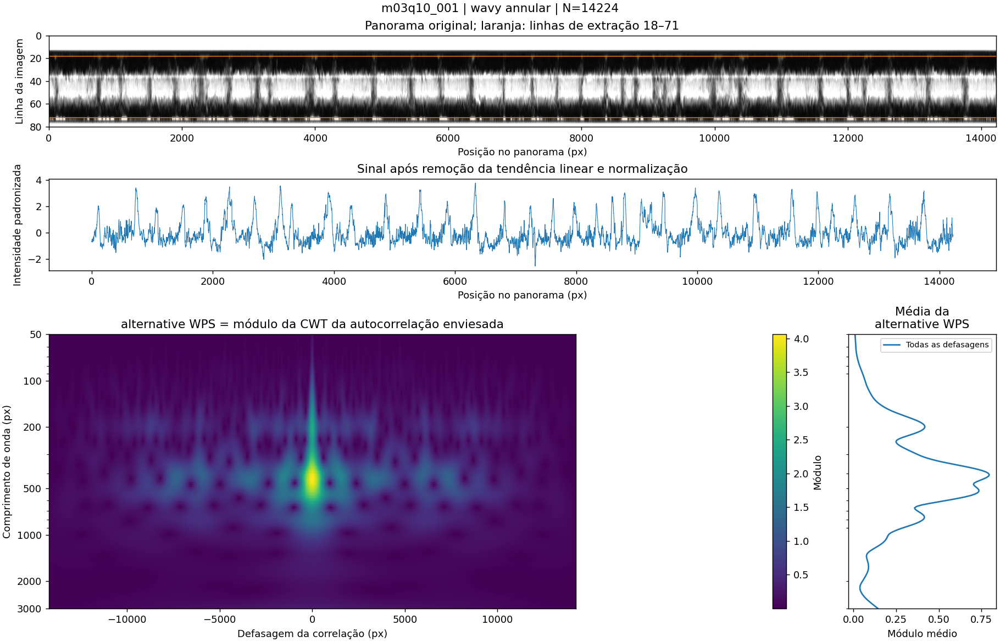

*Figura 3 — Exemplo de wavy annular. As escalas observadas e a aparência do panorama não demonstram, por si, alta alternative WCO entre aquisições independentes.*

### dispersed bubble — m07q01_001

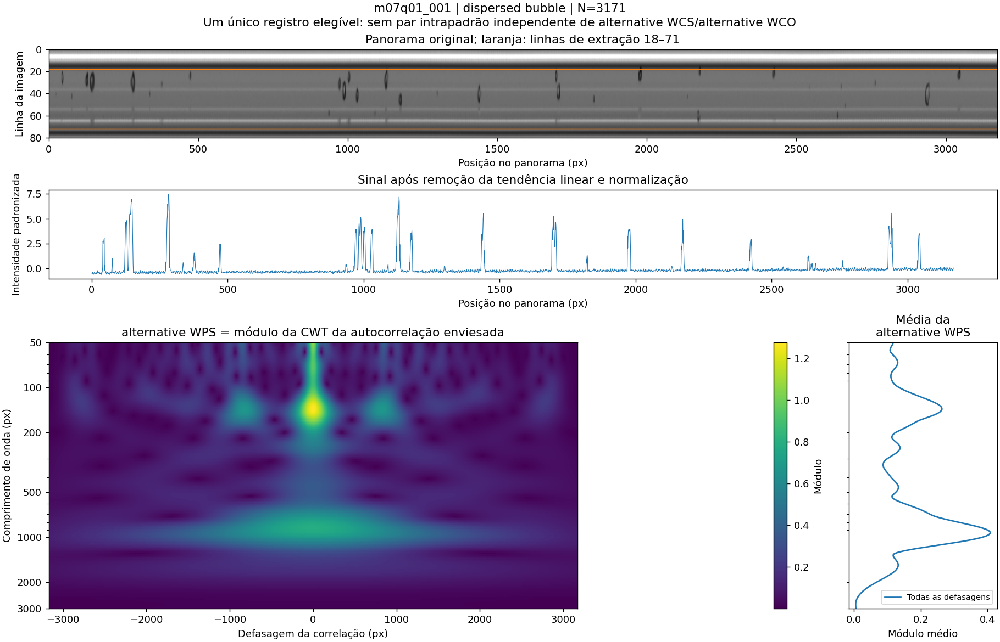

*Figura 4 — Exemplo de dispersed bubble, com o panorama, o sinal extraído e a alternative WPS. Há somente um registro elegível desse padrão no escopo confirmado; portanto, não existe um segundo registro independente para apresentar uma comparação intrapadrão de alternative WCS e alternative WCO.*

### churn — m03q05_001

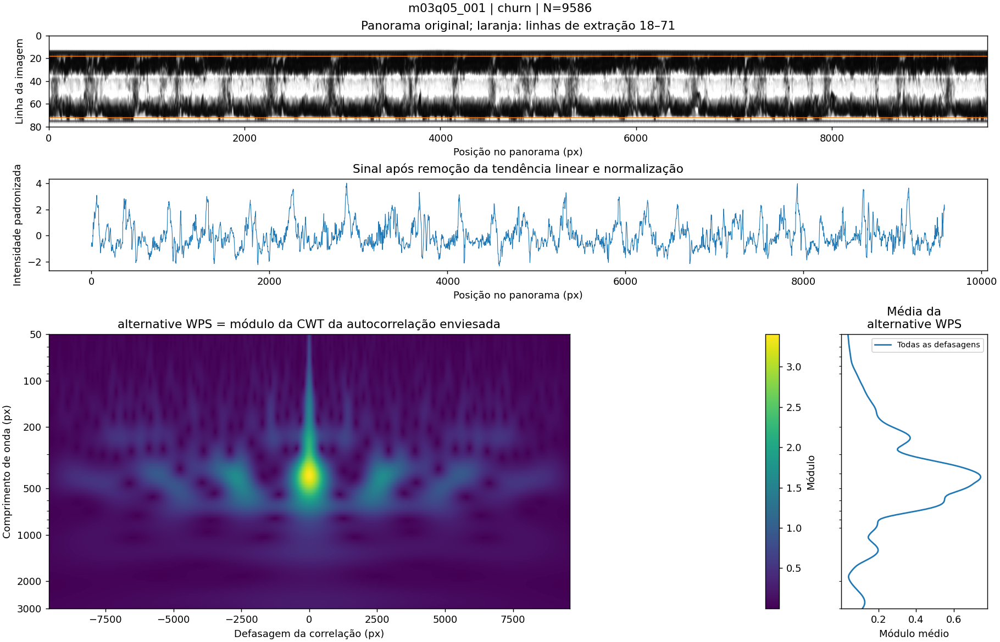

*Figura 5 — Exemplo churn com a mesma entrada e as mesmas equações alternativas. A média em lag e o valor no lag zero resumem aspectos diferentes da alternative WPS.*

### Comparação dos cinco padrões

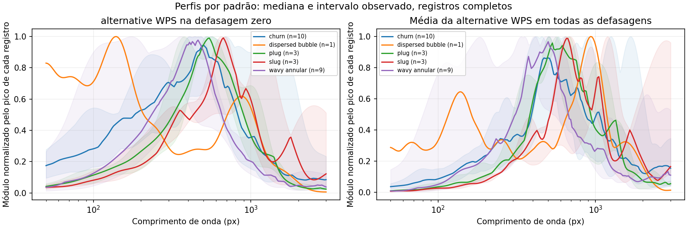

*Figura 6 — Mediana dos perfis normalizados por registro; as faixas mostram o mínimo e o máximo observados, não intervalos de confiança. A sobreposição entre padrões é visível. O padrão dispersed bubble tem somente um registro elegível. O perfil médio em lag inclui todos os lags.*

### Exemplos de alternative WCS e alternative WCO entre registros

As figuras 7–10 mostram o primeiro par em ordem alfabética de cada padrão com pelo menos duas aquisições elegíveis. Usam a implementação corrigida do v16, a correlação enviesada e a média das linhas 18–71. No topo estão as alternative WPS individuais e suas médias sobre todos os lags; no centro, o módulo da alternative WCS; abaixo, a alternative WCO da Eq. 32.17, com denominador no lag zero. Os mapas exibem o plano completo, sem COI nem máscara conservadora.

#### plug — m05q01_001 × m06q01_001

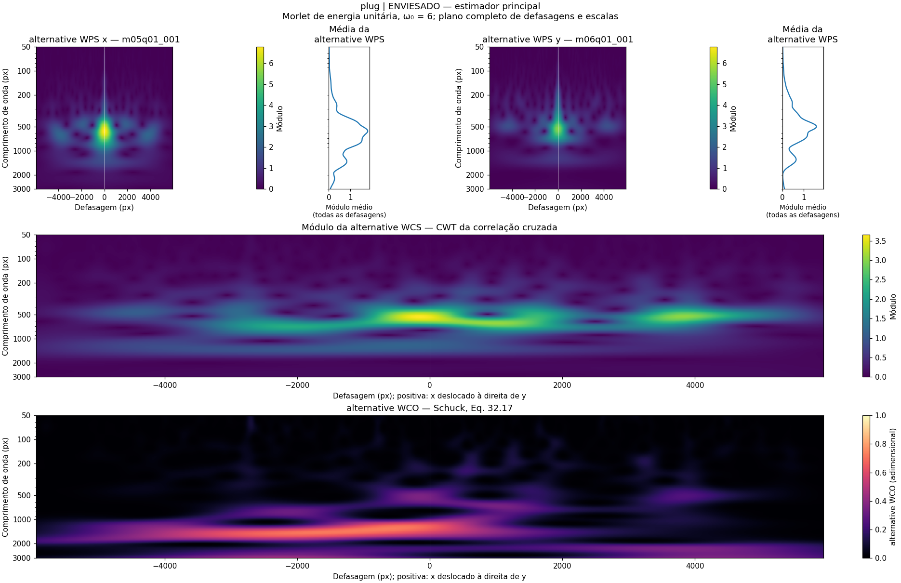

*Figura 7 — Comparação de duas aquisições plug. O mapa de alternative WCS mostra magnitude de correlação filtrada por escala; a alternative WCO normaliza essa magnitude pelas alternative WPS no lag zero.*

#### slug — m04q01_001 × m05q05_001

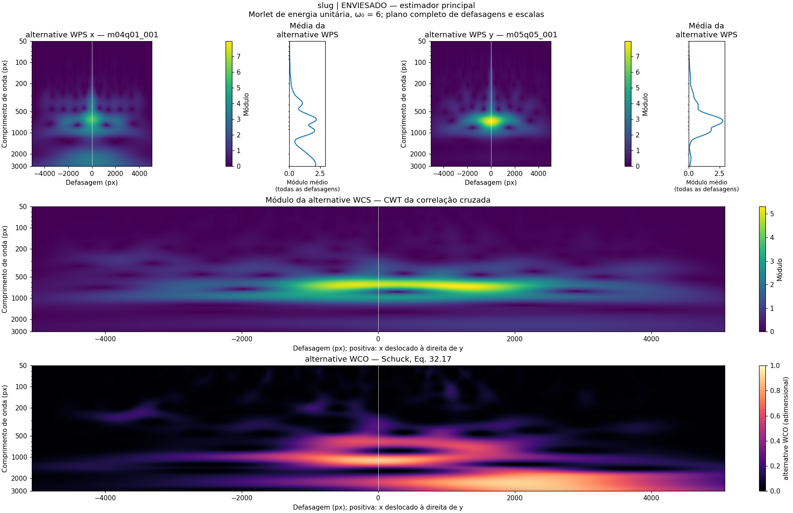

*Figura 8 — Comparação de duas aquisições slug. As regiões de maior alternative WCO indicam associação em lag e escala; não localizam uma mesma bolha nas duas aquisições independentes.*

#### churn — m03q05_001 × m04q10_001

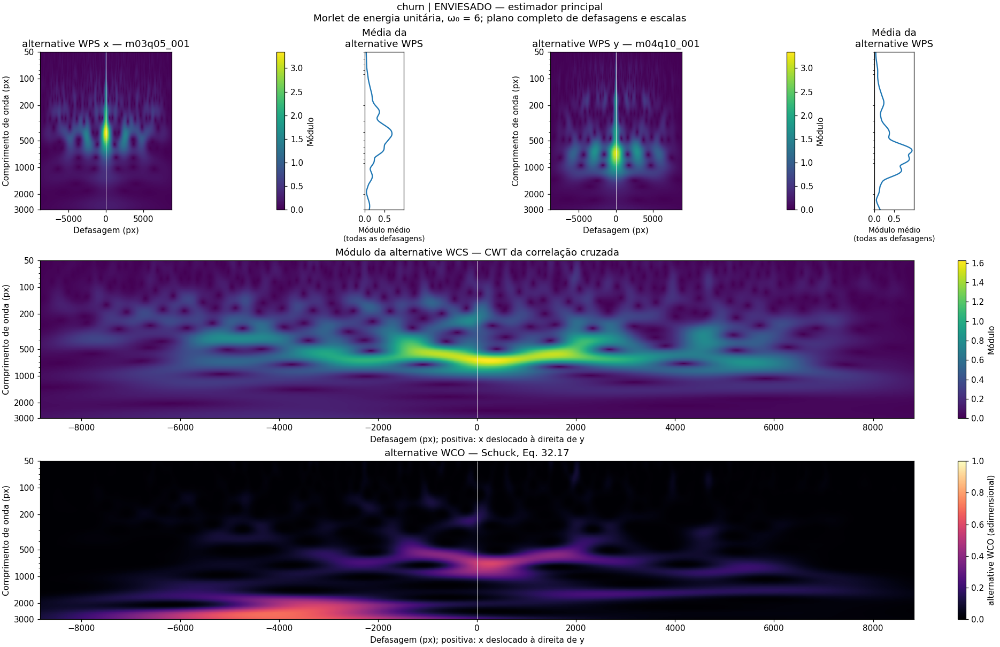

*Figura 9 — Comparação de duas aquisições churn. O exemplo apresenta os mapas calculados; a conclusão sobre ganhos e perdas frente ao v5 depende do conjunto de pares, não de um mapa isolado.*

#### wavy annular — m03q10_001 × m03q20_001

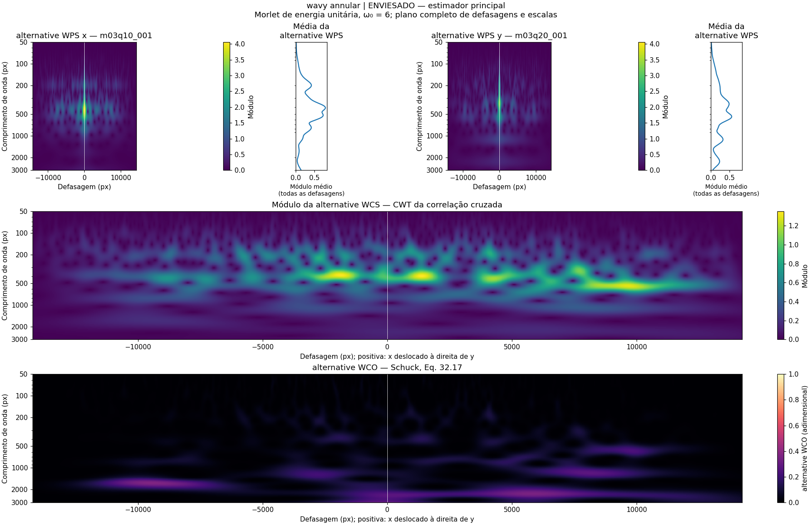

*Figura 10 — Comparação de duas aquisições de wavy annular. Compartilhar o rótulo do padrão não exige que a alternative WCO seja alta em todas as escalas ou defasagens.*

### Ganhos e perdas frente ao v5

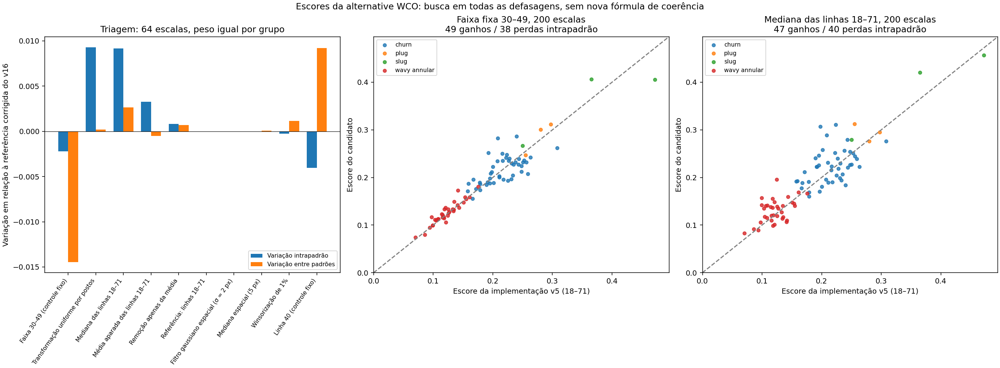

*Figura 11 — À esquerda, a triagem com 64 escalas compara as opções com a referência corrigida do v16. Ao centro, a faixa 30–49 é comparada ao v5 em 200 escalas: 49 pares acima da diagonal e 38 abaixo. À direita, a mediana entre linhas apresenta 47 aumentos e 40 reduções. Os eixos dos dois diagramas de dispersão têm os mesmos limites. Os escores usam todos os lags, sem COI nem máscara conservadora; não são novas fórmulas de coerência.*

## Decisão honesta

A ampliação da média de 20–59 para 18–71 diminuiu o escore médio de alternative WCO dos 87 pares intrapadrão de 0.196662 para 0.195636, diferença de -0.001026 (-0.52%), usando os mesmos pesos brutos da referência 20–59. Houve 41 aumentos, 46 reduções e 0 empates. Frente ao v5 original com entrada 20–59 (0.192835), a diferença da média 18–71 corrigida foi +0.002801 (+1.45%). 

O contraste balanceado intrapadrão menos entre padrões passou de -0.063051 para -0.059861. Não foi obtida uma melhora da média dos 87 pares ao ampliar a faixa principal. Os padrões com aumento da média foram plug, slug; com redução, churn, wavy annular. Com peso igual por padrão, a média intrapadrão passou de 0.228604 para 0.234430, variação de +0.005826.

Nesta execução, a piora na média dos 87 pares foi pequena. A vantagem numérica remanescente sobre o v5 original foi marginal em magnitude e não foi criada pela ampliação da faixa. O resultado é misto entre padrões; não sustenta uma melhora global da alternative WCO. Isso não implica mudanças pequenas em cada par: o exemplo plug predeterminado apresentou uma redução substancial do máximo integral, detalhada no diagnóstico do resumo executivo.

Todas as opções confirmadas apresentaram média entre padrões maior ou igual à intrapadrão neste escore. A escolha da faixa deve considerar simultaneamente a comparação com a extração anterior, as perdas individuais, os controles entre padrões e a integridade do observável. O resultado de uma única ponderação não estabelece uma opção universalmente superior.

O principal limite permanece: pertencer ao mesmo padrão não significa que duas aquisições independentes contenham os mesmos eventos ou a mesma organização espacial. Não seria correto forçar a coerência a subir por seleção de segmentos orientada pela própria coerência, deformação do eixo, redução artificial da banda ou mudança do denominador.

Os próximos caminhos continuam documentados apenas como planos: [v16.1](../v16.1/PLAN.md), comparação de perfis da alternative WPS, especialmente no lag zero; e [v16.2](../v16.2/PLAN.md), comparação de eventos equivalentes definidos por critérios de imagem antes de observar a coerência. Nenhuma dessas novas análises foi executada nesta atualização. A segunda responderia sobre eventos selecionados, não sobre a similaridade dos panoramas completos.

Detalhes: [equações conferidas](EQUATION_AUDIT.md), [experimento e comparação direta com v5](PREPROCESSING.md), [relatório metodológico](REPORT.md), [resultados gerais](RESULTS.md) e [galeria](figures/index.html).
