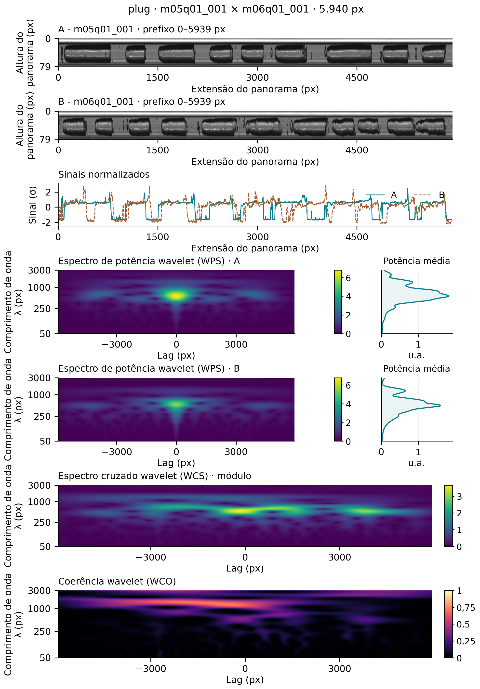

# Piloto da análise v16

Foi refeito somente o par **m05q01_001 × m06q01_001**, do padrão *plug*, para revisão do formato antes do processamento dos demais ensaios. A apresentação seguiu a organização da v16.3, com os parâmetros e procedimentos da v16 original. Os 583 arquivos anteriores permaneceram em `_OLD`; sua integridade foi conferida por SHA-256.

## Figuras

- [Panorama e sinal de m05q01_001](../01_panoramas/plug_m05q01_001.png).
- [Panorama e sinal de m06q01_001](../01_panoramas/plug_m06q01_001.png).
- [Par piloto: panoramas, sinais, WPS, WCS e WCO](../02_wavelets/plug_m05q01_001_m06q01_001.png).

*Os dois primeiros painéis mostraram os prefixos empregados no par; o terceiro apresentou os sinais normalizados no segmento comum. Os painéis seguintes mostraram os espectros de potência wavelet individuais e suas médias em todos os lags, o módulo do espectro cruzado wavelet e a coerência wavelet. O eixo dos sinais representou a extensão do panorama; o eixo dos mapas representou o lag da correlação.*

## Metodologia executada

Os sinais foram novamente extraídos dos panoramas originais pela média das linhas 18–71, inclusive, com indexação iniciada em zero. O primeiro panorama continha 5.940 colunas; o segundo, 7.798. A comparação empregou as primeiras 5.940 colunas de ambos, seguindo o prefixo comum da v16. O trecho final de 1.858 colunas do segundo panorama ficou fora desta comparação e foi assinalado em cinza na apresentação individual.

Após o corte comum, aplicaram-se a inversão `255 − intensidade`, a remoção da tendência linear, a centralização e a divisão pelo desvio padrão populacional. Não houve deslocamento de eventos entre os sinais. Os sinais individuais de `01_panoramas` foram preparados em seus comprimentos completos; os sinais do par foram preparados novamente após o corte.

Utilizou-se a correlação bilateral com divisor N e a CWT Morlet de energia unitária, com ω₀ = 6, amostragem de 1 px e 200 comprimentos de onda espaçados em escala logarítmica entre 50 e 3.000 px. Foram calculados todos os 11.879 lags, de −5.939 a +5.939 px, sem COI nem máscara geométrica. Preservaram-se as definições alternativas da v16:

- WPS: módulo da CWT da autocorrelação, sem elevar o módulo novamente ao quadrado.
- WCS: CWT complexa da correlação cruzada, apresentada em módulo.
- WCO: módulo quadrático da WCS dividido pelo produto das WPS individuais no lag zero.
- Potência média: média da WPS sobre todos os lags, com peso igual por lag.

As duas WPS compartilharam a escala de cores e os limites da potência média. A WCO foi exibida entre 0 e 1, sem truncamento dos dados. As métricas foram calculadas em todos os lags; a redução horizontal dos mapas ocorreu somente para apresentação. Os dados numéricos completos do piloto foram preservados em `intermediario/pares`.

## Resultados do piloto

| Medida | Valor |
| --- | ---: |
| WCO máxima no plano completo | 0,728363 |
| WCO máxima no lag zero | 0,670249 |
| Mediana da WCO no lag zero | 0,067283 |
| Média da WCO no plano completo | 0,094198 |
| Escore ponderado dos máximos por escala, piso de 5% | 0,284465 |
| Pearson dos perfis dos panoramas completos | 0,966950 |

O escore ponderado empregou o mesmo resumo da v16: o máximo da WCO em todos os lags de cada escala, ponderado pela média geométrica das WPS no lag zero. Foram retidas as 154 escalas em que ambas as WPS atingiram pelo menos 5% de seus respectivos máximos. Esse piso foi aplicado ao resumo ponderado; todos os mapas conservaram as 200 escalas.

O Pearson foi calculado entre os resíduos de `log(WPS no lag zero + 10⁻¹²)` após ajuste linear contra `log(λ)`, seguindo a definição estatística da v16.3. Cada descritor utilizou seu panorama completo e a grade nativa da v16, de 50 a 3.000 px. Portanto, seu domínio diferiu daquele da comparação anterior entre versões, que utilizou 50–1.024 px e 25 ensaios comuns. O valor alto deste par indicou semelhança da forma residual dos perfis espectrais; não implicou WCO elevada em todas as escalas e lags.

## Verificação e alcance

Os sinais extraídos coincidiram exatamente com as entradas arquivadas. Os mapas recalculados coincidiram com os valores salvos da v16 nas mesmas posições de lag, com erro máximo zero para WPS, WCS e WCO. O escore ponderado e o máximo integral também coincidiram. A implementação da correlação foi conferida por somas diretas; a WPS no lag zero, por uma implementação temporal independente; o Pearson, por SciPy e NumPy.

Este piloto verificou um par e o formato de apresentação. Não foram calculados os demais pares nem produzidas conclusões sobre separação global entre padrões. A execução completa ficou pendente da revisão deste piloto pelo usuário.

Dados: [métricas](../04_estatistica/dados/metricas_piloto.csv), [perfis espectrais](../04_estatistica/dados/perfis_piloto.csv), [auditoria](../intermediario/auditoria/piloto.json) e [reprodução](../scripts/README.txt).
