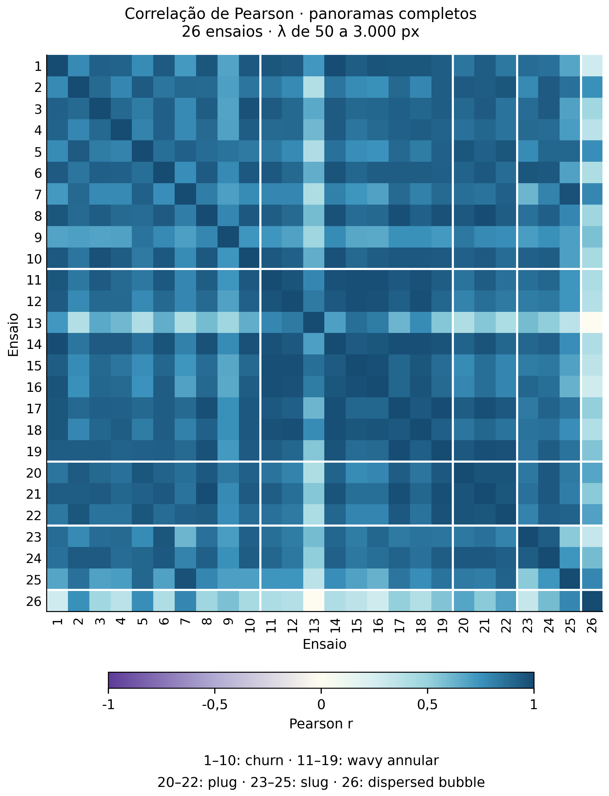
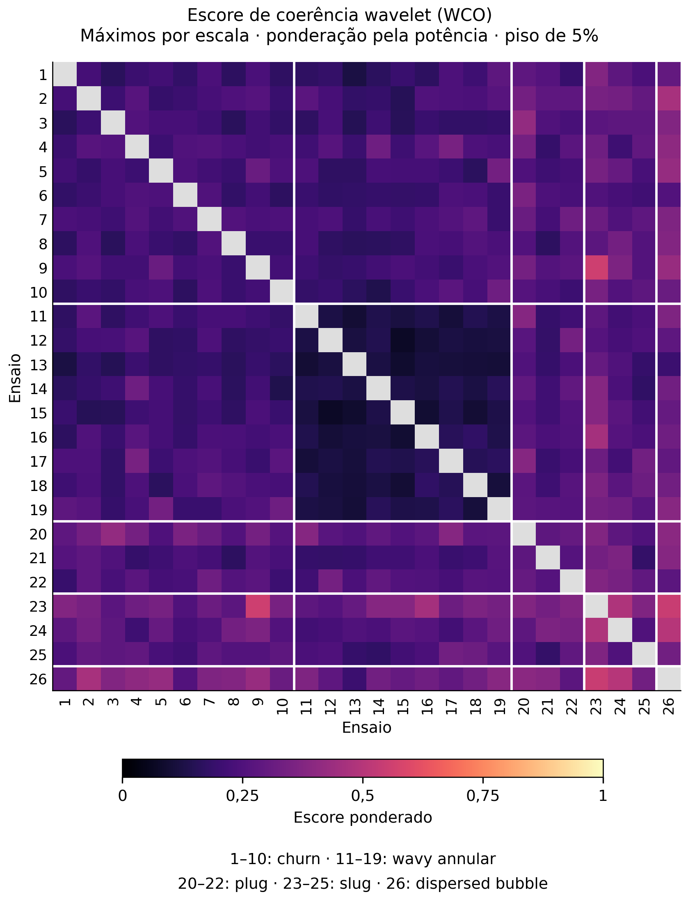
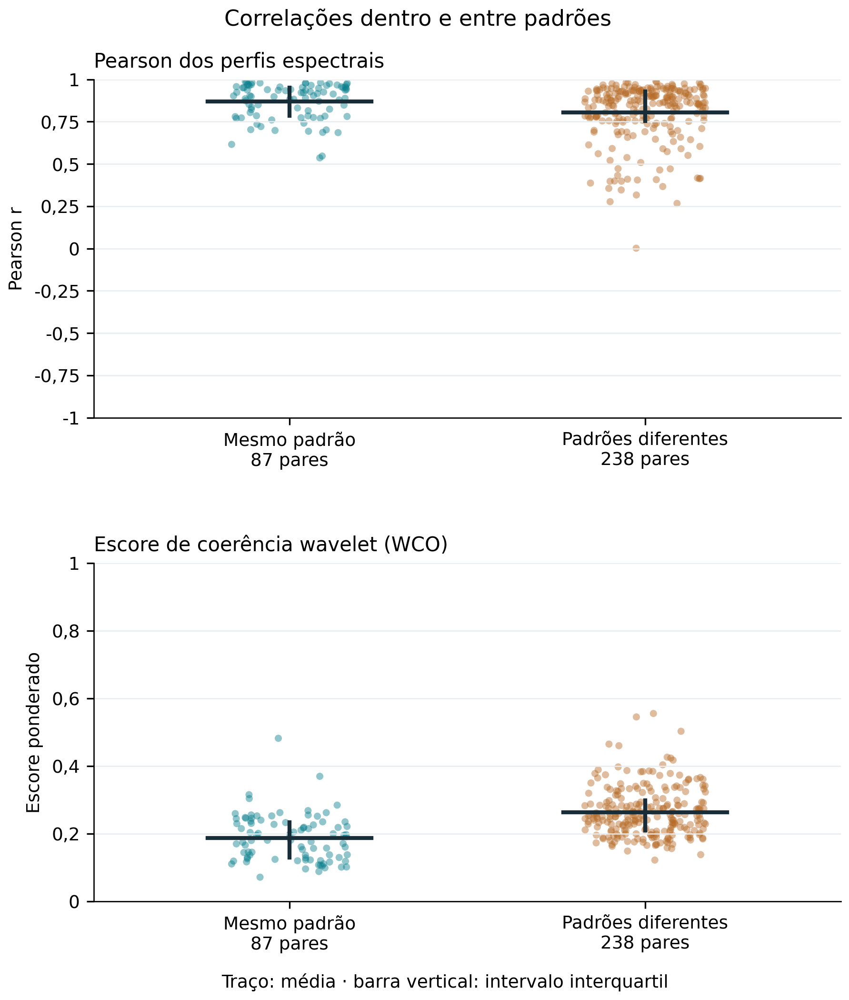
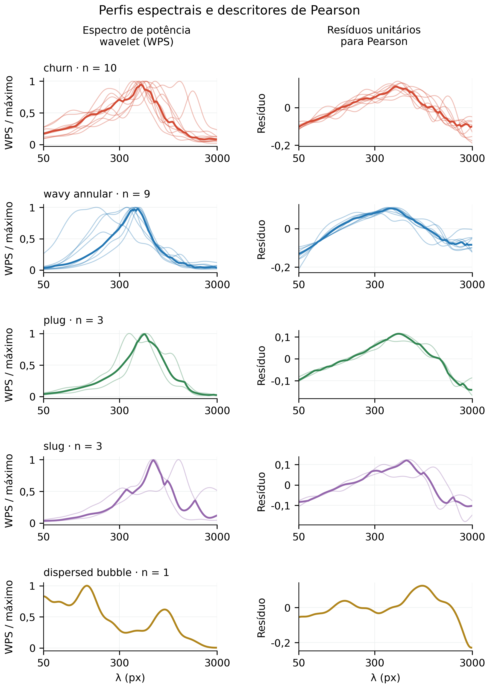

# Resumo executivo da análise v16

A análise completa foi refeita com **26 ensaios e 325 pares**, mantendo a metodologia espacial da v16 e a apresentação aprovada a partir da v16.3. Foram gerados 26 panoramas com seus sinais, 87 figuras intrapadrão e 238 figuras entre padrões. Os perfis, os resumos dos pares e os mapas intrapadrão reproduziram exatamente os resultados arquivados da implementação original.

O Pearson dos perfis espectrais apresentou média maior dentro do mesmo padrão, **0,8697**, do que entre padrões, **0,8038**. O escore principal de coerência apresentou o comportamento oposto: **0,1877** dentro e **0,2635** entre padrões. A diferença decorreu de medidas com definições e domínios distintos; não foi atribuída a uma mudança das equações.

## Organização e acesso

- [Galeria dos 26 panoramas](../intermediario/galerias/01_panoramas.html).
- [Galeria dos 87 pares intrapadrão](../intermediario/galerias/02_wavelets.html).
- [Galeria dos 238 pares entre padrões](../intermediario/galerias/03_wavelets_inter.html).
- [Metodologia e definições dos resumos](../04_estatistica/METODOLOGIA.md).
- [Índice dos ensaios](../04_estatistica/INDICE_ENSAIOS.md) e [médias de Pearson por ensaio](../04_estatistica/MEDIAS_POR_ENSAIO.md).
- [Tabelas dos pares](../04_estatistica/dados/pares_pearson_wco.csv) e [reprodução](../scripts/README.txt).

O conteúdo anterior foi preservado em `_OLD`. O piloto aprovado foi conservado em `_OLD/piloto_aprovado`. A área ativa reuniu os produtos da análise completa, seus dados e scripts de reprodução.

## Conjunto analisado

| Padrão | Ensaios | Pares intrapadrão |
| --- | ---: | ---: |
| churn | 10 | 45 |
| wavy annular | 9 | 36 |
| plug | 3 | 3 |
| slug | 3 | 3 |
| dispersed bubble | 1 | 0 |

Foram conferidos os 31 panoramas de origem, com manutenção dos cinco registros anteriormente excluídos. A seleção experimental permaneceu a mesma da v16. Os 87 pares intrapadrão e os 238 pares entre padrões compartilharam aquisições, constituindo comparações descritivas dependentes.

## Metodologia aplicada

Extraiu-se o sinal pela média das linhas 18–71 dos panoramas originais. As figuras individuais mostraram os panoramas completos. Nos pares, utilizou-se o prefixo comum de comprimento mínimo entre as duas aquisições; a inversão de intensidade, a remoção da tendência linear e a normalização foram executadas após esse corte.

Foram mantidos Morlet com ω₀ = 6, correlação com divisor N e 200 comprimentos de onda de 50 a 3.000 px. A WPS correspondeu ao módulo da CWT da autocorrelação; a WCS, à CWT da correlação cruzada; a WCO normalizou o módulo quadrático da WCS pelas WPS no lag zero. Todos os lags foram incluídos, sem COI nem máscara geométrica. A potência média ao lado da WPS foi calculada sobre todos esses lags.

As figuras adotaram os títulos por extenso seguidos de WPS, WCS e WCO, “Sinais normalizados”, “Extensão do panorama (px)” e “Altura do panorama (px)”. Não foram inseridas âncoras nem executado alinhamento de eventos. A grade espectral nativa da v16 foi preservada.

## Pearson e coerência

*A matriz utilizou os perfis de WPS no lag zero dos panoramas completos, após transformação logarítmica e remoção da tendência linear em log(λ). As cores foram fixadas entre −1 e 1. A numeração correspondeu ao índice dos ensaios.*

*A matriz reuniu os escores ponderados dos máximos de WCO por escala. A diagonal cinza representou comparações do ensaio consigo mesmo, não incluídas no conjunto de pares de aquisições distintas. O piso de 5% foi aplicado ao resumo de potência e não aos mapas.*

| Medida | Agregação | Dentro do padrão | Entre padrões | Dentro − entre |
| --- | --- | ---: | ---: | ---: |
| Pearson | Peso igual por par | 0,8697 | 0,8038 | 0,0659 |
| Pearson | Peso igual por grupo | 0,8616 | 0,7163 | 0,1453 |
| Escore de coerência | Peso igual por par | 0,1877 | 0,2635 | -0,0759 |
| Escore de coerência | Peso igual por grupo | 0,2490 | 0,3133 | -0,0643 |

A média por par atribuiu peso maior aos padrões com mais combinações. A média balanceada atribuiu peso igual aos quatro padrões com pares intrapadrão e às dez combinações distintas de padrões. Por isso, as duas agregações responderam a ponderações diferentes; ambas foram apresentadas.

O contraste médio de Pearson foi positivo, mas houve ampla sobreposição: os valores intrapadrão variaram de 0,5360 a 0,9870, enquanto os valores entre padrões variaram de 0,0018 a 0,9891. Assim, correlação elevada também ocorreu entre padrões distintos. A diferença das médias não demonstrou, isoladamente, uma regra de classificação eficaz.

O escore de coerência foi maior entre padrões nas duas agregações. Portanto, este escore não apresentou o comportamento de maior semelhança intrapadrão pretendido para discriminação global. O máximo de cada escala pôde ocorrer em um lag diferente, e os comprimentos comuns dependeram do parceiro. Esse resumo não representou a coincidência de um único evento físico entre aquisições.

## Resultados por padrão

| Padrão | Pares | Pearson médio | Escore médio de coerência |
| --- | ---: | ---: | ---: |
| churn | 45 | 0,8447 | 0,2196 |
| wavy annular | 36 | 0,9045 | 0,1247 |
| plug | 3 | 0,9618 | 0,2836 |
| slug | 3 | 0,7354 | 0,3681 |
| dispersed bubble | 0 | — | — |

Plug apresentou a maior correlação média dos perfis dentro do padrão, enquanto slug apresentou o maior escore médio de coerência. Wavy annular apresentou correlação espectral elevada e o menor escore intrapadrão de coerência. Essa diferença confirmou que semelhança da forma espectral e coerência entre sinais não foram medidas equivalentes.

*As linhas finas representaram cada ensaio; a linha espessa, a mediana do padrão. A normalização pelo máximo foi usada apenas para exibição dos perfis de WPS. Os resíduos unitários foram os descritores utilizados em Pearson. O único ensaio de dispersed bubble não permitiu estimar variabilidade intrapadrão.*

## Exemplos dos padrões

Os exemplos individuais e intrapadrão abaixo foram definidos pela ordem alfabética dos identificadores, sem seleção pelos maiores valores obtidos.

### churn

O primeiro par em ordem alfabética, m03q05_001 × m04q10_001, apresentou escore ponderado de **0,2261** e WCO máxima de **0,6990**.

### wavy annular

O primeiro par em ordem alfabética, m03q10_001 × m03q20_001, apresentou escore ponderado de **0,1262** e WCO máxima de **0,3701**.

### plug

O primeiro par em ordem alfabética, m05q01_001 × m06q01_001, apresentou escore ponderado de **0,2845** e WCO máxima de **0,7284**.

### slug

O primeiro par em ordem alfabética, m04q01_001 × m05q05_001, apresentou escore ponderado de **0,4821** e WCO máxima de **0,9093**.

### dispersed bubble

A única aquisição de dispersed bubble participou de 25 comparações entre padrões. Não houve segundo ensaio independente para comparação intrapadrão.

## Exemplos entre padrões

Os dois exemplos seguintes foram selecionados pelos extremos do escore somente para ilustrar sua amplitude. Os 238 pares foram mantidos nas estatísticas e na galeria; os exemplos não constituíram critérios de seleção de dados.

### Menor escore entre padrões

m03q05_001 × m03q40_001 (churn × wavy annular): escore **0,1220**.

### Maior escore entre padrões

m04q01_001 × m07q20_001 (slug × churn): escore **0,5554**.

## Controles anteriores preservados

Os controles de pré-processamento, faixa de extração e fases aleatórias já executados na v16 foram preservados em `_OLD`. Não foram reexecutados nesta reorganização. A referência principal 18–71 foi recalculada em todos os pares e conferida contra as tabelas desses controles.

### Pré-processamento na entrada 18–71

| Opção | Média dos 87 pares | Média balanceada | Diferença da média por par frente ao v5 |
| --- | ---: | ---: | ---: |
| v5 aplicado à extração 18–71 | 0,184176 | 0,244365 | 0,000000 |
| v16: média das linhas 18–71 | 0,187651 | 0,249002 | 0,003474 |
| Controle fixo: média das linhas 30–49 | 0,185980 | 0,246895 | 0,001804 |
| Controle: mediana das linhas 18–71 | 0,192501 | 0,258232 | 0,008325 |

A referência corrigida da v16 apresentou aumento de 0,003474 na média por par frente ao v5 aplicado à mesma entrada. Esse ganho numérico não comprovou separação entre padrões: o contraste do escore permaneceu negativo. As alternativas conservaram as definições de WPS, WCS e WCO; alteraram somente o pré-processamento. Os pesos desses escores foram definidos pela referência 18–71.

Fonte: [comparação preservada dos pré-processamentos](../_OLD/results/preprocessing_pooled_comparison.csv) e [estudo original](../_OLD/PREPROCESSING.md).

### Faixa de extração

No controle com pesos fixos da referência 20–59, a ampliação para 18–71 alterou a média dos 87 pares de **0,196662** para **0,195636**. Essa comparação utilizou os mesmos pesos 20–59 nas duas faixas. Os escores das tabelas principais utilizaram pesos nativos 18–71 e foram apresentados separadamente.

A média balanceada passou de 0,228604 para 0,234430, indicando que as conclusões também dependeram da ponderação dos padrões. O resultado desse controle foi misto, sem melhora da média conjunta dos 87 pares.

Fonte: [comparação preservada entre faixas](../_OLD/results/band_comparison_summary.csv).

### Diagnóstico de fases aleatórias

| Exemplo | Máximo observado de WCO | Valor-p condicional |
| --- | ---: | ---: |
| churn | 0,6990 | 0,675 |
| plug | 0,7284 | 0,625 |
| slug | 0,9093 | 0,440 |
| wavy annular | 0,3701 | 0,915 |
| Controle entre padrões | 0,8068 | 0,820 |

O controle anterior empregou 199 pares simulados por exemplo e o máximo de WCO no plano integral. Os máximos observados foram novamente reproduzidos pela execução atual. Os valores-p permaneceram condicionais ao modelo de fases aleatórias e não constituíram testes de acurácia, identidade de eventos ou superioridade entre métodos. Não foram acrescentados contornos de significância aos mapas.

Fonte: [diagnóstico preservado](../_OLD/results/null_diagnostic.csv).

## Alcance e conclusão

A análise reproduziu a metodologia integral da v16 e apresentou todos os pares em um formato uniforme. O Pearson apresentou maior semelhança média dentro dos padrões, acompanhada de forte sobreposição com as comparações entre padrões. O escore principal de coerência apresentou médias maiores entre padrões, o que limitou sua utilização direta como medida global de discriminação neste conjunto.

Os resultados não constituíram uma avaliação de classificador. Os pares compartilharam aquisições, os grupos foram desbalanceados e dispersed bubble dispôs de uma única aquisição. As extensões dos panoramas e dos prefixos comuns variaram; o uso de todos os lags conservou regiões de borda e lags com menor quantidade de produtos na correlação. As unidades espaciais do panorama não foram convertidas em tamanho físico de bolhas ou frequência temporal calibrada.

O Pearson atual empregou **26 ensaios e λ de 50–3.000 px**. A comparação anterior entre v16 e âncoras empregou **25 ensaios comuns e λ de 50–1.024 px**. Esses domínios diferentes impediram atribuir a diferença numérica entre tabelas apenas ao uso de âncoras. A comparação controlada anterior permaneceu separada da estatística nativa desta análise.

Verificação: [cálculos e equivalência com a v16](../intermediario/auditoria/calculo.json), [Pearson e agregações](../intermediario/auditoria/estatistica.json). O núcleo matemático permaneceu idêntico ao original. Os mapas foram reduzidos somente para apresentação; todos os resumos foram calculados na resolução integral.
